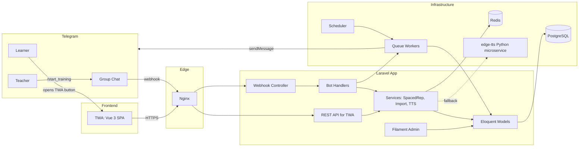
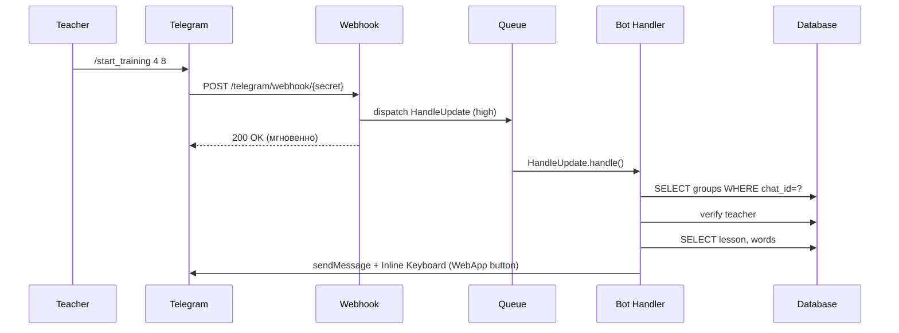
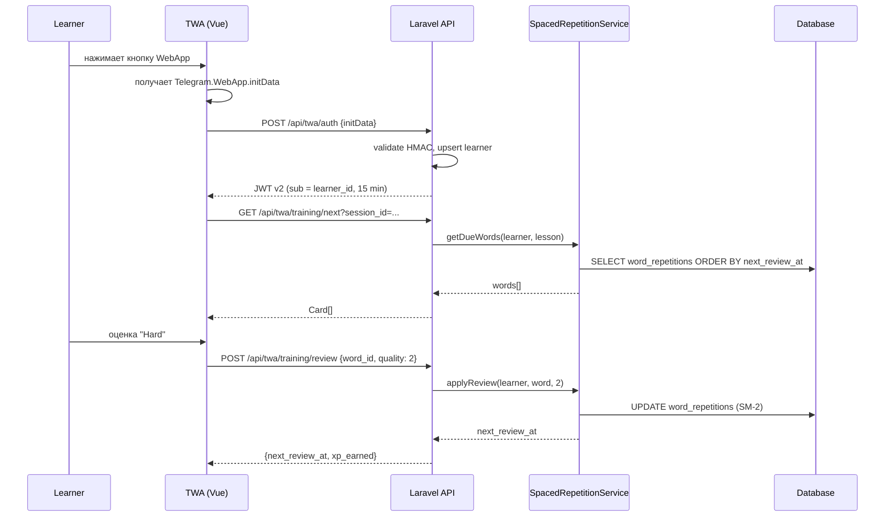
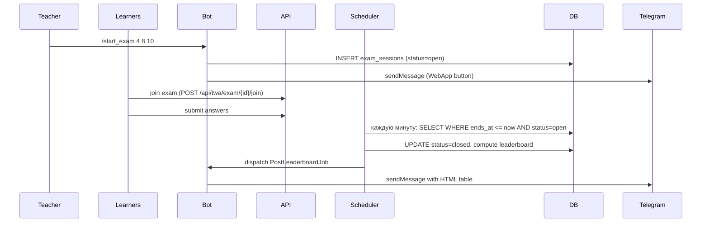

# 02. Architecture — LexiFlow Pro

## 1. Высокоуровневая архитектура



## 2. Компоненты

### 2.1 Laravel Application (монолит)
Один Laravel-проект содержит три «лица»:
- **Filament Admin** — UI для админа и учителя (`/admin`).
- **Bot Webhook** — endpoint для Telegram (`/telegram/webhook/{secret}`).
- **TWA API** — REST-эндпоинты для Web App (`/api/twa/*`).

Зачем монолит: команда маленькая, домены сильно связаны (одна БД, одна модель данных). Если когда-нибудь TWA вырастет в отдельное приложение — выделить его в Nuxt/SPA на поддомене не проблема.

### 2.2 PostgreSQL 16
Основное хранилище. Используем:
- JSONB для `meta` полей (расширяемость).
- `generated columns` для вычисляемых метрик (например, `is_hard` у `word_repetitions`).
- Транзакции для импорта и экзамена.

Альтернатива — MySQL 8 (тоже ок, но JSONB и оконные функции в Postgres удобнее для аналитики).

### 2.3 Redis 7
- **Cache:** настройки, rate limits, счётчики слов урока, готовые лидерборды закрытых экзаменов.
- **Queue:** `high` (webhook ACK), `default` (рассылки), `low` (аналитика).
- **Locks:** `Cache::lock()` для критических секций (импорт, завершение экзамена).
- Redis connection DB разделены по назначению: `default=0`, `cache=1`, `queue=2`, `session=3`, `locks=4`. Это снижает риск, что burst очередей вытеснит session/cache keys.

### 2.4 Queue Workers (Supervisor)
- Отдельные воркеры на три очереди.
- Webhook Telegram кладёт тяжёлую обработку в `high`-queue и сразу отвечает 200 OK (чтобы Telegram не ретрайил).

### 2.5 Scheduler (`schedule:run` через cron)
- Каждую минуту — `artisan schedule:run`.
- Задачи:
  - `exam:close-expired` — раз в минуту.
  - `reminders:dispatch` — каждые 15 минут, `withoutOverlapping`: персональные напоминания по локальному времени learner'а (`ReminderDispatcher` клеймит `learners.next_reminder_at <= now` условным UPDATE и ставит `SendLearnerReminderJob`; текст — review / streak_at_risk — решает job; docs/06 §6, docs/12 §7.5). Параллельный или повторный запуск ничего не дублирует.
  - `training:close-expired` — каждые 15 минут, просроченные личные и устаревшие групповые сессии.
  - `subscriptions:expire` — раз в час, переходы подписок по времени.
  - `billing:expire-orders` — каждые 15 минут, `withoutOverlapping`: `pending`-заказы оплаты с `expires_at <= now` → `expired` одним UPDATE без блокировок субъекта (docs/13 §4.4).
  - `subscriptions:remind-expiring` — ежедневно 06:00 UTC, `withoutOverlapping`: события `SubscriptionRenewalDue` за 3 и 1 день до конца неавтопродляемого периода → `RenewalReminderJob` (ЛС learner'у; письмо + ЛС владельцам организации); повтор запуска безопасен (маркеры в `subscriptions.meta.renewal_reminders`).
  - `billing:reconcile-stars` — ежедневно 04:30 UTC: `getStarTransactions` за 2 дня против `payments`, только чтение и алерты в лог (`billing.reconcile_missing*`); ничего не делает, пока Stars выключен (docs/13 §4.4).
  - `analytics:refresh-materialized-views` — ночью.

### 2.6 Telegram Bot SDK
Текущая реализация использует `irazasyed/telegram-bot-sdk` как транспортный адаптер для Telegram Bot API.

Правило поддержки: бизнес-логика бота не зависит напрямую от vendor SDK. Domain handlers (`app/Domain/Telegram/Handlers`) работают с контрактом `App\Domain\Telegram\Contracts\TelegramClient`; реализация `IrazasyedTelegramClient` инкапсулирует `Telegram\Bot\Api`, форматирование `reply_markup` и вызовы `sendMessage` / `setWebhook`.

Зачем так:
- SDK реально используется для общения с Telegram.
- Хендлеры остаются простыми, тестируемыми и не знают деталей vendor API.
- Если позже понадобится перейти на `nutgram/nutgram` или `defstudio/telegraph`, меняется adapter, а не вся бизнес-логика.

### 2.7 TWA Frontend
- **Vue 3** + Composition API + Pinia (state) + Vite.
- TailwindCSS для стилей.
- Сборка в `public/twa/`, отдаётся через Nginx.
- Взаимодействие с API — через `fetch` + JWT в `Authorization` header.
- Telegram SDK: `@twa-dev/sdk`.

### 2.8 edge-tts микросервис (опционально)
- Отдельный Python-контейнер на FastAPI.
- Endpoint `POST /tts` → принимает `{word, voice}` → возвращает `audio/mpeg`.
- Доступ только из внутренней сети Docker.
- Нужен только если Web Speech API плохо работает у части пользователей.

## 3. Data Flow

### 3.1 Учитель запускает тренировку



### 3.2 Learner открывает TWA и учит карточки



### 3.3 Экзамен и лидерборд



## 4. Слои приложения (Laravel)

```
Http Layer (Controllers, Middleware)
        │
        ▼
Service Layer (бизнес-логика)
        │
        ▼
Repository/Model Layer (Eloquent)
        │
        ▼
Database
```

Правила:
- Контроллеры тонкие: валидируют вход через FormRequest, зовут сервис, возвращают Resource.
- Сервисы — классы с одной ответственностью. Примеры:
  - `App\Services\SpacedRepetition\SpacedRepetitionEngine`
  - `App\Services\Import\VocabularyImporter`
  - `App\Services\Exam\ExamSession`
  - `App\Services\Exam\LeaderboardBuilder`
  - `App\Services\Telegram\TelegramGateway`
- Модели — только отношения, скоупы, аксессоры. Бизнес-логика **не** живёт в моделях.
- Jobs — обёртка вокруг сервисов для асинхронного выполнения.

## 5. Модули (package-by-feature)

Домен **`Learners`** (`app/Domain/Learners/Services`, задача 1.1b): `LearnerRegistrar` — единственная точка превращения Telegram-пользователя (initData, апдейт бота, `chat_member`) в `learners`; `GroupMembershipService` — `join` / `leave` / `isActiveMember` / `activeGroups` / `denialReason`, правило «активное членство = `group_members.status = 'active'` и группа `active`» живёт только здесь. Остальные сервисы домена (онбординг, настройки, `LearnerClock`, ежедневная статистика, streak) — задачи 1.3–1.6.

Домен **`Content`** (`app/Domain/Content`, задача 1.2a): `CourseCatalogService` — единственное место, знающее курс по умолчанию (`defaultCourse()`), курс группы (`courseForGroup`) и поиск stage/урока **внутри курса** (`findStage`/`findLesson`/`lessons`); `CoursePublisher` — статусы курса, порог переводов при публикации, `recount`; `WordTranslationResolver` — единственный читатель переводов (локаль → `ru` → `words.translation`, признак fallback, батч без N+1); `WordTranslationWriter` — ручная запись переводов с синхронизацией `words.translation` ↔ строка `ru`; `VocabularyImporter` v2 (`course`, `translations`). Правила — docs/03 §2.20–2.21.

Домен **`Billing`** (`app/Domain/Billing`, задача 1.4a, docs/12 §3.4, §5): `EntitlementResolver` — единственное место правила «эффективный план = max(Free, личная, спонсорская от организации)» и его кэша; `SubscriptionService` — жизненный цикл `subscriptions` (ручная выдача, отзыв, переходы по времени) под блокировкой строки субъекта; `PromoCodeService` — погашение промокодов под блокировкой строки кода; `SubscriptionLiveness` — общее правило «live сейчас». Инвалидация кэша entitlement — после commit; входы вне домена (членство, привязка группы к организации, статус организации) подключены через `GroupMembershipService` и observers `TelegramGroupObserver`/`OrganizationObserver` (`app/Observers`).

Внутри `app/` организуемся по доменам:

```
app/
├── Domain/
│   ├── Content/           # Stage, Lesson, Word, Import
│   │   ├── Models/
│   │   ├── Services/
│   │   └── Jobs/
│   ├── Learning/          # WordRepetition, SpacedRepetition
│   │   ├── Models/
│   │   ├── Services/
│   │   └── Jobs/
│   ├── Exam/              # ExamSession, ExamAnswer, Leaderboard
│   ├── Group/             # TelegramGroup, Teacher
│   ├── Learners/          # Learner, GroupMember: LearnerRegistrar, GroupMembershipService (docs/12 §3.1)
│   ├── Billing/           # Plan, Entitlement, EntitlementResolver, SubscriptionService, PromoCodeService (docs/12 §3.4)
│   └── Analytics/         # агрегаты, views
├── Filament/
│   ├── Resources/
│   ├── Pages/
│   └── Widgets/
├── Telegram/
│   ├── Bot.php            # bootstrap nutgram
│   ├── Commands/
│   ├── Conversations/
│   ├── Middleware/
│   │   ├── GroupLock.php
│   │   └── TeacherOnly.php
│   └── Handlers/
└── Http/
    ├── Controllers/
    │   └── Api/Twa/
    ├── Middleware/
    │   └── TwaAuth.php
    └── Resources/Twa/
```

## 6. Внешние интеграции

| Сервис | Назначение | Аутентификация |
|--------|------------|----------------|
| Telegram Bot API | Отправка сообщений, webhook | `TELEGRAM_BOT_TOKEN` |
| Telegram Web App | Встраивание TWA | `initData` HMAC по `TELEGRAM_BOT_TOKEN` |
| edge-tts (self-hosted) | Fallback TTS | internal network only |
| Sentry / GlitchTip (опц.) | Error tracking | `SENTRY_LARAVEL_DSN` в env |

## 7. Deployment (Docker Compose)

Сервисы:
- `app` — PHP-FPM 8.2 + Laravel.
- `nginx` — reverse proxy + static TWA.
- `postgres` — БД.
- `redis` — cache + queue.
- `worker-high`, `worker-default`, `worker-low` — Supervisor-воркеры.
- `scheduler` — cron-контейнер.
- `tts` — edge-tts FastAPI (optional).

Env vars (минимум):
```
APP_KEY=
APP_URL=https://lexiflow.example.com
DB_CONNECTION=pgsql
DB_HOST=postgres
DB_DATABASE=lexiflow
DB_USERNAME=lexiflow
DB_PASSWORD=...
REDIS_HOST=redis
REDIS_CACHE_DB=1
REDIS_QUEUE_DB=2
REDIS_SESSION_DB=3
REDIS_LOCK_DB=4
QUEUE_CONNECTION=redis
CACHE_STORE=redis
SESSION_DRIVER=redis
TELEGRAM_BOT_TOKEN=...
TELEGRAM_WEBHOOK_SECRET=...        # случайная 64-символьная строка
TWA_JWT_SECRET=...
TTS_SERVICE_URL=http://tts:8000
SENTRY_LARAVEL_DSN=
```

## 8. Observability

- **Логи:** Laravel Log (channel `stack`/`daily`, отдельный канал `telegram` для Telegram-обновлений). В Docker — stderr/файлы контейнера;
  PII в логах маскируется (`UpdateSanitizer`: имена, username, тексты).
- **Error tracking:** Sentry через `sentry/sentry-laravel` (`config/sentry.php`, `Integration::handles()` в `bootstrap/app.php`).
  Пустой `SENTRY_LARAVEL_DSN` = выключено; совместим с self-hosted GlitchTip (другой DSN). Перед отправкой события проходят
  `SentryScrubber` (Authorization/Cookie, `init_data`, токены Telegram, секрет вебхука, JWT-секрет).
- **Health endpoints:** `GET /up` — процесс жив (framework); `GET /health/ready` — готовность зависимостей
  (`ReadinessProbe`: DB `select 1`, Redis ping если используется, heartbeat планировщика ≤ 3 мин, размер очередей `high`/`default`).
  200 `{"status":"ok","checks":{...}}` либо 503 с `fail`; наружу только `ok`/`fail`, без текстов ошибок.
- **Продуктовые события:** таблица `product_events` (`ProductEventRecorder`, enum `ProductEventName`): `twa.authenticated`,
  `training.session_opened`, `exam.started`, `exam.closed`, `exam.leaderboard_posted`, `reminder.sent`, `reminder.failed`,
  `group.bot_added`, `group.member_joined`, `group.member_left`, `subscription.granted`, `subscription.expired`, `promo.redeemed`,
  `offer.created`, `offer.redeemed`, `daily_goal.met`, `streak.extended`. Props — только скаляры без PII; запись никогда не ломает основной поток.
  Подробности — `docs/03_DATABASE.md` §2.16.
- **Метрики / трейсинг:** отдельный Prometheus/OpenTelemetry пока не подключены. Sentry Performance
  (`SENTRY_TRACES_SAMPLE_RATE=0.1`) даёт базовые трейсы запросов и джобов.
- Мониторинг и алерты — `docs/DEVOPS_GUIDE.md` §15.

## 9. Ключевые архитектурные решения (ADR)

| # | Решение | Причина |
|---|---------|---------|
| ADR-1 | Монолит, не микросервисы | Маленькая команда, связанный домен |
| ADR-2 | PostgreSQL, не MySQL | JSONB, оконные функции для аналитики |
| ADR-3 | nutgram для бота | Лучший DX для Laravel-разработчика |
| ADR-4 | Vue 3 для TWA, не React | Простота + лёгкая сборка для single-page flow |
| ADR-5 | JWT для TWA, не session | Stateless, проще масштабировать |
| ADR-6 | Web Speech API primary, edge-tts fallback | Нулевая стоимость на базовом сценарии |
| ADR-7 | Упрощённый SM-2 | Хорошо изучен, достаточно для MVP |
| ADR-8 | **Learner-first**: центральный объект — `learners` (один на Telegram-пользователя), `students` удалена; членство в группе — `group_members`; прогресс (`word_repetitions`), оценки, ответы экзаменов и напоминания привязаны к `learner_id`; JWT `sub = learner_id` (формат v2); доступ к групповым сессиям — по активному членству | Прогресс принадлежит человеку, а не паре (человек, группа): один человек в двух группах — один прогресс, одно напоминание, один аккаунт. Это основа B2C-режима (личные сессии, подписки, цели) без второго рефакторинга; подробности и отвергнутые варианты — docs/12 §0, §11 |
| ADR-11 | **Кабинет центра — отдельная Filament-панель `/org` с tenancy** по `Organization` (slug в URL, роли `owner`/`teacher` в `organization_users`, свой session-guard `org`); изоляция в три рубежа: tenancy Filament (`canAccessTenant` → 404, global scope `organization_id = tenant` на моделях ресурсов), тенант-политики `App\Policies\Org` (подменяют платформенные только в этой панели через `OrgPolicyResolver`), запросы через `OrgTenantScope` (owner — весь центр, teacher — свои `teacher_groups`) | Платформенные ресурсы `/admin` не делят панель с клиентами — нет риска утечки через непокрытый scope; таблицы/формы/2FA бесплатно; подробности и отвергнутые варианты — docs/13 §6.3, §13 |

## 10. Открытые архитектурные вопросы

- Стоит ли выносить TWA frontend в отдельный репозиторий сразу? (Пока: нет, в одном репо внутри `resources/twa`.)
- Нужен ли feature flags-сервис? (Для MVP — нет, config-based.)
- Multi-tenancy для разных языковых центров? (Не в MVP; если понадобится — `central_id` в ключевых таблицах и scope на уровне Filament.)
