# 03. Database Schema — LexiFlow Pro

## 1. ERD

```mermaid
erDiagram
    USERS ||--o{ TEACHER_GROUPS : owns
    USERS ||--o{ USER_ROLES : has
    TELEGRAM_GROUPS ||--o{ TEACHER_GROUPS : assigned_to
    TELEGRAM_GROUPS ||--o{ TRAINING_SESSIONS : hosts
    TELEGRAM_GROUPS ||--o{ EXAM_SESSIONS : hosts
    STAGES ||--o{ LESSONS : contains
    LESSONS ||--o{ WORDS : contains
    LESSONS ||--o{ TRAINING_SESSIONS : about
    LESSONS ||--o{ EXAM_SESSIONS : about
    LEARNERS ||--o{ WORD_REPETITIONS : tracks
    WORDS ||--o{ WORD_REPETITIONS : tracked_as
    LEARNERS ||--o{ EXAM_ANSWERS : gives
    LEARNERS ||--o{ EXAM_RESULTS : ranked
    LEARNERS ||--o{ EXAM_QUESTION_ATTEMPTS : served
    LEARNERS ||--o{ NOTIFICATIONS_LOG : receives
    LEARNERS ||--o{ PRODUCT_EVENTS : emits
    LEARNERS ||--o{ TRAINING_SESSIONS : personal
    EXAM_SESSIONS ||--o{ EXAM_ANSWERS : contains
    WORDS ||--o{ EXAM_ANSWERS : about
    LEARNERS ||--o{ TRAINING_REVIEWS : makes
    TRAINING_SESSIONS ||--o{ TRAINING_REVIEWS : logs
    LEARNERS ||--o{ GROUP_MEMBERS : joins
    TELEGRAM_GROUPS ||--o{ GROUP_MEMBERS : has
    ORGANIZATIONS ||--o{ TELEGRAM_GROUPS : owns
    COURSES ||--o{ STAGES : modules
    COURSES ||--o{ TELEGRAM_GROUPS : group_course
    COURSES ||--o{ LEARNERS : active_course
    WORDS ||--o{ WORD_TRANSLATIONS : uz_ru
    LEARNERS ||--o{ LEARNER_DAILY_STATS : per_day
    LEARNERS ||--o{ SUBSCRIPTIONS : personal
    ORGANIZATIONS ||--o{ SUBSCRIPTIONS : sponsor
    USERS ||--o{ SUBSCRIPTIONS : granted_by
    PROMO_CODES ||--o{ PROMO_REDEMPTIONS : redeemed
    LEARNERS ||--o{ PROMO_REDEMPTIONS : redeems
    SUBSCRIPTIONS ||--o{ PROMO_REDEMPTIONS : result
    LEARNERS ||--o{ PAYMENT_ORDERS : buys
    ORGANIZATIONS ||--o{ PAYMENT_ORDERS : buys
    PAYMENT_ORDERS ||--o{ PROVIDER_TRANSACTIONS : provider_state
    PAYMENT_ORDERS ||--o{ PAYMENTS : settles
    SUBSCRIPTIONS ||--o{ PAYMENTS : funds
    PAYMENTS ||--o| PAYMENTS : refunds
    LEARNERS ||--o{ OFFERS : personal_discount
    OFFERS ||--o| PAYMENT_ORDERS : applied_to
    ORGANIZATIONS ||--o{ ORGANIZATION_MEMBERS : seats
    LEARNERS ||--o{ ORGANIZATION_MEMBERS : member
    ORGANIZATIONS ||--o{ ORGANIZATION_INVITES : codes
    ORGANIZATION_INVITES ||--o{ ORGANIZATION_MEMBERS : joined_via
    ORGANIZATIONS ||--o{ ORGANIZATION_USERS : staff
    USERS ||--o{ ORGANIZATION_USERS : role
    COURSES ||--o{ PRACTICE_ITEMS : tasks
    PRACTICE_ITEMS ||--o{ PRACTICE_ITEM_VERSIONS : versions
    PRACTICE_ITEMS ||--o{ PRACTICE_ITEM_WORDS : target_words
    WORDS ||--o{ PRACTICE_ITEM_WORDS : targeted_by
    LEARNERS ||--o{ PRACTICE_SESSIONS : plays
    COURSES ||--o{ PRACTICE_SESSIONS : about
    PRACTICE_SESSIONS ||--o{ PRACTICE_ATTEMPTS : journal
    LEARNERS ||--o{ BATTLE_PARTICIPANTS : takes_part
    BATTLES ||--o{ BATTLE_PARTICIPANTS : two_players
    BATTLES ||--o{ BATTLE_ANSWERS : final_answers
    COURSES ||--o{ BATTLES : about
    FRIENDSHIPS ||--o{ BATTLES : invited_through
```



> **Практика и баттл 1 на 1 (docs/16 §2, задачи 18.x).** Добавлены `practice_items`, `practice_item_versions` (текст, целевые слова, урок и уровень версии),
> `practice_item_words` (проекция целевых слов одной версии) (авторские задания, §2.40–§2.42), `practice_sessions`, `practice_attempts` (сольные сессии, §2.43–§2.44), `battles`,
> `battle_participants`, `battle_answers` (баттл, §2.45–§2.47) и колонка `learners.practice_pilot_at` (§2.17). Практика **не пишет**
> таблицы обучения (`word_repetitions`, `training_*`, `learner_daily_stats`, серия, лиги, `assignment_results`, `achievements`,
> `challenges`) — только свои таблицы и `product_events`; инвариант закреплён тестом `PracticeIsolationTest`.

> **Фаза 2, оплата (docs/13 §1.2, задача 2A.1).** Добавлены `offers`, `payment_orders`, `provider_transactions`,
> `payments` (§2.26–§2.29); `subscriptions` получила `tier`, а статус `canceled` стал live (предикат partial unique).

> **Фаза 2, центры (docs/13 §1.3, задача 2B.1).** Добавлены `organization_users`, `organization_invites`,
> `organization_members` (§2.30–§2.32). Членство learner'а в организации теперь **явное**: спонсорский Pro даёт
> только место (`organization_members.status = active AND seat_state = seated`) в активной организации с live-подпиской;
> группа организации лишь создаёт членство (`joined_via = group`).

> **Learner-first (docs/12, Sprint 14).** Прогресс, оценки, ответы и напоминания принадлежат человеку —
> `learners` (один на Telegram-пользователя); членство в группе — `group_members`. Таблицы `students` **больше нет**
> (удалена в задаче 1.1b), все `student_id` заменены на `learner_id`. Задача 1.1a добавила `learners`, `group_members`,
> `courses`, `organizations`, `word_translations`, `learner_daily_stats`, `subscriptions`, `promo_codes`,
> `promo_redemptions` (§2.17–§2.25).

## 2. Таблицы

Все таблицы содержат `id` (bigint, PK), `created_at`, `updated_at` (если не указано иное).

### 2.1 `users` — администраторы и учителя
| Колонка | Тип | Описание |
|---------|-----|----------|
| id | bigint PK | |
| name | string(100) | ФИО |
| email | string(150) unique | Логин |
| password | string(255) | bcrypt |
| telegram_user_id | bigint nullable unique | Для учителя — обязательно, получаем из `/start` в ЛС бота |
| is_active | boolean default true | |
| last_login_at | timestamp nullable | |
| created_at, updated_at | | |

Роли через `spatie/laravel-permission`: `admin`, `teacher`.

### 2.2 `telegram_groups`
| Колонка | Тип | Описание |
|---------|-----|----------|
| id | bigint PK | |
| chat_id | bigint unique | Telegram chat_id (может быть отрицательный для supergroup) |
| title | string(255) | Название группы |
| status | enum('pending','active','disabled') default 'pending' | |
| organization_id | bigint nullable FK → organizations, ON DELETE SET NULL | организация-владелец (спонсор Pro для участников) |
| course_id | bigint nullable FK → courses, ON DELETE SET NULL | курс для команд учителя; `NULL` = курс `default` |
| meta | jsonb default '{}' | Member count, type и т.п. |
| created_at, updated_at | | |

**Индексы:** `chat_id` unique, `status`, `organization_id`, `course_id`.

### 2.3 `teacher_groups` — pivot учитель ↔ группа
| Колонка | Тип |
|---------|-----|
| id | bigint PK |
| user_id | bigint FK → users |
| telegram_group_id | bigint FK → telegram_groups |
| is_primary | boolean default true |

**Индексы:** `(user_id, telegram_group_id)` unique.

### 2.4 ~~`students`~~ — удалена (learner-first)
Таблица `students` (запись на пару «Telegram-пользователь + группа») удалена в задаче 1.1b. Её роль разделили:
**человек** — `learners` (§2.17), **вхождение человека в группу** — `group_members` (§2.18). Один и тот же человек в двух
группах — **один** `learners` и **два** `group_members`, а значит один прогресс в `word_repetitions`.
Прежний флаг `students.is_active` заменён двумя понятиями: выход/исключение из группы — `group_members.status` (`left` / `removed` / `banned`), бан на уровне платформы — `learners.blocked_at`.

### 2.5 `stages` — модули курса
| Колонка | Тип |
|---------|-----|
| id | bigint PK |
| course_id | bigint FK → courses, ON DELETE CASCADE, NOT NULL |
| number | int |
| title | string(255) **nullable** |
| description | text nullable |

**Индексы:** `(course_id, number)` unique — номер модуля уникален внутри курса (одинаковый `number` в разных курсах разрешён).

**`title` = NULL — модуль без собственного названия** (17.14-S). Его подпись строится при показе на языке читателя: «Модуль N» /
«N-modul» (docs/14 §8) — TWA из `number`, админка из `admin.stages.untitled`; в API `stages[].title` приходит `null`
(docs/04 A.5a). Раньше импорт без `stage.title` и демо-сидер писали английское «Stage N», которое видел и uz-ученик; миграция
`2026_10_28_400001_make_stages_title_nullable` сняла NOT NULL и превратила в NULL названия, равные ровно «Stage {свой number}»
(«Stage 3» у модуля №5 и любое настоящее название остаются; `down()` возвращает «Stage N» в NULL-строки). Импорт без названия
создаёт модуль с NULL и **не затирает** название существующего; пустая строка и пробелы — то же, что «нет названия».
У колод learner'а название техническое («Моя колода», см. §2.20) и в API заменяется локализованным.

### 2.6 `lessons`
| Колонка | Тип |
|---------|-----|
| id | bigint PK |
| stage_id | bigint FK → stages |
| number | int |
| title | string(255) nullable |

**Индексы:** `(stage_id, number)` unique.

### 2.7 `words`
| Колонка | Тип | Описание |
|---------|-----|----------|
| id | bigint PK | |
| lesson_id | bigint FK → lessons | |
| word | string(100) | английское слово |
| translation | string(500) | русский перевод по умолчанию (NOT NULL); читать переводы в коде — только через `WordTranslationResolver` (см. 2.21) |
| example | text nullable | пример предложения |
| part_of_speech | string(30) nullable | noun/verb/... |
| transcription | string(100) nullable | IPA |
| audio_path | string(255) nullable | предгенерированное аудио (задача 1.2c) |
| is_active | boolean default true | слово не удаляем, а деактивируем; учитывается в `courses.words_count` и в проверке публикации курса |
| meta | jsonb default '{}' | |

**Индексы:** `(lesson_id, word)` unique, `lesson_id`, `word` (для поиска); `(id) WHERE is_active = false` — partial
`words_inactive_idx`: под анти-join `DueRepetitionCriteria` (`NOT EXISTS (… words.is_active = false)`, docs/06 §6) —
выведенных слов мало, и хэш их id строится с пары страниц индекса вместо seq scan всех активных слов.

### 2.8 `word_repetitions` — состояние SM-2 для пары (learner, слово)
| Колонка | Тип | Описание |
|---------|-----|----------|
| id | bigint PK | |
| learner_id | bigint FK → learners, ON DELETE CASCADE | |
| word_id | bigint FK → words | |
| repetitions | smallint default 0 | счётчик успешных повторений в состоянии `review` (сброс при провале) |
| interval_days | smallint default 0 | текущий интервал в днях (0, пока карточка в минутных шагах) |
| easiness_factor | decimal(4,2) default 2.50 | EF из SM-2 |
| last_quality | smallint nullable | 0..5, последняя оценка |
| last_reviewed_at | timestamp nullable | |
| next_review_at | timestamp | индексируем для запроса «что пора повторить»; для `learning`/`relearning` — минуты |
| is_hard | boolean default false | провалена и ещё не прошла успешное review-повторение (docs/06 §3.5) |
| introduced_mode | varchar(16) NOT NULL default 'lesson' | режим сессии, в которой слово было выдано впервые: `group_lesson` / `lesson` / `daily_review` (`TrainingScope::$sessionMode` → `CardPicker`); квота Free не считает строки `group_lesson` (docs/12 §5.3). Дефолт — для строк не от пикера (сидеры) |
| state | varchar(16) default 'new' | `new` / `learning` / `review` / `relearning` (docs/06 §3.1) |
| learning_step | smallint default 0 | индекс текущего минутного шага внутри learning/relearning |
| lapses | smallint default 0 | сколько раз карточка в `review` была провалена |
| served_ahead_at | timestamp nullable | метка learn-ahead: карточка выдана до `next_review_at`; обнуляется при приёме оценки |
| served_ahead_token | varchar(64) nullable | одноразовый билет learn-ahead (32 hex); уходит клиенту как `card.serve_token`, обязан вернуться в `POST /review`; обнуляется при приёме оценки (docs/06 §5.2) |
| stability | decimal(9,4) nullable | FSRS: стабильность S, дни; `NULL`, пока карточку не вела FSRS *(2D.3, docs/06 §9.4)* |
| difficulty | decimal(6,4) nullable | FSRS: сложность D, 1..10 *(2D.3)* |
| scheduler | varchar(8) default 'sm2' | `sm2` / `fsrs` — кто писал строку последним *(2D.3)* |
| scheduled_days | smallint nullable | интервал, назначенный FSRS (метрики); 0 при провале *(2D.3)* |
| meta | jsonb default '{}' | |

Backfill миграции `add_learning_state_to_word_repetitions`: `repetitions >= 1` → `review`;
`repetitions = 0` и `last_quality` не null → `relearning` (в напоминания они возвращаются по правилу
«брошенных» карточек, docs/06 §6); остальные → `new`.

**Индексы:**
- `(learner_id, word_id)` unique — **один прогресс по слову на человека**, независимо от числа его групп.
- `(learner_id, next_review_at)` — для «что показывать».
- ~~`(learner_id) WHERE is_hard = true`~~ (`word_repetitions_learner_is_hard_idx`) — **удалён** миграцией `2026_10_28_200001_drop_word_repetitions_learner_is_hard_idx`:
  partial index обслуживает только запрос с `WHERE is_hard = true`, а такого запроса в коде нет — `is_hard` стоит лишь в `ORDER BY` пикера
  (его обслуживает `word_repetitions_next_card_idx`) и читается по `(learner_id, word_id)` в `ExamAnswerService`. EXPLAIN на 90 000 строк
  (30 learner'ов, 12 % `is_hard`) по всем путям кода и `idx_scan = 0` за весь прогон тестов на PostgreSQL; индекс только удорожал записи
  `POST /review` по трудным карточкам. Если когда-нибудь понадобится выборка «трудные слова learner'а» — вернуть вместе с этим запросом.
- `(learner_id, is_hard DESC, next_review_at, id)` (`word_repetitions_next_card_idx`) — hot path выбора следующей карточки:
  ровно порядок `CardPicker::pickNext` шаг 1 (`WHERE learner_id = ? AND next_review_at <= now ORDER BY is_hard DESC, next_review_at, id LIMIT 1`,
  docs/06 §4.2), поэтому due-карточка — первая подходящая запись индекса, а не top-N sort по всем просроченным (1500 просроченных:
  5977 буферов / 2,8 мс → 7 буферов / 0,05 мс). Заменил `(learner_id, is_hard, next_review_at)` (`word_repetitions_learner_hard_due_idx`):
  по `is_hard` сортирует только пикер, остальным запросам хватает индексов по `learner_id` / `(learner_id, next_review_at)`.
  В sqlite создаётся так же (`DESC` поддерживается).
- ~~`(next_review_at, learner_id)`~~ (`word_repetitions_due_learners_idx`) — **удалён** миграцией `2026_10_28_300001_drop_word_repetitions_due_learners_idx`
  (17.12). Задумывался под «batch scan learner'ов, которым пора напомнить о повторении», но этот скан — `learners.next_reminder_at`
  (`learners_next_reminder_at_idx`, `ReminderDispatcher`), а запроса к `word_repetitions` с фильтром по `next_review_at` **без** learner'а в приложении нет:
  три запроса с этим фильтром (due-выбор и learn-ahead в `CardPicker`, `dueCount` для `/today`, `/me` и напоминаний) содержат `learner_id = ?` и обслуживаются
  `word_repetitions_next_card_idx` и `(learner_id, next_review_at)`; в `app/`, командах, виджетах Filament и отчётах других нет (`DueRepetitionCriteria`
  вызывается только из `LearnerStatsService::dueCount`). Замер на PostgreSQL 16, 900 000 строк (300 learner'ов × 3000 слов): EXPLAIN (ANALYZE, BUFFERS) всех
  реальных путей (`/me`, `/today`, `/courses`, `/league`, `/friends`, `/achievements`, `/assignments`, daily- и lesson-сессия с оценками, `CardPicker`,
  `LearnerStatsService`, каталог, поиск `is_hard` в экзамене, список learner'ов Filament — 36 разных запросов) и generic-планы 163 запросов, которые тестовый
  набор шлёт в таблицу, не содержат его ни в одном плане, `idx_scan = 0` за прогон реальных путей, а планы трёх запросов без индекса те же
  (1,98 / 0,058 / 0,064 мс с индексом, 2,19 / 0,050 / 0,068 мс без). Индекс стоил 36 МБ на этом объёме и запись в него при каждой оценке (`POST /review`
  двигает `next_review_at`). Единственное, что он ускорял бы, — запрос по **всем** learner'ам («у кого карточка наступит в ближайшие 15 минут»: 0,05 мс
  против 21 мс без него, `count(*)` «сколько всего просрочено»: 37 против 98 мс), но такого запроса нет; кто его добавит, вернёт индекс в том же изменении.
- `(learner_id, created_at)` — квота новых слов за локальный день (docs/12 §5.3).

### 2.9 `training_sessions`
Одна таблица для групповых (`mode = group_lesson`, открывает учитель) и личных сессий (`lesson`, `daily_review` — открывает сам learner через `TrainingSessionService::openPersonal`, задача 1.3a).

| Колонка | Тип |
|---------|-----|
| id | bigint PK |
| telegram_group_id | bigint FK nullable, ON DELETE CASCADE — `NULL` у личной сессии |
| lesson_id | bigint FK nullable, ON DELETE RESTRICT — `NULL` у `daily_review` |
| started_by_user_id | bigint FK nullable → users — `NULL` у личной сессии |
| learner_id | bigint FK nullable → learners, ON DELETE CASCADE — владелец личной сессии |
| mode | varchar(16) default 'group_lesson' — `group_lesson` / `lesson` / `daily_review` |
| source | varchar(16) default 'command' — `command` / `picker` / `self` / `reminder` / `onboarding` |
| course_id | bigint FK nullable → courses, ON DELETE SET NULL — откуда брать новые слова в `daily_review` |
| status | enum('open','closed') default 'open' |
| started_at | timestamp |
| ended_at | timestamp nullable |
| expires_at | timestamp nullable — автозакрытие личных сессий планировщиком |
| done_reason | varchar(16) nullable — почему закрыта: `finished` (learner нажал «Завершить») / `expired` (планировщик `training:close-expired` или замена просроченной при повторном открытии); `NULL` пока открыта *(1.3a)* |

**Ограничения:**
- `(telegram_group_id, lesson_id) WHERE status = 'open'` unique — одна открытая тренировка урока на группу даже при параллельных командах (у личных сессий группа `NULL`, они не конфликтуют);
- `(learner_id) WHERE status = 'open' AND mode = 'daily_review'` unique (`training_sessions_one_open_daily_per_learner`);
- `(learner_id, lesson_id) WHERE status = 'open' AND mode = 'lesson'` unique (`training_sessions_one_open_lesson_per_learner`);
- PostgreSQL-only CHECK `training_sessions_mode_shape_check`: `group_lesson` ⇒ есть группа и урок, любой другой режим ⇒ есть `learner_id` (на других драйверах инвариант держит сервис);
- индексы `(learner_id, status, started_at)`, `(status, expires_at)`, `course_id`.

### 2.10 `training_reviews` — каждая оценка карточки
| Колонка | Тип |
|---------|-----|
| id | bigint PK |
| training_session_id | bigint FK |
| learner_id | bigint FK → learners, ON DELETE CASCADE |
| word_id | bigint FK |
| quality | smallint (0..5) |
| exercise | varchar(12) default `'flash'` — `flash` / `reverse` / `audio` / `spelling` / `gap_fill` (2D.2, docs/13 §2.5) |
| answer_text | varchar(100) nullable — ответ learner'а в `spelling`/`gap_fill`, обрезка до 100; `null` при оценке клиентом (2D.2) |
| scheduler | varchar(8) default `'sm2'` — `sm2` / `fsrs`, кто применил оценку (2D.3; колонка добавлена в 2D.2) |
| interval_before_days | smallint nullable — `word_repetitions.interval_days` до этой оценки (метрики 2D.4) |
| time_spent_ms | int |
| created_at | timestamp |

**Индексы:** `(learner_id, created_at)`, `(word_id, quality)` для аналитики «трудных слов».
Дополнительно для нагрузки:
- `(created_at, learner_id)` — отчёты по активности за период.
- `(training_session_id, learner_id)` — прогресс ученика внутри занятия.

### 2.11 `exam_sessions`
| Колонка | Тип |
|---------|-----|
| id | bigint PK |
| telegram_group_id | bigint FK nullable | — группа (`group_exam`); у `personal_mock` NULL |
| lesson_id | bigint FK nullable | — урок (`group_exam`); у `personal_mock` NULL (слова берутся из курса) |
| started_by_user_id | bigint FK nullable | — учитель (`group_exam`); у `personal_mock` NULL |
| learner_id | bigint FK nullable cascade | — владелец `personal_mock` (2D.4, docs/13 §1.6) |
| mode | varchar(16) default 'group_exam' | — `group_exam` / `personal_mock` |
| course_id | bigint FK nullable cascade | — курс `personal_mock` (процентиль считается по курсу) |
| status | enum('open','closed') default 'open' |
| started_at | timestamp |
| ends_at | timestamp |
| closed_at | timestamp nullable |
| leaderboard_posted_at | timestamp nullable | — защита от повторной публикации результата |
| config | jsonb default '{}' | — параметры и канонический набор вопросов, см. ниже |

`config` (пишется `ExamSessionService::open`, неизменяем после создания):
- `total_questions`, `seconds_per_question`, `duration_minutes` — параметры сессии;
- `locale` — язык текстов вопросов: локаль **группы** (`LocaleResolver::forGroup`) на момент открытия экзамена,
  переводы с fallback на `ru` (см. 2.21); вопросы канонические и не пересчитываются при смене языка группы;
- `question_order` — `'per_learner'`: порядок вопросов и вариантов у каждого learner'а свой
  (`ExamQuestionPersonalizer`, HMAC от `session_id` + `learner_id`). Отсутствие ключа =
  legacy-сессия с общим порядком — доигрывается как есть;
- `order_secret` — случайные 32 байта (hex), HMAC-ключ перестановки этой сессии; независим от `app.key`, поэтому
  ротация ключа приложения посреди экзамена не сдвигает вопросы. У сессий без `order_secret` (созданных до
  появления поля) ключом остаётся `app.key`. **Секрет никогда не отдаётся наружу**: `ExamSession::$hidden = ['config']`,
  Resource-классы TWA — по белому списку, Filament показывает отдельные поля (не `config` целиком) — это закреплено тестами;
- `questions[]` — **канонический** список `{word_id, word, correct_translation, options[]}`; `options`
  содержит правильный перевод и 1–3 реальных дистрактора. `correct_index` **не хранится** — он зависит
  от learner'а и вычисляется на сервере при выдаче/ответе (legacy-записи с `correct_index` читаются корректно).

Следствие: `exam_question_attempts.question_index` — позиция в личной последовательности learner'а, а не в
`config.questions`. Перестановка — биекция, поэтому unique `(exam_session_id, learner_id, word_id)` в
`exam_answers` по-прежнему защищает от повторного ответа на слово.

`config` у `personal_mock` (пишется `MockExamService::open`): те же ключи плюс `seconds` (лимит всего теста);
`seconds_per_question = seconds` — таймер один на весь тест; `locale` — локаль learner'а.

**Индексы:** `status`, `ends_at` (для scheduler).
Дополнительно для нагрузки:
- `(status, ends_at)` — закрытие истёкших экзаменов одним range scan.
- `(telegram_group_id, status, started_at)` — поиск открытого/последнего экзамена группы.
- `(telegram_group_id) WHERE status = 'open'` unique — не более одного открытого экзамена в группе, включая параллельные команды.
- `(learner_id) WHERE status = 'open' AND mode = 'personal_mock'` unique (`exam_sessions_one_open_mock_per_learner`) — не
  более одного открытого mock'а у learner'а (2D.4).
- `(learner_id, status, started_at)`, `(course_id, mode, closed_at)` — открытый mock learner'а и выборка процентиля по курсу.
- PG CHECK `exam_sessions_mode_shape_check`: `group_exam` ⇒ `telegram_group_id`, `lesson_id`, `started_by_user_id` NOT NULL;
  `personal_mock` ⇒ `learner_id`, `course_id` NOT NULL (миграция `2026_10_23_400001_generalize_exam_sessions_for_personal_mock`;
  на sqlite таблица перестраивается, partial-индекс группы пересоздаётся явно).

### 2.12 `exam_answers`
| Колонка | Тип |
|---------|-----|
| id | bigint PK |
| exam_session_id | bigint FK |
| learner_id | bigint FK nullable → learners, ON DELETE SET NULL |
| word_id | bigint FK |
| selected_translation | string(500) nullable |
| is_correct | boolean |
| score | int default 0 |
| time_spent_ms | int |
| answered_at | timestamp |

**Индексы:** `(exam_session_id, learner_id)`, `(learner_id, answered_at)`.
Дополнительно для нагрузки:
- `(exam_session_id, learner_id, word_id)` unique (`exam_answers_session_learner_word_unique`) — защита от двойного ответа при параллельных запросах.
- `(answered_at, learner_id)` — аналитика и cleanup по периоду.

### 2.12.1 `exam_question_attempts`

Серверный тайминг показа экзаменационного вопроса. Клиентское `time_spent_ms` не используется для начисления баллов.

| Колонка | Тип |
|---------|-----|
| id | bigint PK |
| exam_session_id | bigint FK |
| learner_id | bigint FK → learners, ON DELETE CASCADE |
| question_index | smallint unsigned |
| served_at | timestamp |
| answered_at | timestamp nullable |

**Ограничение:** `(exam_session_id, learner_id, question_index)` unique. Повторный `GET question` не перезапускает таймер.

У `personal_mock` — ровно одна строка на сессию (`learner_id` = владелец, `rank = 1`), `total_count` = число вопросов
теста, а не число ответов; пишется `MockExamService::finalize` только если был хотя бы один ответ.

### 2.13 `exam_results` (materialized-style snapshot)
Заполняется при закрытии экзамена. Денормализация для быстрого лидерборда.

| Колонка | Тип |
|---------|-----|
| id | bigint PK |
| exam_session_id | bigint FK |
| learner_id | bigint FK nullable → learners, ON DELETE SET NULL |
| total_score | int |
| correct_count | int |
| total_count | int |
| rank | int |

**Индексы:** `(exam_session_id, rank)`, `(exam_session_id, learner_id)` unique.

### 2.14 `notifications_log` — аудит пушей learner'ам
| Колонка | Тип |
|---------|-----|
| id | bigint PK |
| learner_id | bigint FK → learners, ON DELETE CASCADE |
| type | string(50) | `review_reminder` / `streak_reminder` (вид напоминания, docs/06 §6) |
| payload | jsonb | — что отправили: `{kind, due_count, streak, scheduled_for}` |
| sent_at | timestamp |

**Индексы:** `(learner_id, type, sent_at)` — идемпотентность «не больше одного напоминания любого вида за локальный день learner'а и не чаще раза в 2 ч» (`ReminderSender`), `(type, sent_at)` — batch-аудит рассылок.

### 2.15 `audit_logs` — минимальный аудит админки
| Колонка | Тип |
|---------|-----|
| id | bigint PK |
| user_id | bigint FK nullable |
| action | string(100) | e.g. `import.uploaded`, `group.activated` |
| entity_type | string(100) nullable |
| entity_id | bigint nullable |
| ip | string(45) nullable |
| meta | jsonb |
| created_at | timestamp |

### 2.16 `product_events` — продуктовые события
Append-only журнал для продуктовой аналитики (не путать с Laravel events). Пишется только через
`App\Domain\Analytics\Services\ProductEventRecorder`; сбой записи логируется warning'ом и не ломает основной поток.

| Колонка | Тип |
|---------|-----|
| id | bigint PK |
| name | string(100) | см. `ProductEventName`, например `exam.started` |
| learner_id | bigint FK nullable → learners, ON DELETE SET NULL |
| telegram_group_id | bigint FK nullable → telegram_groups, ON DELETE SET NULL |
| user_id | bigint FK nullable → users, ON DELETE SET NULL (учитель) |
| props | jsonb | только скаляры, ≤ 20 ключей, строки ≤ 100 символов, **без PII** |
| occurred_at | timestamp |

**Индексы:** `(name, occurred_at)`, `(learner_id, occurred_at)`, `(telegram_group_id, occurred_at)`, `(user_id)`, `(occurred_at)` (пакетный prune)
(индексы на FK нужны для `ON DELETE SET NULL` и аналитики по группе/учителю).

**Ретенция:** модель `ProductEvent` — `MassPrunable`; события старше `operations.product_events.retention_days`
(env `PRODUCT_EVENTS_RETENTION_DAYS`, по умолчанию 400 дней) удаляются ежедневно в 03:00 командой
`model:prune --model=App\Models\ProductEvent` (см. `routes/console.php`). `occurred_at` кастится в `immutable_datetime`.

**События (MVP):** `twa.authenticated`, `training.session_opened`, `exam.started`, `exam.closed`
(пока только ручной `/close_exam`), `exam.leaderboard_posted`, `reminder.sent`, `reminder.failed` (`reason`:
`bot_blocked` / `not_started` / `user_deactivated` / `forbidden`), `group.bot_added`, `group.member_joined` (`via`: `group` / `chat_member`), `group.member_left` (`reason`: `left` / `removed`).

Ключи props с признаками PII (`name`, `username`, `text`, `message`, `title`, `token`, `hash`, `init_data`, ...)
отбрасываются рекордером автоматически.

### 2.17 `learners` — профиль ученика (один на Telegram-пользователя)
Центральный объект Фазы 1: прогресс и подписка принадлежат человеку, а не паре (человек, группа). Заменил `students` (задача 1.1b).

| Колонка | Тип | Описание |
|---------|-----|----------|
| id | bigint PK | |
| telegram_user_id | bigint NOT NULL unique | |
| first_name, last_name | string(100) nullable | из Telegram |
| username | string(100) nullable | |
| language_code | string(10) nullable | сырой код Telegram |
| interface_locale | string(5) default 'ru' | `ru` / `uz` — язык бота и TWA |
| timezone | string(64) default 'Asia/Tashkent' | IANA; дефолт — `config('learners.default_timezone')` |
| goal | string(20) nullable | `general` / `ielts` / `sat` / `school` |
| level | string(2) nullable | `A1`..`C2` |
| active_course_id | bigint nullable FK → courses, ON DELETE SET NULL | курс для новых слов экрана «Сегодня» |
| daily_goal | smallint default 20 | карточек (оценок) в день |
| reminder_time | time nullable default '19:00' | локальное время напоминания; `NULL` = выключено |
| next_reminder_at | timestamp nullable | ближайшее напоминание, UTC |
| dm_blocked_at | timestamp nullable | Telegram ответил 403 на ЛС |
| onboarding_state | string(16) default 'new' | `new` → `locale` → `goal` → `level` → `timezone` → `reminder` → `done` |
| onboarding_completed_at | timestamp nullable | |
| acquisition_source | string(64) nullable | `ref`, `org`, `src:<channel>`, `course:<slug>`, `group` |
| start_payload | string(64) nullable | сырой payload `/start` |
| referrer_learner_id | bigint nullable FK → learners, ON DELETE SET NULL | реферер (только фиксируется) |
| referral_code | string(12) nullable unique | код приглашения *(2C.1, docs/13 §1.5)*: генерируется лениво (`ReferralService::codeFor`, 8 символов алфавита без `0/O/1/I`), ссылка `t.me/<bot>?start=ref_<code>` |
| streak_current, streak_best | smallint default 0 | |
| streak_last_date | date nullable | последний **удержанный** локальный день серии: дневная цель выполнена или день заморожен (`learner_daily_stats.frozen_at`, 2C.2) |
| streak_freezes | smallint default 0 | инвентарь заморозок серии (Pro, docs/13 §7.2): ≤ `config('learners.streak_freeze.max')` (2); тратится `StreakFreezeService::tryFreeze` условным `UPDATE … WHERE streak_freezes > 0` *(2C.2)* |
| streak_freezes_refilled_on | date nullable | понедельник локальной недели, за которую пополнение уже выдано (или отмечено при полном инвентаре) *(2C.2)* |
| scheduler | varchar(8) nullable | A/B-бакет SRS: `sm2` / `fsrs`; `NULL` = `config('learning.algorithm')`. Ставится при создании: `crc32(telegram_user_id) % 100 < config('learning.fsrs.rollout_percent')`; позже — только админом в Filament с аудитом *(2D.3, docs/06 §9.1)* |
| practice_pilot_at | timestamp nullable | ученик включён в пилот практики (`PRACTICE_ACCESS=pilot`, docs/16 §2.1, §3.2): ставит и снимает админ действием «Включить в пилот практики» / «Исключить из пилота» (`PracticePilotService`), `audit_logs` `learner.practice_pilot_changed {from, to}`; `NULL` — не в пилоте. При `PRACTICE_ACCESS=all` колонка не читается; индекса нет (редкий флаг) |
| last_seen_at | timestamp nullable | |
| blocked_at | timestamp nullable | бан платформой |
| deleted_at | timestamp nullable | `SoftDeletes` |
| meta | jsonb default '{}' | |
| created_at, updated_at | | |

**Индексы:** `telegram_user_id` unique; `next_reminder_at` — **partial** `WHERE next_reminder_at IS NOT NULL AND dm_blocked_at IS NULL`
(`learners_next_reminder_at_idx`, PostgreSQL; на sqlite — обычный индекс); `onboarding_state`; `last_seen_at`; `active_course_id`; `referrer_learner_id`; `referral_code` unique.

### 2.18 `group_members` — членство learner'а в Telegram-группе
| Колонка | Тип | Описание |
|---------|-----|----------|
| id | bigint PK | |
| telegram_group_id | bigint FK → telegram_groups, ON DELETE CASCADE | |
| learner_id | bigint FK → learners, ON DELETE CASCADE | |
| status | string(12) default 'active' | `active` / `left` / `removed` / `banned` |
| joined_at | timestamp NOT NULL | |
| left_at | timestamp nullable | |
| created_at, updated_at | | |

**Индексы:** `(telegram_group_id, learner_id)` unique; `(learner_id, status)`; `(telegram_group_id, status)`.

### 2.19 `organizations` — минимальные организации (центр / репетитор)
| Колонка | Тип |
|---------|-----|
| id | bigint PK |
| name | string(150) |
| slug | string(64) unique |
| type | string(16) default 'center' (`center` / `tutor`) |
| status | string(16) default 'active' (`active` / `suspended`) |
| timezone | string(64) default 'Asia/Tashkent' |
| locale | string(5) default 'ru' |
| settings | jsonb default '{}' |
| created_at, updated_at | |

~~Членство learner'а в организации выводится из активного членства в её группах; отдельной таблицы участников в Фазе 1 нет.~~
**Изменено в 2B.1 (docs/13 §1.3):** членство явное — `organization_members` (§2.32); группа организации создаёт его автоматически
(`joined_via = group`, хук `GroupMembershipService::join/leave`), инвайт-код — `organization_invites` (§2.31), персонал кабинета —
`organization_users` (§2.30). Спонсирует только место (`seated`), лимит мест — `subscriptions.seats_limit` live-подписки организации.

### 2.20 `courses`
| Колонка | Тип | Описание |
|---------|-----|----------|
| id | bigint PK | |
| slug | string(64) unique | `default` — платформенный курс для демо-контента и импорта без указания курса |
| owner_type | string(16) default 'platform' | `platform` / `organization` / `learner` (колода learner'а, docs/13 §8.1) |
| owner_id | bigint nullable | полиморфный (`organizations.id` / `learners.id`), FK не ставим (целостность — в сервисе) |
| title | jsonb NOT NULL | `{"ru": "...", "uz": "..."}` |
| description | jsonb default '{}' | по локалям |
| target_language | string(5) default 'en' | |
| level | string(2) nullable | `A1`..`C2` |
| exam_tag | string(16) nullable | `ielts` / `sat` / `school` / `general` |
| source | string(12) default 'platform' | происхождение для фильтров: `platform` / `organization` / `learner` |
| visibility | string(10) default 'public' | `public` / `unlisted` / `private` |
| status | string(10) default 'draft' | `draft` → `review` → `published` (→ `archived`) |
| published_at | timestamp nullable | |
| position | int default 0 | порядок в каталоге |
| is_featured | boolean default false | |
| words_count | int default 0 | денормализация |
| meta | jsonb default '{}' | |
| created_at, updated_at | | |

**Индексы:** `slug` unique; `(status, visibility, position)`; `(owner_type, owner_id)`.

**Колоды learner'а** (Фаза 2, 2D.1, `LearnerDeckService`): `owner_type = learner`, `owner_id = learners.id`, `source = learner`,
`visibility = private`, `status = published` сразу (без модерации и публикационного гейта), `slug = deck-<learner_id>-<случайный суффикс>`,
`title = {ru, uz}` (одно и то же название в обеих локалях). Содержимое — обычные `stages` / `lessons` / `words`: один stage
«Моя колода» (`number = 1`), уроки «Часть N» по 50 слов — в БД технические русские заголовки, а в TWA (`CourseCatalogService::lessonsWithProgress` → `CourseDetailResource`) для `owner_type = learner` заголовки выводятся локализованными (`lang/*/decks.php`: `decks.stage`, `decks.part`) по языку интерфейса learner'а. `private` доступен **только** владельцу
(`CourseCatalogService::isAvailable($course, $learner)` / `Course::availableTo($learnerId)`); для всех остальных — как несуществующий.
Лимиты колод — `config/decks.php` (Free 1 колода × 50 слов, Pro 20 × 2000; считаются неархивные колоды и активные слова).
«Удаление» колоды = `courses.status = archived` + `words.is_active = false` у её слов (правило §8.1: строки не удаляем),
`word_repetitions` остаются, `learners.active_course_id` на эту колоду сбрасывается.

**Жизненный цикл** (`CoursePublisher::transition`, только активный admin, каждый переход — строка `audit_logs`
`course.status_changed` с `from`/`to`): `draft → review`, `review → draft | published`, `published → archived`,
`archived → draft`; прочие переходы — ошибка. **Публикация** (`→ published`) требует: заголовок на каждом
поддерживаемом языке (`config('localization.supported')`), ≥ 1 урока, ≥ 1 активного слова и переводы **всех**
поддерживаемых локалей (сейчас `uz` + `ru`) не менее чем у `config('content.publish_translation_threshold')`
(0.95) активных слов. Проверка — только при новой публикации: уже опубликованный курс не пересматривается,
контент без `uz` показывается с ru-fallback и пометкой. `words_count` — число активных слов курса,
пересчитывается `CoursePublisher::recount` после импорта. Это **читаемое** значение: `total` прогресса в каталоге
(`GET /courses`, колоды, `active_course` на «Сегодня») берётся из него, слова каталога при открытии не считаются
(`done` — запросом по строкам `word_repetitions` самого learner'а). Поэтому любой путь, меняющий активные слова
(импорт, колоды learner'а, правка слова в админке), обязан вызвать `recount` и `LearningCache::forgetLesson`;
текущие пути перечислены в `WordChangePathsTest` и `WordTranslationsAdminTest`. Ремонт расхождений (дамп, ручной SQL, релиз, меняющий правило) —
`php artisan courses:recount-words` (17.12): `CoursePublisher::recount` для каждого курса, **включая колоды learner'ов и архивные**
(пишет только тех, у кого число неверно), и сброс `LearningCache::forgetLesson` по всем урокам; идемпотентна, выводит, сколько курсов
изменила; `deploy.sh` вызывает её после миграций (DEVOPS_GUIDE §14.2).
**Писатели одного курса идут по очереди через его строку** (17.12): `VocabularyImporter` первым выражением своей транзакции берёт строку
курса (`CoursePublisher::lockForWriting`, `FOR NO KEY UPDATE` на PostgreSQL; её же берёт ремонт), как `LearnerDeckService` (`addWords` / `removeWord` / `archive`) и `CoursePublisher::transition`
берут её `FOR UPDATE`. Без этого два параллельных импорта в один курс считали активные слова из снимков без чужих незакоммиченных строк,
и позднейший commit оставлял `words_count` без слов раннего импорта; двойная отправка одного файла в существующий урок падала на unique
`(lesson_id, word)`. Порядок замков единый (курс — первым, уроки и слова — после), цикла нет; правка слова в админке: само слово пишется одиночным
выражением без транзакции панели (`databaseTransactions()` не включён, это закреплено `CourseWriterLocksTest`), а пересчёт после
него (`LessonContentRefresher::wordChanged`) идёт в своей короткой транзакции, где строка курса берётся первой (17.14-S; +1 запрос
на пути правки слова): иначе `COUNT` мог пройти, пока импорт держит свои слова незакоммиченными, и после его commit записать
число без них. Слабее `FOR UPDATE`
выбран намеренно: он не конфликтует с `FOR KEY SHARE` проверки внешнего ключа, поэтому вставки `training_sessions.course_id`,
`learners.active_course_id` и `stages` не ждут конца импорта (замер на PG 16: при удержании строки курса 3 с вставка в `stages` ждала остаток
удержания, 2,0 с, а при `FOR NO KEY UPDATE` — 0,05 с). Гонки проверены на
PostgreSQL в `ImportConcurrencyTest` (pcntl). Курс `default` создаётся `CourseCatalogService::defaultCourse()`
(сидер, первый импорт без `course`) сразу в статусе `published`; группа с `telegram_groups.course_id = NULL` работает в нём.

### 2.21 `word_translations` — переводы слов по локалям
| Колонка | Тип |
|---------|-----|
| id | bigint PK |
| word_id | bigint FK → words, ON DELETE CASCADE |
| locale | string(5) NOT NULL (`ru` / `uz`) |
| translation | string(500) NOT NULL |
| example_translation | text nullable |
| source | string(16) default 'import' (`import` / `manual` / `ai`) |
| reviewed_at | timestamp nullable (проверено носителем) |
| created_at, updated_at | |

**Индексы:** `(word_id, locale)` unique.

**Чтение** — только `WordTranslationResolver`: `word_translations[locale]` → `word_translations[ru]` →
`words.translation`; пустая строка = нет перевода. Признак `is_fallback` = «показан не запрошенный язык»
(запрос `ru` не бывает fallback'ом). Батч (`map`/`resolveMany`) — один запрос на пачку слов. Язык выбирается так:
личная сессия — `learners.interface_locale`; групповая тренировка и экзамен — локаль группы
(`telegram_groups.meta.locale`, по умолчанию `ru`). **Запись** дублирует русский текст в обе стороны:
`words.translation` ↔ строка `ru` (импорт `VocabularyImporter` и админка через `WordTranslationWriter`).
`source`: `import` — из файла; `manual` — правка в админке; изменённый текст теряет `reviewed_at`.

### 2.22 `learner_daily_stats` — агрегат за локальный день
| Колонка | Тип | Описание |
|---------|-----|----------|
| id | bigint PK | |
| learner_id | bigint FK → learners, ON DELETE CASCADE | |
| date | date NOT NULL | локальная дата learner'а (`LearnerClock::today()` в момент оценки) |
| reviews_count | int default 0 | все принятые оценки |
| new_words_count | int default 0 | карточек **впервые оценено** за день (`state = new` до оценки); квота Free считается не по нему, а по `word_repetitions.created_at` в границах локального дня (docs/12 §1.6, §5.3) |
| correct_count | int default 0 | `quality >= 3` |
| time_spent_ms | bigint default 0 | |
| goal_met_at | timestamp nullable | момент первого достижения `reviews_count >= learners.daily_goal`; ставится один раз под `FOR UPDATE` строки; источник истины для streak (`learners.streak_*` — проекция, обновляемая после commit) |
| frozen_at | timestamp nullable | день закрыт заморозкой серии (`goal_met_at` остаётся `NULL`; строка со счётчиками 0 создаётся, если её не было); ставится один раз условным `UPDATE … WHERE frozen_at IS NULL AND goal_met_at IS NULL` вне транзакции оценки — docs/06 §6a *(2C.2)* |
| created_at, updated_at | | |

**Индексы:** `(learner_id, date)` unique.

**Представление `date` (17.12).** Eloquent пишет `date`-каст как `Y-m-d 00:00:00`. PostgreSQL приводит это к DATE в любом виде, а в sqlite колонка —
текст, и `'2026-10-28'` ≠ `'2026-10-28 00:00:00'`: запись, равенство, границы диапазона и unique `(learner_id, date)` обязаны идти в одном
представлении, иначе unique не увидит дубль, а диапазон потеряет граничный день. Это представление строит **одно** место —
`App\Domain\Learners\Support\StoredDate::of('Y-m-d')` (раньше — семь приватных копий `storedDate()` в `DailyStatsService`, `StreakService`,
`StreakFreezeService`, `ReferralService`, `ChallengeService`, `LeagueService`, `OrgActivityReport`); любой код, строящий границу или значение для
`learner_daily_stats.date` и для `date`-колонок недель лиг и вызовов (`league_weeks`, `challenges`), берёт его оттуда. Поведение на sqlite и PostgreSQL
закреплено `StoredDateTest`.

### 2.23 `subscriptions`
| Колонка | Тип | Описание |
|---------|-----|----------|
| id | bigint PK | |
| subscriber_type | string(16) | `learner` / `organization` |
| subscriber_id | bigint | полиморфный, без FK |
| plan | string(16) | `pro` |
| tier | string(16) nullable | тариф организации `tutor` / `center_s` / `center_m` / `center_l` (docs/13 §6.1), `NULL` у learner'а *(2A.1)* |
| status | string(12) | `trialing` / `active` / `past_due` / `canceled` / `expired`; `canceled` — live до `current_period_ends_at` без grace *(2A.1, docs/13 §2.1)* |
| provider | string(16) | `manual` / `promo` / `reward` / `telegram_stars` / `payme` / `click`; grace (`past_due`) — только у `telegram_stars` |
| provider_ref | string(191) nullable | |
| starts_at | timestamp NOT NULL | |
| current_period_ends_at | timestamp nullable | `NULL` = бессрочно (только `manual`) |
| grace_until | timestamp nullable | |
| canceled_at, ended_at | timestamp nullable | |
| seats_limit | int nullable | для организаций (Фаза 2) |
| granted_by_user_id | bigint nullable FK → users, ON DELETE SET NULL | |
| note | string(255) nullable | |
| meta | jsonb default '{}' | |
| created_at, updated_at | | |

**Индексы:** `(subscriber_type, subscriber_id, status)`; `(status, current_period_ends_at)`; `(status, grace_until)`; `granted_by_user_id`;
partial unique `subscriptions_one_live_per_subscriber` `(subscriber_type, subscriber_id) WHERE status IN ('trialing','active','past_due','canceled')`
(PostgreSQL и sqlite; на других драйверах — проверка в сервисе под `lockForUpdate`).

`meta` (2A.1): `history[]` — журнал переходов (`manual_grant` / `charge` / `renewal` / `promo_extension` / `reward` / `canceled` / `resumed` / `ended` / `revoked`
с `from {plan,status,provider,until}`); `stars.charge_id` — `telegram_payment_charge_id` первого платежа Stars-подписки (нужен `editUserStarSubscription`);
`renewal_reminders[]` — маркеры `"<days>@<ISO конца периода>"` уже поднятых напоминаний о продлении (`SubscriptionService::remindExpiring`).

### 2.24 `promo_codes`
| Колонка | Тип |
|---------|-----|
| id | bigint PK |
| code | string(32) unique (upper-case) |
| plan | string(16) |
| duration_days | smallint |
| max_redemptions | int nullable |
| redemptions_count | int default 0 |
| expires_at | timestamp nullable |
| is_active | boolean default true |
| created_by_user_id | bigint nullable FK → users, ON DELETE SET NULL |
| note | string(255) nullable |
| created_at, updated_at | |

### 2.25 `promo_redemptions`
| Колонка | Тип |
|---------|-----|
| id | bigint PK |
| promo_code_id | bigint FK → promo_codes, ON DELETE CASCADE |
| learner_id | bigint FK → learners, ON DELETE CASCADE |
| subscription_id | bigint nullable FK → subscriptions, ON DELETE SET NULL |
| redeemed_at | timestamp |
| created_at, updated_at | |

**Индексы:** `(promo_code_id, learner_id)` unique.

### 2.26 `offers` — персональные скидки *(2A.1, docs/13 §1.2)*
| Колонка | Тип |
|---------|-----|
| id | bigint PK |
| learner_id | bigint FK → learners, ON DELETE CASCADE |
| kind | string(24): `post_org_discount` / `winback` / `campaign` |
| plan, period | string(16), string(8) nullable (`NULL` = любой период) |
| discount_pct | smallint 1..90 |
| expires_at | timestamp NOT NULL |
| redeemed_at | timestamp nullable |
| payment_order_id | bigint nullable → payment_orders (FK ON DELETE SET NULL **только на PostgreSQL**: на sqlite `ALTER TABLE` пересоздаёт таблицу и теряет предикат partial-индекса) |
| source_organization_id | bigint nullable FK → organizations, ON DELETE SET NULL |
| meta, created_at, updated_at | |

**Индексы:** `(learner_id, kind, expires_at)`; `payment_order_id`; partial unique `offers_one_open_per_learner_kind (learner_id, kind) WHERE redeemed_at IS NULL`
(считает и просроченные непогашенные — `OfferService::createPostOrgDiscount` удаляет просроченную непогашенную того же вида перед вставкой).

### 2.27 `payment_orders` — намерение купить, единственный источник суммы *(2A.1)*
| Колонка | Тип | Описание |
|---------|-----|----------|
| id | bigint PK | |
| token | string(32) unique | `Str::random(32)`; уходит провайдеру как `invoice_payload` / `account.order_id` / `merchant_trans_id` |
| subscriber_type / subscriber_id | string(16) / bigint | `learner` / `organization`, без FK (как `subscriptions`) |
| plan | string(16) | `pro` |
| tier | string(16) nullable | тариф организации |
| period | string(8) | `month` / `year` (дни — `config('billing.periods')`) |
| provider | string(16) | `telegram_stars` / `payme` / `click` |
| amount, list_amount | bigint | минорные единицы (тийины / Stars) после и до скидки |
| currency | string(8) | `UZS` / `XTR` |
| offer_id | bigint nullable FK → offers, ON DELETE SET NULL | |
| status | string(12) default `pending` | `pending` → `paid` / `canceled` / `expired` / `failed`; Stars-подписка остаётся `paid` как якорь продлений |
| provider_ref | string(2048) nullable | ссылка на оплату (не id транзакции); вид ссылки — `meta.checkout.kind`; 2A.4: 191 не вмещал Payme-ссылку с base64-параметрами |
| expires_at | timestamp NOT NULL | `now + checkout.order_ttl_minutes` |
| paid_at | timestamp nullable | первая успешная оплата |
| subscription_id | bigint nullable FK → subscriptions, ON DELETE SET NULL | |
| created_via | string(16) | `twa` / `bot` / `org_panel` / `admin` |
| meta | jsonb | `{learner_locale, checkout: {kind, expires_at}, checkout_error?}` |

**Индексы:** `token` unique; `(subscriber_type, subscriber_id, status)`; `(status, expires_at)`; `subscription_id`; `offer_id`.

### 2.28 `provider_transactions` — состояние транзакции провайдера *(2A.1, +`perform_time`/`cancel_time` в 2A.4)*
| Колонка | Тип | Описание |
|---------|-----|----------|
| id | bigint PK | для Click — `merchant_prepare_id` |
| provider | string(16) | `payme` / `click` |
| provider_transaction_id | string(64) | Payme `params.id`, Click `click_trans_id` |
| payment_order_id | bigint FK → payment_orders, ON DELETE RESTRICT | |
| state | smallint | Payme: 1 / 2 / −1 / −2; Click: 1 / 2 / −1 |
| amount | bigint | как пришло от провайдера (сверяется с заказом) |
| provider_time | bigint nullable | Payme `params.time` (мс) |
| created_at_provider, performed_at, canceled_at | timestamp nullable | |
| perform_time, cancel_time | bigint nullable | Payme `perform_time` / `cancel_time` в мс (2A.4): первый ответ, который повторяется на ретрай; `timestamp` терял бы миллисекунды |
| cancel_reason | smallint nullable | Payme reason 1–5, 10 (4 = таймаут) |
| raw | jsonb | последний запрос без секретов (`{method, params}`) |
| history | jsonb | `[{method, at, state_from, state_to}]` |

**Индексы:** `(provider, provider_transaction_id)` unique; `payment_order_id`; `(provider, state, created_at_provider)`.

### 2.29 `payments` — леджер *(2A.1)*
| Колонка | Тип | Описание |
|---------|-----|----------|
| id | bigint PK | |
| payment_order_id | bigint nullable FK → payment_orders, ON DELETE SET NULL | |
| provider_transaction_id | bigint nullable FK → provider_transactions, ON DELETE SET NULL | |
| subscription_id | bigint nullable FK → subscriptions, ON DELETE SET NULL | |
| subscriber_type / subscriber_id | string(16) / bigint | дублируется из заказа |
| provider | string(16) | |
| provider_event_id | string(191) | ключ идемпотентности (Stars `telegram_payment_charge_id`; Payme `<id>:perform` / `:cancel`; Click `<click_trans_id>:complete`; ручной возврат из админки — `admin-refund:<payment id>`, 2A.7/2A.5) |
| provider_charge_id | string(191) nullable | что нужно для возврата |
| kind | string(12) | `charge` / `renewal` / `refund` |
| status | string(12) | `succeeded` / `refunded` / `failed` (`failed` = деньги могли прийти, но заказ/сумма не сошлись — `raw.failure_reason`) |
| amount, currency | bigint, string(8) | положительные; возврат — отдельная строка с `refunded_payment_id` |
| refunded_payment_id | bigint nullable FK → payments, ON DELETE SET NULL | |
| period_starts_at, period_ends_at | timestamp nullable | за какой период уплачено |
| occurred_at | timestamp NOT NULL | момент у провайдера |
| raw | jsonb | нормализованное событие без секретов |

**Индексы:** `(provider, provider_event_id)` unique; `(subscriber_type, subscriber_id, occurred_at)`; `(status, occurred_at)`; `subscription_id`; `payment_order_id`; `provider_charge_id`.

### 2.30 `organization_users` — персонал кабинета `/org` *(2B.1, docs/13 §1.3)*
| Колонка | Тип | Описание |
|---------|-----|----------|
| id | bigint PK | |
| organization_id | bigint FK → organizations, ON DELETE CASCADE | |
| user_id | bigint FK → users, ON DELETE CASCADE | |
| role | string(12) | `owner` / `teacher` — tenant-роль (не spatie: у одного пользователя разные роли в разных организациях) |
| invited_by_user_id | bigint nullable FK → users, ON DELETE SET NULL | |
| created_at, updated_at | | |

**Индексы:** `(organization_id, user_id)` unique; `(user_id, role)`. Читается панелью `/org` (2B.3): `User::getTenants()` / `canAccessTenant()`.

### 2.31 `organization_invites` — инвайт-коды *(2B.1)*
| Колонка | Тип | Описание |
|---------|-----|----------|
| id | bigint PK | |
| organization_id | bigint FK → organizations, ON DELETE CASCADE | |
| code | string(16) unique | 10 символов из алфавита без `0/O/1/I` (`OrganizationInviteService::generateCode`); deep-link `t.me/<bot>?start=org_<code>` |
| label | string(64) nullable | метка («группа 7Б») |
| telegram_group_id | bigint nullable FK → telegram_groups, ON DELETE SET NULL | только метка; в чат человек вступает сам |
| max_uses | int unsigned nullable | NULL = без лимита |
| uses_count | int unsigned default 0 | инкремент под блокировкой `organizations` при каждом реальном вступлении (включая `waitlisted`) |
| expires_at | timestamp nullable | |
| is_active | boolean default true | |
| created_by_user_id | bigint nullable FK → users, ON DELETE SET NULL | |
| created_at, updated_at | | |

**Индексы:** `code` unique; `(organization_id, is_active)`.

### 2.32 `organization_members` — членство и место *(2B.1)*
| Колонка | Тип | Описание |
|---------|-----|----------|
| id | bigint PK | |
| organization_id | bigint FK → organizations, ON DELETE CASCADE | |
| learner_id | bigint FK → learners, ON DELETE CASCADE | |
| status | string(12) | `active` / `left` (сам или вышел из всех групп организации) / `removed` (персонал/суперадмин) |
| seat_state | string(12) | `seated` / `waitlisted` (мест нет) / `none` (status ≠ active) |
| joined_via | string(12) | `invite` / `group` / `admin`; `group` → `invite` при погашении кода уже участником группы |
| invite_id | bigint nullable FK → organization_invites, ON DELETE SET NULL | |
| seated_at, waitlisted_at | timestamp nullable | `waitlisted_at` — порядок FIFO |
| joined_at | timestamp NOT NULL | |
| left_at | timestamp nullable | |
| meta | jsonb default '{}' | |
| created_at, updated_at | | |

**Индексы:** `(organization_id, learner_id)` unique; `(organization_id, status, seat_state)`; `(learner_id, status)`;
`organization_members_waitlist_fifo_idx (organization_id, seat_state, waitlisted_at)`.

**Правила (docs/13 §1.3, §6.1):** место = `status = active AND seat_state = seated`; спонсорский Pro — только у `seated` в организации
`status = active` с live-подпиской (`EntitlementResolver`, `PaidSubscriptionQuery::sponsorFor/sponsoredLearnerIds`). Все записи — через
`OrganizationMembershipService` под `organizations FOR UPDATE` (порядок блокировок docs/13 §3): вступление садит, если
`seated < seats_limit` (NULL при live = без лимита; нет live-подписки = все `waitlisted`); освобождённое место отдаётся самому раннему
`waitlisted` в той же транзакции; повышение тарифа — `reseat()` после commit подписки; понижение никого не снимает (виджет показывает превышение).

### 2.33 `referrals` — «Пригласить друга» *(2C.1, docs/13 §1.5, §7.1)*
| Колонка | Тип | Описание |
|---------|-----|----------|
| id | bigint PK | |
| referrer_learner_id | bigint FK → learners, ON DELETE CASCADE | пригласивший |
| referee_learner_id | bigint FK → learners, ON DELETE CASCADE, **unique** | приглашённый — один реферал на learner'а, повторный `/start` ничего не меняет |
| status | string(12) | `pending` → `activated` → `rewarded`; `rejected` |
| reject_reason | string(24) nullable | `self` (своя ссылка), `existing_learner` (learner существовал до этого `/start`), `referrer_capped` (исторический: до 2C.6 лимит наград пригласившего отклонял реферал; теперь лимит лишь пропускает награду пригласившего — `meta.rewards.referrer.skipped = referrer_capped`, статус `rewarded`), `flagged` (отклонён админом) |
| linked_at | timestamp NOT NULL | момент `/start ref_<code>` |
| activated_at | timestamp nullable | правило активации выполнено (`config('referrals.activation')`: ≥ 3 локальных дня с `learner_daily_stats.reviews_count ≥ 10` в окне 14 дней от локального дня привязки) |
| rewarded_at | timestamp nullable | клейм награды (`activated → rewarded`); сами гранты — по `meta.rewards` |
| flagged_at | timestamp nullable | всплеск (≥ 20 привязок пригласившего за 24 ч): награда ждёт снятия флага админом |
| meta | jsonb default '{}' | `rewards: {referee: {subscription_id, skipped}, referrer: {...}}` (одна транзакция на сторону — повтор доначисляет недостающее; `skipped`: `perpetual` / `learner_missing`), `reward_subscription_ids`, `active_days` |
| created_at, updated_at | | |

**Индексы:** `referee_learner_id` unique; `(referrer_learner_id, status, linked_at)`.

**Правила:** строки пишет только `ReferralService` (docs/13 §2.4). Порядок блокировок пути награды: `referrals` (FOR UPDATE, строки пригласившего по `id`) → `learners` (FOR UPDATE внутри `SubscriptionService::grantReward`) → `subscriptions`; два learner'а в одной транзакции не блокируются никогда; в транзакцию оценки ничего не добавляется (`evaluate` — после commit).

### 2.34 `league_weeks` — неделя лиг *(2C.3, docs/13 §1.5, §7.3)*
| Колонка | Тип | Описание |
|---------|-----|----------|
| id | bigint PK | |
| starts_on | date **unique** | понедельник недели в `config('leagues.timezone')` (`Asia/Tashkent`) — одна граница для всех |
| ends_on | date | воскресенье |
| status | string(10) default `open` | `open` → `closing` (барьер: с этого момента в неделю никого не размещают; группы финализируются по одной транзакции) → `closed` (все группы проштампованы) |
| closed_at | timestamp nullable | момент шага `closing → closed` (`LeagueService::closeWeek`); ЛС итогов считаются «этой недели» по `notifications_log.sent_at >= closed_at` |
| created_at, updated_at | | |

Строка создаётся при первом размещении недели (`currentWeek`, `firstOrCreate` через savepoint — гонка создателей безопасна). Закрытие — `leagues:close-week` (ежедневно 00:00 tz лиг + страховочный 00:05 на том же мьютексе; реально работает в понедельник). Размещение держит строку недели `FOR SHARE` на время взятия места: UPDATE статуса закрывателя ждёт идущие размещения, а неделю в `closing` / `closed` размещение пропускает (docs/13 §7.3, P1-2).

### 2.35 `league_groups` — группа одного tier'а внутри недели *(2C.3)*
| Колонка | Тип | Описание |
|---------|-----|----------|
| id | bigint PK | |
| league_week_id | bigint FK → league_weeks, ON DELETE CASCADE | |
| tier | smallint | 0 Bronze … 4 Diamond (`config('leagues.tiers')`) |
| capacity | smallint default 30 | `LEAGUES_GROUP_CAPACITY` на момент создания группы (конфиг режет значение до 500: итоги группы пишутся одним UPDATE по 4 параметра на участника, а PostgreSQL принимает не больше 65 535 параметров) |
| members_count | smallint default 0 | число мест занято; меняется только под блокировкой строки в `LeagueService::place` |
| closed_at | timestamp nullable | штамп финализации группы (`LeagueService::closeGroup`, P1-2): `final_*` всех её участников записаны одним UPDATE; `NOT NULL` ⇔ standings читаются из `final_*`, место в группе больше не выдаётся. Ставится закрытием недели (по группе в транзакции) или размещением участника в следующую неделю, которому вердикт нужен раньше закрытия |
| created_at, updated_at | | |

**Индексы:** `(league_week_id, tier, members_count)` — выбор группы с местом; он же (по префиксу `league_week_id`) — выбор групп недели без штампа при закрытии.

### 2.36 `league_members` — место learner'а в группе недели *(2C.3)*
| Колонка | Тип | Описание |
|---------|-----|----------|
| id | bigint PK | |
| league_group_id | bigint FK → league_groups, ON DELETE CASCADE | |
| league_week_id | bigint FK → league_weeks, ON DELETE CASCADE | денормализация для уникальности «один раз в неделю» |
| learner_id | bigint FK → learners, ON DELETE CASCADE | |
| tier_before | smallint | tier недели (= `league_groups.tier`): результат прошлой закрытой недели learner'а или 0 |
| final_points | int nullable | очки на момент закрытия (до закрытия очки **не хранятся** — считаются из `learner_daily_stats`, §2.22) |
| final_rank | smallint nullable | место в группе на момент закрытия (ничьи — по более раннему размещению, `id`) |
| result | string(10) nullable | `promoted` / `stayed` / `demoted`; пишется один раз при финализации группы — вместе с `final_*` всех участников группы одним `UPDATE … FROM (VALUES …)` (sqlite — `CASE`) |
| created_at, updated_at | | |

**Индексы:** unique `(league_week_id, learner_id)`; `(league_group_id)`; `(learner_id, league_week_id)` — членства learner'а (последнее по дате недели через join `league_weeks` — tier следующего размещения).

**Правила:** строки пишет только `LeagueService` (docs/13 §2.4). Размещение — после commit транзакции оценки (`DailyStatsService` → `DB::afterCommit` на первой оценке локального дня), блокирует строку `league_weeks` `FOR SHARE` (барьер закрытия) и затем `league_groups` (`FOR UPDATE SKIP LOCKED`, при отсутствии свободной группы — advisory-lock `(week, tier)` + ожидающий `FOR UPDATE`, затем новая группа; финализированные группы `closed_at IS NOT NULL` не рассматриваются); `learners` не блокируется, двух learner'ов в одной транзакции нет. Закрыватель держит либо строку недели (`FOR UPDATE`, миллисекунды), либо одну строку группы — никогда обе. Очки недели: `Σ reviews_count×1 + correct_count×1 + new_words_count×2 + (goal_met_at IS NOT NULL ? 10 : 0)` по `learner_daily_stats.date ∈ [starts_on, ends_on]` (веса — `config('leagues.points')`), один агрегирующий запрос на группу, кэш `league:standings:{group}` 60 с. `learners.meta.leagues_opt_out = true` — learner не размещается (настройки TWA).

### 2.37 `friendships` — друзья *(2C.5, docs/13 §1.5, §7.5)*
| Колонка | Тип | Описание |
|---------|-----|----------|
| id | bigint PK | |
| learner_id | bigint FK → learners, ON DELETE CASCADE | **меньший** id пары |
| friend_id | bigint FK → learners, ON DELETE CASCADE | **больший** id пары |
| status | string(10) | `pending` / `accepted` / `blocked`. Отклонённая, отозванная или удалённая дружба **строки не имеет** (пара может запросить снова) |
| requested_by_learner_id | bigint FK → learners, ON DELETE CASCADE | кто пригласил; для `blocked` — кто заблокировал |
| accepted_at | timestamp nullable | |
| created_at, updated_at | | |

**Индексы:** unique `(learner_id, friend_id)`; `(friend_id, status)`; `requested_by_learner_id`. **На PostgreSQL** CHECK `friendships_pair_order_check (learner_id < friend_id)` — A→B и B→A физически одна строка (на sqlite пару нормализует `FriendshipService::pair()`). Пишет только `FriendshipService`; блокировок learner'ов нет (docs/13 §3 п.4): каждая запись — одна инструкция по строке пары.

### 2.38 `challenges` — вызовы между друзьями *(2C.5, docs/13 §1.5, §7.5)*
| Колонка | Тип | Описание |
|---------|-----|----------|
| id | bigint PK | |
| challenger_id, opponent_id | bigint FK → learners, ON DELETE CASCADE | кто бросил вызов / кому |
| metric | string(12) | `reviews` (Σ `learner_daily_stats.reviews_count`) / `new_words` (Σ `new_words_count`) |
| days | smallint | длина вызова (`config('friends.challenges.days')`, 7) |
| status | string(10) | `pending` → `active` → `finished`; `declined`, `expired` (не принят за `pending_ttl_hours`, 72), `canceled` (дружба закончилась) |
| open_pair | string(40) nullable **unique** | `<меньший id>:<больший id>`, пока вызов открыт (`pending`/`active`), иначе `NULL`: «один открытый вызов на пару» — факт БД |
| starts_at, ends_at | timestamp nullable | задаются при принятии; `ends_at` — момент, когда `ends_on` закончился в поясах **обоих** игроков (позднейший) |
| starts_on, ends_on | date nullable | диапазон локальных дат `learner_daily_stats.date` (включительно) |
| winner_learner_id | bigint FK nullable → learners, ON DELETE SET NULL | `NULL` при ничьей |
| scores | jsonb nullable | `{challenger: int, opponent: int}` после закрытия |
| finished_at | timestamp nullable | закрытие / отказ / истечение / отмена |
| created_at, updated_at | | |

**Индексы:** `open_pair` unique; `(status, ends_at)` (планировщик); `(challenger_id, status)`; `(opponent_id, status)`; `winner_learner_id`. Пишет только `ChallengeService` (+ `FriendshipService` при удалении дружбы: `UPDATE … SET status='canceled', open_pair=NULL` по паре).

### 2.39 `achievements` — достижения learner'а *(2C.4, docs/13 §1.5, §7.4)*
| Колонка | Тип | Описание |
|---------|-----|----------|
| id | bigint PK | |
| learner_id | bigint FK → learners, ON DELETE CASCADE | |
| key | string(32) | `first_session`, `streak_7` / `streak_30` / `streak_100`, `words_100` / `words_500` / `words_1000`, `league_top1`, `first_friend` (`App\Domain\Engagement\Enums\AchievementKey`); `course_completed:<slug>` из §1.5 пока не выдаётся |
| unlocked_at | timestamp | момент выдачи |
| shared_at | timestamp nullable | learner открыл диалог «Поделиться» в TWA (один раз) |
| meta | json nullable | значение на момент выдачи (`{value: 7}`, `{league_week_id}`) |
| created_at, updated_at | | |

**Индексы:** unique `(learner_id, key)` — именно он делает выдачу «ровно один раз»: `AchievementService::unlock` — `INSERT … ON CONFLICT DO NOTHING` (`insertOrIgnore`), и только вставивший (affected rows = 1) пишет событие `achievement.unlocked` и ставит ЛС с карточкой. Строки пишет только `AchievementService`, после commit (docs/13 §3 п.5).

### Практика и баттл 1 на 1 *(задачи 18.x, docs/16 §2)*

Общие правила: перечисления — `varchar` (допустимые значения держат enum'ы `App\Domain\Practice\Enums\*`, а на **PostgreSQL** ещё и CHECK; на SQLite
CHECK не создаются — инвариант дублируют сервисы и тесты). «Один активный» — факт БД: nullable **unique-колонка** `active_learner_id`
(как `challenges.open_pair`): у активной строки она равна владельцу, у завершённой — `NULL`, а `NULL` не конфликтуют; одинаково на PostgreSQL и SQLite.
`snapshot` (`jsonb`) — **серверный** снимок выдачи (тексты, раскладка, ожидаемые ответы, непрозрачные id; ≤ 40 КБ в UTF-8): во время игры проверка читает только его
(`practice_items` и `words` не читаются), в ответы API он не попадает — клиент получает белый список через `PracticeModeHandler::project`.

### 2.40 `practice_items` — авторское задание *(18.1, 18.7a)*
| Колонка | Тип | Описание |
|---------|-----|----------|
| id | bigint PK | |
| course_id | bigint FK → courses, ON DELETE CASCADE | курс задания; колоды learner'ов заданий не имеют (проверка `PracticeItemService`, ошибка `course_invalid`) |
| lesson_id | bigint nullable FK → lessons, ON DELETE SET NULL | урок («практика урока»); `NULL` — задание курса. **Проекция версии** (опубликованной, а пока её нет — текущей), см. §2.41–§2.42 |
| type | varchar(12) | `collocation` / `sentence` / `dictation` (у режима «Найди пары» заданий нет — он собирается из слов) |
| key | varchar(64) | стабильный ключ автора (`/\A[a-z0-9][a-z0-9._-]{0,63}\z/`): идемпотентность импорта; после создания не меняется (как курс и тип) |
| level | varchar(2) nullable | `A1`..`C2`; проекция версии, как `lesson_id` |
| status | varchar(10) default 'draft' | `draft` / `reviewed` / `published` / `archived` — **проекция версий**: `archived`, если `archived_at` задан; иначе `published`, если есть `published_version_id`; иначе состояние текущей версии |
| current_version_id | bigint nullable | последняя версия (**без FK**: цикл items ↔ versions; целостность держит `PracticeItemService`) |
| published_version_id | bigint nullable | версия, которую получают ученики; `NULL` — не публиковалось. Правка опубликованного задания создаёт новую версию-черновик (`current_version_id` переезжает), `published_version_id` и выдача остаются прежними |
| created_by_user_id | bigint nullable FK → users, ON DELETE SET NULL | |
| archived_at | timestamp nullable | |
| created_at, updated_at | | |

**Индексы:** unique `(course_id, key)`; `(course_id, status, type)`; `(lesson_id, status, type)`; `current_version_id`; `published_version_id`. **PostgreSQL CHECK:**
`practice_items_type_check`, `practice_items_status_check`, `practice_items_published_shape_check ((status = 'published') = (published_version_id IS NOT NULL AND archived_at IS NULL))`.
Пишет только `PracticeItemService` (редактор админки, импорт, `practice:import`), под блокировкой курса (`CoursePublisher::lockForWriting`).

### 2.41 `practice_item_versions` — неизменяемая версия задания: текст, целевые слова, урок, уровень *(18.1, 18.7a, 18.9a)*
| Колонка | Тип | Описание |
|---------|-----|----------|
| id | bigint PK | |
| item_id | bigint FK → practice_items, ON DELETE CASCADE | |
| number | smallint | 1, 2, … внутри задания |
| state | varchar(10) | `draft` → `reviewed` → `published` → `superseded` (прямой `draft → published` — только импорт с «опубликовать сразу») |
| content | jsonb | тексты и структура по типу (`sentence`: `prompt`, `fragments`, `accepted` — перестановки индексов, `display`, `explanation`; `collocation`: `text` с одним `___`, `options`, `correct`, `translation`, `explanation`; `dictation`: `text`, `accepted`, `translation`, `explanation`); **не меняется после INSERT** |
| target_word_ids | jsonb NOT NULL default '[]' | `words.id` целевых слов версии, по возрастанию, без повторов; **не меняется после INSERT** *(18.9a)* |
| lesson_id | bigint nullable FK → lessons, ON DELETE SET NULL | урок версии (при удалении урока — `NULL`, как у `practice_items.lesson_id`); не меняется после INSERT *(18.9a)* |
| level | varchar(2) nullable | `A1`..`C2`; не меняется после INSERT *(18.9a)* |
| audio_key | varchar(40) nullable | только `dictation`: `sha1(version_id\|нормализованный текст\|голос\|TTS_AUDIO_VERSION)` — имя файла `{audio_key}.mp3` на диске `practice_audio`; наружу не уходит |
| audio_status | varchar(8) default 'none' | `none` (не диктант) / `pending` / `ready` / `failed` |
| audio_error | varchar(100) nullable | причина последнего `failed` |
| audio_generated_at | timestamp nullable | |
| created_by_user_id, reviewed_by_user_id, published_by_user_id | bigint nullable FK → users, ON DELETE SET NULL | |
| reviewed_at, published_at, superseded_at | timestamp nullable | |
| created_at | timestamp default now | **без `updated_at`**: содержимое неизменно, служебные колонки аудио меняет только job `GeneratePracticeAudioJob` |

**Индексы:** unique `(item_id, number)`; **partial** `practice_item_versions_audio_pending_idx (audio_status) WHERE audio_status = 'pending'` (PostgreSQL и SQLite — для виджета «аудио в очереди» и повторной постановки). **PostgreSQL CHECK:** `practice_item_versions_state_check`, `practice_item_versions_audio_status_check`.
Версия — отдельная таблица, а не `version int` у задания: аудио принадлежит конкретному тексту, снимки ссылаются на `version_id` для аналитики, а «проверено / опубликовано» относится к тексту. Текст, целевые слова, урок и уровень — четыре составляющие версии: изменилась любая — `PracticeItemService` пишет новую версию (изменения задания без новой версии нет), поэтому черновик опубликованного задания не меняет выдачу.

### 2.42 `practice_item_words` — проекция целевых слов задания *(18.1, 18.7a, 18.9a)*
| Колонка | Тип | Описание |
|---------|-----|----------|
| id | bigint PK | |
| item_id | bigint FK → practice_items, ON DELETE CASCADE | |
| word_id | bigint FK → words, ON DELETE CASCADE | активное слово **того же курса** (любого урока); для публикации нужно ≥ 1 слова |

**Индексы:** unique `(item_id, word_id)`; `word_id`. Целевые слова версии лежат в `practice_item_versions.target_word_ids` (§2.41); строки этой таблицы вместе с `practice_items.lesson_id` и `practice_items.level` — **проекция одной версии**: опубликованной, если у задания есть `published_version_id`, иначе текущей. Её читает выдача (`PracticeMaterialService`). Пишет проекцию только `PracticeItemService`: для задания без опубликованной версии — при каждой новой версии, для опубликованного — когда новая версия публикуется (в той же транзакции, что и `published_version_id`); черновик правки её не трогает. Ученику выдаётся только задание, у которого **все** целевые слова (проекции) активны и введены ему (есть `word_repetitions`).

### 2.43 `practice_sessions` — сольная сессия *(18.1)*
| Колонка | Тип | Описание |
|---------|-----|----------|
| id | bigint PK | |
| learner_id | bigint FK → learners, ON DELETE CASCADE | владелец; чужая сессия отвечает 404, как несуществующая |
| active_learner_id | bigint nullable **unique** | `= learner_id`, пока `status = active`, иначе `NULL` — «одна активная сессия на ученика» |
| mode | varchar(12) | `pairs` / `collocation` / `sentence` / `dictation` |
| course_id | bigint FK → courses, ON DELETE CASCADE | |
| lesson_id | bigint nullable FK → lessons, ON DELETE SET NULL | |
| source | varchar(16) | откуда открыта: `hub` / `after_training` (хаб, открытый кнопкой «Практика урока / курса» на итоге занятия) / `retry` («Повторить ошибки») / `deeplink`; для аналитики |
| retry_of_session_id | bigint nullable FK → practice_sessions, ON DELETE SET NULL | исходная сессия «Повторить ошибки» |
| status | varchar(10) default 'active' | `active` / `finished` |
| finish_reason | varchar(12) nullable | `completed` / `expired` (TTL) / `replaced` (ученик начал новую с `replace_active`) |
| snapshot | jsonb | выдача целиком (серверная) |
| state | jsonb default '{}' | прогресс по элементам: текущий, ответы, пары (`matched`, `wrong_left`), замены; меняется только под `FOR UPDATE` строки |
| total | smallint | число элементов (у пар — раундов) |
| answered, correct_first, hints, mismatches | smallint default 0 | счётчики для итогов и отчётов: завершено / верно с первой попытки (`typo` не считается) / «Не знаю» / неверных сопоставлений пар |
| locale | varchar(5) | язык текстов снимка (локаль ученика при открытии) |
| expires_at | timestamp | `started_at + practice.solo.session_ttl_hours` (24 ч) |
| started_at | timestamp | |
| finished_at | timestamp nullable | |
| created_at, updated_at | | |

**Индексы:** `active_learner_id` unique; `(learner_id, status, started_at)`; `(status, expires_at)` (планировщик `practice:close-expired`); `retry_of_session_id`; `(course_id, mode, finished_at)` (отчёты пилота).
**PostgreSQL CHECK:** `practice_sessions_mode_check`, `practice_sessions_status_check`, `practice_sessions_active_shape_check ((status = 'active') = (active_learner_id IS NOT NULL))`, `practice_sessions_active_owner_check`.
Пишет только `PracticeSessionService` (+ одиночный `UPDATE` планировщика): порядок блокировок docs/16 §9 — строка сессии `FOR UPDATE` → `practice_attempts` → `product_events`; строки `learners`, `courses`, `words` практика **не блокирует**.

### 2.44 `practice_attempts` — журнал принятых запросов *(18.1)*
| Колонка | Тип | Описание |
|---------|-----|----------|
| id | bigint PK | |
| session_id | bigint FK → practice_sessions, ON DELETE CASCADE | |
| learner_id | bigint FK → learners, ON DELETE CASCADE | |
| request_id | uuid (PostgreSQL `uuid`, SQLite `char(36)`) | клиентский ключ запроса: повтор того же `request_id` возвращает прежний результат |
| element_id | varchar(16) | непрозрачный id элемента снимка |
| kind | varchar(8) | `answer` / `pair` (одно сопоставление) / `skip` («Не знаю») / `replace` (замена диктанта) |
| payload | jsonb | ответ как прислан (после валидации формы) |
| verdict | varchar(8) nullable | `correct` / `typo` / `wrong` / `skipped`; `NULL` у `replace` |
| is_first | boolean default true | первая попытка по элементу / по левому слову пары |
| result | jsonb | тело ответа API без `session` — для побайтово одинакового повтора |
| time_spent_ms | int nullable | телеметрия клиента, на вердикт не влияет |
| accepted_at | timestamp | серверное время приёма |
| created_at | timestamp default now | **без `updated_at`**: строки не меняются |

**Индексы:** unique `(session_id, request_id)` — идемпотентность и защита от двойной отправки (нарушение при гонке → перечитать победителя); `(session_id, element_id)`; `(learner_id, accepted_at)`.

### 2.45 `battles` — матч «Баттл 1 на 1» *(18.1; ядро — 18.6, HTTP и ЛС — 18.6b; контракт — docs/04 A.17)*
| Колонка | Тип | Описание |
|---------|-----|----------|
| id | bigint PK | |
| challenger_id, opponent_id | bigint FK → learners, ON DELETE CASCADE | инициатор / приглашённый; **PostgreSQL CHECK** `battles_distinct_players_check (challenger_id <> opponent_id)` |
| friendship_id | bigint nullable FK → friendships, ON DELETE SET NULL | пара на момент приглашения (играют только принявшие дружбу); у реванша — пара, найденная по сопернику прежнего матча |
| open_pair | varchar(64) nullable **unique** *(18.6-fix)* | `"<меньший learner_id>:<больший>"`, пока матч не завершён; `NULL` после любого конца — «одна пара — один незавершённый матч» как факт БД (встречные приглашения не проходят обе, docs/16 §8.2); **PostgreSQL CHECK** `battles_open_pair_shape_check (open_pair IS NULL OR status NOT IN ('finished','closed'))` |
| course_id | bigint FK → courses, ON DELETE CASCADE | курс матча (опубликованный, не колода) |
| lesson_id | bigint nullable FK → lessons, ON DELETE SET NULL | `NULL` — матч на весь курс |
| mode | varchar(12) | формат матча (один на матч): `pairs` / `collocation` / `sentence` / `dictation` |
| status | varchar(10) | `invited` → `room` → `countdown` → `playing` → `finished` (есть результат: победа, поражение, ничья) / `closed` (без результата). Терминальные — `finished` и `closed`; «живые» — `room`, `countdown`, `playing` |
| end_reason | varchar(16) nullable | `finished`: `completed` / `surrender` / `absent`; `closed`: `declined` / `invite_expired` / `room_expired` / `canceled` / `both_absent` / `voided`; `NULL`, пока матч не закончился |
| snapshot | jsonb NOT NULL | 5 раундов, общих для обоих игроков (элементы режима, ожидаемые ответы, локали обоих — docs/16 §2.8); **серверный**, в API целиком не отдаётся |
| current_round | smallint default 0 | 0 до старта; с `countdown` — 1…5 (у закончившегося матча остаётся номер последнего раунда; CHECK `battles_round_check`). По нему аудио отдаёт клипы только начавшихся раундов |
| phase | varchar(10) nullable | `answering` / `reveal`; **только в `playing`**, в остальных статусах (в том числе в `countdown`: раунд 1 уже назван, фазы ещё нет) `NULL` — CHECK `battles_phase_shape_check`. Любой терминальный переход обнуляет `phase` |
| round_deadline_at | timestamp nullable | конец приёма ответов текущего раунда (серверное время): у раунда 1 ставится вторым «Готов» (`starts_at + round_seconds`), у следующих — в момент перехода в раунд (`+ round_seconds`). Грейс `deadline_grace_ms` в колонку не входит; в `reveal` остаётся значением прошедшего дедлайна |
| phase_ends_at | timestamp nullable | конец показа разбора (`reveal`, `+ reveal_seconds`); в `answering` `NULL` |
| invite_expires_at | timestamp NOT NULL | срок приглашения (`practice.battle.invite_ttl_seconds`, 300 с) |
| room_expires_at | timestamp nullable | срок комнаты: `accepted_at + room_ttl_seconds` (120 с) |
| accepted_at, starts_at, finished_at | timestamp nullable | принятие; конец обратного отсчёта (второе «Готов» + `countdown_seconds`, 3 с); конец матча — и у `finished`, и у `closed` |
| winner_learner_id | bigint nullable FK → learners, ON DELETE SET NULL | `NULL` — ничья или матч без результата; у `completed` победитель — по `battle_participants.score`, у `surrender` — соперник сдавшегося, у `absent` — оставшийся |
| rematch_of_id | bigint nullable FK → battles, ON DELETE SET NULL | реванш какого матча; «реванш этого матча» в API — самый поздний (по `id`) матч с таким `rematch_of_id` |
| state_version | int default 0 | растёт на 1 при каждом изменении, видимом игрокам (принятие, готовность, ответ, смена фазы или раунда, конец); присутствие его **не** меняет. Клиент по нему узнаёт, что состояние новее |
| meta | jsonb default '{}' | служебное, ключи — ниже |
| created_at, updated_at | | |

**Индексы:** `status`; `(status, invite_expires_at)` (дворник: просроченные приглашения); `(challenger_id, status)`; `(opponent_id, status)` (встречное приглашение, `incoming`, список); `rematch_of_id`; `winner_learner_id`; `friendship_id`; unique `open_pair` *(18.6-fix, миграция `2026_10_30_100005`: одна пара — один незавершённый матч; `openBattleOfPair` ищет по нему встречное приглашение)*.
**PostgreSQL CHECK:** `battles_distinct_players_check`, `battles_round_check (current_round BETWEEN 0 AND 5)`, `battles_status_check (status IN ('invited','room','countdown','playing','finished','closed'))`, `battles_phase_shape_check ((status = 'playing') = (phase IS NOT NULL))`, `battles_open_pair_shape_check (open_pair IS NULL OR status NOT IN ('finished','closed'))` *(18.6-fix)*.
На SQLite эти инварианты держат сервисы и enum'ы (`BattleStatus`, `BattleEndReason`, `BattlePhase`).

**Ключи `meta`** — все необязательны; пишет только ядро (`BattleService`, `BattleClock`, `BattleJanitor`), клиенту отдаётся не `meta`, а то, что из неё считается:

| Ключ | Значение | Кто и когда пишет | Что из него читается |
|------|----------|-------------------|----------------------|
| `answered` | `{"challenger": n, "opponent": n}` — номер последнего раунда, на который ответил игрок | `BattleService::answer` при каждом принятом ответе (строки `timeout`, которые пишет сервер, ключ не двигают) | флаги `round.my_answered` / `round.opponent_answered` опроса и `BattleResource` без запроса к `battle_answers`: «ответил» ⇔ значение ≥ `current_round` |
| `rounds_played` | int — сколько раундов разрешено к концу матча | `BattleClock::finish` и `close` при любом терминальном переходе (раунд, оборванный сдачей или отсутствием, не считается) | `result.rounds` и разбор — только для этих раундов; `battle.finished.rounds_played`. У приглашений, закрытых дворником по сроку (`invite_expired`, шаг 1 — одним условным UPDATE), ключа нет: читается как 0 |
| `left` | `"challenger"` / `"opponent"` — кто ушёл | `cancel` в `room` / `countdown` (роль отменившего); `BattleClock::advance`, когда участник молчит дольше `presence_grace_seconds` в `room` / `countdown` (роль молчавшего) | причина отмены `closed / canceled`; в API не отдаётся |
| `voided_reason` | `"audio_missing"` / `"practice_off"` | `ready` и `audio-failed`, когда файла клипа диктанта нет (`audio_missing`); дворник при `PRACTICE_ACCESS=off` (`practice_off`) | диагностика `closed / voided` |
| `audio_failed_by` | `"challenger"` / `"opponent"` | `audio-failed`, когда сервер подтвердил, что файла нет | диагностика: кто сообщил |
| `audio_reports` | `{"<request_id>": true/false}` — результат проверки (`verified`) по `request_id` отчёта; хранятся последние 20 | `audio-failed` при каждом новом `request_id` | идемпотентность: повтор того же `request_id` отвечает прежним `verified` и не пишет второго события `practice.audio_failed` |

Порядок блокировок (`battles` `FOR UPDATE` → `battle_participants` → `battle_answers` → `product_events`; строки `learners` не блокируются) — docs/16 §9; переходы и сроки — docs/16 §8.
Из других таблиц баттл пишет события `battle.invited` · `battle.accepted` · `battle.started` · `battle.finished` · `battle.closed` (а также `practice.audio_failed` и `practice.not_enough_material`) в `product_events` (§2.16; актёр — инициатор) и маркер ЛС-приглашения в `notifications_log` (§2.14: `type = battle_dm`, `payload.key = invited:<battle_id>`, пишется до отправки).

### 2.46 `battle_participants` — два игрока матча *(18.1, 18.6)*
Ровно две строки на матч, создаются вместе с ним в одной транзакции.

| Колонка | Тип | Описание |
|---------|-----|----------|
| id | bigint PK | |
| battle_id | bigint FK → battles, ON DELETE CASCADE | |
| learner_id | bigint FK → learners, ON DELETE CASCADE | |
| role | varchar(10) | `challenger` / `opponent` |
| active_learner_id | bigint nullable **unique** | `= learner_id`, пока игрок «занят» матчем: инициатор — с приглашения, приглашённый — с принятия; `NULL` при любом завершении (у обоих сразу, одним UPDATE в транзакции перехода). **«Один живой баттл на ученика» как факт БД**: нарушение unique при приглашении или принятии — 409 `battle_busy` |
| ready_at | timestamp nullable | момент «Готов» |
| last_seen_at | timestamp nullable | присутствие (heartbeat): условный UPDATE не чаще раза в `heartbeat_write_seconds` (5 с) на игрока, пишут опрос и действия; принятие ставит обоим `= accepted_at`. Игрок молчит дольше `presence_warn_seconds` (10 с) — предупреждение, дольше `presence_grace_seconds` (30 с) — отсутствует (конец матча) |
| surrendered_at | timestamp nullable | момент сдачи |
| score | smallint default 0 | сумма очков **разрешённых** раундов (0..500): растёт одним UPDATE на обе строки в момент разрешения раунда, в той же транзакции, что и ответы; при конце матча не пересчитывается (источник один) |
| locale | varchar(5) | язык игрока при приглашении — язык его стороны снимка (название курса, `prompt`, `translation`, `explanation`) |
| created_at, updated_at | | |

**Индексы:** unique `(battle_id, learner_id)`; `active_learner_id` unique; `(learner_id, battle_id)`. **PostgreSQL CHECK:** `battle_participants_active_owner_check (active_learner_id IS NULL OR active_learner_id = learner_id)`.

### 2.47 `battle_answers` — окончательные ответы раундов *(18.1, 18.6)*
Строки не меняются и не удаляются: `updated_at` нет.

| Колонка | Тип | Описание |
|---------|-----|----------|
| id | bigint PK | |
| battle_id | bigint FK → battles, ON DELETE CASCADE | |
| learner_id | bigint FK → learners, ON DELETE CASCADE | |
| round | smallint | 1..5 (CHECK `battle_answers_round_check`) |
| request_id | uuid (PostgreSQL `uuid`, SQLite `char(36)`) | клиентский ключ запроса (хранится в нижнем регистре): повтор того же `request_id` отвечает прежним результатом. У `timeout` — **случайный uuid v4** (`Str::uuid()`, 18.6-fix): прежний детерминированный uuid v5 от `battle:round:learner` игрок мог вычислить и занять своим ответом на предыдущий раунд — INSERT таймаута бился в unique `(battle_id, learner_id, request_id)`, раунд не разрешался (docs/16 §2.7). Повтор таймаута держит unique `(battle_id, round, learner_id)` |
| payload | jsonb | принятый ответ в форме, в которой его присылает клиент: `{pairs: {left_id: right_id}}` (весь набор, по порядку левых карточек) / `{option_id}` / `{order: [fragment_id…]}` / `{text}` (обрезан до 200 символов) / `{skip: true}`; у `timeout` — `{timeout: true}` |
| verdict | varchar(8) | `correct` / `typo` (диктант: одна безопасная опечатка, 0 очков) / `wrong` / `skipped` («Не знаю», пустой текст) / `timeout` (пишет сервер, когда дедлайн + `deadline_grace_ms` прошли без ответа) |
| points | smallint | 0..100 (CHECK `battle_answers_points_check`): 100 за `correct`; пары — 25 за каждую верную пару; остальные вердикты — 0 |
| accepted_at | timestamp | серверное время приёма |
| created_at | timestamp default now | |

**Индексы:** unique `(battle_id, round, learner_id)` — один окончательный ответ на раунд; unique `(battle_id, learner_id, request_id)` — повтор запроса. Читают ответы раунда одним запросом при приёме ответа и при разрешении раунда по времени, разбор и итог — `BattleReader`.

## 3. Порядок миграций

Миграции создаём в таком порядке (порядок имеет значение из-за FK). Пока на дисках лежат исходные create-миграции
(до пересоздания БД `migrate:fresh --seed`), правки схемы вносятся **в них на месте**, а новые таблицы получают более
ранние/поздние метки времени, чтобы цели FK создавались раньше (docs/12 §2.2–§2.3):

1. `create_users_table` (стандартный Laravel, правим)
2. `create_permission_tables` (spatie)
3. `2026_04_23_095900_create_organizations_table` *(1.1a)*
4. `2026_04_23_095901_create_courses_table` *(1.1a)*
5. `2026_04_23_095902_create_learners_table` *(1.1a; + `referral_code` на месте — 2C.1)*
6. `create_telegram_groups_table` (+ `organization_id`, `course_id`) *(1.1a)*
7. `create_teacher_groups_table`
8. ~~`create_students_table`~~ *(удалена в 1.1b)*
9. `create_stages_table` (+ `course_id`, unique `(course_id, number)`) *(1.1a)*
10. `create_lessons_table`
11. `create_words_table` (+ `audio_path`, `is_active`) *(1.1a)*
12. `create_word_repetitions_table` (`learner_id`) *(1.1b)*
13. `create_training_sessions_table` (обобщена: `learner_id`, `mode`, `source`, `course_id`, `expires_at`) *(1.1b)*
14. `create_training_reviews_table` (`learner_id`) *(1.1b)*
15. `create_exam_sessions_table`
16. `create_exam_question_attempts_table`
17. `create_exam_answers_table`
18. `create_exam_results_table`
19. `create_notifications_log_table`
20. `create_audit_logs_table`
21. `2026_04_23_100014_create_group_members_table` *(1.1a)*
22. `2026_04_23_100015_create_word_translations_table` *(1.1a)*
23. `2026_04_23_100016_create_learner_daily_stats_table` *(1.1a)*
24. `2026_04_23_100017_create_subscriptions_table` *(1.1a)*
25. `2026_04_23_100018_create_promo_codes_table` *(1.1a)*
26. `2026_04_23_100019_create_promo_redemptions_table` *(1.1a)*
27. `create_product_events_table`
28. `2026_10_20_000001_create_offers_table` *(2A.1; до `payment_orders` из-за FK `payment_orders.offer_id`)*
29. `2026_10_20_000002_create_payment_orders_table` *(2A.1; добавляет FK `offers.payment_order_id` — PostgreSQL)*
30. `2026_10_20_000003_create_provider_transactions_table` *(2A.1)*
31. `2026_10_20_000004_create_payments_table` *(2A.1; self-FK `refunded_payment_id`)*
32. `2026_10_21_000001_create_organization_users_table` *(2B.1)*
33. `2026_10_21_000002_create_organization_invites_table` *(2B.1; до `organization_members` из-за FK `invite_id`)*
34. `2026_10_21_000003_create_organization_members_table` *(2B.1)*
35. `2026_10_21_000004_create_assignments_table`, `2026_10_21_000005_create_assignment_results_table` *(2B.4)*
36. `2026_10_22_000003_create_achievements_table` *(2C.4; по имени файла идёт раньше `…_100001`, FK только на `learners`)*
37. `2026_10_22_100001_create_referrals_table` *(2C.1)*
38. `2026_10_22_200001_add_streak_freeze_columns` — `learners.streak_freezes`, `streak_freezes_refilled_on`; `learner_daily_stats.frozen_at` *(2C.2)*
39. `2026_10_22_300001_create_league_tables` — `league_weeks`, `league_groups`, `league_members` (одна миграция, три таблицы) *(2C.3)*
40. `2026_10_22_500001_create_friendships_table`, `2026_10_22_500002_create_challenges_table` *(2C.5)*
41. `2026_10_23_200001_add_exercise_columns_to_training_reviews_table` — `training_reviews.exercise`, `answer_text`, `scheduler`, `interval_before_days` *(2D.2)*
42. `2026_10_23_300001_add_scheduler_to_learners_table` — `learners.scheduler`; `2026_10_23_300002_add_fsrs_columns_to_word_repetitions_table` — `stability`, `difficulty`, `scheduler`, `scheduled_days` *(2D.3; отдельные forward-миграции с `down()`, а не правка на месте)*
43. `2026_10_23_400001_generalize_exam_sessions_for_personal_mock` — `exam_sessions.mode`, `learner_id`, `course_id` *(2D.4)*
44. `2026_10_28_000001_add_next_card_and_inactive_words_indexes` — `word_repetitions_next_card_idx (learner_id, is_hard DESC, next_review_at, id)`
    вместо `word_repetitions_learner_hard_due_idx`; partial `words_inactive_idx` на `words (id) WHERE is_active = false`. На PostgreSQL индексы
    строятся и удаляются `CONCURRENTLY` (без SHARE-блокировки `word_repetitions` на время сборки — её пишет каждый `POST /review`), поэтому
    миграция идёт вне транзакции мигратора (`$withinTransaction = false`); внутри чужой транзакции (тесты) — обычные `CREATE/DROP INDEX`.
    Перед каждой сборкой `DROP INDEX IF EXISTS` — повторный запуск после прерванной сборки убирает INVALID-индекс *(perf 2026-10-28, P2-3 / P2-9)*
45. `2026_10_28_100001_add_closed_at_to_league_groups_table` — `league_groups.closed_at` + штамп групп уже закрытых недель значением `league_weeks.closed_at` *(P1-2, docs/13 §7.3)*
46. `2026_10_28_200001_drop_word_repetitions_learner_is_hard_idx` — убирает неиспользуемый partial index `word_repetitions_learner_is_hard_idx`
    `(learner_id) WHERE is_hard = true` (см. §2.8). Как и 44: на PostgreSQL `DROP INDEX CONCURRENTLY IF EXISTS` вне транзакции мигратора
    (`$withinTransaction = false`), внутри чужой транзакции (тесты) — обычный `DROP INDEX IF EXISTS`; индекс есть и в sqlite, там тот же обычный `DROP`.
    `down()` пересоздаёт его ровно в исходном виде *(17.10)*
47. `2026_10_28_300001_drop_word_repetitions_due_learners_idx` — убирает неиспользуемый индекс `word_repetitions_due_learners_idx (next_review_at, learner_id)`
    (см. §2.8): запроса по `next_review_at` без learner'а нет. Как 44 и 46: `DROP INDEX CONCURRENTLY IF EXISTS` на PostgreSQL вне транзакции мигратора,
    обычный `DROP` внутри чужой транзакции и в sqlite; `down()` пересоздаёт индекс ровно в исходном виде *(17.12)*
48. `2026_10_28_400001_make_stages_title_nullable` — `stages.title` необязателен: безымянный модуль — `NULL` и «Модуль N» в интерфейсе, а не английское «Stage N» *(17.14-S)*
49. `2026_10_30_100001_add_practice_pilot_at_to_learners_table` — `learners.practice_pilot_at` *(18.1, §2.17)*
50. `2026_10_30_100002_create_practice_items_tables` — `practice_items`, `practice_item_versions`, `practice_item_words` (одна миграция, три таблицы; без FK на версии из `practice_items`; partial-индекс `practice_item_versions_audio_pending_idx` — `CREATE INDEX … WHERE` для pgsql и sqlite; CHECK — только pgsql) *(18.1, §2.40–§2.42)*
51. `2026_10_30_100003_create_practice_sessions_tables` — `practice_sessions`, `practice_attempts` (unique `active_learner_id`; CHECK — только pgsql) *(18.1, §2.43–§2.44)*
52. `2026_10_30_100004_create_battles_tables` — `battles`, `battle_participants`, `battle_answers`; созданы вместе с практикой, чтобы баттл (18.6) стартовал на готовой схеме *(18.1, §2.45–§2.47)*
53. `2026_10_30_100010_add_scope_to_practice_item_versions_table` — `practice_item_versions.target_word_ids` (jsonb NOT NULL default `'[]'`), `lesson_id` (nullable FK → `lessons`, ON DELETE SET NULL), `level`; backfill всех существующих версий из их заданий (слова — из `practice_item_words` по возрастанию, урок и уровень — из `practice_items`; query builder, чанки по 500 заданий, переносимо для SQLite и PostgreSQL). На SQLite FK добавляется пересборкой таблицы, а пересборка пересоздаёт индексы без предиката — поэтому partial-индекс `practice_item_versions_audio_pending_idx` перед ней снимается и после неё ставится заново. `down()` снимает FK и три колонки *(18.9a, §2.41–§2.42)*

Миграции практики (49–53) — отдельные **forward**-миграции с рабочим `down()` (он удаляет таблицы в обратном порядке зависимостей; индексы и CHECK уходят вместе с таблицами; `down()` 49 снимает колонку, `down()` 53 — FK и три колонки); откат всех проверяет `DatabaseSchemaTest`, backfill и откат 53 — `PracticeVersionScopeMigrationTest`. Цикл `practice_items` ↔ `practice_item_versions` разорван сознательно (версии ссылаются на задание FK, обратные ссылки `current_version_id` / `published_version_id` — без FK).

Индексные миграции (`add_performance_indexes`, `add_open_session_unique_indexes`) и `create_exam_*`, `create_notifications_log_table`,
`create_product_events_table` переведены на `learner_id` на месте; `add_open_session_unique_indexes` дополнительно создаёт
partial unique `training_sessions_one_open_daily_per_learner` / `..._lesson_per_learner` и (PostgreSQL) CHECK
`training_sessions_mode_shape_check`.

Правило: до первого прод-релиза история миграций правится на месте (все среды — `php artisan migrate:fresh --seed`);
с первого прод-релиза — только forward-миграции.

## 4. Сидеры (для локальной разработки)

- `DemoAdminSeeder` — создаёт админа `admin@local` / `password`.
- `DemoTeacherSeeder` — создаёт учителя.
- `DemoContentSeeder` — платформенный курс `default` (slug из `config('content.default_course_slug')`, `published`, `public`) и в нём 2 stages × 3 lessons × 20 words (из JSON-fixture). Запускается до `DemoGroupSeeder`.
- `DemoGroupSeeder` — тестовая группа со статусом `active` и `course_id` = курс `default`.
- `DemoLearnersSeeder` — 5 learner'ов (`onboarding_state = 'done'`) с активным членством в демо-группе; первый также состоит во второй демо-группе (`Demo English Class B`, создаётся здесь): `learners = 5`, `group_members = 6`.
- `DemoRepetitionsSeeder` — разбрасывает состояния SM-2 по learner'ам демо-группы так, чтобы у некоторых слов `next_review_at <= now()`.
- `DemoActivitySeeder` — историю тренировок и экзаменов демо-группы (виджеты дашборда).

## 5. Ключевые запросы (примеры)

### 5.1 Слова, которые пора повторить learner'у
```sql
SELECT wr.*, w.word, w.translation, w.example
FROM word_repetitions wr
JOIN words w ON w.id = wr.word_id
WHERE wr.learner_id = :learner_id
  AND wr.next_review_at <= NOW()
ORDER BY wr.is_hard DESC, wr.next_review_at ASC, wr.id ASC   -- порядок индекса word_repetitions_next_card_idx
LIMIT 30;
```

### 5.2 Топ-20 «трудных слов» по группе
```sql
SELECT w.id, w.word, w.translation,
       COUNT(*) AS attempts,
       SUM(CASE WHEN tr.quality < 3 THEN 1 ELSE 0 END)::float / COUNT(*) AS hard_ratio
FROM training_reviews tr
JOIN words w ON w.id = tr.word_id
JOIN training_sessions ts ON ts.id = tr.training_session_id
WHERE ts.telegram_group_id = :group_id
  AND ts.mode = 'group_lesson'
  AND tr.created_at >= NOW() - INTERVAL '30 days'
GROUP BY w.id, w.word, w.translation
HAVING COUNT(*) >= 10
ORDER BY hard_ratio DESC
LIMIT 20;
```

### 5.3 Лидерборд экзамена
```sql
SELECT l.first_name, l.username, er.total_score, er.correct_count, er.rank
FROM exam_results er
JOIN learners l ON l.id = er.learner_id
WHERE er.exam_session_id = :session_id
ORDER BY er.rank ASC;
```

## 6. Партиционирование (на будущее)

Когда `training_reviews` или `exam_answers` перерастут 10M строк — партиционировать по `created_at` (месячные партиции Postgres). В MVP не нужно.

Для ожидаемой нагрузки около 300 учеников в день достаточно:
- держать hot path индексы выше;
- не считать лидерборд на каждый запрос — использовать `exam_results` и Redis cache;
- не считать количество слов урока через `COUNT(*)` каждый старт TWA — использовать Redis cache с инвалидизацией после импорта;
- выполнять Telegram webhook и рассылки через Redis queue.

## 7. Бэкап-стратегия

- Ежедневно `pg_dump --format=custom` в S3-совместимое хранилище.
- Ретеншн: 14 дней + 4 еженедельных.
- Раз в месяц — тест restore в staging.

## 8. Важные правила

1. **Никогда не удаляем `words`** — только soft-deactivate (`words.is_active`). Иначе сломается история `word_repetitions`.
2. **Удаление learner'а** (жёсткое) — каскадом удаляются его `group_members`, `word_repetitions`, `training_reviews`, `exam_question_attempts`, `notifications_log`, `learner_daily_stats`, личные `training_sessions`. `exam_answers`, `exam_results` и `product_events` сохраняются с анонимизацией `learner_id → NULL`, чтобы статистика группы не разваливалась. Обычное удаление аккаунта — мягкое (`learners.deleted_at`); при следующем входе тем же Telegram-пользователем `LearnerRegistrar` возвращает запись.
2a. **Выход из группы** не удаляет ничего: `group_members.status` становится `left` / `removed`, прогресс остаётся у learner'а.
3. **FK всегда с `onDelete` явно**. Не полагайся на дефолты.
4. **Всегда транзакция** для: импорта JSON, закрытия экзамена, подсчёта лидерборда.
