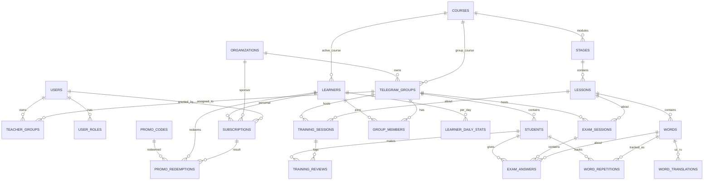

# 03. Database Schema — LexiFlow Pro

## 1. ERD



> **Переход на learner-first (docs/12, Sprint 14).** Задача 1.1a добавляет таблицы `learners`, `group_members`,
> `courses`, `organizations`, `word_translations`, `learner_daily_stats`, `subscriptions`, `promo_codes`,
> `promo_redemptions` (§2.17–§2.25) **аддитивно**: `students` и все `student_id` остаются до задачи 1.1b, которая
> заменит их на `learner_id` и удалит `students`. До этого `group_members` / `learners` не используются кодом.

## 2. Таблицы

Все таблицы содержат `id` (bigint, PK), `created_at`, `updated_at` (если не указано иное).

### 2.1 `users` — администраторы и учителя
| Колонка | Тип | Описание |
|---------|-----|----------|
| id | bigint PK | |
| name | string(100) | ФИО |
| email | string(150) unique | Логин |
| password | string(255) | bcrypt |
| telegram_user_id | bigint nullable unique | Для учителя — обязательно, получаем из `/start` в ЛС бота |
| is_active | boolean default true | |
| last_login_at | timestamp nullable | |
| created_at, updated_at | | |

Роли через `spatie/laravel-permission`: `admin`, `teacher`.

### 2.2 `telegram_groups`
| Колонка | Тип | Описание |
|---------|-----|----------|
| id | bigint PK | |
| chat_id | bigint unique | Telegram chat_id (может быть отрицательный для supergroup) |
| title | string(255) | Название группы |
| status | enum('pending','active','disabled') default 'pending' | |
| organization_id | bigint nullable FK → organizations, ON DELETE SET NULL | организация-владелец (спонсор Pro для участников) |
| course_id | bigint nullable FK → courses, ON DELETE SET NULL | курс для команд учителя; `NULL` = курс `default` |
| meta | jsonb default '{}' | Member count, type и т.п. |
| created_at, updated_at | | |

**Индексы:** `chat_id` unique, `status`, `organization_id`, `course_id`.

### 2.3 `teacher_groups` — pivot учитель ↔ группа
| Колонка | Тип |
|---------|-----|
| id | bigint PK |
| user_id | bigint FK → users |
| telegram_group_id | bigint FK → telegram_groups |
| is_primary | boolean default true |

**Индексы:** `(user_id, telegram_group_id)` unique.

### 2.4 `students` — Telegram-юзеры в группах
| Колонка | Тип | Описание |
|---------|-----|----------|
| id | bigint PK | |
| telegram_user_id | bigint | |
| telegram_group_id | bigint FK → telegram_groups | |
| username | string(100) nullable | |
| first_name | string(100) | |
| last_name | string(100) nullable | |
| language_code | string(10) nullable | |
| last_seen_at | timestamp nullable | |
| is_active | boolean default true | |
| created_at, updated_at | | |

**Индексы:** `(telegram_user_id, telegram_group_id)` unique, `telegram_group_id`.

Заметка: один и тот же пользователь в двух разных группах будет двумя записями — это нормально, у каждой группы своя история обучения.

### 2.5 `stages` — модули курса
| Колонка | Тип |
|---------|-----|
| id | bigint PK |
| course_id | bigint FK → courses, ON DELETE CASCADE, NOT NULL |
| number | int |
| title | string(255) |
| description | text nullable |

**Индексы:** `(course_id, number)` unique — номер модуля уникален внутри курса (одинаковый `number` в разных курсах разрешён).

### 2.6 `lessons`
| Колонка | Тип |
|---------|-----|
| id | bigint PK |
| stage_id | bigint FK → stages |
| number | int |
| title | string(255) nullable |

**Индексы:** `(stage_id, number)` unique.

### 2.7 `words`
| Колонка | Тип | Описание |
|---------|-----|----------|
| id | bigint PK | |
| lesson_id | bigint FK → lessons | |
| word | string(100) | английское слово |
| translation | string(500) | перевод |
| example | text nullable | пример предложения |
| part_of_speech | string(30) nullable | noun/verb/... |
| transcription | string(100) nullable | IPA |
| meta | jsonb default '{}' | |

**Индексы:** `(lesson_id, word)` unique, `lesson_id`, `word` (для поиска).

### 2.8 `word_repetitions` — состояние SM-2 для пары (студент, слово)
| Колонка | Тип | Описание |
|---------|-----|----------|
| id | bigint PK | |
| student_id | bigint FK → students | |
| word_id | bigint FK → words | |
| repetitions | smallint default 0 | счётчик успешных повторений в состоянии `review` (сброс при провале) |
| interval_days | smallint default 0 | текущий интервал в днях (0, пока карточка в минутных шагах) |
| easiness_factor | decimal(4,2) default 2.50 | EF из SM-2 |
| last_quality | smallint nullable | 0..5, последняя оценка |
| last_reviewed_at | timestamp nullable | |
| next_review_at | timestamp | индексируем для запроса «что пора повторить»; для `learning`/`relearning` — минуты |
| is_hard | boolean default false | провалена и ещё не прошла успешное review-повторение (docs/06 §3.5) |
| state | varchar(16) default 'new' | `new` / `learning` / `review` / `relearning` (docs/06 §3.1) |
| learning_step | smallint default 0 | индекс текущего минутного шага внутри learning/relearning |
| lapses | smallint default 0 | сколько раз карточка в `review` была провалена |
| served_ahead_at | timestamp nullable | метка learn-ahead: карточка выдана до `next_review_at`; обнуляется при приёме оценки |
| served_ahead_token | varchar(64) nullable | одноразовый билет learn-ahead (32 hex); уходит клиенту как `card.serve_token`, обязан вернуться в `POST /review`; обнуляется при приёме оценки (docs/06 §5.2) |
| meta | jsonb default '{}' | |

Backfill миграции `add_learning_state_to_word_repetitions`: `repetitions >= 1` → `review`;
`repetitions = 0` и `last_quality` не null → `relearning` (в напоминания они возвращаются по правилу
«брошенных» карточек, docs/06 §6); остальные → `new`.

**Индексы:**
- `(student_id, word_id)` unique.
- `(student_id, next_review_at)` — для «что показывать».
- `(student_id, is_hard)` partial index `WHERE is_hard = true`.
- `(student_id, is_hard, next_review_at)` — hot path для выбора следующей карточки с приоритетом hard.
- `(next_review_at, student_id)` — batch scan студентов, которым пора напомнить о повторении.

### 2.9 `training_sessions`
| Колонка | Тип |
|---------|-----|
| id | bigint PK |
| telegram_group_id | bigint FK |
| lesson_id | bigint FK |
| started_by_user_id | bigint FK → users |
| status | enum('open','closed') default 'open' |
| started_at | timestamp |
| ended_at | timestamp nullable |

**Ограничение:** `(telegram_group_id, lesson_id) WHERE status = 'open'` unique — одна открытая тренировка урока на группу даже при параллельных командах.

### 2.10 `training_reviews` — каждая оценка карточки
| Колонка | Тип |
|---------|-----|
| id | bigint PK |
| training_session_id | bigint FK |
| student_id | bigint FK |
| word_id | bigint FK |
| quality | smallint (0..5) |
| time_spent_ms | int |
| created_at | timestamp |

**Индексы:** `(student_id, created_at)`, `(word_id, quality)` для аналитики «трудных слов».
Дополнительно для нагрузки:
- `(created_at, student_id)` — отчёты по активности за период.
- `(training_session_id, student_id)` — прогресс ученика внутри занятия.

### 2.11 `exam_sessions`
| Колонка | Тип |
|---------|-----|
| id | bigint PK |
| telegram_group_id | bigint FK |
| lesson_id | bigint FK |
| started_by_user_id | bigint FK |
| status | enum('open','closed') default 'open' |
| started_at | timestamp |
| ends_at | timestamp |
| closed_at | timestamp nullable |
| leaderboard_posted_at | timestamp nullable | — защита от повторной публикации результата |
| config | jsonb default '{}' | — параметры и канонический набор вопросов, см. ниже |

`config` (пишется `ExamSessionService::open`, неизменяем после создания):
- `total_questions`, `seconds_per_question`, `duration_minutes` — параметры сессии;
- `question_order` — `'per_student'`: порядок вопросов и вариантов у каждого студента свой
  (`ExamQuestionPersonalizer`, HMAC от `session_id` + `student_id`). Отсутствие ключа =
  legacy-сессия с общим порядком — доигрывается как есть;
- `order_secret` — случайные 32 байта (hex), HMAC-ключ перестановки этой сессии; независим от `app.key`, поэтому
  ротация ключа приложения посреди экзамена не сдвигает вопросы. У сессий без `order_secret` (созданных до
  появления поля) ключом остаётся `app.key`. **Секрет никогда не отдаётся наружу**: `ExamSession::$hidden = ['config']`,
  Resource-классы TWA — по белому списку, Filament показывает отдельные поля (не `config` целиком) — это закреплено тестами;
- `questions[]` — **канонический** список `{word_id, word, correct_translation, options[]}`; `options`
  содержит правильный перевод и 1–3 реальных дистрактора. `correct_index` **не хранится** — он зависит
  от студента и вычисляется на сервере при выдаче/ответе (legacy-записи с `correct_index` читаются корректно).

Следствие: `exam_question_attempts.question_index` — позиция в личной последовательности студента, а не в
`config.questions`. Перестановка — биекция, поэтому unique `(exam_session_id, student_id, word_id)` в
`exam_answers` по-прежнему защищает от повторного ответа на слово.

**Индексы:** `status`, `ends_at` (для scheduler).
Дополнительно для нагрузки:
- `(status, ends_at)` — закрытие истёкших экзаменов одним range scan.
- `(telegram_group_id, status, started_at)` — поиск открытого/последнего экзамена группы.
- `(telegram_group_id) WHERE status = 'open'` unique — не более одного открытого экзамена в группе, включая параллельные команды.

### 2.12 `exam_answers`
| Колонка | Тип |
|---------|-----|
| id | bigint PK |
| exam_session_id | bigint FK |
| student_id | bigint FK |
| word_id | bigint FK |
| selected_translation | string(500) nullable |
| is_correct | boolean |
| score | int default 0 |
| time_spent_ms | int |
| answered_at | timestamp |

**Индексы:** `(exam_session_id, student_id)`, `(student_id, answered_at)`.
Дополнительно для нагрузки:
- `(exam_session_id, student_id, word_id)` unique — защита от двойного ответа при параллельных запросах.
- `(answered_at, student_id)` — аналитика и cleanup по периоду.

### 2.12.1 `exam_question_attempts`

Серверный тайминг показа экзаменационного вопроса. Клиентское `time_spent_ms` не используется для начисления баллов.

| Колонка | Тип |
|---------|-----|
| id | bigint PK |
| exam_session_id | bigint FK |
| student_id | bigint FK |
| question_index | smallint unsigned |
| served_at | timestamp |
| answered_at | timestamp nullable |

**Ограничение:** `(exam_session_id, student_id, question_index)` unique. Повторный `GET question` не перезапускает таймер.

### 2.13 `exam_results` (materialized-style snapshot)
Заполняется при закрытии экзамена. Денормализация для быстрого лидерборда.

| Колонка | Тип |
|---------|-----|
| id | bigint PK |
| exam_session_id | bigint FK |
| student_id | bigint FK |
| total_score | int |
| correct_count | int |
| total_count | int |
| rank | int |

**Индексы:** `(exam_session_id, rank)`, `(exam_session_id, student_id)` unique.

### 2.14 `notifications_log` — аудит пушей студентам
| Колонка | Тип |
|---------|-----|
| id | bigint PK |
| student_id | bigint FK |
| type | string(50) | например, `review_reminder` |
| payload | jsonb | — что отправили |
| sent_at | timestamp |

**Индексы:** `(student_id, type, sent_at)` — rate-limit «не чаще 1 в сутки», `(type, sent_at)` — batch-аудит рассылок.

### 2.15 `audit_logs` — минимальный аудит админки
| Колонка | Тип |
|---------|-----|
| id | bigint PK |
| user_id | bigint FK nullable |
| action | string(100) | e.g. `import.uploaded`, `group.activated` |
| entity_type | string(100) nullable |
| entity_id | bigint nullable |
| ip | string(45) nullable |
| meta | jsonb |
| created_at | timestamp |

### 2.16 `product_events` — продуктовые события
Append-only журнал для продуктовой аналитики (не путать с Laravel events). Пишется только через
`App\Domain\Analytics\Services\ProductEventRecorder`; сбой записи логируется warning'ом и не ломает основной поток.

| Колонка | Тип |
|---------|-----|
| id | bigint PK |
| name | string(100) | см. `ProductEventName`, например `exam.started` |
| student_id | bigint FK nullable → students, ON DELETE SET NULL |
| telegram_group_id | bigint FK nullable → telegram_groups, ON DELETE SET NULL |
| user_id | bigint FK nullable → users, ON DELETE SET NULL (учитель) |
| props | jsonb | только скаляры, ≤ 20 ключей, строки ≤ 100 символов, **без PII** |
| occurred_at | timestamp |

**Индексы:** `(name, occurred_at)`, `(student_id, occurred_at)`, `(telegram_group_id, occurred_at)`, `(user_id)`, `(occurred_at)` (пакетный prune)
(индексы на FK нужны для `ON DELETE SET NULL` и аналитики по группе/учителю).

**Ретенция:** модель `ProductEvent` — `MassPrunable`; события старше `operations.product_events.retention_days`
(env `PRODUCT_EVENTS_RETENTION_DAYS`, по умолчанию 400 дней) удаляются ежедневно в 03:00 командой
`model:prune --model=App\Models\ProductEvent` (см. `routes/console.php`). `occurred_at` кастится в `immutable_datetime`.

**События (MVP):** `twa.authenticated`, `training.session_opened`, `exam.started`, `exam.closed`
(пока только ручной `/close_exam`), `exam.leaderboard_posted`, `reminder.sent`, `reminder.failed` (`reason`:
`bot_blocked` / `not_started` / `user_deactivated` / `forbidden`), `group.bot_added`, `student.joined`.

Ключи props с признаками PII (`name`, `username`, `text`, `message`, `title`, `token`, `hash`, `init_data`, ...)
отбрасываются рекордером автоматически.

### 2.17 `learners` — профиль ученика (один на Telegram-пользователя)
Центральный объект Фазы 1: прогресс и подписка принадлежат человеку, а не паре (человек, группа). Заменит `students` в задаче 1.1b.

| Колонка | Тип | Описание |
|---------|-----|----------|
| id | bigint PK | |
| telegram_user_id | bigint NOT NULL unique | |
| first_name, last_name | string(100) nullable | из Telegram |
| username | string(100) nullable | |
| language_code | string(10) nullable | сырой код Telegram |
| interface_locale | string(5) default 'ru' | `ru` / `uz` — язык бота и TWA |
| timezone | string(64) default 'Asia/Tashkent' | IANA; дефолт — `config('learners.default_timezone')` |
| goal | string(20) nullable | `general` / `ielts` / `sat` / `school` |
| level | string(2) nullable | `A1`..`C2` |
| active_course_id | bigint nullable FK → courses, ON DELETE SET NULL | курс для новых слов экрана «Сегодня» |
| daily_goal | smallint default 20 | карточек (оценок) в день |
| reminder_time | time nullable default '19:00' | локальное время напоминания; `NULL` = выключено |
| next_reminder_at | timestamp nullable | ближайшее напоминание, UTC |
| dm_blocked_at | timestamp nullable | Telegram ответил 403 на ЛС |
| onboarding_state | string(16) default 'new' | `new` → `locale` → `goal` → `level` → `timezone` → `reminder` → `done` |
| onboarding_completed_at | timestamp nullable | |
| acquisition_source | string(64) nullable | `ref`, `org`, `src:<channel>`, `course:<slug>`, `group` |
| start_payload | string(64) nullable | сырой payload `/start` |
| referrer_learner_id | bigint nullable FK → learners, ON DELETE SET NULL | реферер (только фиксируется) |
| streak_current, streak_best | smallint default 0 | |
| streak_last_date | date nullable | локальная дата, когда дневная цель выполнялась последний раз |
| last_seen_at | timestamp nullable | |
| blocked_at | timestamp nullable | бан платформой |
| deleted_at | timestamp nullable | `SoftDeletes` |
| meta | jsonb default '{}' | |
| created_at, updated_at | | |

**Индексы:** `telegram_user_id` unique; `next_reminder_at` — **partial** `WHERE next_reminder_at IS NOT NULL AND dm_blocked_at IS NULL`
(`learners_next_reminder_at_idx`, PostgreSQL; на sqlite — обычный индекс); `onboarding_state`; `last_seen_at`; `active_course_id`; `referrer_learner_id`.

### 2.18 `group_members` — членство learner'а в Telegram-группе
| Колонка | Тип | Описание |
|---------|-----|----------|
| id | bigint PK | |
| telegram_group_id | bigint FK → telegram_groups, ON DELETE CASCADE | |
| learner_id | bigint FK → learners, ON DELETE CASCADE | |
| status | string(12) default 'active' | `active` / `left` / `removed` / `banned` |
| joined_at | timestamp NOT NULL | |
| left_at | timestamp nullable | |
| created_at, updated_at | | |

**Индексы:** `(telegram_group_id, learner_id)` unique; `(learner_id, status)`; `(telegram_group_id, status)`.

### 2.19 `organizations` — минимальные организации (центр / репетитор)
| Колонка | Тип |
|---------|-----|
| id | bigint PK |
| name | string(150) |
| slug | string(64) unique |
| type | string(16) default 'center' (`center` / `tutor`) |
| status | string(16) default 'active' (`active` / `suspended`) |
| timezone | string(64) default 'Asia/Tashkent' |
| locale | string(5) default 'ru' |
| settings | jsonb default '{}' |
| created_at, updated_at | |

Членство learner'а в организации выводится из активного членства в её группах; отдельной таблицы участников в Фазе 1 нет.

### 2.20 `courses`
| Колонка | Тип | Описание |
|---------|-----|----------|
| id | bigint PK | |
| slug | string(64) unique | `default` — платформенный курс для демо-контента и импорта без указания курса |
| owner_type | string(16) default 'platform' | `platform` / `organization` |
| owner_id | bigint nullable | полиморфный, FK не ставим (целостность — в сервисе) |
| title | jsonb NOT NULL | `{"ru": "...", "uz": "..."}` |
| description | jsonb default '{}' | по локалям |
| target_language | string(5) default 'en' | |
| level | string(2) nullable | `A1`..`C2` |
| exam_tag | string(16) nullable | `ielts` / `sat` / `school` / `general` |
| visibility | string(10) default 'public' | `public` / `unlisted` / `private` |
| status | string(10) default 'draft' | `draft` → `review` → `published` (→ `archived`) |
| published_at | timestamp nullable | |
| position | int default 0 | порядок в каталоге |
| is_featured | boolean default false | |
| words_count | int default 0 | денормализация |
| meta | jsonb default '{}' | |
| created_at, updated_at | | |

**Индексы:** `slug` unique; `(status, visibility, position)`; `(owner_type, owner_id)`.

### 2.21 `word_translations` — переводы слов по локалям
| Колонка | Тип |
|---------|-----|
| id | bigint PK |
| word_id | bigint FK → words, ON DELETE CASCADE |
| locale | string(5) NOT NULL (`ru` / `uz`) |
| translation | string(500) NOT NULL |
| example_translation | text nullable |
| source | string(16) default 'import' (`import` / `manual` / `ai`) |
| reviewed_at | timestamp nullable (проверено носителем) |
| created_at, updated_at | |

**Индексы:** `(word_id, locale)` unique.

### 2.22 `learner_daily_stats` — агрегат за локальный день
| Колонка | Тип | Описание |
|---------|-----|----------|
| id | bigint PK | |
| learner_id | bigint FK → learners, ON DELETE CASCADE | |
| date | date NOT NULL | локальная дата learner'а |
| reviews_count | int default 0 | все принятые оценки |
| new_words_count | int default 0 | карточек впервые показано (то, что ограничивает Free) |
| correct_count | int default 0 | `quality >= 3` |
| time_spent_ms | bigint default 0 | |
| goal_met_at | timestamp nullable | |
| created_at, updated_at | | |

**Индексы:** `(learner_id, date)` unique.

### 2.23 `subscriptions`
| Колонка | Тип | Описание |
|---------|-----|----------|
| id | bigint PK | |
| subscriber_type | string(16) | `learner` / `organization` |
| subscriber_id | bigint | полиморфный, без FK |
| plan | string(16) | `pro` |
| status | string(12) | `trialing` / `active` / `past_due` / `canceled` / `expired` |
| provider | string(16) | `manual` / `promo` / `telegram_stars` / `payme` / `click` |
| provider_ref | string(191) nullable | |
| starts_at | timestamp NOT NULL | |
| current_period_ends_at | timestamp nullable | `NULL` = бессрочно (только `manual`) |
| grace_until | timestamp nullable | |
| canceled_at, ended_at | timestamp nullable | |
| seats_limit | int nullable | для организаций (Фаза 2) |
| granted_by_user_id | bigint nullable FK → users, ON DELETE SET NULL | |
| note | string(255) nullable | |
| meta | jsonb default '{}' | |
| created_at, updated_at | | |

**Индексы:** `(subscriber_type, subscriber_id, status)`; `(status, current_period_ends_at)`; `(status, grace_until)`; `granted_by_user_id`;
partial unique `subscriptions_one_live_per_subscriber` `(subscriber_type, subscriber_id) WHERE status IN ('trialing','active','past_due')`
(PostgreSQL и sqlite; на других драйверах — проверка в сервисе под `lockForUpdate`).

### 2.24 `promo_codes`
| Колонка | Тип |
|---------|-----|
| id | bigint PK |
| code | string(32) unique (upper-case) |
| plan | string(16) |
| duration_days | smallint |
| max_redemptions | int nullable |
| redemptions_count | int default 0 |
| expires_at | timestamp nullable |
| is_active | boolean default true |
| created_by_user_id | bigint nullable FK → users, ON DELETE SET NULL |
| note | string(255) nullable |
| created_at, updated_at | |

### 2.25 `promo_redemptions`
| Колонка | Тип |
|---------|-----|
| id | bigint PK |
| promo_code_id | bigint FK → promo_codes, ON DELETE CASCADE |
| learner_id | bigint FK → learners, ON DELETE CASCADE |
| subscription_id | bigint nullable FK → subscriptions, ON DELETE SET NULL |
| redeemed_at | timestamp |
| created_at, updated_at | |

**Индексы:** `(promo_code_id, learner_id)` unique.

`payments` в Фазе 1 не создаётся (оплата вне Фазы 1, docs/12 §1.9).

## 3. Порядок миграций

Миграции создаём в таком порядке (порядок имеет значение из-за FK). Пока на дисках лежат исходные create-миграции
(до пересоздания БД `migrate:fresh --seed`), правки схемы вносятся **в них на месте**, а новые таблицы получают более
ранние/поздние метки времени, чтобы цели FK создавались раньше (docs/12 §2.2–§2.3):

1. `create_users_table` (стандартный Laravel, правим)
2. `create_permission_tables` (spatie)
3. `2026_04_23_095900_create_organizations_table` *(1.1a)*
4. `2026_04_23_095901_create_courses_table` *(1.1a)*
5. `2026_04_23_095902_create_learners_table` *(1.1a)*
6. `create_telegram_groups_table` (+ `organization_id`, `course_id`) *(1.1a)*
7. `create_teacher_groups_table`
8. `create_students_table` *(удаляется в 1.1b)*
9. `create_stages_table` (+ `course_id`, unique `(course_id, number)`) *(1.1a)*
10. `create_lessons_table`
11. `create_words_table` (+ `audio_path`, `is_active`) *(1.1a)*
12. `create_word_repetitions_table`
13. `create_training_sessions_table`
14. `create_training_reviews_table`
15. `create_exam_sessions_table`
16. `create_exam_question_attempts_table`
17. `create_exam_answers_table`
18. `create_exam_results_table`
19. `create_notifications_log_table`
20. `create_audit_logs_table`
21. `2026_04_23_100014_create_group_members_table` *(1.1a)*
22. `2026_04_23_100015_create_word_translations_table` *(1.1a)*
23. `2026_04_23_100016_create_learner_daily_stats_table` *(1.1a)*
24. `2026_04_23_100017_create_subscriptions_table` *(1.1a)*
25. `2026_04_23_100018_create_promo_codes_table` *(1.1a)*
26. `2026_04_23_100019_create_promo_redemptions_table` *(1.1a)*
27. `create_product_events_table`

Правило: до первого прод-релиза история миграций правится на месте (все среды — `php artisan migrate:fresh --seed`);
с первого прод-релиза — только forward-миграции.

## 4. Сидеры (для локальной разработки)

- `DemoAdminSeeder` — создаёт админа `admin@local` / `password`.
- `DemoTeacherSeeder` — создаёт учителя.
- `DemoContentSeeder` — платформенный курс `default` (slug из `config('content.default_course_slug')`, `published`, `public`) и в нём 2 stages × 3 lessons × 20 words (из JSON-fixture). Запускается до `DemoGroupSeeder`.
- `DemoGroupSeeder` — тестовая группа со статусом `active` и `course_id` = курс `default`.
- `DemoStudentsSeeder` — 5 тестовых студентов.
- `DemoRepetitionsSeeder` — разбрасывает состояния SM-2 так, чтобы у некоторых слов `next_review_at <= now()`.

## 5. Ключевые запросы (примеры)

### 5.1 Слова, которые пора повторить студенту
```sql
SELECT wr.*, w.word, w.translation, w.example
FROM word_repetitions wr
JOIN words w ON w.id = wr.word_id
WHERE wr.student_id = :student_id
  AND wr.next_review_at <= NOW()
ORDER BY wr.is_hard DESC, wr.next_review_at ASC
LIMIT 30;
```

### 5.2 Топ-20 «трудных слов» по группе
```sql
SELECT w.id, w.word, w.translation,
       COUNT(*) AS attempts,
       SUM(CASE WHEN tr.quality < 3 THEN 1 ELSE 0 END)::float / COUNT(*) AS hard_ratio
FROM training_reviews tr
JOIN words w ON w.id = tr.word_id
JOIN students s ON s.id = tr.student_id
WHERE s.telegram_group_id = :group_id
  AND tr.created_at >= NOW() - INTERVAL '30 days'
GROUP BY w.id, w.word, w.translation
HAVING COUNT(*) >= 10
ORDER BY hard_ratio DESC
LIMIT 20;
```

### 5.3 Лидерборд экзамена
```sql
SELECT s.first_name, s.username, er.total_score, er.correct_count, er.rank
FROM exam_results er
JOIN students s ON s.id = er.student_id
WHERE er.exam_session_id = :session_id
ORDER BY er.rank ASC;
```

## 6. Партиционирование (на будущее)

Когда `training_reviews` или `exam_answers` перерастут 10M строк — партиционировать по `created_at` (месячные партиции Postgres). В MVP не нужно.

Для ожидаемой нагрузки около 300 учеников в день достаточно:
- держать hot path индексы выше;
- не считать лидерборд на каждый запрос — использовать `exam_results` и Redis cache;
- не считать количество слов урока через `COUNT(*)` каждый старт TWA — использовать Redis cache с инвалидизацией после импорта;
- выполнять Telegram webhook и рассылки через Redis queue.

## 7. Бэкап-стратегия

- Ежедневно `pg_dump --format=custom` в S3-совместимое хранилище.
- Ретеншн: 14 дней + 4 еженедельных.
- Раз в месяц — тест restore в staging.

## 8. Важные правила

1. **Никогда не удаляем `words`** — только soft-deactivate (`words.is_active` — если понадобится, добавить на v2). Иначе сломается история `word_repetitions`.
2. **Удаление студента** — каскадом удаляются его `word_repetitions` и `training_reviews` (GDPR-friendly). `exam_answers` — сохраняем с анонимизацией `student_id → NULL`, чтобы статистика группы не разваливалась.
3. **FK всегда с `onDelete` явно**. Не полагайся на дефолты.
4. **Всегда транзакция** для: импорта JSON, закрытия экзамена, подсчёта лидерборда.
