# 03. Database Schema — LexiFlow Pro

## 1. ERD

```mermaid
erDiagram
    USERS ||--o{ TEACHER_GROUPS : owns
    USERS ||--o{ USER_ROLES : has
    TELEGRAM_GROUPS ||--o{ TEACHER_GROUPS : assigned_to
    TELEGRAM_GROUPS ||--o{ TRAINING_SESSIONS : hosts
    TELEGRAM_GROUPS ||--o{ EXAM_SESSIONS : hosts
    STAGES ||--o{ LESSONS : contains
    LESSONS ||--o{ WORDS : contains
    LESSONS ||--o{ TRAINING_SESSIONS : about
    LESSONS ||--o{ EXAM_SESSIONS : about
    LEARNERS ||--o{ WORD_REPETITIONS : tracks
    WORDS ||--o{ WORD_REPETITIONS : tracked_as
    LEARNERS ||--o{ EXAM_ANSWERS : gives
    LEARNERS ||--o{ EXAM_RESULTS : ranked
    LEARNERS ||--o{ EXAM_QUESTION_ATTEMPTS : served
    LEARNERS ||--o{ NOTIFICATIONS_LOG : receives
    LEARNERS ||--o{ PRODUCT_EVENTS : emits
    LEARNERS ||--o{ TRAINING_SESSIONS : personal
    EXAM_SESSIONS ||--o{ EXAM_ANSWERS : contains
    WORDS ||--o{ EXAM_ANSWERS : about
    LEARNERS ||--o{ TRAINING_REVIEWS : makes
    TRAINING_SESSIONS ||--o{ TRAINING_REVIEWS : logs
    LEARNERS ||--o{ GROUP_MEMBERS : joins
    TELEGRAM_GROUPS ||--o{ GROUP_MEMBERS : has
    ORGANIZATIONS ||--o{ TELEGRAM_GROUPS : owns
    COURSES ||--o{ STAGES : modules
    COURSES ||--o{ TELEGRAM_GROUPS : group_course
    COURSES ||--o{ LEARNERS : active_course
    WORDS ||--o{ WORD_TRANSLATIONS : uz_ru
    LEARNERS ||--o{ LEARNER_DAILY_STATS : per_day
    LEARNERS ||--o{ SUBSCRIPTIONS : personal
    ORGANIZATIONS ||--o{ SUBSCRIPTIONS : sponsor
    USERS ||--o{ SUBSCRIPTIONS : granted_by
    PROMO_CODES ||--o{ PROMO_REDEMPTIONS : redeemed
    LEARNERS ||--o{ PROMO_REDEMPTIONS : redeems
    SUBSCRIPTIONS ||--o{ PROMO_REDEMPTIONS : result
    LEARNERS ||--o{ PAYMENT_ORDERS : buys
    ORGANIZATIONS ||--o{ PAYMENT_ORDERS : buys
    PAYMENT_ORDERS ||--o{ PROVIDER_TRANSACTIONS : provider_state
    PAYMENT_ORDERS ||--o{ PAYMENTS : settles
    SUBSCRIPTIONS ||--o{ PAYMENTS : funds
    PAYMENTS ||--o| PAYMENTS : refunds
    LEARNERS ||--o{ OFFERS : personal_discount
    OFFERS ||--o| PAYMENT_ORDERS : applied_to
    ORGANIZATIONS ||--o{ ORGANIZATION_MEMBERS : seats
    LEARNERS ||--o{ ORGANIZATION_MEMBERS : member
    ORGANIZATIONS ||--o{ ORGANIZATION_INVITES : codes
    ORGANIZATION_INVITES ||--o{ ORGANIZATION_MEMBERS : joined_via
    ORGANIZATIONS ||--o{ ORGANIZATION_USERS : staff
    USERS ||--o{ ORGANIZATION_USERS : role
```



> **Фаза 2, оплата (docs/13 §1.2, задача 2A.1).** Добавлены `offers`, `payment_orders`, `provider_transactions`,
> `payments` (§2.26–§2.29); `subscriptions` получила `tier`, а статус `canceled` стал live (предикат partial unique).

> **Фаза 2, центры (docs/13 §1.3, задача 2B.1).** Добавлены `organization_users`, `organization_invites`,
> `organization_members` (§2.30–§2.32). Членство learner'а в организации теперь **явное**: спонсорский Pro даёт
> только место (`organization_members.status = active AND seat_state = seated`) в активной организации с live-подпиской;
> группа организации лишь создаёт членство (`joined_via = group`).

> **Learner-first (docs/12, Sprint 14).** Прогресс, оценки, ответы и напоминания принадлежат человеку —
> `learners` (один на Telegram-пользователя); членство в группе — `group_members`. Таблицы `students` **больше нет**
> (удалена в задаче 1.1b), все `student_id` заменены на `learner_id`. Задача 1.1a добавила `learners`, `group_members`,
> `courses`, `organizations`, `word_translations`, `learner_daily_stats`, `subscriptions`, `promo_codes`,
> `promo_redemptions` (§2.17–§2.25).

## 2. Таблицы

Все таблицы содержат `id` (bigint, PK), `created_at`, `updated_at` (если не указано иное).

### 2.1 `users` — администраторы и учителя
| Колонка | Тип | Описание |
|---------|-----|----------|
| id | bigint PK | |
| name | string(100) | ФИО |
| email | string(150) unique | Логин |
| password | string(255) | bcrypt |
| telegram_user_id | bigint nullable unique | Для учителя — обязательно, получаем из `/start` в ЛС бота |
| is_active | boolean default true | |
| last_login_at | timestamp nullable | |
| created_at, updated_at | | |

Роли через `spatie/laravel-permission`: `admin`, `teacher`.

### 2.2 `telegram_groups`
| Колонка | Тип | Описание |
|---------|-----|----------|
| id | bigint PK | |
| chat_id | bigint unique | Telegram chat_id (может быть отрицательный для supergroup) |
| title | string(255) | Название группы |
| status | enum('pending','active','disabled') default 'pending' | |
| organization_id | bigint nullable FK → organizations, ON DELETE SET NULL | организация-владелец (спонсор Pro для участников) |
| course_id | bigint nullable FK → courses, ON DELETE SET NULL | курс для команд учителя; `NULL` = курс `default` |
| meta | jsonb default '{}' | Member count, type и т.п. |
| created_at, updated_at | | |

**Индексы:** `chat_id` unique, `status`, `organization_id`, `course_id`.

### 2.3 `teacher_groups` — pivot учитель ↔ группа
| Колонка | Тип |
|---------|-----|
| id | bigint PK |
| user_id | bigint FK → users |
| telegram_group_id | bigint FK → telegram_groups |
| is_primary | boolean default true |

**Индексы:** `(user_id, telegram_group_id)` unique.

### 2.4 ~~`students`~~ — удалена (learner-first)
Таблица `students` (запись на пару «Telegram-пользователь + группа») удалена в задаче 1.1b. Её роль разделили:
**человек** — `learners` (§2.17), **вхождение человека в группу** — `group_members` (§2.18). Один и тот же человек в двух
группах — **один** `learners` и **два** `group_members`, а значит один прогресс в `word_repetitions`.
Прежний флаг `students.is_active` заменён двумя понятиями: выход/исключение из группы — `group_members.status` (`left` / `removed` / `banned`), бан на уровне платформы — `learners.blocked_at`.

### 2.5 `stages` — модули курса
| Колонка | Тип |
|---------|-----|
| id | bigint PK |
| course_id | bigint FK → courses, ON DELETE CASCADE, NOT NULL |
| number | int |
| title | string(255) |
| description | text nullable |

**Индексы:** `(course_id, number)` unique — номер модуля уникален внутри курса (одинаковый `number` в разных курсах разрешён).

### 2.6 `lessons`
| Колонка | Тип |
|---------|-----|
| id | bigint PK |
| stage_id | bigint FK → stages |
| number | int |
| title | string(255) nullable |

**Индексы:** `(stage_id, number)` unique.

### 2.7 `words`
| Колонка | Тип | Описание |
|---------|-----|----------|
| id | bigint PK | |
| lesson_id | bigint FK → lessons | |
| word | string(100) | английское слово |
| translation | string(500) | русский перевод по умолчанию (NOT NULL); читать переводы в коде — только через `WordTranslationResolver` (см. 2.21) |
| example | text nullable | пример предложения |
| part_of_speech | string(30) nullable | noun/verb/... |
| transcription | string(100) nullable | IPA |
| audio_path | string(255) nullable | предгенерированное аудио (задача 1.2c) |
| is_active | boolean default true | слово не удаляем, а деактивируем; учитывается в `courses.words_count` и в проверке публикации курса |
| meta | jsonb default '{}' | |

**Индексы:** `(lesson_id, word)` unique, `lesson_id`, `word` (для поиска).

### 2.8 `word_repetitions` — состояние SM-2 для пары (learner, слово)
| Колонка | Тип | Описание |
|---------|-----|----------|
| id | bigint PK | |
| learner_id | bigint FK → learners, ON DELETE CASCADE | |
| word_id | bigint FK → words | |
| repetitions | smallint default 0 | счётчик успешных повторений в состоянии `review` (сброс при провале) |
| interval_days | smallint default 0 | текущий интервал в днях (0, пока карточка в минутных шагах) |
| easiness_factor | decimal(4,2) default 2.50 | EF из SM-2 |
| last_quality | smallint nullable | 0..5, последняя оценка |
| last_reviewed_at | timestamp nullable | |
| next_review_at | timestamp | индексируем для запроса «что пора повторить»; для `learning`/`relearning` — минуты |
| is_hard | boolean default false | провалена и ещё не прошла успешное review-повторение (docs/06 §3.5) |
| introduced_mode | varchar(16) NOT NULL default 'lesson' | режим сессии, в которой слово было выдано впервые: `group_lesson` / `lesson` / `daily_review` (`TrainingScope::$sessionMode` → `CardPicker`); квота Free не считает строки `group_lesson` (docs/12 §5.3). Дефолт — для строк не от пикера (сидеры) |
| state | varchar(16) default 'new' | `new` / `learning` / `review` / `relearning` (docs/06 §3.1) |
| learning_step | smallint default 0 | индекс текущего минутного шага внутри learning/relearning |
| lapses | smallint default 0 | сколько раз карточка в `review` была провалена |
| served_ahead_at | timestamp nullable | метка learn-ahead: карточка выдана до `next_review_at`; обнуляется при приёме оценки |
| served_ahead_token | varchar(64) nullable | одноразовый билет learn-ahead (32 hex); уходит клиенту как `card.serve_token`, обязан вернуться в `POST /review`; обнуляется при приёме оценки (docs/06 §5.2) |
| meta | jsonb default '{}' | |

Backfill миграции `add_learning_state_to_word_repetitions`: `repetitions >= 1` → `review`;
`repetitions = 0` и `last_quality` не null → `relearning` (в напоминания они возвращаются по правилу
«брошенных» карточек, docs/06 §6); остальные → `new`.

**Индексы:**
- `(learner_id, word_id)` unique — **один прогресс по слову на человека**, независимо от числа его групп.
- `(learner_id, next_review_at)` — для «что показывать».
- `(learner_id) WHERE is_hard = true` — partial index `word_repetitions_learner_is_hard_idx`.
- `(learner_id, is_hard, next_review_at)` (`word_repetitions_learner_hard_due_idx`) — hot path для выбора следующей карточки с приоритетом hard.
- `(next_review_at, learner_id)` (`word_repetitions_due_learners_idx`) — batch scan learner'ов, которым пора напомнить о повторении.
- `(learner_id, created_at)` — квота новых слов за локальный день (docs/12 §5.3).

### 2.9 `training_sessions`
Одна таблица для групповых (`mode = group_lesson`, открывает учитель) и личных сессий (`lesson`, `daily_review` — открывает сам learner через `TrainingSessionService::openPersonal`, задача 1.3a).

| Колонка | Тип |
|---------|-----|
| id | bigint PK |
| telegram_group_id | bigint FK nullable, ON DELETE CASCADE — `NULL` у личной сессии |
| lesson_id | bigint FK nullable, ON DELETE RESTRICT — `NULL` у `daily_review` |
| started_by_user_id | bigint FK nullable → users — `NULL` у личной сессии |
| learner_id | bigint FK nullable → learners, ON DELETE CASCADE — владелец личной сессии |
| mode | varchar(16) default 'group_lesson' — `group_lesson` / `lesson` / `daily_review` |
| source | varchar(16) default 'command' — `command` / `picker` / `self` / `reminder` / `onboarding` |
| course_id | bigint FK nullable → courses, ON DELETE SET NULL — откуда брать новые слова в `daily_review` |
| status | enum('open','closed') default 'open' |
| started_at | timestamp |
| ended_at | timestamp nullable |
| expires_at | timestamp nullable — автозакрытие личных сессий планировщиком |
| done_reason | varchar(16) nullable — почему закрыта: `finished` (learner нажал «Завершить») / `expired` (планировщик `training:close-expired` или замена просроченной при повторном открытии); `NULL` пока открыта *(1.3a)* |

**Ограничения:**
- `(telegram_group_id, lesson_id) WHERE status = 'open'` unique — одна открытая тренировка урока на группу даже при параллельных командах (у личных сессий группа `NULL`, они не конфликтуют);
- `(learner_id) WHERE status = 'open' AND mode = 'daily_review'` unique (`training_sessions_one_open_daily_per_learner`);
- `(learner_id, lesson_id) WHERE status = 'open' AND mode = 'lesson'` unique (`training_sessions_one_open_lesson_per_learner`);
- PostgreSQL-only CHECK `training_sessions_mode_shape_check`: `group_lesson` ⇒ есть группа и урок, любой другой режим ⇒ есть `learner_id` (на других драйверах инвариант держит сервис);
- индексы `(learner_id, status, started_at)`, `(status, expires_at)`, `course_id`.

### 2.10 `training_reviews` — каждая оценка карточки
| Колонка | Тип |
|---------|-----|
| id | bigint PK |
| training_session_id | bigint FK |
| learner_id | bigint FK → learners, ON DELETE CASCADE |
| word_id | bigint FK |
| quality | smallint (0..5) |
| time_spent_ms | int |
| created_at | timestamp |

**Индексы:** `(learner_id, created_at)`, `(word_id, quality)` для аналитики «трудных слов».
Дополнительно для нагрузки:
- `(created_at, learner_id)` — отчёты по активности за период.
- `(training_session_id, learner_id)` — прогресс ученика внутри занятия.

### 2.11 `exam_sessions`
| Колонка | Тип |
|---------|-----|
| id | bigint PK |
| telegram_group_id | bigint FK |
| lesson_id | bigint FK |
| started_by_user_id | bigint FK |
| status | enum('open','closed') default 'open' |
| started_at | timestamp |
| ends_at | timestamp |
| closed_at | timestamp nullable |
| leaderboard_posted_at | timestamp nullable | — защита от повторной публикации результата |
| config | jsonb default '{}' | — параметры и канонический набор вопросов, см. ниже |

`config` (пишется `ExamSessionService::open`, неизменяем после создания):
- `total_questions`, `seconds_per_question`, `duration_minutes` — параметры сессии;
- `locale` — язык текстов вопросов: локаль **группы** (`LocaleResolver::forGroup`) на момент открытия экзамена,
  переводы с fallback на `ru` (см. 2.21); вопросы канонические и не пересчитываются при смене языка группы;
- `question_order` — `'per_learner'`: порядок вопросов и вариантов у каждого learner'а свой
  (`ExamQuestionPersonalizer`, HMAC от `session_id` + `learner_id`). Отсутствие ключа =
  legacy-сессия с общим порядком — доигрывается как есть;
- `order_secret` — случайные 32 байта (hex), HMAC-ключ перестановки этой сессии; независим от `app.key`, поэтому
  ротация ключа приложения посреди экзамена не сдвигает вопросы. У сессий без `order_secret` (созданных до
  появления поля) ключом остаётся `app.key`. **Секрет никогда не отдаётся наружу**: `ExamSession::$hidden = ['config']`,
  Resource-классы TWA — по белому списку, Filament показывает отдельные поля (не `config` целиком) — это закреплено тестами;
- `questions[]` — **канонический** список `{word_id, word, correct_translation, options[]}`; `options`
  содержит правильный перевод и 1–3 реальных дистрактора. `correct_index` **не хранится** — он зависит
  от learner'а и вычисляется на сервере при выдаче/ответе (legacy-записи с `correct_index` читаются корректно).

Следствие: `exam_question_attempts.question_index` — позиция в личной последовательности learner'а, а не в
`config.questions`. Перестановка — биекция, поэтому unique `(exam_session_id, learner_id, word_id)` в
`exam_answers` по-прежнему защищает от повторного ответа на слово.

**Индексы:** `status`, `ends_at` (для scheduler).
Дополнительно для нагрузки:
- `(status, ends_at)` — закрытие истёкших экзаменов одним range scan.
- `(telegram_group_id, status, started_at)` — поиск открытого/последнего экзамена группы.
- `(telegram_group_id) WHERE status = 'open'` unique — не более одного открытого экзамена в группе, включая параллельные команды.

### 2.12 `exam_answers`
| Колонка | Тип |
|---------|-----|
| id | bigint PK |
| exam_session_id | bigint FK |
| learner_id | bigint FK nullable → learners, ON DELETE SET NULL |
| word_id | bigint FK |
| selected_translation | string(500) nullable |
| is_correct | boolean |
| score | int default 0 |
| time_spent_ms | int |
| answered_at | timestamp |

**Индексы:** `(exam_session_id, learner_id)`, `(learner_id, answered_at)`.
Дополнительно для нагрузки:
- `(exam_session_id, learner_id, word_id)` unique (`exam_answers_session_learner_word_unique`) — защита от двойного ответа при параллельных запросах.
- `(answered_at, learner_id)` — аналитика и cleanup по периоду.

### 2.12.1 `exam_question_attempts`

Серверный тайминг показа экзаменационного вопроса. Клиентское `time_spent_ms` не используется для начисления баллов.

| Колонка | Тип |
|---------|-----|
| id | bigint PK |
| exam_session_id | bigint FK |
| learner_id | bigint FK → learners, ON DELETE CASCADE |
| question_index | smallint unsigned |
| served_at | timestamp |
| answered_at | timestamp nullable |

**Ограничение:** `(exam_session_id, learner_id, question_index)` unique. Повторный `GET question` не перезапускает таймер.

### 2.13 `exam_results` (materialized-style snapshot)
Заполняется при закрытии экзамена. Денормализация для быстрого лидерборда.

| Колонка | Тип |
|---------|-----|
| id | bigint PK |
| exam_session_id | bigint FK |
| learner_id | bigint FK nullable → learners, ON DELETE SET NULL |
| total_score | int |
| correct_count | int |
| total_count | int |
| rank | int |

**Индексы:** `(exam_session_id, rank)`, `(exam_session_id, learner_id)` unique.

### 2.14 `notifications_log` — аудит пушей learner'ам
| Колонка | Тип |
|---------|-----|
| id | bigint PK |
| learner_id | bigint FK → learners, ON DELETE CASCADE |
| type | string(50) | `review_reminder` / `streak_reminder` (вид напоминания, docs/06 §6) |
| payload | jsonb | — что отправили: `{kind, due_count, streak, scheduled_for}` |
| sent_at | timestamp |

**Индексы:** `(learner_id, type, sent_at)` — идемпотентность «не больше одного напоминания любого вида за локальный день learner'а и не чаще раза в 2 ч» (`ReminderSender`), `(type, sent_at)` — batch-аудит рассылок.

### 2.15 `audit_logs` — минимальный аудит админки
| Колонка | Тип |
|---------|-----|
| id | bigint PK |
| user_id | bigint FK nullable |
| action | string(100) | e.g. `import.uploaded`, `group.activated` |
| entity_type | string(100) nullable |
| entity_id | bigint nullable |
| ip | string(45) nullable |
| meta | jsonb |
| created_at | timestamp |

### 2.16 `product_events` — продуктовые события
Append-only журнал для продуктовой аналитики (не путать с Laravel events). Пишется только через
`App\Domain\Analytics\Services\ProductEventRecorder`; сбой записи логируется warning'ом и не ломает основной поток.

| Колонка | Тип |
|---------|-----|
| id | bigint PK |
| name | string(100) | см. `ProductEventName`, например `exam.started` |
| learner_id | bigint FK nullable → learners, ON DELETE SET NULL |
| telegram_group_id | bigint FK nullable → telegram_groups, ON DELETE SET NULL |
| user_id | bigint FK nullable → users, ON DELETE SET NULL (учитель) |
| props | jsonb | только скаляры, ≤ 20 ключей, строки ≤ 100 символов, **без PII** |
| occurred_at | timestamp |

**Индексы:** `(name, occurred_at)`, `(learner_id, occurred_at)`, `(telegram_group_id, occurred_at)`, `(user_id)`, `(occurred_at)` (пакетный prune)
(индексы на FK нужны для `ON DELETE SET NULL` и аналитики по группе/учителю).

**Ретенция:** модель `ProductEvent` — `MassPrunable`; события старше `operations.product_events.retention_days`
(env `PRODUCT_EVENTS_RETENTION_DAYS`, по умолчанию 400 дней) удаляются ежедневно в 03:00 командой
`model:prune --model=App\Models\ProductEvent` (см. `routes/console.php`). `occurred_at` кастится в `immutable_datetime`.

**События (MVP):** `twa.authenticated`, `training.session_opened`, `exam.started`, `exam.closed`
(пока только ручной `/close_exam`), `exam.leaderboard_posted`, `reminder.sent`, `reminder.failed` (`reason`:
`bot_blocked` / `not_started` / `user_deactivated` / `forbidden`), `group.bot_added`, `group.member_joined` (`via`: `group` / `chat_member`), `group.member_left` (`reason`: `left` / `removed`).

Ключи props с признаками PII (`name`, `username`, `text`, `message`, `title`, `token`, `hash`, `init_data`, ...)
отбрасываются рекордером автоматически.

### 2.17 `learners` — профиль ученика (один на Telegram-пользователя)
Центральный объект Фазы 1: прогресс и подписка принадлежат человеку, а не паре (человек, группа). Заменил `students` (задача 1.1b).

| Колонка | Тип | Описание |
|---------|-----|----------|
| id | bigint PK | |
| telegram_user_id | bigint NOT NULL unique | |
| first_name, last_name | string(100) nullable | из Telegram |
| username | string(100) nullable | |
| language_code | string(10) nullable | сырой код Telegram |
| interface_locale | string(5) default 'ru' | `ru` / `uz` — язык бота и TWA |
| timezone | string(64) default 'Asia/Tashkent' | IANA; дефолт — `config('learners.default_timezone')` |
| goal | string(20) nullable | `general` / `ielts` / `sat` / `school` |
| level | string(2) nullable | `A1`..`C2` |
| active_course_id | bigint nullable FK → courses, ON DELETE SET NULL | курс для новых слов экрана «Сегодня» |
| daily_goal | smallint default 20 | карточек (оценок) в день |
| reminder_time | time nullable default '19:00' | локальное время напоминания; `NULL` = выключено |
| next_reminder_at | timestamp nullable | ближайшее напоминание, UTC |
| dm_blocked_at | timestamp nullable | Telegram ответил 403 на ЛС |
| onboarding_state | string(16) default 'new' | `new` → `locale` → `goal` → `level` → `timezone` → `reminder` → `done` |
| onboarding_completed_at | timestamp nullable | |
| acquisition_source | string(64) nullable | `ref`, `org`, `src:<channel>`, `course:<slug>`, `group` |
| start_payload | string(64) nullable | сырой payload `/start` |
| referrer_learner_id | bigint nullable FK → learners, ON DELETE SET NULL | реферер (только фиксируется) |
| referral_code | string(12) nullable unique | код приглашения *(2C.1, docs/13 §1.5)*: генерируется лениво (`ReferralService::codeFor`, 8 символов алфавита без `0/O/1/I`), ссылка `t.me/<bot>?start=ref_<code>` |
| streak_current, streak_best | smallint default 0 | |
| streak_last_date | date nullable | локальная дата, когда дневная цель выполнялась последний раз |
| last_seen_at | timestamp nullable | |
| blocked_at | timestamp nullable | бан платформой |
| deleted_at | timestamp nullable | `SoftDeletes` |
| meta | jsonb default '{}' | |
| created_at, updated_at | | |

**Индексы:** `telegram_user_id` unique; `next_reminder_at` — **partial** `WHERE next_reminder_at IS NOT NULL AND dm_blocked_at IS NULL`
(`learners_next_reminder_at_idx`, PostgreSQL; на sqlite — обычный индекс); `onboarding_state`; `last_seen_at`; `active_course_id`; `referrer_learner_id`; `referral_code` unique.

### 2.18 `group_members` — членство learner'а в Telegram-группе
| Колонка | Тип | Описание |
|---------|-----|----------|
| id | bigint PK | |
| telegram_group_id | bigint FK → telegram_groups, ON DELETE CASCADE | |
| learner_id | bigint FK → learners, ON DELETE CASCADE | |
| status | string(12) default 'active' | `active` / `left` / `removed` / `banned` |
| joined_at | timestamp NOT NULL | |
| left_at | timestamp nullable | |
| created_at, updated_at | | |

**Индексы:** `(telegram_group_id, learner_id)` unique; `(learner_id, status)`; `(telegram_group_id, status)`.

### 2.19 `organizations` — минимальные организации (центр / репетитор)
| Колонка | Тип |
|---------|-----|
| id | bigint PK |
| name | string(150) |
| slug | string(64) unique |
| type | string(16) default 'center' (`center` / `tutor`) |
| status | string(16) default 'active' (`active` / `suspended`) |
| timezone | string(64) default 'Asia/Tashkent' |
| locale | string(5) default 'ru' |
| settings | jsonb default '{}' |
| created_at, updated_at | |

~~Членство learner'а в организации выводится из активного членства в её группах; отдельной таблицы участников в Фазе 1 нет.~~
**Изменено в 2B.1 (docs/13 §1.3):** членство явное — `organization_members` (§2.32); группа организации создаёт его автоматически
(`joined_via = group`, хук `GroupMembershipService::join/leave`), инвайт-код — `organization_invites` (§2.31), персонал кабинета —
`organization_users` (§2.30). Спонсирует только место (`seated`), лимит мест — `subscriptions.seats_limit` live-подписки организации.

### 2.20 `courses`
| Колонка | Тип | Описание |
|---------|-----|----------|
| id | bigint PK | |
| slug | string(64) unique | `default` — платформенный курс для демо-контента и импорта без указания курса |
| owner_type | string(16) default 'platform' | `platform` / `organization` / `learner` (колода learner'а, docs/13 §8.1) |
| owner_id | bigint nullable | полиморфный (`organizations.id` / `learners.id`), FK не ставим (целостность — в сервисе) |
| title | jsonb NOT NULL | `{"ru": "...", "uz": "..."}` |
| description | jsonb default '{}' | по локалям |
| target_language | string(5) default 'en' | |
| level | string(2) nullable | `A1`..`C2` |
| exam_tag | string(16) nullable | `ielts` / `sat` / `school` / `general` |
| source | string(12) default 'platform' | происхождение для фильтров: `platform` / `organization` / `learner` |
| visibility | string(10) default 'public' | `public` / `unlisted` / `private` |
| status | string(10) default 'draft' | `draft` → `review` → `published` (→ `archived`) |
| published_at | timestamp nullable | |
| position | int default 0 | порядок в каталоге |
| is_featured | boolean default false | |
| words_count | int default 0 | денормализация |
| meta | jsonb default '{}' | |
| created_at, updated_at | | |

**Индексы:** `slug` unique; `(status, visibility, position)`; `(owner_type, owner_id)`.

**Колоды learner'а** (Фаза 2, 2D.1, `LearnerDeckService`): `owner_type = learner`, `owner_id = learners.id`, `source = learner`,
`visibility = private`, `status = published` сразу (без модерации и публикационного гейта), `slug = deck-<learner_id>-<случайный суффикс>`,
`title = {ru, uz}` (одно и то же название в обеих локалях). Содержимое — обычные `stages` / `lessons` / `words`: один stage
«Моя колода» (`number = 1`), уроки «Часть N» по 50 слов. `private` доступен **только** владельцу
(`CourseCatalogService::isAvailable($course, $learner)` / `Course::availableTo($learnerId)`); для всех остальных — как несуществующий.
Лимиты колод — `config/decks.php` (Free 1 колода × 50 слов, Pro 20 × 2000; считаются неархивные колоды и активные слова).
«Удаление» колоды = `courses.status = archived` + `words.is_active = false` у её слов (правило §8.1: строки не удаляем),
`word_repetitions` остаются, `learners.active_course_id` на эту колоду сбрасывается.

**Жизненный цикл** (`CoursePublisher::transition`, только активный admin, каждый переход — строка `audit_logs`
`course.status_changed` с `from`/`to`): `draft → review`, `review → draft | published`, `published → archived`,
`archived → draft`; прочие переходы — ошибка. **Публикация** (`→ published`) требует: заголовок на каждом
поддерживаемом языке (`config('localization.supported')`), ≥ 1 урока, ≥ 1 активного слова и переводы **всех**
поддерживаемых локалей (сейчас `uz` + `ru`) не менее чем у `config('content.publish_translation_threshold')`
(0.95) активных слов. Проверка — только при новой публикации: уже опубликованный курс не пересматривается,
контент без `uz` показывается с ru-fallback и пометкой. `words_count` — число активных слов курса,
пересчитывается `CoursePublisher::recount` после импорта. Курс `default` создаётся `CourseCatalogService::defaultCourse()`
(сидер, первый импорт без `course`) сразу в статусе `published`; группа с `telegram_groups.course_id = NULL` работает в нём.

### 2.21 `word_translations` — переводы слов по локалям
| Колонка | Тип |
|---------|-----|
| id | bigint PK |
| word_id | bigint FK → words, ON DELETE CASCADE |
| locale | string(5) NOT NULL (`ru` / `uz`) |
| translation | string(500) NOT NULL |
| example_translation | text nullable |
| source | string(16) default 'import' (`import` / `manual` / `ai`) |
| reviewed_at | timestamp nullable (проверено носителем) |
| created_at, updated_at | |

**Индексы:** `(word_id, locale)` unique.

**Чтение** — только `WordTranslationResolver`: `word_translations[locale]` → `word_translations[ru]` →
`words.translation`; пустая строка = нет перевода. Признак `is_fallback` = «показан не запрошенный язык»
(запрос `ru` не бывает fallback'ом). Батч (`map`/`resolveMany`) — один запрос на пачку слов. Язык выбирается так:
личная сессия — `learners.interface_locale`; групповая тренировка и экзамен — локаль группы
(`telegram_groups.meta.locale`, по умолчанию `ru`). **Запись** дублирует русский текст в обе стороны:
`words.translation` ↔ строка `ru` (импорт `VocabularyImporter` и админка через `WordTranslationWriter`).
`source`: `import` — из файла; `manual` — правка в админке; изменённый текст теряет `reviewed_at`.

### 2.22 `learner_daily_stats` — агрегат за локальный день
| Колонка | Тип | Описание |
|---------|-----|----------|
| id | bigint PK | |
| learner_id | bigint FK → learners, ON DELETE CASCADE | |
| date | date NOT NULL | локальная дата learner'а (`LearnerClock::today()` в момент оценки) |
| reviews_count | int default 0 | все принятые оценки |
| new_words_count | int default 0 | карточек **впервые оценено** за день (`state = new` до оценки); квота Free считается не по нему, а по `word_repetitions.created_at` в границах локального дня (docs/12 §1.6, §5.3) |
| correct_count | int default 0 | `quality >= 3` |
| time_spent_ms | bigint default 0 | |
| goal_met_at | timestamp nullable | момент первого достижения `reviews_count >= learners.daily_goal`; ставится один раз под `FOR UPDATE` строки; источник истины для streak (`learners.streak_*` — проекция, обновляемая после commit) |
| created_at, updated_at | | |

**Индексы:** `(learner_id, date)` unique.

### 2.23 `subscriptions`
| Колонка | Тип | Описание |
|---------|-----|----------|
| id | bigint PK | |
| subscriber_type | string(16) | `learner` / `organization` |
| subscriber_id | bigint | полиморфный, без FK |
| plan | string(16) | `pro` |
| tier | string(16) nullable | тариф организации `tutor` / `center_s` / `center_m` / `center_l` (docs/13 §6.1), `NULL` у learner'а *(2A.1)* |
| status | string(12) | `trialing` / `active` / `past_due` / `canceled` / `expired`; `canceled` — live до `current_period_ends_at` без grace *(2A.1, docs/13 §2.1)* |
| provider | string(16) | `manual` / `promo` / `reward` / `telegram_stars` / `payme` / `click`; grace (`past_due`) — только у `telegram_stars` |
| provider_ref | string(191) nullable | |
| starts_at | timestamp NOT NULL | |
| current_period_ends_at | timestamp nullable | `NULL` = бессрочно (только `manual`) |
| grace_until | timestamp nullable | |
| canceled_at, ended_at | timestamp nullable | |
| seats_limit | int nullable | для организаций (Фаза 2) |
| granted_by_user_id | bigint nullable FK → users, ON DELETE SET NULL | |
| note | string(255) nullable | |
| meta | jsonb default '{}' | |
| created_at, updated_at | | |

**Индексы:** `(subscriber_type, subscriber_id, status)`; `(status, current_period_ends_at)`; `(status, grace_until)`; `granted_by_user_id`;
partial unique `subscriptions_one_live_per_subscriber` `(subscriber_type, subscriber_id) WHERE status IN ('trialing','active','past_due','canceled')`
(PostgreSQL и sqlite; на других драйверах — проверка в сервисе под `lockForUpdate`).

`meta` (2A.1): `history[]` — журнал переходов (`manual_grant` / `charge` / `renewal` / `promo_extension` / `reward` / `canceled` / `resumed` / `ended` / `revoked`
с `from {plan,status,provider,until}`); `stars.charge_id` — `telegram_payment_charge_id` первого платежа Stars-подписки (нужен `editUserStarSubscription`);
`renewal_reminders[]` — маркеры `"<days>@<ISO конца периода>"` уже поднятых напоминаний о продлении (`SubscriptionService::remindExpiring`).

### 2.24 `promo_codes`
| Колонка | Тип |
|---------|-----|
| id | bigint PK |
| code | string(32) unique (upper-case) |
| plan | string(16) |
| duration_days | smallint |
| max_redemptions | int nullable |
| redemptions_count | int default 0 |
| expires_at | timestamp nullable |
| is_active | boolean default true |
| created_by_user_id | bigint nullable FK → users, ON DELETE SET NULL |
| note | string(255) nullable |
| created_at, updated_at | |

### 2.25 `promo_redemptions`
| Колонка | Тип |
|---------|-----|
| id | bigint PK |
| promo_code_id | bigint FK → promo_codes, ON DELETE CASCADE |
| learner_id | bigint FK → learners, ON DELETE CASCADE |
| subscription_id | bigint nullable FK → subscriptions, ON DELETE SET NULL |
| redeemed_at | timestamp |
| created_at, updated_at | |

**Индексы:** `(promo_code_id, learner_id)` unique.

### 2.26 `offers` — персональные скидки *(2A.1, docs/13 §1.2)*
| Колонка | Тип |
|---------|-----|
| id | bigint PK |
| learner_id | bigint FK → learners, ON DELETE CASCADE |
| kind | string(24): `post_org_discount` / `winback` / `campaign` |
| plan, period | string(16), string(8) nullable (`NULL` = любой период) |
| discount_pct | smallint 1..90 |
| expires_at | timestamp NOT NULL |
| redeemed_at | timestamp nullable |
| payment_order_id | bigint nullable → payment_orders (FK ON DELETE SET NULL **только на PostgreSQL**: на sqlite `ALTER TABLE` пересоздаёт таблицу и теряет предикат partial-индекса) |
| source_organization_id | bigint nullable FK → organizations, ON DELETE SET NULL |
| meta, created_at, updated_at | |

**Индексы:** `(learner_id, kind, expires_at)`; `payment_order_id`; partial unique `offers_one_open_per_learner_kind (learner_id, kind) WHERE redeemed_at IS NULL`
(считает и просроченные непогашенные — `OfferService::createPostOrgDiscount` удаляет просроченную непогашенную того же вида перед вставкой).

### 2.27 `payment_orders` — намерение купить, единственный источник суммы *(2A.1)*
| Колонка | Тип | Описание |
|---------|-----|----------|
| id | bigint PK | |
| token | string(32) unique | `Str::random(32)`; уходит провайдеру как `invoice_payload` / `account.order_id` / `merchant_trans_id` |
| subscriber_type / subscriber_id | string(16) / bigint | `learner` / `organization`, без FK (как `subscriptions`) |
| plan | string(16) | `pro` |
| tier | string(16) nullable | тариф организации |
| period | string(8) | `month` / `year` (дни — `config('billing.periods')`) |
| provider | string(16) | `telegram_stars` / `payme` / `click` |
| amount, list_amount | bigint | минорные единицы (тийины / Stars) после и до скидки |
| currency | string(8) | `UZS` / `XTR` |
| offer_id | bigint nullable FK → offers, ON DELETE SET NULL | |
| status | string(12) default `pending` | `pending` → `paid` / `canceled` / `expired` / `failed`; Stars-подписка остаётся `paid` как якорь продлений |
| provider_ref | string(2048) nullable | ссылка на оплату (не id транзакции); вид ссылки — `meta.checkout.kind`; 2A.4: 191 не вмещал Payme-ссылку с base64-параметрами |
| expires_at | timestamp NOT NULL | `now + checkout.order_ttl_minutes` |
| paid_at | timestamp nullable | первая успешная оплата |
| subscription_id | bigint nullable FK → subscriptions, ON DELETE SET NULL | |
| created_via | string(16) | `twa` / `bot` / `org_panel` / `admin` |
| meta | jsonb | `{learner_locale, checkout: {kind, expires_at}, checkout_error?}` |

**Индексы:** `token` unique; `(subscriber_type, subscriber_id, status)`; `(status, expires_at)`; `subscription_id`; `offer_id`.

### 2.28 `provider_transactions` — состояние транзакции провайдера *(2A.1, +`perform_time`/`cancel_time` в 2A.4)*
| Колонка | Тип | Описание |
|---------|-----|----------|
| id | bigint PK | для Click — `merchant_prepare_id` |
| provider | string(16) | `payme` / `click` |
| provider_transaction_id | string(64) | Payme `params.id`, Click `click_trans_id` |
| payment_order_id | bigint FK → payment_orders, ON DELETE RESTRICT | |
| state | smallint | Payme: 1 / 2 / −1 / −2; Click: 1 / 2 / −1 |
| amount | bigint | как пришло от провайдера (сверяется с заказом) |
| provider_time | bigint nullable | Payme `params.time` (мс) |
| created_at_provider, performed_at, canceled_at | timestamp nullable | |
| perform_time, cancel_time | bigint nullable | Payme `perform_time` / `cancel_time` в мс (2A.4): первый ответ, который повторяется на ретрай; `timestamp` терял бы миллисекунды |
| cancel_reason | smallint nullable | Payme reason 1–5, 10 (4 = таймаут) |
| raw | jsonb | последний запрос без секретов (`{method, params}`) |
| history | jsonb | `[{method, at, state_from, state_to}]` |

**Индексы:** `(provider, provider_transaction_id)` unique; `payment_order_id`; `(provider, state, created_at_provider)`.

### 2.29 `payments` — леджер *(2A.1)*
| Колонка | Тип | Описание |
|---------|-----|----------|
| id | bigint PK | |
| payment_order_id | bigint nullable FK → payment_orders, ON DELETE SET NULL | |
| provider_transaction_id | bigint nullable FK → provider_transactions, ON DELETE SET NULL | |
| subscription_id | bigint nullable FK → subscriptions, ON DELETE SET NULL | |
| subscriber_type / subscriber_id | string(16) / bigint | дублируется из заказа |
| provider | string(16) | |
| provider_event_id | string(191) | ключ идемпотентности (Stars `telegram_payment_charge_id`; Payme `<id>:perform` / `:cancel`; Click `<click_trans_id>:complete`; ручной возврат из админки — `admin-refund:<payment id>`, 2A.7/2A.5) |
| provider_charge_id | string(191) nullable | что нужно для возврата |
| kind | string(12) | `charge` / `renewal` / `refund` |
| status | string(12) | `succeeded` / `refunded` / `failed` (`failed` = деньги могли прийти, но заказ/сумма не сошлись — `raw.failure_reason`) |
| amount, currency | bigint, string(8) | положительные; возврат — отдельная строка с `refunded_payment_id` |
| refunded_payment_id | bigint nullable FK → payments, ON DELETE SET NULL | |
| period_starts_at, period_ends_at | timestamp nullable | за какой период уплачено |
| occurred_at | timestamp NOT NULL | момент у провайдера |
| raw | jsonb | нормализованное событие без секретов |

**Индексы:** `(provider, provider_event_id)` unique; `(subscriber_type, subscriber_id, occurred_at)`; `(status, occurred_at)`; `subscription_id`; `payment_order_id`; `provider_charge_id`.

### 2.30 `organization_users` — персонал кабинета `/org` *(2B.1, docs/13 §1.3)*
| Колонка | Тип | Описание |
|---------|-----|----------|
| id | bigint PK | |
| organization_id | bigint FK → organizations, ON DELETE CASCADE | |
| user_id | bigint FK → users, ON DELETE CASCADE | |
| role | string(12) | `owner` / `teacher` — tenant-роль (не spatie: у одного пользователя разные роли в разных организациях) |
| invited_by_user_id | bigint nullable FK → users, ON DELETE SET NULL | |
| created_at, updated_at | | |

**Индексы:** `(organization_id, user_id)` unique; `(user_id, role)`. Читается панелью `/org` (2B.3): `User::getTenants()` / `canAccessTenant()`.

### 2.31 `organization_invites` — инвайт-коды *(2B.1)*
| Колонка | Тип | Описание |
|---------|-----|----------|
| id | bigint PK | |
| organization_id | bigint FK → organizations, ON DELETE CASCADE | |
| code | string(16) unique | 10 символов из алфавита без `0/O/1/I` (`OrganizationInviteService::generateCode`); deep-link `t.me/<bot>?start=org_<code>` |
| label | string(64) nullable | метка («группа 7Б») |
| telegram_group_id | bigint nullable FK → telegram_groups, ON DELETE SET NULL | только метка; в чат человек вступает сам |
| max_uses | int unsigned nullable | NULL = без лимита |
| uses_count | int unsigned default 0 | инкремент под блокировкой `organizations` при каждом реальном вступлении (включая `waitlisted`) |
| expires_at | timestamp nullable | |
| is_active | boolean default true | |
| created_by_user_id | bigint nullable FK → users, ON DELETE SET NULL | |
| created_at, updated_at | | |

**Индексы:** `code` unique; `(organization_id, is_active)`.

### 2.32 `organization_members` — членство и место *(2B.1)*
| Колонка | Тип | Описание |
|---------|-----|----------|
| id | bigint PK | |
| organization_id | bigint FK → organizations, ON DELETE CASCADE | |
| learner_id | bigint FK → learners, ON DELETE CASCADE | |
| status | string(12) | `active` / `left` (сам или вышел из всех групп организации) / `removed` (персонал/суперадмин) |
| seat_state | string(12) | `seated` / `waitlisted` (мест нет) / `none` (status ≠ active) |
| joined_via | string(12) | `invite` / `group` / `admin`; `group` → `invite` при погашении кода уже участником группы |
| invite_id | bigint nullable FK → organization_invites, ON DELETE SET NULL | |
| seated_at, waitlisted_at | timestamp nullable | `waitlisted_at` — порядок FIFO |
| joined_at | timestamp NOT NULL | |
| left_at | timestamp nullable | |
| meta | jsonb default '{}' | |
| created_at, updated_at | | |

**Индексы:** `(organization_id, learner_id)` unique; `(organization_id, status, seat_state)`; `(learner_id, status)`;
`organization_members_waitlist_fifo_idx (organization_id, seat_state, waitlisted_at)`.

**Правила (docs/13 §1.3, §6.1):** место = `status = active AND seat_state = seated`; спонсорский Pro — только у `seated` в организации
`status = active` с live-подпиской (`EntitlementResolver`, `PaidSubscriptionQuery::sponsorFor/sponsoredLearnerIds`). Все записи — через
`OrganizationMembershipService` под `organizations FOR UPDATE` (порядок блокировок docs/13 §3): вступление садит, если
`seated < seats_limit` (NULL при live = без лимита; нет live-подписки = все `waitlisted`); освобождённое место отдаётся самому раннему
`waitlisted` в той же транзакции; повышение тарифа — `reseat()` после commit подписки; понижение никого не снимает (виджет показывает превышение).

### 2.33 `referrals` — «Пригласить друга» *(2C.1, docs/13 §1.5, §7.1)*
| Колонка | Тип | Описание |
|---------|-----|----------|
| id | bigint PK | |
| referrer_learner_id | bigint FK → learners, ON DELETE CASCADE | пригласивший |
| referee_learner_id | bigint FK → learners, ON DELETE CASCADE, **unique** | приглашённый — один реферал на learner'а, повторный `/start` ничего не меняет |
| status | string(12) | `pending` → `activated` → `rewarded`; `rejected` |
| reject_reason | string(24) nullable | `self` (своя ссылка), `existing_learner` (learner существовал до этого `/start`), `referrer_capped` (лимит наград пригласившего), `flagged` (отклонён админом) |
| linked_at | timestamp NOT NULL | момент `/start ref_<code>` |
| activated_at | timestamp nullable | правило активации выполнено (`config('referrals.activation')`: ≥ 3 локальных дня с `learner_daily_stats.reviews_count ≥ 10` в окне 14 дней от локального дня привязки) |
| rewarded_at | timestamp nullable | клейм награды (`activated → rewarded`); сами гранты — по `meta.rewards` |
| flagged_at | timestamp nullable | всплеск (≥ 20 привязок пригласившего за 24 ч): награда ждёт снятия флага админом |
| meta | jsonb default '{}' | `rewards: {referee: {subscription_id, skipped}, referrer: {...}}` (одна транзакция на сторону — повтор доначисляет недостающее; `skipped`: `perpetual` / `learner_missing`), `reward_subscription_ids`, `active_days` |
| created_at, updated_at | | |

**Индексы:** `referee_learner_id` unique; `(referrer_learner_id, status, linked_at)`.

**Правила:** строки пишет только `ReferralService` (docs/13 §2.4). Порядок блокировок пути награды: `referrals` (FOR UPDATE, строки пригласившего по `id`) → `learners` (FOR UPDATE внутри `SubscriptionService::grantReward`) → `subscriptions`; два learner'а в одной транзакции не блокируются никогда; в транзакцию оценки ничего не добавляется (`evaluate` — после commit).

## 3. Порядок миграций

Миграции создаём в таком порядке (порядок имеет значение из-за FK). Пока на дисках лежат исходные create-миграции
(до пересоздания БД `migrate:fresh --seed`), правки схемы вносятся **в них на месте**, а новые таблицы получают более
ранние/поздние метки времени, чтобы цели FK создавались раньше (docs/12 §2.2–§2.3):

1. `create_users_table` (стандартный Laravel, правим)
2. `create_permission_tables` (spatie)
3. `2026_04_23_095900_create_organizations_table` *(1.1a)*
4. `2026_04_23_095901_create_courses_table` *(1.1a)*
5. `2026_04_23_095902_create_learners_table` *(1.1a; + `referral_code` на месте — 2C.1)*
6. `create_telegram_groups_table` (+ `organization_id`, `course_id`) *(1.1a)*
7. `create_teacher_groups_table`
8. ~~`create_students_table`~~ *(удалена в 1.1b)*
9. `create_stages_table` (+ `course_id`, unique `(course_id, number)`) *(1.1a)*
10. `create_lessons_table`
11. `create_words_table` (+ `audio_path`, `is_active`) *(1.1a)*
12. `create_word_repetitions_table` (`learner_id`) *(1.1b)*
13. `create_training_sessions_table` (обобщена: `learner_id`, `mode`, `source`, `course_id`, `expires_at`) *(1.1b)*
14. `create_training_reviews_table` (`learner_id`) *(1.1b)*
15. `create_exam_sessions_table`
16. `create_exam_question_attempts_table`
17. `create_exam_answers_table`
18. `create_exam_results_table`
19. `create_notifications_log_table`
20. `create_audit_logs_table`
21. `2026_04_23_100014_create_group_members_table` *(1.1a)*
22. `2026_04_23_100015_create_word_translations_table` *(1.1a)*
23. `2026_04_23_100016_create_learner_daily_stats_table` *(1.1a)*
24. `2026_04_23_100017_create_subscriptions_table` *(1.1a)*
25. `2026_04_23_100018_create_promo_codes_table` *(1.1a)*
26. `2026_04_23_100019_create_promo_redemptions_table` *(1.1a)*
27. `create_product_events_table`
28. `2026_10_20_000001_create_offers_table` *(2A.1; до `payment_orders` из-за FK `payment_orders.offer_id`)*
29. `2026_10_20_000002_create_payment_orders_table` *(2A.1; добавляет FK `offers.payment_order_id` — PostgreSQL)*
30. `2026_10_20_000003_create_provider_transactions_table` *(2A.1)*
31. `2026_10_20_000004_create_payments_table` *(2A.1; self-FK `refunded_payment_id`)*
32. `2026_10_21_000001_create_organization_users_table` *(2B.1)*
33. `2026_10_21_000002_create_organization_invites_table` *(2B.1; до `organization_members` из-за FK `invite_id`)*
34. `2026_10_21_000003_create_organization_members_table` *(2B.1)*
35. `2026_10_22_100001_create_referrals_table` *(2C.1)*

Индексные миграции (`add_performance_indexes`, `add_open_session_unique_indexes`) и `create_exam_*`, `create_notifications_log_table`,
`create_product_events_table` переведены на `learner_id` на месте; `add_open_session_unique_indexes` дополнительно создаёт
partial unique `training_sessions_one_open_daily_per_learner` / `..._lesson_per_learner` и (PostgreSQL) CHECK
`training_sessions_mode_shape_check`.

Правило: до первого прод-релиза история миграций правится на месте (все среды — `php artisan migrate:fresh --seed`);
с первого прод-релиза — только forward-миграции.

## 4. Сидеры (для локальной разработки)

- `DemoAdminSeeder` — создаёт админа `admin@local` / `password`.
- `DemoTeacherSeeder` — создаёт учителя.
- `DemoContentSeeder` — платформенный курс `default` (slug из `config('content.default_course_slug')`, `published`, `public`) и в нём 2 stages × 3 lessons × 20 words (из JSON-fixture). Запускается до `DemoGroupSeeder`.
- `DemoGroupSeeder` — тестовая группа со статусом `active` и `course_id` = курс `default`.
- `DemoLearnersSeeder` — 5 learner'ов (`onboarding_state = 'done'`) с активным членством в демо-группе; первый также состоит во второй демо-группе (`Demo English Class B`, создаётся здесь): `learners = 5`, `group_members = 6`.
- `DemoRepetitionsSeeder` — разбрасывает состояния SM-2 по learner'ам демо-группы так, чтобы у некоторых слов `next_review_at <= now()`.
- `DemoActivitySeeder` — историю тренировок и экзаменов демо-группы (виджеты дашборда).

## 5. Ключевые запросы (примеры)

### 5.1 Слова, которые пора повторить learner'у
```sql
SELECT wr.*, w.word, w.translation, w.example
FROM word_repetitions wr
JOIN words w ON w.id = wr.word_id
WHERE wr.learner_id = :learner_id
  AND wr.next_review_at <= NOW()
ORDER BY wr.is_hard DESC, wr.next_review_at ASC
LIMIT 30;
```

### 5.2 Топ-20 «трудных слов» по группе
```sql
SELECT w.id, w.word, w.translation,
       COUNT(*) AS attempts,
       SUM(CASE WHEN tr.quality < 3 THEN 1 ELSE 0 END)::float / COUNT(*) AS hard_ratio
FROM training_reviews tr
JOIN words w ON w.id = tr.word_id
JOIN training_sessions ts ON ts.id = tr.training_session_id
WHERE ts.telegram_group_id = :group_id
  AND ts.mode = 'group_lesson'
  AND tr.created_at >= NOW() - INTERVAL '30 days'
GROUP BY w.id, w.word, w.translation
HAVING COUNT(*) >= 10
ORDER BY hard_ratio DESC
LIMIT 20;
```

### 5.3 Лидерборд экзамена
```sql
SELECT l.first_name, l.username, er.total_score, er.correct_count, er.rank
FROM exam_results er
JOIN learners l ON l.id = er.learner_id
WHERE er.exam_session_id = :session_id
ORDER BY er.rank ASC;
```

## 6. Партиционирование (на будущее)

Когда `training_reviews` или `exam_answers` перерастут 10M строк — партиционировать по `created_at` (месячные партиции Postgres). В MVP не нужно.

Для ожидаемой нагрузки около 300 учеников в день достаточно:
- держать hot path индексы выше;
- не считать лидерборд на каждый запрос — использовать `exam_results` и Redis cache;
- не считать количество слов урока через `COUNT(*)` каждый старт TWA — использовать Redis cache с инвалидизацией после импорта;
- выполнять Telegram webhook и рассылки через Redis queue.

## 7. Бэкап-стратегия

- Ежедневно `pg_dump --format=custom` в S3-совместимое хранилище.
- Ретеншн: 14 дней + 4 еженедельных.
- Раз в месяц — тест restore в staging.

## 8. Важные правила

1. **Никогда не удаляем `words`** — только soft-deactivate (`words.is_active`). Иначе сломается история `word_repetitions`.
2. **Удаление learner'а** (жёсткое) — каскадом удаляются его `group_members`, `word_repetitions`, `training_reviews`, `exam_question_attempts`, `notifications_log`, `learner_daily_stats`, личные `training_sessions`. `exam_answers`, `exam_results` и `product_events` сохраняются с анонимизацией `learner_id → NULL`, чтобы статистика группы не разваливалась. Обычное удаление аккаунта — мягкое (`learners.deleted_at`); при следующем входе тем же Telegram-пользователем `LearnerRegistrar` возвращает запись.
2a. **Выход из группы** не удаляет ничего: `group_members.status` становится `left` / `removed`, прогресс остаётся у learner'а.
3. **FK всегда с `onDelete` явно**. Не полагайся на дефолты.
4. **Всегда транзакция** для: импорта JSON, закрытия экзамена, подсчёта лидерборда.
