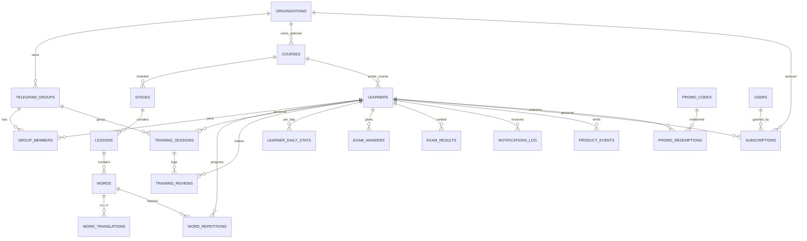
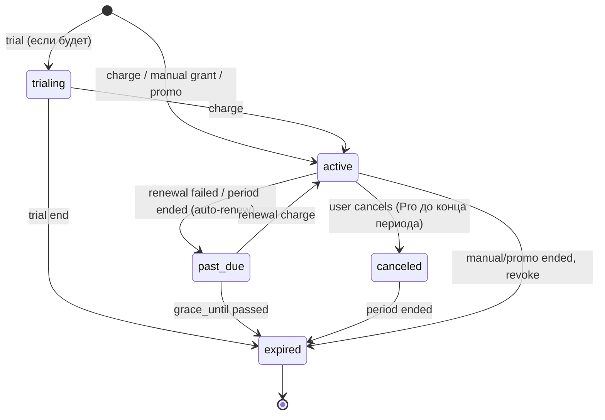
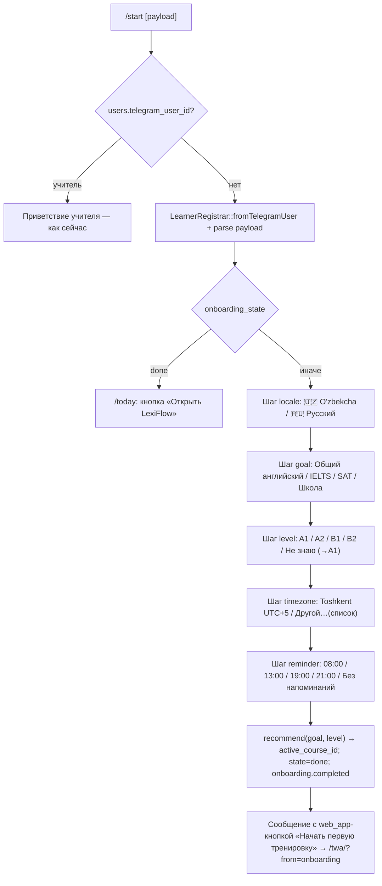

# 12. Фаза 1 — проектирование публичного B2C MVP (learner-first)

> Статус: проект, ред. 2 — 2026-10-18 (ред. 1 — тот же день). Автор: architect (задача 1.0, Sprint 14). Ред. 2 учитывает ответы владельца на вопросы §10: прода с данными нет → §2 переписан без переноса данных, задачи 1.1a–1.1d слиты в 1.1a/1.1b.
> База: ветка `claude/magical-pascal-qz05gz` после приёмки Фазы 0 (Pest 409, Larastan 8, CI на PostgreSQL 16, локально sqlite).
> Этот документ **уточняет и в части Фазы 1 заменяет** [11_SYSTEM_ANALYSIS_AND_SAAS_STRATEGY.md](./11_SYSTEM_ANALYSIS_AND_SAAS_STRATEGY.md) §5–§6, §10. Там — стратегия; здесь — схема, контракты сервисов, план миграции и нарезка на задачи. Где docs/11 расходится с кодом или с решениями владельца — сказано прямо (§13).

**Решения владельца, зафиксированные в проекте:** B2C-first; платные тарифы для всех; ученик центра получает полный Pro; языки интерфейса и переводов — uz (латиница) и ru; изучаемый язык — только английский; **оплата (Telegram Stars, Payme/Click) в Фазе 1 не реализуется** — Pro выдаётся вручную суперадмином (с аудитом) и промокодом; **Free-лимит — 20 новых слов в день**, повторения не ограничиваются никогда.

---

## 0. Резюме решений

| Вопрос | Решение | Почему |
|---|---|---|
| Центральный объект | Новая таблица `learners` (один на `telegram_user_id`); `students` заменяется таблицей членств `group_members` | Прогресс и подписка принадлежат человеку, а не паре (человек, группа) |
| `students`: расширять или заменять | **Заменить**: `students` удаляется, во всех зависимых таблицах `student_id` → `learner_id` | Прогресс принадлежит человеку; «добавить `learner_id` в `students`» оставляет `word_repetitions` привязанными к группе |
| Личное обучение | **Обобщить `training_sessions`** (`mode`, `learner_id`), а не заводить отдельную `learner_sessions` | `training_reviews`, `TrainingFlowService`, `ReviewSubmissionService`, маршрут TWA `/training/:id` переиспользуются без дублирования |
| Контент | `courses` → `stages` (модули курса) → `lessons` → `words` + `word_translations (uz/ru)`; демо-контент и импорт без указания курса → платформенный курс `default` | Сохраняем команды учителя `/start_training <stage> <lesson>` и импортёр; переводы отделены от слова |
| Организации | В Фазе 1 — **минимальная `organizations`** + `telegram_groups.organization_id`; спонсорство = подписка организации; места/инвайты/кабинет — Фаза 2 | Нужен субъект подписки для центра-клиента уже сейчас; UI центра без оплаты не окупается |
| Entitlement | `EntitlementResolver`: `max(личная подписка, подписка организации любой активной группы learner'а)`; кэш Redis 5 мин с инвалидацией | Один код для личного и спонсорского Pro |
| Оплата | Схема `subscriptions` + `promo_codes` сейчас; `payments` и `BillingProvider` — контракт описан, реализация вынесена за Фазу 1 | Решение владельца; схема не потребует переделки при подключении провайдера |
| JWT | `{iss, sub: learner_id, v: 2, iat, exp}` без `gid`; токены без `v=2` → 401 `invalid_token` | Смысл `sub` меняется (`students.id` → `learners.id`); токен любой старой сборки (демо-стенд, локально) должен отклоняться, а не читаться как чужой learner; клиент перелогинивается на 401 |
| Напоминания | `learners.next_reminder_at` (UTC), пересчитывается после отправки; планировщик каждые 15 мин выбирает `next_reminder_at <= now()` | Переносимо (sqlite/PG), корректно при DST, индексируемо |
| День / streak | Локальная дата learner'а (`timezone`), агрегаты в `learner_daily_stats` | «Сегодня» за O(1), streak без сканирования `training_reviews` |
| Схема в коде | Create-миграции правятся **на месте** (+ новые create-файлы, `create_students_table` удаляется), все среды — `migrate:fresh --seed` | Прода с данными нет (решение владельца); переносить нечего, forward-миграции drop/create были бы одноразовым кодом с `down()` для мёртвой таблицы (§2.2) |

---

## 1. Модель данных

### 1.1 ERD (целевое состояние после Фазы 1)



Таблицы `users`, `teacher_groups`, `exam_sessions`, `audit_logs` остаются как в docs/03; `students` **удаляется** (§2).

### 1.2 `learners` — профиль ученика (один на Telegram-пользователя)

| Колонка | Тип | Описание |
|---|---|---|
| id | bigint PK | |
| telegram_user_id | bigint NOT NULL **unique** | |
| first_name, last_name | varchar(100) nullable | из Telegram, обновляются при каждом `/auth` и сообщении |
| username | varchar(100) nullable | |
| language_code | varchar(10) nullable | сырой код Telegram (только для аналитики/дефолта) |
| interface_locale | varchar(5) NOT NULL default `'ru'` | `ru` / `uz` — выбран в онбординге; единственный источник языка для бота и TWA |
| timezone | varchar(64) NOT NULL default `'Asia/Tashkent'` | IANA; дефолт — `config('learners.default_timezone')` |
| goal | varchar(20) nullable | `general` / `ielts` / `sat` / `school` |
| level | varchar(2) nullable | `A1`..`C2` (самооценка в онбординге) |
| active_course_id | bigint nullable FK → courses `nullOnDelete` | курс, из которого берутся новые слова на экране «Сегодня» |
| daily_goal | smallint NOT NULL default 20 | карточек (оценок) в день; варианты 10/20/40 |
| reminder_time | time nullable default `'19:00'` | локальное время напоминания; `NULL` = выключено |
| next_reminder_at | timestamp nullable | ближайшее напоминание в UTC (см. §7.5) |
| dm_blocked_at | timestamp nullable | Telegram ответил 403 на ЛС; сбрасывается любым входящим сообщением learner'а |
| onboarding_state | varchar(16) NOT NULL default `'new'` | `new` → `locale` → `goal` → `level` → `timezone` → `reminder` → `done` |
| onboarding_completed_at | timestamp nullable | |
| acquisition_source | varchar(64) nullable | из `start`-параметра: `ref`, `org`, `src:<channel>`, `course:<slug>`; `group` для пришедших через группу |
| start_payload | varchar(64) nullable | сырой payload `/start` (Telegram ограничивает 64 символами `[A-Za-z0-9_-]`) |
| referrer_learner_id | bigint nullable FK → learners `nullOnDelete` | только фиксируем; награды — Фаза 2 |
| streak_current, streak_best | smallint NOT NULL default 0 | |
| streak_last_date | date nullable | локальная дата, когда дневная цель выполнялась последний раз |
| last_seen_at | timestamp nullable | |
| blocked_at | timestamp nullable | бан платформой (суперадмин); `TwaAuth` отвечает 401 `learner_blocked` |
| deleted_at | timestamp nullable | `SoftDeletes` — удаление аккаунта по запросу (анонимизация — Фаза 2, схема готова) |
| meta | jsonb default `'{}'` | |
| created_at, updated_at | | |

**Индексы:** `telegram_user_id` unique; `next_reminder_at` partial `WHERE next_reminder_at IS NOT NULL AND dm_blocked_at IS NULL` (PG; на sqlite — обычный индекс); `onboarding_state`; `last_seen_at`; `active_course_id`; `referrer_learner_id`.

### 1.3 `group_members` — членство learner'а в Telegram-группе (замена `students`)

| Колонка | Тип | Описание |
|---|---|---|
| id | bigint PK | |
| telegram_group_id | bigint FK → telegram_groups `cascadeOnDelete` | |
| learner_id | bigint FK → learners `cascadeOnDelete` | |
| status | varchar(12) NOT NULL default `'active'` | `active` / `left` (сам вышел, `chat_member`) / `removed` (учитель/админ) / `banned` |
| joined_at | timestamp NOT NULL | |
| left_at | timestamp nullable | |
| created_at, updated_at | | |

**Индексы:** `(telegram_group_id, learner_id)` unique; `(learner_id, status)`; `(telegram_group_id, status)`.

Правила: «активное членство» = `status = 'active'` **и** `telegram_groups.status = 'active'`. Деактивация студента админом (бывшее `students.is_active = false`) → `status = 'removed'`. Учитель видит learner'а только через активное членство (§4.4).

### 1.4 `training_sessions` — обобщение под личные сессии

Изменения существующей таблицы (все — nullable/с default, старые строки валидны):

| Колонка | Изменение |
|---|---|
| telegram_group_id | → **nullable** (личная сессия без группы) |
| started_by_user_id | → **nullable** |
| lesson_id | → **nullable** (`daily_review` охватывает все уроки) |
| learner_id | **новая**, bigint nullable FK → learners `cascadeOnDelete` — владелец личной сессии |
| mode | **новая**, varchar(16) NOT NULL default `'group_lesson'`: `group_lesson` (как сейчас) / `lesson` (личная тренировка урока) / `daily_review` (экран «Сегодня») |
| source | **новая**, varchar(16) NOT NULL default `'command'`: `command` / `picker` / `self` / `reminder` / `onboarding` |
| course_id | **новая**, bigint nullable FK → courses `nullOnDelete` — для `daily_review`: откуда брать новые слова |
| expires_at | **новая**, timestamp nullable — личные сессии закрываются планировщиком через `config('learning.session_ttl_hours')` (12 ч) |
| done_reason | **новая** (1.3a), varchar(16) nullable — `finished` (learner завершил) / `expired` (планировщик или замена просроченной при повторном `openPersonal`); `NULL` пока открыта |

**Ограничения:**
- существующий partial unique `(telegram_group_id, lesson_id) WHERE status='open'` остаётся (NULL не конфликтуют ни в PG, ни в sqlite);
- новый partial unique `training_sessions_one_open_daily_per_learner` `(learner_id) WHERE status='open' AND mode='daily_review'`;
- новый partial unique `training_sessions_one_open_lesson_per_learner` `(learner_id, lesson_id) WHERE status='open' AND mode='lesson'`;
- PG-only CHECK `training_sessions_mode_shape_check`: `(mode='group_lesson' AND telegram_group_id IS NOT NULL AND lesson_id IS NOT NULL) OR (mode<>'group_lesson' AND learner_id IS NOT NULL)` (как в `2026_07_13_000002` — пропуск на других драйверах, инвариант дублируется в `TrainingSessionService`);
- индекс `(learner_id, status, started_at)`; `(status, expires_at)` для закрытия просроченных.

### 1.5 Зависимые таблицы: `student_id` → `learner_id`

Во всех таблицах `student_id` **заменяется** на `learner_id` (FK → learners) правкой create-миграций на месте (§2.3); колонки `student_id` в целевой схеме нет.

| Таблица | learner_id | onDelete | Уникальности / индексы |
|---|---|---|---|
| word_repetitions | NOT NULL | cascade | unique `(learner_id, word_id)`; `(learner_id, next_review_at)`; `(learner_id, is_hard, next_review_at)`; `(next_review_at, learner_id)`; partial `(learner_id) WHERE is_hard`; **новый** `(learner_id, created_at)` — квота новых слов (§5.3) |
| training_reviews | NOT NULL | cascade | `(learner_id, created_at)`; `(created_at, learner_id)`; `(training_session_id, learner_id)` |
| exam_answers | nullable | setNull | unique `(exam_session_id, learner_id, word_id)`; `(exam_session_id, learner_id)`; `(learner_id, answered_at)`; `(answered_at, learner_id)` |
| exam_results | nullable | setNull | unique `(exam_session_id, learner_id)` |
| exam_question_attempts | NOT NULL | cascade | unique `(exam_session_id, learner_id, question_index)` |
| notifications_log | NOT NULL | cascade | `(learner_id, type, sent_at)` |
| product_events | nullable | setNull | `(learner_id, occurred_at)` |

Смысл уникальностей: `word_repetitions (learner_id, word_id)` — один прогресс по слову на человека независимо от числа групп; `exam_*` остаются в рамках сессии (экзамен принадлежит одной группе), поэтому один learner в двух группах участвует в экзаменах каждой из них независимо.

### 1.6 `learner_daily_stats` — агрегат за локальный день

| Колонка | Тип | Описание |
|---|---|---|
| id | bigint PK | |
| learner_id | FK → learners cascade | |
| date | date NOT NULL | **локальная** дата learner'а на момент оценки |
| reviews_count | int default 0 | все принятые оценки (включая минутные шаги) |
| new_words_count | int default 0 | карточек **впервые оценено** за день (строка `word_repetitions` была в `state = new` до этой оценки) — аналитика «новых слов в день» |
| correct_count | int default 0 | `quality >= 3` |
| time_spent_ms | bigint default 0 | |
| goal_met_at | timestamp nullable | момент, когда `reviews_count` впервые достиг `daily_goal`; ставится один раз под блокировкой строки |
| created_at, updated_at | | |

Unique `(learner_id, date)`. Обновляется в той же транзакции, что и `training_reviews` (§3.3). Это замена `usage_counters` из docs/11 — хранить счётчики по дням проще и полезнее для аналитики.

> **Уточнение 1.3b (2026-10-19, architect).** Квота Free (§5.3) считается **не** по `new_words_count`, а по выдаче — `word_repetitions.created_at` в границах локального дня (`LearnerClock::dayBoundsUtc`), под блокировкой строки `learners` в транзакции пикера. Причина: выдача происходит раньше первой оценки и в другой транзакции (пикер держит `learners`, оценка — `training_sessions → word_repetitions → learner_daily_stats`); писать `learner_daily_stats` из пикера значило бы связать два порядка блокировок. `new_words_count` остаётся аналитическим счётчиком «впервые оценено» и может быть меньше числа выданных за день карточек (выдана, но не отвечена).

### 1.7 Контент: `courses`, `stages`, `lessons`, `words`, `word_translations`

**`courses`**

| Колонка | Тип | Описание |
|---|---|---|
| id | bigint PK | |
| slug | varchar(64) unique | `default` (платформенный курс для демо-контента и импорта без `course`), `english-a1`, `ielts-academic` |
| owner_type | varchar(16) NOT NULL default `'platform'` | `platform` / `organization` (Фаза 2: `learner`) |
| owner_id | bigint nullable | `organizations.id` при `owner_type='organization'`; FK не ставим (полиморфный), целостность — в `CourseService` |
| title | jsonb NOT NULL | `{"ru": "...", "uz": "..."}` — обязательны оба ключа (валидация в сервисе) |
| description | jsonb default `'{}'` | по локалям |
| target_language | varchar(5) NOT NULL default `'en'` | параметр «на вырост», в Фазе 1 всегда `en` |
| level | varchar(2) nullable | `A1`..`C2` |
| exam_tag | varchar(16) nullable | `ielts` / `sat` / `school` / `general` |
| visibility | varchar(10) NOT NULL default `'public'` | `public` / `unlisted` (по ссылке/группе) / `private` (только владелец) |
| status | varchar(10) NOT NULL default `'draft'` | `draft` → `review` → `published` (→ `archived`) |
| published_at | timestamp nullable | |
| position | int default 0 | порядок в каталоге |
| is_featured | boolean default false | |
| words_count | int default 0 | денормализация, пересчёт в `CourseService::recount()` после импорта |
| meta | jsonb default `'{}'` | |
| created_at, updated_at | | |

Индексы: `slug` unique; `(status, visibility, position)`; `(owner_type, owner_id)`.

**`stages`** (модули курса): + `course_id` bigint NOT NULL FK → courses `cascadeOnDelete`; unique `number` **заменяется** на unique `(course_id, number)`. В UI называем «Модуль»; команды учителя `/start_training <stage> <lesson>` резолвят номер в курсе группы (`telegram_groups.course_id`, иначе курс `default`; slug — `config('content.default_course_slug')`).

**`lessons`**: без изменений схемы (`stage_id`, `number`, `title`). Порядок внутри курса — `(stage.number, lesson.number)`.

**`words`**: + `audio_path` varchar(255) nullable (предгенерированный mp3, относительный путь в `storage/app/public/audio`), + `is_active` boolean default true (docs/03 §8 правило 1 — слова не удаляем). `translation` остаётся **ru-переводом по умолчанию** (NOT NULL, как сейчас — его читают импортёр v1, экзамен и демо-сидер); `VocabularyImporter` v2 пишет ru и в `translation`, и в `word_translations`; чтение переводов в коде — только через `WordTranslationResolver` (`word_translations[locale]` → `ru` → `words.translation`).

**`word_translations`**

| Колонка | Тип |
|---|---|
| id | bigint PK |
| word_id | FK → words cascade |
| locale | varchar(5) NOT NULL (`ru` / `uz`; значения — `config('localization.supported')`) |
| translation | varchar(500) NOT NULL |
| example_translation | text nullable |
| source | varchar(16) default `'import'` (`import` / `manual` / `ai`) |
| reviewed_at | timestamp nullable — проверено носителем |
| created_at, updated_at | |

Unique `(word_id, locale)`. Экзаменационные дистракторы строятся на переводах локали **группы** (`LocaleResolver::forGroup`) с fallback на `ru`; личных экзаменов в Фазе 1 нет.

**`telegram_groups`**: + `organization_id` bigint nullable FK → organizations `nullOnDelete`; + `course_id` bigint nullable FK → courses `nullOnDelete` (курс для команд учителя; `NULL` = курс `default`).

### 1.8 Организации (минимум Фазы 1)

**`organizations`**

| Колонка | Тип |
|---|---|
| id | bigint PK |
| name | varchar(150) |
| slug | varchar(64) unique |
| type | varchar(16) default `'center'` (`center` / `tutor`) |
| status | varchar(16) default `'active'` (`active` / `suspended`) |
| timezone | varchar(64) default `'Asia/Tashkent'` |
| locale | varchar(5) default `'ru'` |
| settings | jsonb default `'{}'` |
| created_at, updated_at | |

В Фазе 1 организацию создаёт только суперадмин в Filament и привязывает к ней группы. Членство learner'а в организации **выводится** из активного членства в её группах — отдельной `organization_members` нет. Обоснование: без оплаты и кабинета центра явные участники, места, инвайт-коды и `organization_users` (owner/admin) не нужны; но субъект «организация» необходим уже сейчас, чтобы существующий центр-клиент получил спонсорский Pro через тот же `subscriptions`, что и физлица. Фаза 2 добавит `organization_members` (status, joined_at, invited_via), `organization_users`, `seats_limit`, инвайт-коды и deep-link `start=org_<code>` — без изменения уже созданных таблиц.

### 1.9 Тарифы: `subscriptions`, `promo_codes`, `promo_redemptions`

**`subscriptions`**

| Колонка | Тип | Описание |
|---|---|---|
| id | bigint PK | |
| subscriber_type | varchar(16) NOT NULL | `learner` / `organization` |
| subscriber_id | bigint NOT NULL | без FK (полиморфный); целостность — `SubscriptionService` |
| plan | varchar(16) NOT NULL | `pro` (ключ из `config('billing.plans')`); для организаций — тоже `pro` (спонсорский) |
| status | varchar(12) NOT NULL | `trialing` / `active` / `past_due` / `canceled` / `expired` |
| provider | varchar(16) NOT NULL | `manual` / `promo` / `telegram_stars` / `payme` / `click` |
| provider_ref | varchar(191) nullable | id подписки/договора у провайдера |
| starts_at | timestamp NOT NULL | |
| current_period_ends_at | timestamp nullable | `NULL` = бессрочно (только `manual`) |
| grace_until | timestamp nullable | конец grace-периода при `past_due` |
| canceled_at, ended_at | timestamp nullable | |
| seats_limit | int nullable | для организаций (Фаза 2 — проверка мест) |
| granted_by_user_id | bigint nullable FK → users `nullOnDelete` | кто выдал вручную |
| note | varchar(255) nullable | причина ручной выдачи |
| meta | jsonb default `'{}'` | |
| created_at, updated_at | | |

Индексы: `(subscriber_type, subscriber_id, status)`; `(status, current_period_ends_at)`; `(status, grace_until)`; partial unique `subscriptions_one_live_per_subscriber` `(subscriber_type, subscriber_id) WHERE status IN ('trialing','active','past_due')` — не больше одной «живой» подписки у субъекта (PG/sqlite; на других драйверах — проверка в сервисе под `lockForUpdate`).

**`promo_codes`**: id, `code` varchar(32) unique (нормализуется в upper-case, генерируется `Str::upper(Str::random(10))`), `plan` varchar(16), `duration_days` smallint, `max_redemptions` int nullable, `redemptions_count` int default 0, `expires_at` nullable, `is_active` bool default true, `created_by_user_id` FK users nullOnDelete, `note`, timestamps.
**`promo_redemptions`**: id, `promo_code_id` FK cascade, `learner_id` FK cascade, `subscription_id` FK → subscriptions nullOnDelete, `redeemed_at`; unique `(promo_code_id, learner_id)`.

**`payments`** — **не создаётся в Фазе 1** (нечему писать). Целевая форма для задачи «Оплата» (вне Фазы 1): id, `subscription_id` FK nullable, `subscriber_type/id`, `provider`, `provider_event_id` varchar(191) **unique вместе с provider** `(provider, provider_event_id)`, `kind` (`charge` / `refund` / `renewal`), `amount` bigint (минорные единицы / Stars), `currency` varchar(8) (`XTR`, `UZS`), `status` (`succeeded` / `refunded` / `failed`), `raw` jsonb, `occurred_at`. См. §6.

### 1.10 Прочее

- `product_events`: `student_id` → `learner_id` (§1.5); новые имена событий — §7.7.
- `audit_logs`: действия `subscription.granted` (meta: subscriber_type/id, plan, until, note, extended), `subscription.revoked` (meta: subscriber_type/id, plan, note), `promo.created`, `promo.updated` (meta: `code`, `changes` — `{поле: {from, to}}` по `max_redemptions`/`duration_days`/`expires_at`/`is_active`/`note`), `learner.blocked`, `course.published`, `organization.linked_group` / `organization.unlinked_group`, `organization.status_changed` (meta: `name`, `from`, `to`); `entity_type = App\Models\Subscription`, `ip` — передаёт обвязка.
- `notifications_log.type`: `review_reminder`, `streak_reminder`, `onboarding_nudge`.

---

## 2. Переход схемы `students` → `learners` (без переноса данных)

### 2.1 Исходные условия

Решение владельца (2026-10-18): **продакшена с реальными данными нет** — только тестовые/демо-стенды, данные которых пересоздаются `migrate:fresh --seed`. Следствия:

- переносить `students` нечего — `StudentsToLearnersMigrator`, слияние `word_repetitions`, архив `word_repetitions_merge_archive`, `group_members.legacy_student_id`, окно обслуживания, dual-write и двухрелизный переход (A/B) **из проекта удалены**; coder их не делает;
- остаётся один вопрос — как получить целевую схему §1 в коде миграций так, чтобы `down()` работал (CLAUDE.md), тесты шли и на sqlite (локально), и на PostgreSQL (CI), а FK и порядок таблиц были корректны.

### 2.2 Выбор пути

| Вариант | Плюсы | Минусы | Решение |
|---|---|---|---|
| (a) Forward-миграции поверх текущих: `drop students`, `create learners/group_members`, замена `student_id` → `learner_id` в 7 таблицах, `down()` возвращает всё обратно | тем, у кого ветка накатана локально, достаточно `migrate` | ~9 файлов одноразового кода: `down()` воссоздаёт `students`, которой не пользуется ни одна строка кода, но обязан работать и быть покрыт тестом; на sqlite замена FK-колонки — пересборка таблицы (Laravel 12 делает её сам, но raw partial-индекс `word_repetitions_student_is_hard_idx` и уникальности `(…, student_id, …)` надо снимать руками до `dropColumn`, и ту же цепочку повторять в `down()`); история миграций навсегда несёт мёртвую `students`; FK, добавленные через `Schema::table`, на sqlite не применяются без пересборки — локальные тесты каскадов расходятся с CI | отклонён |
| **(b) Правка исходных create-миграций на месте + новые create-файлы + `migrate:fresh`** | итоговая схема читается «с нуля», одна таблица — одна миграция со своими FK (на sqlite FK гарантированно есть, т.к. задаются при `create`); `down()` — симметричные `dropIfExists`/`dropIndex`, как сейчас; нет кода, который никогда не выполнится в проде; минимум файлов | все локальные БД пересоздаются `migrate:fresh --seed` | **принят** |

Почему (b) корректен: проект ещё не выкатывался, миграции — часть кода, а не истории прода; прецедент уже есть (PROGRESS.md, Sprint 13: миграции `2026_10_18_*` правились на месте). Правило на будущее фиксируем в DEVOPS_GUIDE: **до первого прод-релиза история миграций может правиться на месте; с первого прод-релиза — только forward-миграции.**

### 2.3 План правок миграций (`database/migrations/`)

Порядок файлов определяет порядок создания таблиц, поэтому таблицы-цели FK получают более ранние метки времени. Переименований нет: только новые файлы, правки на месте и одно удаление.

| Файл | Действие | Задача | Содержимое |
|---|---|---|---|
| `2026_04_23_095900_create_organizations_table` | новый | 1.1a | §1.8 |
| `2026_04_23_095901_create_courses_table` | новый | 1.1a | §1.7 `courses` (FK наружу нет: `owner_id` полиморфный) |
| `2026_04_23_095902_create_learners_table` | новый | 1.1a | §1.2, включая FK `active_course_id → courses nullOnDelete`, `referrer_learner_id → learners nullOnDelete` (self); partial-индекс `next_reminder_at` — только `pgsql` (guard драйвера как в `2026_07_13_000002`), на sqlite обычный |
| `2026_04_23_100000_create_telegram_groups_table` | правка | 1.1a | + `organization_id`, `course_id` (nullable FK, `nullOnDelete`) |
| `2026_04_23_100002_create_students_table` | **удалить** | 1.1b | — |
| `2026_04_23_100003_create_stages_table` | правка | 1.1a | + `course_id` NOT NULL FK → courses `cascadeOnDelete`; unique `(course_id, number)` **вместо** unique `number` |
| `2026_04_23_100005_create_words_table` | правка | 1.1a | + `audio_path`, `is_active` |
| `2026_04_23_100006_create_word_repetitions_table` | правка | 1.1b | `student_id` → `learner_id` (FK learners cascade); unique `(learner_id, word_id)`; индексы §1.5; partial `word_repetitions_learner_is_hard_idx` |
| `2026_04_23_100007_create_training_sessions_table` | правка | 1.1b | §1.4: `telegram_group_id`/`lesson_id`/`started_by_user_id` nullable; + `learner_id`, `mode`, `source`, `course_id`, `expires_at`; индексы `(learner_id, status, started_at)`, `(status, expires_at)` |
| `2026_04_23_100008_create_training_reviews_table` | правка | 1.1b | `learner_id` NOT NULL cascade; индекс `(learner_id, created_at)` |
| `2026_04_23_100010_create_exam_answers_table` | правка | 1.1b | `learner_id` nullable setNull; индексы §1.5 |
| `2026_04_23_100011_create_exam_results_table` | правка | 1.1b | `learner_id` nullable setNull |
| `2026_04_23_100012_create_notifications_log_table` | правка | 1.1b | `learner_id` NOT NULL cascade; индекс `(learner_id, type, sent_at)` |
| `2026_04_23_100014_create_group_members_table` | новый | 1.1a | §1.3 (после `telegram_groups` и `learners`) |
| `2026_04_23_100015_create_word_translations_table` | новый | 1.1a | §1.7 |
| `2026_04_23_100016_create_learner_daily_stats_table` | новый | 1.1a | §1.6 |
| `2026_04_23_100017_create_subscriptions_table` | новый | 1.1a | §1.9; partial unique `subscriptions_one_live_per_subscriber` — `pgsql`/`sqlite` с guard драйвера |
| `2026_04_23_100018_create_promo_codes_table`, `2026_04_23_100019_create_promo_redemptions_table` | новые | 1.1a | §1.9 |
| `2026_05_03_000001_add_performance_indexes` | правка | 1.1b | колонки и имена индексов `student` → `learner` (`word_repetitions_learner_hard_due_idx`, `word_repetitions_due_learners_idx`, `training_reviews_created_learner_idx`, `training_reviews_session_learner_idx`, `exam_answers_session_learner_word_unique`, `exam_answers_answered_learner_idx`, `exam_results_session_learner_unique`) |
| `2026_07_13_000001_create_exam_question_attempts_table` | правка | 1.1b | `learner_id` NOT NULL cascade; unique `(exam_session_id, learner_id, question_index)` |
| `2026_07_13_000002_add_open_session_unique_indexes` | правка | 1.1b | + `training_sessions_one_open_daily_per_learner`, `training_sessions_one_open_lesson_per_learner` (§1.4); PG-only CHECK `training_sessions_mode_shape_check`; `down()` симметричен |
| `2026_10_18_000001_create_product_events_table` | правка | 1.1b | `learner_id` nullable setNull; индекс `(learner_id, occurred_at)` |
| `2026_10_18_000002_add_learning_state_to_word_repetitions` | без изменений | — | backfill на пустой таблице — no-op; тест `down()`/`up()` в `TwaTrainingTest` остаётся |

Файлы `0001_01_01_*`, `teacher_groups`, `lessons`, `exam_sessions`, `audit_logs`, `permission_tables`, `two_factor`, `leaderboard_posted_at` не трогаем.

Правила для всех правок:
- `down()` обязателен и симметричен (`dropIfExists` для create; `dropIndex`/`DROP INDEX IF EXISTS` для индексных миграций);
- partial-индексы и CHECK — через `DB::statement` с guard `in_array(DB::getDriverName(), ['pgsql', 'sqlite'])` (CHECK — только `pgsql`), как в `2026_07_13_000002`; инварианты дублируются в сервисах;
- никаких `DB::raw` с интерполяцией; литералы статусов — в тексте `CREATE INDEX … WHERE status = 'open'` (как сейчас).

### 2.4 Демо-данные (сидеры)

- `DemoContentSeeder`: создаёт платформенный курс `default` (`owner_type = platform`, `status = published`, `visibility = public`, `title = {ru: "Базовый курс", uz: "Asosiy kurs"}`), все демо-`stages` — в нём; ru-переводы слов дублируются в `word_translations (locale = 'ru', source = 'import')`.
- `DemoGroupSeeder`: `telegram_groups.course_id = default`.
- `DemoLearnersSeeder` (заменяет `DemoStudentsSeeder`, задача 1.1b): 5 learners с `onboarding_state = 'done'`, членства в демо-группе; один learner состоит в двух группах (вторая группа создаётся здесь) — на нём виден принцип «один человек — один прогресс».
- `DemoRepetitionsSeeder`, `DemoActivitySeeder`: `student_id` → `learner_id`.
- `DatabaseSchemaTest` «`migrate:fresh --seed`»: ожидание `students = 5` → `learners = 5`, `group_members = 6`, `courses = 1`.

### 2.5 Локальные среды, CI, демо-стенд

После приёмки 1.1a и 1.1b каждый разработчик выполняет `php artisan migrate:fresh --seed`; «накатить поверх» нельзя — `migrate:status` покажет расхождение (в `migrations` есть `create_students_table`, которой нет на диске). CI создаёт БД с нуля — изменений не требует. Демо-стенд пересоздаётся тем же `migrate:fresh --seed` (данные не нужны). Правило «до первого прод-релиза — правки на месте, после — только forward» фиксируется в DEVOPS_GUIDE (§12).

### 2.6 Smoke после 1.1b (демо-стенд)

`migrate:fresh --seed`; `POST /api/twa/auth` без `context` → 200 с `learner.id` (повторный вызов — тот же `learner.id`); токен старого формата (без `v`) → 401 `invalid_token`; `/start` в ЛС нового пользователя → learner создан; в группе `/start_training 1 1` → ссылка → тренировка работает; Filament: Learners (учитель видит только участников своих групп), Courses; напоминание уходит learner'у, состоящему в двух группах, **один раз**.

---

## 3. Границы доменов и контракты сервисов

Модели остаются в `app/Models` (конвенция проекта). Удаляются `Student`, `StudentPolicy`, `StudentContextResolver`, `StudentStatsService`, `StudentFactory`, `DemoStudentsSeeder` (замены ниже). Домен `Content` **не переименовываем** в `Catalog` — лишний churn; курсы добавляются в него.

### 3.1 `app/Domain/Learners` (новый)

```php
final class LearnerRegistrar
{
    /** Собственное действие человека (/auth, /start в ЛС): upsert по telegram_user_id; обновляет только присутствующие в payload поля имени/username/language_code, last_seen_at; восстанавливает soft-deleted; НЕ трогает interface_locale после онбординга (и при отсутствии language_code). */
    public function fromTelegramUser(array $tgUser, ?string $source = null, ?string $startPayload = null): Learner;

    /** Пассивное событие группы (new_chat_members, chat_member): то же, но без last_seen_at; soft-deleted не восстанавливает и возвращает null. */
    public function observeTelegramUser(array $tgUser, ?string $source = null): ?Learner;
}

final class OnboardingService
{
    public function start(Learner $l, ?string $startPayload): OnboardingStep;      // парсит payload (§7.2), ставит state=locale
    public function apply(Learner $l, string $step, string $value): OnboardingStep; // валидирует значение шага, сохраняет, возвращает следующий шаг
}
final readonly class OnboardingStep { public string $state; public string $messageKey; public array $options; } // options → inline-кнопки

final class LearnerSettingsService
{
    public function update(Learner $l, LearnerSettings $dto): Learner; // locale, timezone, reminder_time, daily_goal, active_course_id; пересчитывает next_reminder_at; инвалидирует кэш
}

final class LearnerClock
{
    public function today(Learner $l, ?CarbonImmutable $now = null): CarbonImmutable;        // локальная дата (00:00 в tz learner'а)
    public function dayBoundsUtc(Learner $l, ?CarbonImmutable $now = null): array;            // [startUtc, endUtc] текущего локального дня
    public function nextOccurrenceUtc(Learner $l, string $localTime, CarbonImmutable $after): CarbonImmutable;
}

final class DailyStatsService
{
    /** В транзакции review: upsert строки (learner_id, localDate) + инкременты; возвращает актуальную строку. */
    public function recordReview(Learner $l, int $quality, int $timeSpentMs, bool $isNewCard, CarbonImmutable $now): LearnerDailyStats;
    public function today(Learner $l): ?LearnerDailyStats;
}

final class StreakService
{
    /** Вызывается DailyStatsService, когда reviews_count впервые >= daily_goal за день. Правила §7.4. */
    public function onGoalMet(Learner $l, CarbonImmutable $localDate): void;
    public function current(Learner $l, CarbonImmutable $today): StreakState; // {current, best, atRisk, metToday}; current=0 если streak_last_date < yesterday
}

final class GroupMembershipService
{
    public function join(Learner $l, TelegramGroup $g, string $via): GroupMember;     // active (idempotent)
    public function leave(Learner $l, TelegramGroup $g, string $status = 'left'): void;
    public function isActiveMember(Learner $l, TelegramGroup $g): bool;              // status=active AND group active
    public function activeGroupIds(Learner $l): array;
}
```

> **Реализация 1.3b, часть A (2026-10-19, architect).** Уточнения к контракту выше (`LearnerClock`, `DailyStatsService`, `StreakService`):
> - `LearnerClock` (`app/Domain/Learners/Services/LearnerClock.php`) — единственное место пересчёта UTC ↔ локальный календарь learner'а. `timezone(Learner): DateTimeZone` (невалидный/пустой `learners.timezone` → `config('learners.default_timezone')` → UTC, без исключений); `today(Learner, ?now): CarbonImmutable` — локальная полночь в зоне learner'а; `localDate(Learner, ?now): string` — `Y-m-d`, ключ `learner_daily_stats`; `dayBoundsUtc(Learner, ?now): DayBounds` и `localDateBoundsUtc(Learner, 'Y-m-d'): DayBounds` — вместо `array` возвращают VO `App\Domain\Learners\DTO\DayBounds {date, timezone, startUtc, endUtc}` — полуинтервал `[startUtc, endUtc)`, границы — локальные полуночи, поэтому день DST-перехода длится 23 или 25 часов; `nextOccurrenceUtc(Learner, 'HH:MM[:SS]', after): CarbonImmutable` — первый момент **строго после** `after`, когда стенные часы learner'а показывают заданное время (несуществующее время в «дыре» перевода сдвигается вперёд, как в PHP). `after == момент напоминания` → завтра: диспетчер 1.5b выбирает `next_reminder_at <= now`, и тот же момент уже отправлен.
> - `DailyStatsService::recordReview(...): LearnerDailyStats` (внутри транзакции оценки): `INSERT ... ON CONFLICT DO NOTHING` строки `(learner_id, localDate)` → `SELECT ... FOR UPDATE` этой строки → перезапись счётчиков из заблокированных значений (без raw-выражений) → `goal_met_at = now` только если он `NULL` и `reviews_count >= max(1, daily_goal)` → в этом случае `StreakService::onGoalMet`. Порядок блокировок транзакции оценки: `training_sessions → word_repetitions → learner_daily_stats`; `learners` не трогается. Также `today(Learner, ?now)` и `forDate(Learner, 'Y-m-d')`. Значение `date` пишется и сравнивается в формате даты модели (как Eloquent-cast `date`), иначе на sqlite unique-индекс не видел бы дубликатов с фабричными строками.
> - `StreakService`: источник истины — `learner_daily_stats.goal_met_at`, а `learners.streak_*` — проекция. `onGoalMet(Learner, localDate)` лишь регистрирует `DB::afterCommit` → `apply(Learner, 'Y-m-d'): bool` — одиночный оптимистичный `UPDATE learners ... WHERE id = ? AND streak_last_date = <прочитанное>` (без `FOR UPDATE`, до 3 попыток), поэтому строка `learners` никогда не блокируется внутри транзакции оценки (пикер держит её в своей транзакции — иначе возможен цикл). Откат оценки → колбэк не выполняется. `current(Learner, today, ?todayStats): StreakState {current, best, metToday, atRisk}` — ленивое обнуление по §7.4; если передана строка «сегодня» с `goal_met_at`, а проекция отстала (процесс умер между commit и колбэком) — `apply(today)` чинит её на чтении. `apply` также обновляет атрибуты переданной модели (`syncOriginalAttributes`), чтобы текущий запрос видел результат без перезагрузки.
> - События: `daily_goal.met {streak, date}` — при каждом зачёте дня; `streak.extended {current, best}` — только когда серия продолжилась (`streak_last_date = d − 1`). Пишутся из колбэка после commit через `ProductEventRecorder` (никогда не бросает).
> - Квота Free для 1.4b: `NewCardBudget::lazy(fn (int $learnerId, CarbonImmutable $now) => limit − WordRepetition::where('learner_id', $learnerId)->where('created_at', '>=', $b->startUtc)->where('created_at', '<', $b->endUtc)->count())`, где `$b = LearnerClock::dayBoundsUtc($learner, $now)`; замыкание выполняется пикером под `FOR UPDATE` строки `learners` (§5.3). `learner_daily_stats.new_words_count` для квоты не используется (§1.6).
> - `TodayService` (часть C) собирает: `clock->today($l, $now)` → `stats = dailyStats->today($l, $now)` → `goal = {target: $l->daily_goal, done: stats?->reviews_count ?? 0, met: stats?->goal_met_at !== null}` → `streak = streaks->current($l, $today, $stats)->toArray()`; `due_count` — `DueRepetitionCriteria`; `new_words_remaining` — из 1.4b (до него `null`).

> **Реализация 1.3b, часть C (2026-10-19).** `TodayService::summary(Learner, ?now): TodaySummary` (DTO `app/Domain/Learners/DTO/{TodaySummary,DailyProgress,DailyGoal,TodayCourse,TodayLesson}`) и `progress(Learner, ?now): DailyProgress {goal, streak}` — второй вход для summary `/finish` (`SessionSummaryResource` принимает `{summary, progress}`). `due_count` — `LearnerStatsService::dueCount(Learner, ?now)` (общий с `words_due_today`); `active_course` — только доступный курс learner'а (`CourseCatalogService::isAvailable`: `published` и не `private`; иначе `null`): прогресс из `CourseCatalogService::listing`, следующий урок из `nextLessonWithNewWords`; `open_session_id` — открытая `daily_review` с `expires_at` NULL или в будущем; `new_words_remaining` — `null` до 1.4b. `entitlement` в `/today` без `new_words_per_day` (он есть в `/me`). Streak в `/me` не добавлялся: контракт `/me` остаётся прежним. TWA: `TodayView` + `GoalRing`, стор `today`; `LandingView` в Telegram переходит на `/today`, кнопка «Повторить всё» убрана; `FinishedView` берёт goal/streak из `training.summary`.

### 3.2 `app/Domain/Content` (расширяется)

```php
final class CourseCatalogService
{
    public function published(string $locale): Collection;                 // public+published, с title[locale]; кэш 10 мин
    public function forLearner(Learner $l): Collection;                     // + progress % по курсу
    public function lessonsWithProgress(Course $c, Learner $l): Collection; // (stage.number, lesson.number, title, total, done)
    public function nextLessonWithNewWords(Course $c, Learner $l): ?Lesson; // источник новых слов для daily_review
    public function recommend(?string $goal, ?string $level): ?Course;      // онбординг: exam_tag=goal → level → featured
}

final class CoursePublisher
{
    public function transition(Course $c, string $to, User $by): Course;    // draft→review→published→archived; audit_log; published требует >= 1 урока и переводы uz+ru у >= 95% слов (порог в config)
    public function recount(Course $c): void;
}

final class WordTranslationResolver
{
    public function for(Word $w, string $locale): string;                   // word_translations[locale] → [fallback 'ru'] → words.translation
    /** Батч: избегаем N+1 в CardPicker/ExamQuestionBuilder. */
    public function map(Collection $words, string $locale): array;          // word_id => translation
}

// VocabularyImporter v2: схема JSON получает `course` (slug) и `translations: {ru, uz}` у слова; `translation` как раньше = ru.
```

> **Реализация 1.2a (2026-10-18).** Сделано из этого контракта: `CourseCatalogService` — `defaultCourse()`, `findBySlug`, `courseForGroup`, `findStage`/`findLesson`, `lessons(Course)` (каталог для learner'а — `published`/`forLearner`/`lessonsWithProgress`/`nextLessonWithNewWords`/`recommend` — в 1.2b/1.3a); `CoursePublisher::transition(Course, string $to, User $by, ?string $ip = null)` + `allowedTransitions`, `translationCoverage`, `recount`; `WordTranslationResolver` — `for`/`resolve` (+ признак fallback)/`map`/`resolveMany`; добавлен `WordTranslationWriter` (ручная запись + синхронизация ru). Переходы: `draft→review`, `review→draft|published`, `published→archived`, `archived→draft`. Публикация: заголовок на всех языках, ≥ 1 урока и ≥ 1 активного слова, `uz`+`ru` у ≥ `config('content.publish_translation_threshold')` (0.95) активных слов; только при новой публикации. Импорт v2: `course` — slug **существующего** курса (неизвестный → отказ всего файла), `translations`/`example_translations` по локалям из `config('localization.supported')`, `translation` ≡ `translations.ru`. `TrainingSessionService::openForLesson` — открыть сессию по уроку, без номеров (ссылка напоминания).

> **Реализация 1.2b (2026-10-18).** `CourseCatalogService`: `published(locale)` (public+published, кэш 10 мин на локаль, DTO `CatalogCourse`), `forgetPublished()` (зовут `CoursePublisher::transition` после коммита, `recount` через `afterCommit` и `EditCourse::afterSave`), `findAvailable(slug)` (published и не private), `forLearner` (+ прогресс одним агрегатным запросом; активный `unlisted` курс learner'а остаётся в списке), `listing`, `detail`, `lessonsWithProgress` (одним запросом). Прогресс — только активные слова, «изучено» = `word_repetitions.repetitions >= 1` (как `words_learned`). Выбор курса — `Learners\LearnerCourseService::select(Learner, slug)`, а не `LearnerSettingsService` (его пока нет) и по `slug`, а не `course_id` (в TWA slug — публичный идентификатор); ответ — строка курса, а не `MeResource`. `nextLessonWithNewWords` реализован в 1.3a; не сделано: `recommend`.
>
> **Доступность курса (исправления по ревью 1.2b/1.3a).** Одно правило: курс доступен, если `status = published` и `visibility != private` — `CourseCatalogService::isAvailable(Course)` и SQL-близнец `Course::available()`. Его используют `findAvailable`, `forLearner`, `TrainingSessionService::assertLessonAvailable` (личный урок недоступного курса — `lesson_not_available`, 404 `lesson_not_found`) и курс для `daily_review`: `training_sessions.course_id` — снимок `active_course_id` только пока курс доступен, иначе `NULL`; `TrainingScope::newWordCandidates` дополнительно отсекает недоступный курс (новых слов нет, только due). Групповые сессии правило не затрагивает (private-курсы организаций). Перенос этапа/урока между курсами в админке запрещён после создания (`words_count` не пересчитывается).

### 3.3 `app/Domain/Learning` (изменяется)

```php
final readonly class TrainingScope
{
    public static function lesson(int $lessonId): self;
    public static function daily(int $learnerId, ?int $courseId): self;   // due по всем словам + new из nextLessonWithNewWords(course)
    public ?int $lessonId; public ?int $courseId; public bool $includeNew;
}

final class TrainingSessionService
{
    public function open(TelegramGroup $g, int $stage, int $lesson, User $teacher): TrainingSession;              // как сейчас; mode=group_lesson; stage/lesson резолвятся в курсе группы
    public function openPersonal(Learner $l, string $mode, ?Lesson $lesson, string $source): TrainingSession;     // idempotent по partial unique; expires_at = now + session_ttl_hours
    public function finish(TrainingSession $s, Learner $l): SessionSummary;                                       // status=closed, ended_at; summary из training_reviews сессии
    public function closeExpired(CarbonImmutable $now): int;                                                      // планировщик, личные сессии
}

final class CardPicker
{
    /** @return array{repetition, word, kind, ahead}|null */
    public function pickNext(int $learnerId, TrainingScope $scope, NewCardBudget $budget, ?CarbonImmutable $now = null): ?array;
    public function progress(int $learnerId, TrainingScope $scope, ?int $totalWords = null): array;
}
// NewCardBudget: {remaining: ?int} — null = безлимит; pickNew пропускается при remaining <= 0 и возвращает причину в TrainingStep.doneReason

final class TrainingFlowService
{
    public function start(TrainingSession $s, Learner $l): ?TrainingStart;
    public function nextStep(TrainingSession $s, Learner $l, ?int $totalWords = null): TrainingStep; // + doneReason: lesson_complete|nothing_due|new_quota_exhausted|session_cap
    public function review(TrainingSession $s, Learner $l, int $wordId, int $quality, int $timeSpentMs, ?string $serveToken = null): ReviewOutcome;
}

final class ReviewSubmissionService
{
    // Проверка «слово принадлежит уроку сессии» → «слово в scope сессии»: для daily_review — любое слово со строкой word_repetitions learner'а.
    // В той же транзакции: DailyStatsService::recordReview(...). isNewCard = repetition.state === New до applyReview.
}

final class TodayService
{
    public function summary(Learner $l, ?CarbonImmutable $now = null): TodaySummary;
    // {dueCount (DueRepetitionCriteria), newRemaining (?int), goal: {target, done, met}, streak: StreakState, activeCourse, openDailySessionId, entitlement: plan}
}

final class LearnerStatsService { public function forLearner(Learner $l): LearnerStats; } // wordsLearned, wordsDueToday — замена StudentStatsService
```

> **Реализация 1.3a, часть A (2026-10-18, architect).** Уточнения к контракту выше:
> - `TrainingScope::lesson(int $lessonId)` / `TrainingScope::daily(?int $courseId)` / `TrainingScope::forSession(TrainingSession)` — без `learnerId` (он и так параметр каждого вызова; дублировать его в VO значило бы хранить два источника истины). Неактивные слова (`is_active = false`) вне scope всегда (docs/06 §4.1).
> - `CardPicker::pickNext(int $learnerId, TrainingScope $scope, ?NewCardBudget $budget = null, ?CarbonImmutable $now = null): CardPick` — результат-объект вместо `array|null`, с `doneReason` (`DoneReason` enum: `lesson_complete` / `nothing_due` / `new_quota_exhausted`; `session_cap` ставит `TrainingFlowService`). `progress(int $learnerId, int $lessonId, ?int $totalWords)` остался урочным; прогресс `daily_review` считает `TrainingFlowService` (оценок в сессии / `daily_goal`).
> - `NewCardBudget` — не «`{remaining: ?int}`», а VO с ленивым вычислением: `unlimited()` / `of(int)` / `lazy(Closure(learnerId, now): ?int)`; `remaining()` пикер вызывает **под блокировкой строки learner'а внутри транзакции** новой карточки, иначе две вкладки читали бы один и тот же остаток. Бюджет во flow поступает через контракт `NewCardBudgetResolver::budgetFor(Learner, now)` (по умолчанию безлимит), 1.4b перепривязывает его — сигнатуры `TrainingFlowService` не меняются.
> - `TrainingSessionService::openPersonal(Learner $l, string $mode, ?Lesson $lesson = null, string $source = 'self', ?CarbonImmutable $now = null)`: для `lesson` курс урока должен быть `published` (`lesson_not_available`); для `daily_review` при повторном открытии `course_id` **обновляется** до текущего `active_course_id` (смена курса днём действует сразу); открытая сессия с истёкшим `expires_at` (планировщик ещё не прошёл) закрывается `done_reason = expired` и заменяется новой. Исключения `TrainingSessionException`: `invalid_mode`, `lesson_mismatch`, `lesson_not_available`.
> - `finish(TrainingSession $s, string $reason = 'finished', ?CarbonImmutable $now = null): SessionSummary {session, reviewed, correct, newWords, wasOpen}` — без `Learner` (владение проверяет `TrainingSessionPolicy::canFinish`); идемпотентен (повтор → `wasOpen = false`, те же числа); для `group_lesson` — `not_personal`. `newWords` = слова, чья строка `word_repetitions` создана не раньше `started_at`. Цель/streak добавляет `TodayService` (1.3b).
> - `closeExpired(?CarbonImmutable $now = null): int` закрывает личные (`expires_at <= now`) и групповые (`started_at <= now − group_session_ttl_hours`, 24 ч) сессии с `done_reason = expired`, `ended_at = now` (момент закрытия — до него оценки принимались; `DB::raw('expires_at')` в проекте запрещён).
> - Исправления по ревью: открытая **групповая** сессия старше половины `group_session_ttl_hours` (12 ч при 24) не переиспользуется — `openLesson` закрывает её (`done_reason = expired`, `ended_at = now`) и создаёт новую (ссылки напоминаний и повторный `/start_training` приходят через минуты, а планировщик закрывает по полному TTL). Личная сессия с `expires_at <= now` отвечает 410 `session_closed` на `/start`, `/next`, `/review` ещё до прогона планировщика (`TrainingSession::isLiveAt`). `POST /finish` при реальном закрытии пишет `training.session_finished {training_session_id, mode, reviewed, correct, new_words}`.
> - `TrainingSessionService::assertModeShape(array)` — зеркало PG CHECK `training_sessions_mode_shape_check` для всех драйверов, вызывается перед каждым INSERT.
> - `ReviewSubmissionService` вызывает `DailyStatsService::recordReview(Learner, int $quality, int $timeSpentMs, bool $isNewCard, CarbonImmutable $now): void` в транзакции оценки; в 1.3a это no-op, который 1.3b наполняет (и меняет возврат на `LearnerDailyStats`).
> - `CourseCatalogService::nextLessonWithNewWords(Course, Learner)` реализован (нужен `TodayService` для `active_course.next_lesson`); сам пикер берёт новые слова `daily_review` одним запросом по словам курса в учебном порядке.

`ExamQuestionPersonalizer`, `ExamAnswerService`, `ExamFlowService`, `LeaderboardBuilder`, `LearningCache::examLeaderboard`: `Student` → `Learner`, `student_id` → `learner_id`; поведение не меняется. `ReviewReminderLinkBuilder` упрощается: ссылка всегда `{twa.base_url}/twa/?from=reminder` (экран «Сегодня» сам откроет `daily_review`); путь с открытием сессии от имени учителя удаляется.

### 3.4 `app/Domain/Billing` (новый)

Реализовано в 1.4a (часть A). Структура: `Enums/` (`Plan`, `SubscriptionStatus`, `SubscriptionProvider`), `DTO/Entitlement`, `Support/SubscriptionLiveness`, `Services/`, `Exceptions/`.

```php
enum Plan: string { case Free = 'free'; case Pro = 'pro';
    public static function fromKey(string $key): self;   // PlanException plan_unknown (422) для ключа вне config('billing.plans'); для ключей извне enum (формы, строки БД) — только fromKey, не from()
    public function rank(): int; public function features(): array; public function newWordsPerDay(): ?int; public function outranks(self $o): bool; }
enum SubscriptionStatus: string { Trialing, Active, PastDue, Canceled, Expired; public static function liveValues(): array; public function isLive(): bool; }
enum SubscriptionProvider: string { Manual, Promo, TelegramStars, Payme, Click; public function hasGrace(): bool; } // grace только у автопродляемых

final readonly class Entitlement
{
    public Plan $plan;
    public string $source;              // 'free' | 'subscription' | 'sponsor:organization:<id>'
    public ?CarbonImmutable $until;     // null = конца нет (Free или бессрочная выдача)
    public array $features;             // из config('billing.plans.<plan>.features')
    public ?int $newWordsPerDay;        // null = безлимит
    public ?int $subscriptionId;        // откуда план (null для Free)
    public function can(string $feature): bool; public function isUnlimited(): bool; public function isSponsored(): bool;
    public function toArray(): array; public static function fromArray(array $a): self;   // форма хранения в кэше (не сериализованный объект)
}

final class SubscriptionLiveness   // единое правило «live сейчас» для резолвера и планировщика (§5.1)
{
    public static function isLive(Subscription $s, CarbonImmutable $now): bool;
    public static function liveUntil(Subscription $s): ?CarbonImmutable;
}

final class EntitlementResolver
{
    public function for(Learner $l, ?CarbonImmutable $now = null): Entitlement;   // кэш "entitlement:learner:{id}:v{n}" (n — версия из "entitlement:ver:{id}", читается до resolve()) TTL config('billing.cache_ttl') (300 с); снимок с истёкшим until пересчитывается без forget; forget* = инкремент версии (§5.2)
    public function resolve(Learner $l, ?CarbonImmutable $now = null): Entitlement; // без кэша
    public function forget(Learner|int $l): void;
    public function forgetMany(iterable $learnerIds): void;
    public function forgetOrganization(Organization|int $o): void;                // чистит кэш всем активным участникам групп организации (chunk)
    public function forgetGroup(TelegramGroup|int $g): void;                      // чистит кэш активным участникам группы
    public function paywall(): array;                                             // {mode, contact: string|null} из config('billing.paywall'); пустой contact → null
}

final class SubscriptionService
{
    /** lockForUpdate строки субъекта (learners/organizations) → live-подписка под блокировкой; есть live — продлевает/заменяет на месте (тот же id, provider=manual); audit `subscription.granted`; событие; forget после commit.
     *  SubscriptionException: plan_not_grantable (422) | until_in_past (422) | subscriber_not_found (404) */
    public function grantManual(Learner|Organization $subscriber, Plan $plan, ?CarbonImmutable $until, User $by, string $note, ?string $ip = null, ?CarbonImmutable $now = null): Subscription;
    /** subscriber_type/id без блокировки → lockForUpdate строки субъекта (нет строки — не ошибка) → lockForUpdate подписки с повторной проверкой → status=expired, ended_at=now; audit `subscription.revoked`; SubscriptionException subscription_not_live (409), если уже не live */
    public function revoke(Subscription $s, User $by, string $note, ?string $ip = null, ?CarbonImmutable $now = null): Subscription;
    /** планировщик (§5.6); каждая строка — своя транзакция: субъект → подписка (lockForUpdate, повторная проверка) → событие; возвращает число переходов */
    public function expireDue(?CarbonImmutable $now = null): int;
    public function liveFor(Learner|Organization $subscriber): ?Subscription;     // для отображения (без блокировки)
    /** @internal для PromoCodeService: внутри его транзакции; создаёт promo-подписку или продлевает live личную (§5.5) */
    public function grantFromPromo(Learner $l, PromoCode $promo, CarbonImmutable $now): Subscription;
    public function applyProviderEvent(ProviderEvent $e): Subscription;           // контракт для будущих провайдеров (§6), в Фазе 1 не реализуется
}

final class PromoCodeService
{
    /** lockForUpdate promo_codes → проверки (active, не истёк, лимит, не использован этим learner'ом) → grantFromPromo (блокирует learner) → promo_redemptions → redemptions_count++ → событие `promo.redeemed`.
     *  Любая ошибка: после rollback — событие `promo.rejected {reason, promo_code_id|null, code_length}` (сам код не пишется — секрет) + счётчик отказов learner'а (`RateLimiter` `promo-rejected:{id}`, окно config('billing.promo.rejections_alert.window')); на threshold-м отказе и каждом кратном — `Log::warning('billing.promo_rejected_burst')` (§8). TWA и бот идут через этот метод — покрытие одинаковое.
     *  PromoCodeException: promo_not_found (404; неизвестный, пустой или деактивированный код) | promo_expired (410) | promo_exhausted (409) | promo_already_redeemed (409) | promo_not_applicable (409, у learner'а бессрочная личная подписка) */
    public function redeem(Learner $l, string $code, ?CarbonImmutable $now = null): Subscription;
    public static function normalize(string $code): string;                        // trim, без пробелов/дефисов, upper-case
    public function generateCode(): string;                                        // уникальный Str::upper(Str::random(10)) — для Filament PromoCodeResource
}

abstract class BillingException extends RuntimeException { public readonly string $errorCode; abstract public function httpStatus(): int; } // база PromoCodeException / SubscriptionException / PlanException (plan_unknown, 422)

final class NewWordQuota   // задача 1.4b
{
    public function budget(Learner $l, Entitlement $e, ?CarbonImmutable $now = null): NewCardBudget; // remaining = limit - learner_daily_stats.today.new_words_count (fallback: count word_repetitions created в локальном дне)
}
```

**Порядок блокировок (обязателен для всех путей записи биллинга).** Любая транзакция берёт row-lock'и строго в порядке
`promo_codes` → **строка субъекта** (`learners` / `organizations`) → `subscriptions` → INSERT'ы с FK (`product_events`, `promo_redemptions`, `audit_logs`) — и никогда иначе.
Последний шаг не декоративный: INSERT со внешним ключом берёт `FOR KEY SHARE` на строку-родителя (learner, promo, user), и он конфликтует с чужим `FOR UPDATE` на той же строке.
Поэтому `revoke()` и `expireDue()` (`expireOne`) блокируют строку субъекта **до** подписки, хотя для инварианта «одна live» им это не нужно: вариант «подписка → (неявно, через FK) learner» давал deadlock
с `grantManual`/`grantFromPromo`, которые держат learner и ждут подписку (`SQLSTATE 40P01`, воспроизведено fork-тестом). Алгоритм: прочитать `subscriber_type/id` без блокировки (поля неизменяемы),
`lockForUpdate` субъекта (отсутствующая строка — не ошибка: ни блокировать, ни ждать по FK нечего), затем `lockForUpdate` подписки с повторной проверкой статуса/дат. Новый путь записи (провайдер §6, seats, отмена) обязан следовать тому же порядку;
проверка — `tests/Feature/Billing/BillingConcurrencyTest.php` (PG, форки с хуком задержки).

`config/billing.php` — единственное место цен и лимитов:

```php
return [
    'cache_ttl' => (int) env('BILLING_CACHE_TTL', 300),
    'grace_days' => (int) env('BILLING_GRACE_DAYS', 3),
    'plans' => [
        'free' => ['rank' => 0, 'limits' => ['new_words_per_day' => (int) env('BILLING_FREE_NEW_WORDS_PER_DAY', 20)], 'features' => ['courses.public', 'training.daily', 'training.lesson']],
        'pro'  => ['rank' => 1, 'limits' => ['new_words_per_day' => null], 'features' => ['courses.public', 'training.daily', 'training.lesson', 'stats.detailed', 'streak.freeze' /* Фаза 2 */]],
    ],
    'prices' => [ /* заполняется при подключении оплаты: ['pro' => ['month' => ['XTR' => …, 'UZS' => …], 'year' => […]]] */ ],
    'promo' => ['rejections_alert' => ['threshold' => (int) env('BILLING_PROMO_REJECTIONS_ALERT_THRESHOLD', 5), 'window' => (int) env('BILLING_PROMO_REJECTIONS_ALERT_WINDOW', 600)]], // §8; threshold 0 — алерт выключен
    'paywall' => ['mode' => env('BILLING_PAYWALL_MODE', 'coming_soon'), 'contact' => env('BILLING_SUPPORT_CONTACT', '')], // coming_soon | purchase (после подключения провайдера)
];
```

### 3.5 `app/Domain/Twa` (изменяется)

```php
final class JwtService
{
    public function issue(int $learnerId): array;             // {token, expires_in, expires_at}; payload {iss, sub, v:2, iat, exp}
    public function verify(string $token): array;             // {learner_id, iat, exp}; отклоняет v≠2, iss≠lexiflow
}

final class LearnerContextResolver
{
    /** Находит/создаёт learner по initData (LearnerRegistrar), source через /auth не пишется (acquisition_source фиксируется только при создании learner'а: 'group' из события группы, 'ref'/'src:*' из /start). Группа из context возвращается (для аналитики) только если learner — её активный участник. Никогда не отвечает 409 session_context_required. */
    public function resolve(array $tgUser, ?string $contextType, ?int $sessionId): array; // [Learner, ?TelegramGroup]
}
```

`TwaAuth`: грузит `Learner` по `sub`, отвечает 401 `learner_not_found` / `learner_blocked`; кладёт в `request->attributes`: `twa = ['learner_id' => int]`, `learner = Learner`. Rate limiter'ы (`AppServiceProvider`) ключуются `learner_id`.

### 3.6 `app/Domain/Telegram` (изменяется)

Новые хендлеры: `OnboardingCallbackHandler` (`callback_data` `onb:<step>:<value>`), `LearnerDmHandler` (любое сообщение в ЛС не-учителя: сброс `dm_blocked_at`, повтор текущего шага онбординга или краткое меню), `ChatMemberHandler` (`chat_member` → `GroupMembershipService::join/leave`; `allowed_updates` уже включает `chat_member`), `TodayCommandHandler` (`/today` → web_app-кнопка на `/twa/`), `SettingsCommandHandler` (`/settings` → inline-меню, те же шаги онбординга по одному). `StartCommandHandler` разветвляется: учитель (есть `users.telegram_user_id`) — как сейчас; иначе — `OnboardingService::start`. `NewMembersHandler` → `GroupMembershipService::join(via: 'group')` (learner создаётся `LearnerRegistrar`, `onboarding_state = 'new'`, `acquisition_source = 'group'`). `TelegramClient` получает `editMessageReplyMarkup(chatId, messageId, ?array)` для снятия кнопок после выбора (опционально).

> **Реализация 1.5a (2026-10-18).** `OnboardingService` (`start(Learner, StartPayload)`, `apply`, `applySetting`, `current`, `step`/`options`), DTO `OnboardingStep`/`OnboardingOption`/`StartPayload`, `OnboardingException` (`onboarding_stale_step`/`onboarding_invalid_value` — оба «тихие»); `LearnerRegistrar::attributeAcquisition(Learner, StartPayload)` (first-touch, условный UPDATE `WHERE acquisition_source IS NULL`); `CourseCatalogService::recommend`. Хендлеры: `StartCommandHandler` (учитель — как раньше, остальные — learner), `OnboardingCallbackHandler` (`onb1:<step>:<value>` и `set1:<step>[:<value>]` — **префикс с версией вместо `onb:`**), `LearnerDmHandler` (последний в списке), `TodayCommandHandler`, `SettingsCommandHandler`; `TelegramClient::editMessageReplyMarkup`. Отличия от наброска выше: `ref_<id learner'а>` (числовой id, а не `referral_code` — колонки нет); `c_<slug>` хранится в `learners.meta.pending_course` до конца онбординга, а не в `start_payload`; `LearnerSettingsService` не создавался — `/settings` идёт через `OnboardingService::applySetting`, `next_reminder_at` при установке/смене пояса или времени сразу считается `LearnerClock::nextOccurrenceUtc` (`NULL` при «без напоминаний»), дальше его ведёт планировщик 1.5b. `skipToDone` не делался (его нет в коде; «пропустить» из TWA-баннера — задача 1.6, если понадобится). Исправления по ревью: лимит входящих `bot-in:<telegram_user_id>` (30/мин, `config('telegram.inbound_rate_limit')`, env `TELEGRAM_INBOUND_MAX_PER_MINUTE`) в `TelegramDispatcher`; `CallbackAcknowledger` (отказ `answerCallbackQuery` не прерывает хендлер); повтор job после потерянного шага переотправляет текущий. Подробности — docs/04 B.3.

### 3.7 `app/Domain/Organizations` (Фаза 1 — модель и Filament-ресурс)

`Organization` модель, `OrganizationResource` (CRUD суперадмина, привязка групп через relation manager). Сервисов нет до Фазы 2.

### 3.8 Контроллеры/Resource (обвязка для coder)

Маршруты `/api/twa/*` (все под `TwaAuth` + `throttle:twa-api`, кроме `/auth`):

| Метод | Путь | Сервис | Resource |
|---|---|---|---|
| POST | `/auth` | `LearnerContextResolver` → `JwtService::issue` | `AuthTokenResource` → `{token, expires_in, learner: {id, first_name, locale, onboarding_completed}}` |
| GET | `/me` | `LearnerStatsService`, `EntitlementResolver` | `MeResource` → `{learner: {...settings}, entitlement: {plan, source, until, new_words_per_day}, stats: {words_learned, words_due_today}}` |
| PATCH | `/me/settings` | `LearnerSettingsService` | `MeResource` |
| GET | `/today` | `TodayService` | `TodayResource` |
| GET | `/courses` | `CourseCatalogService::forLearner` | `CourseResource` (collection) |
| GET | `/courses/{slug}` | `lessonsWithProgress` | `CourseDetailResource` |
| POST | `/me/course` `{slug}` | `LearnerCourseService::select` (событие `course.selected {course_id, via: 'twa'}` при смене) | `CourseResource` (строка курса, как элемент `/courses`); недоступный курс — 404 `course_not_found` |
| POST | `/training/sessions` `{mode, lesson_id?}` (throttle `twa-session-create` 10/min) | `TrainingSessionService::openPersonal` + `TrainingFlowService::start` | `TrainingStartResource` (+ `mode`, `done_reason`) |
| POST/GET/POST | `/training/sessions/{id}/start|next|review` | без изменений формы; `card: null` сопровождается `done_reason`; `quota: {new_words_remaining}` | существующие Resource + поля |
| POST | `/training/sessions/{id}/finish` | `TrainingSessionService::finish` | `SessionSummaryResource` → `{reviewed, correct, new_words, goal: {target, done, met}, streak}` |
| POST | `/promo/redeem` `{code}` (throttle `twa-promo` 5/min per learner, 20/min per IP) | `PromoCodeService::redeem` | `MeResource`; ошибки 404 `promo_not_found`, 409 `promo_exhausted`/`promo_already_redeemed`, 410 `promo_expired` |
| … | `/exam/sessions/{id}/*` | без изменений; доступ через членство | без изменений |

TWA экраны: `TodayView` (новый `/`), `CoursesView`, `CourseView`, `TrainingView` (режимы), `FinishedView` (summary), `SettingsView`, `PaywallSheet` (компонент), экзамен — без изменений. `stores/auth.ts`: `Student` → `Learner`, `context` остаётся для аналитики, `ensure()` больше не перелогинивает при смене контекста (один learner).

---

## 4. Аутентификация и доступ

### 4.1 JWT v2

Payload `{iss: 'lexiflow', sub: '<learner_id>', v: 2, iat, exp}`; TTL 15 мин как сейчас. `verify()` требует `v === 2` — иначе `invalid_token`. Токены старого формата (где `sub` = `students.id`, есть `gid`) **не могут** быть прочитаны как learner: прода нет, но демо-стенды и локальные сборки выдавали такие токены, и без версии студент №42 стал бы learner'ом №42. Претензия `v` остаётся и на будущее для смены формата. Клиент уже умеет 401 → `login()` → retry (`api/client.ts`), поэтому переход прозрачен. `jti` + denylist отложены (§8): отзыв в Фазе 1 — `learners.blocked_at`, проверяемый `TwaAuth` на каждом запросе (как сегодня проверяется `is_active`).

### 4.2 Вход в TWA без контекста сессии

`POST /auth` принимает `init_data` и необязательный `context` (оставлен для совместимости клиента и для события `twa.authenticated`). Identity = `initData.user.id` → `LearnerRegistrar::fromTelegramUser` (создаёт learner при первом входе — например, человек открыл кнопку в группе, не нажимая `/start` в ЛС). Ошибок `session_context_required`/`student_not_found` на `/auth` больше нет. Доступ к конкретной сессии проверяется на её маршрутах.

### 4.3 Совместимость со старым клиентом, ссылками и токенами

- Совместимость с данными, сессиями и напоминаниями «до деплоя» **не требуется** — прода нет (§2.1). Единственная обязательная мера — `v: 2` в JWT (§4.1): токен старого формата → 401 `invalid_token`, клиент перелогинивается сам.
- `/twa/training/{id}`, `/twa/exam/{id}` — маршруты те же; проверка доступа — по членству (§4.4). Клиент TWA деплоится вместе с API (один образ), версионирования API не нужно.
- `/twa/` становится экраном «Сегодня» (реализовано в 1.3b C: `LandingView` в Telegram переходит на `/twa/today`; вне Telegram остаётся подсказка).
- Кнопка бота в ЛС: `web_app` URL `{base}/twa/?from=bot`. Прямые ссылки `t.me/<bot>/<app>?startapp=…` требуют регистрации Mini App в BotFather — опционально, не в Фазе 1.

### 4.4 Политики

```php
final class TrainingSessionPolicy
{
    public function canAccess(Learner $l, TrainingSession $s): bool
    {
        if ($l->blocked_at !== null) return false;
        if ($s->mode !== 'group_lesson') return (int) $s->learner_id === (int) $l->id;      // личная
        return $this->memberships->isActiveMember($l, $s->group);                             // групповая
    }
    public function canParticipate(...)  // + status=open (410 отдельно, как сейчас)
}
```

`ExamSessionPolicy::canAccess/canParticipate/canViewResult(Learner, ExamSession)` — через `isActiveMember`. Ошибки: 403 `not_a_member` (бывш. `forbidden`), 403 `group_inactive`, 410 `session_closed`.

Filament (`PanelDataScope`): `students()` → `learners()`: админ — все; учитель — learner'ы с **активным** членством в его группах (`whereHas('memberships', fn => active + group in teacher_groups)`). `trainingReviews()` учителя ограничиваются **групповыми** сессиями его групп (`training_sessions.mode = 'group_lesson'`) — личные занятия ученика учителю не видны (приватность, docs/11 §5.2). `LearnerResource` для учителя показывает только имя/username и учебные метрики по его группам; настройки, подписка, курсы, личные сессии — только админу.

### 4.5 Изоляция организаций

Фаза 1: данных организаций, кроме привязки групп и подписки, нет; изоляция — существующий `teacher_groups` scope + тесты «учитель A не видит учеников группы B» (есть `TeacherPanelScopeTest`, расширить на `learners()`). Postgres RLS — **не в Фазе 1**: RLS требует отдельной БД-роли без `BYPASSRLS`, `SET LOCAL app.current_org` на каждый запрос (включая очереди и Filament) и ломает `migrate`/`backup` сценарии; окупается, когда появятся кабинеты центров с собственными данными (Фаза 2). Тогда — global scope `BelongsToOrganization` на моделях центра + RLS как второй рубеж.

---

## 5. Entitlement и тарифы

### 5.1 Вычисление

```
effective(learner) = argmax_rank( Free,
                                  live personal subscription(plan),
                                  live subscription of any active organization owning an active group where learner has active membership )
live(s) = status IN (trialing, active) AND (current_period_ends_at IS NULL OR liveUntil(s) > now)
       OR status = past_due AND grace_until > now
liveUntil(s) = current_period_ends_at (+ grace_days, если provider автопродляемый: telegram_stars/payme/click)
```

Уточнения 1.4a: (1) `canceled` и `expired` никогда не live. В Фазе 1 отмены нет, поэтому `canceled` **сознательно не live**: статус появится только вместе с провайдером, и тогда «Pro до конца периода» (§6.2) надо включать **одним согласованным изменением** в четырёх местах — `SubscriptionStatus::liveValues()` (а через него `isLive()` и `SubscriptionService::lockedLive`/`liveQuery`), `SubscriptionLiveness::isLive()`/`liveUntil()` (canceled живёт до `current_period_ends_at` без grace), partial unique index `subscriptions_one_live_per_subscriber` (новая миграция с `canceled` в `WHERE status IN (...)` — иначе `canceled` + новая `active` будут сосуществовать, а резолвер начнёт считать обе), `EntitlementResolver::liveCandidates` (использует `liveValues()`) и `expireDue` (сейчас `canceled` c истёкшим периодом → `expired` без grace — остаётся). Менять что-то одно из этого списка нельзя: тесты `BillingPlanTest` («knows which statuses are live»), `EntitlementResolverTest` («applies the liveness rule», кейс `canceled`) и `SubscriptionServiceTest` («keeps at most one live subscription») зафиксированы на текущем наборе и должны меняться той же задачей; (2) `active` с прошедшим `current_period_ends_at` у `manual`/`promo` не даёт Pro даже до запуска планировщика — резолвер и `expireDue` используют одно правило `SubscriptionLiveness`; у автопродляемых провайдеров до конца grace план сохраняется, чтобы не «мигать» между концом периода и часовым запуском; (3) организация спонсирует только в статусе `active`; (4) при равном ранге выигрывает подписка с более поздним концом (бессрочная — всегда), при полном равенстве — личная перед спонсорской, чтобы «Pro до X» в UI был самой поздней истинной датой.

Запрос спонсора: `subscriptions WHERE subscriber_type='organization' AND subscriber_id IN (SELECT g.organization_id FROM telegram_groups g JOIN group_members gm ON gm.telegram_group_id=g.id JOIN organizations o ON o.id=g.organization_id WHERE gm.learner_id=? AND gm.status='active' AND g.status='active' AND o.status='active') AND status IN (live-статусы)`; liveness по датам считается в PHP (`SubscriptionLiveness`). Результат — `Entitlement` с `source` и `subscriptionId`. Ушёл из группы → при следующем вычислении Free (прогресс остаётся у learner'а).

### 5.2 Кэш и инвалидация

Ключ **версионный**: `entitlement:learner:{id}:v{n}`, где `n` — целое из `entitlement:ver:{id}` (нет ключа = 0); TTL 300 с, хранится `Entitlement::toArray()`. `forget*()` не удаляет снимок, а делает `Cache::increment` версии: все последующие читатели смотрят в новый (пустой) ключ. Зачем: при обычном «forget → put» запрос, который начал `resolve()` по старым данным, параллельная запись сделала `forget`, а затем запрос положил устаревший снимок — и он жил до конца TTL. С версией `for()` читает `n` **до** `resolve()` и пишет в ключ с этим `n`; если за время вычисления версия выросла, запись ложится в мёртвый ключ, который никто не читает (тест «never caches a snapshot computed before a concurrent invalidation»). Старые снимки доживают TTL сами (одна лишняя запись на learner'а ≤ 5 мин); ключ версии без TTL (несколько байт на learner'а; при вытеснении читатели вернутся к `v0` — устаревшим он может быть только в пределах одного TTL от самого первого forget learner'а). `forgetMany`/`forgetOrganization`/`forgetGroup` — инкремент на каждого участника (chunk 500 по SQL; на Фазе 1 это сотни ключей). Снимок, чей `until` уже прошёл, пересчитывается при чтении без инвалидации — план не переживает подписку даже при опоздании планировщика. `forget()` вызывают **после commit** (`DB::afterCommit`, вне транзакции — сразу): `SubscriptionService` (grant/revoke/expire — для организации `forgetOrganization`), `PromoCodeService` (через `grantFromPromo`), `GroupMembershipService::join/leave` (только при реальном изменении статуса членства), `TelegramGroupObserver` (смена `organization_id`/`status`, удаление группы → `forgetGroup`/`forgetMany`), `OrganizationObserver` (смена `status`, удаление → `forgetOrganization`/`forgetMany`). Observers зарегистрированы в `AppServiceProvider::boot` — любой путь привязки группы к организации (relation manager, форма группы, консоль) инвалидирует кэш без кода в Filament. Обновления через query builder (`TelegramGroup::where()->update()` в `MyChatMemberHandler`) observers не ловят — там допустима задержка до TTL. Пропуск инвалидации стоит максимум 5 минут задержки, но никогда не даёт лишний Pro дольше TTL — приемлемо.

### 5.3 Лимит новых слов (Free = 20/день)

- **Что считается:** первая выдача карточки (создание строки `word_repetitions`, `state = new`) — `learner_daily_stats.new_words_count` за **локальный** день learner'а. Повторения (`due`, `learning`, learn-ahead) **никогда** не ограничиваются — ни Free, ни лимитом сессии (`max_cards_per_session` остаётся защитой от зацикливания клиента и считает оценки, как сейчас).
- **Где:** `CardPicker::pickNewInTransaction` получает `NewCardBudget`; при `remaining <= 0` шаг «new» пропускается, пикер идёт к learn-ahead, затем `null` с `doneReason = new_quota_exhausted` (только если именно квота остановила — то есть в scope были невыданные слова). Клиент показывает paywall-лист (§5.4), но сессия не завершается, пока есть learning-карточки.
- **Гонка двух вкладок:** внутри транзакции `pickNewInTransaction` сначала `Learner::whereKey($id)->lockForUpdate()` (сериализует выдачу новых карточек одного learner'а; существующий `lockForUpdate` на строке `words` убрать — он блокирует глобальную строку слова для всех учеников), затем пересчёт `remaining` по `learner_daily_stats` под той же блокировкой, затем INSERT. На sqlite `FOR UPDATE` игнорируется (блокировка всей БД делает то же).
- **Граница дня:** `LearnerClock::dayBoundsUtc($learner, $now)` → `[startUtc, endUtc)` текущего локального дня; `remaining = limit − count(word_repetitions WHERE learner_id = ? AND created_at >= startUtc AND created_at < endUtc)` (см. уточнение в §1.6 и §3.1 — `new_words_count` для квоты не используется). Смена часового пояса в настройках сдвигает границы «сегодня» — выданные карточки с `created_at` вне нового окна в квоту не попадают; это та же «мелкая аномалия», что и у streak (§7.4), не эксплойт: лимит — 20 выдач за любой локальный день.
- Лимит и фичи — только в `config/billing.php`; Pro — `null` (безлимит).

### 5.4 Paywall в Фазе 1

`EntitlementResolver` отдаёт `paywall.mode` из конфига. Режим `coming_soon` (старт): лист «Лимит новых слов на сегодня исчерпан — повторения доступны без ограничений. Pro скоро откроется. Есть промокод? [Ввести код]. Учитесь в центре? Попросите администратора центра подключить LexiFlow Pro: {contact}». Фраза про контакт показывается **только если** `config('billing.paywall.contact')` непустой (`BILLING_SUPPORT_CONTACT` владелец задаст позже); `/me.entitlement`/`/today` отдают `paywall: {mode, contact: string|null}`. Кнопки: «Повторить due-слова», «Ввести промокод», «Напомнить завтра» (просто закрывает). Событие `paywall.shown {reason}`. Режим `purchase` появится вместе с провайдером — та же компонента, другой текст и кнопка оплаты.

### 5.5 Способы получить Pro без оплаты (Фаза 1)

| Способ | Кто | Механика | Аудит |
|---|---|---|---|
| Ручная выдача | суперадмин (Filament `SubscriptionResource` → «Grant Pro»: субъект learner/organization, срок или бессрочно, причина) | `SubscriptionService::grantManual` | `audit_logs` `subscription.granted` + `granted_by_user_id`, `note` |
| Промокод | learner в TWA/боте (`/promo CODE`) | `PromoCodeService::redeem`: нет live личной подписки → новая `provider=promo`, `until = now + duration_days`; есть live личная с конечной датой → **продление на месте** (тот же id, `until = max(until, now) + duration_days`, `past_due` → `active`, провайдер сохраняется, запись в `meta.history`); бессрочная личная → `promo_not_applicable`, код не тратится; спонсорский Pro не мешает — создаётся личная подписка | `promo_redemptions`, событие `promo.redeemed`; audit не пишется (действие learner'а) |
| Спонсорство центра | суперадмин создаёт `organizations`, привязывает группы, выдаёт организации ручную подписку | §5.1 | те же `audit_logs` |
| Триал | **не вводим** в Фазе 1 | без оплаты триал заканчивается стеной «скоро» — хуже, чем честный Free | — |

Рекомендация по промокодам: да, реализовать — это дешёвый канал для блогеров/центров и инструмент поддержки до появления оплаты.

### 5.6 Планировщик

`subscriptions:expire` — каждый час (`hourly()->withoutOverlapping()`, `SubscriptionService::expireDue`): `active`/`trialing` с `current_period_ends_at <= now` → `past_due` с `grace_until = ends + grace_days` (для `manual`/`promo` без автопродления — сразу `expired`, grace не имеет смысла; если grace к моменту запуска уже прошёл — тоже сразу `expired`); `canceled` с `current_period_ends_at <= now` → `expired`; `past_due` с `grace_until <= now` (или NULL) → `expired`; `ended_at = now`. Каждая строка — отдельная транзакция с `lockForUpdate` и повторной проверкой (параллельный запуск или продление между выборкой и переходом безопасны); каждый переход — событие `subscription.expired {reason: period_ended|grace_over}` и `forget()` после commit; audit не пишется (не действие человека).

---

## 6. Оплата — архитектура без выбора провайдера (реализация вне Фазы 1)

Владелец отложил подключение провайдеров; схема §1.9 и сервисы §3.4 спроектированы так, чтобы любой провайдер подключался добавлением класса и таблицы `payments`, без правок `subscriptions`.

### 6.1 Контракт

```php
interface BillingProvider
{
    public function key(): string;                                                  // 'telegram_stars' | 'payme' | 'click' | 'manual'
    public function createCheckout(Learner|Organization $subscriber, Plan $plan, string $period /* month|year */): CheckoutIntent; // {url|invoice_link, provider_ref}
    public function parseWebhook(Request $request): ProviderEvent;                  // проверка подписи/IP, нормализация; бросает InvalidWebhookException
    public function refund(Payment $payment): void;
}
final readonly class ProviderEvent { string $provider; string $providerEventId; string $kind /* charge|renewal|refund|failed|canceled */; string $subscriberType; int $subscriberId; string $plan; int $amount; string $currency; CarbonImmutable $occurredAt; ?CarbonImmutable $periodEndsAt; array $raw; }
```

`SubscriptionService::applyProviderEvent(ProviderEvent $e)`: одна транзакция — `INSERT payments` (unique `(provider, provider_event_id)`; `UniqueConstraintViolationException` → событие уже обработано, выход без побочных эффектов), `lockForUpdate` живой подписки субъекта (или создание), сверка `amount/currency/plan` с `config('billing.prices')` (несовпадение → `status = failed`, алерт, подписка не меняется), переход состояния, `forget()`. Повторы вебхука и параллельная доставка безопасны за счёт уникальности и блокировки.

### 6.2 Состояния подписки



Переход `active → canceled` («Pro до конца периода») появится только с провайдером. Пока его нет, `canceled` **не live** (§5.1), и при подключении надо одним изменением поменять согласованно: `SubscriptionStatus::liveValues()` (+ `isLive()`, `SubscriptionService::lockedLive`/`liveQuery`, `EntitlementResolver::liveCandidates`), `SubscriptionLiveness::isLive()`/`liveUntil()` (canceled → до `current_period_ends_at`, без grace), partial unique `subscriptions_one_live_per_subscriber` (новая миграция, `canceled` в предикате), `expireDue` (`canceled` c истёкшим периодом → `expired` — уже так) и тесты, перечисленные в §5.1. Любой новый путь записи провайдера (`applyProviderEvent`) обязан соблюдать порядок блокировок §3.4: `payments` (unique) → субъект → подписка → FK-вставки.

### 6.3 Особенности провайдеров (для будущей задачи)

- **Telegram Stars** (единственный разрешённый способ продажи цифровых подписок внутри бота/Mini App): `createInvoiceLink(currency: 'XTR', prices: [{amount}], subscription_period: 2592000)` — только 30-дневный период; `pre_checkout_query` надо ответить `answerPreCheckoutQuery` за 10 с (в `TelegramDispatcher` появится приоритетный хендлер); `successful_payment` в `message` несёт `telegram_payment_charge_id` (= `provider_event_id`), `is_recurring`, `is_first_recurring`, `subscription_expiration_date`; отмена — `editUserStarSubscription`; возврат — `refundStarPayment`. Webhook — существующий (подписан secret-token), IP allowlist уже есть. Вывод Stars — с задержкой и комиссией; проверить правила перед запуском.
- **Payme** (Merchant API, JSON-RPC: `CheckPerformTransaction`, `CreateTransaction`, `PerformTransaction`, `CancelTransaction`, `CheckTransaction`): аутентификация `Authorization: Basic base64(Paycom:<key>)` — сравнивать `hash_equals`; идемпотентность по `params.id` транзакции; обязателен отдельный маршрут `/billing/webhook/payme` без CSRF с rate limit и IP allowlist (адреса из кабинета Payme — в config).
- **Click** (Prepare/Complete): подпись `sign_string = md5(click_trans_id + service_id + secret_key + merchant_trans_id + amount + action + sign_time)` (`hash_equals`), `provider_event_id = click_trans_id + ':' + action`.
- Веб-оплата живёт на публичном сайте (Фаза 1 даёт лендинг), привязка к learner'у — через одноразовую ссылку из бота (`/pay` → `billing_checkout_tokens`, TTL 15 мин) — таблица появится вместе с провайдером.

---

## 7. Онбординг и личное обучение

### 7.1 Поток `/start` (цель: первая тренировка < 2 минут, 5 нажатий)



- Каждый шаг — одно сообщение с inline-клавиатурой, `callback_data = onb:<step>:<value>` (≤ 64 байт). После выбора бот редактирует клавиатуру (убирает кнопки) и шлёт следующий шаг; повторное нажатие старой кнопки — `OnboardingService::apply` отвергает шаг ≠ текущему (идемпотентно, `answerCallbackQuery` без текста).
- Язык первого сообщения — `LocaleResolver::fromLanguageCode(from.language_code)`; после шага `locale` — только `learners.interface_locale`. `LocaleResolver::forLearner(Learner)` заменяет `forStudent`.
- Любое текстовое сообщение в ЛС во время онбординга → повтор текущего шага. `/start` повторно при `done` → экран «Сегодня».
- Дефолты, если человек сразу открыл TWA из группы (онбординг не пройден): `interface_locale` из `language_code`, `timezone` дефолт, `daily_goal` 20, напоминания 19:00; TWA показывает баннер «Настроить язык/напоминания» → `SettingsView`. Онбординг не блокирует обучение.

### 7.2 Deep-link параметры

`start_payload` ≤ 64 символов; парсер `StartPayload::parse(string): StartPayload`:

| Префикс | Значение | Действие в Фазе 1 |
|---|---|---|
| `ref_<code>` | код приглашающего learner'а (`learners.referral_code` — добавить колонку varchar(16) unique, генерируется лениво) | `referrer_learner_id`, `acquisition_source = 'ref'`; наград нет |
| `src_<channel>` | канал/блогер (`[a-z0-9_]{1,32}`) | `acquisition_source = 'src:<channel>'` |
| `c_<slug>` | курс | `active_course_id` после онбординга, если курс опубликован; `acquisition_source = 'course:<slug>'` |
| `org_<code>` | инвайт центра | Фаза 2; в Фазе 1 сохраняется в `start_payload`, пользователю — обычный онбординг |

Источник записывается только при **первом** `/start` (не перетирается). Событие `onboarding.started {source_kind}`.

### 7.3 Экран «Сегодня» (`GET /api/twa/today`)

```json
{
  "due_count": 23,                       // DueRepetitionCriteria по всем словам learner'а
  "new_words_remaining": 12,             // null = безлимит (Pro); 0 → paywall при попытке
  "goal": { "target": 20, "done": 8, "met": false },
  "streak": { "current": 5, "best": 12, "met_today": false, "at_risk": true },   // at_risk = current>0 && !met_today
  "active_course": { "id": 3, "slug": "english-a1", "title": "English A1", "progress": { "learned": 120, "total": 900 }, "next_lesson": { "stage": 2, "lesson": 4, "title": "..." } } | null,
  "open_session_id": 918 | null,         // открытая daily_review — продолжить
  "entitlement": { "plan": "free", "source": "free", "until": null },
  "onboarding_completed": true
}
```

Кнопка «Начать» → `POST /training/sessions {mode: 'daily_review'}` → `TrainingView`. Порядок карточек в `daily_review`: due (hard first) по всем словам → новые из `nextLessonWithNewWords(active_course)` в пределах бюджета → learn-ahead → done. Если `active_course` отсутствует — только due; экран предлагает выбрать курс.

### 7.4 Дневная цель и streak

- Единица цели — **оценки** (`reviews_count`), потому что они доступны и Free, и при пустом каталоге. `daily_goal` ∈ {10, 20, 40}, дефолт 20.
- Локальная дата — `LearnerClock::today()` в момент оценки. `goal_met_at` ставится один раз за день (под блокировкой строки `learner_daily_stats`).
- Streak: при первом выполнении цели за день `d`: если `streak_last_date = d - 1` → `streak_current++`, иначе `streak_current = 1`; `streak_best = max`; `streak_last_date = d`. Чтение (`StreakService::current`): если `streak_last_date < today - 1` → `current = 0` (ленивое обнуление, без ночного job); `at_risk = current > 0 && streak_last_date = today - 1`. Смена часового пояса может сдвинуть «сегодня» на день — допускаем (мелкая аномалия, не эксплойт: цель всё равно требует 20 оценок).
- **Уточнение 1.3b (architect):** день засчитывается **не более одного раза и никогда задним числом** — `StreakService::apply(d)` ничего не делает, если `streak_last_date >= d`. Отсюда поведение при смене пояса: сдвиг **на запад** снова открывает уже засчитанную дату — новые оценки растут в той же строке `learner_daily_stats`, цель повторно не «выполняется», серия не трогается; сдвиг **на восток** может открыть следующую дату раньше — одна честная серия-плюс-один за полную цель; `met_today = streak_last_date >= today` (включая случай «засчитана более поздняя дата»). Проекция `learners.streak_*` обновляется **после commit** транзакции оценки одиночным условным `UPDATE` (без блокировки `learners` внутри транзакции оценки — порядок блокировок §3.1); источник истины — `learner_daily_stats.goal_met_at`, по которому `current()` чинит отставшую проекцию. Крайний случай: переезд между поясами с разницей ≥ 2 календарных дней (UTC−12 → UTC+14) может обнулить серию при чтении — принимаем.
- «Заморозки» streak (Pro) — Фаза 2; флаг фичи уже в конфиге.
- События: `daily_goal.met {streak}`, `streak.extended {current}`.

### 7.5 Напоминания по локальному времени

- `learners.next_reminder_at` (UTC) = ближайшее `reminder_time` в `timezone` после `now` (`LearnerClock::nextOccurrenceUtc`); пересчитывается при изменении настроек и после каждой попытки отправки (на следующий день). DST и смена пояса учитываются автоматически при каждом пересчёте.
- `repetitions:notify` → **каждые 15 минут** (`Schedule::command('reminders:dispatch')->everyFifteenMinutes()->withoutOverlapping()`): `ReminderDispatcher::dispatchDue(now)`: выборка `learners WHERE next_reminder_at <= now AND dm_blocked_at IS NULL AND blocked_at IS NULL AND deleted_at IS NULL` `chunkById(200)`; для каждого — атомарный «клейм» `UPDATE learners SET next_reminder_at = <next> WHERE id = ? AND next_reminder_at = <old>` (affected = 1 → диспатч `SendLearnerReminderJob(learnerId)`), иначе пропуск (второй инстанс планировщика/повтор). Это идемпотентность первого уровня; второй — `notifications_log` «не чаще 1 раза в 20 ч» внутри job под `Cache::lock` (как сейчас).
- Содержимое решает job: `due = DueRepetitionCriteria`; `streakAtRisk = StreakService::current().atRisk`. Если `due >= threshold (config 1)` → `reminders.review` (`trans_choice`); иначе если `streakAtRisk` → `reminders.streak_at_risk`; иначе не отправлять (но `next_reminder_at` уже сдвинут на завтра — это и нужно). Кнопка → `/twa/?from=reminder`. `threshold` снижаем с 5 до 1: в B2C «1 слово к повторению» — валидный повод вернуться; значение в `config/learning.php`.
- `TelegramForbiddenException` (`bot_blocked` / `not_started` / `user_deactivated`) → `dm_blocked_at = now`, событие `reminder.failed {reason}`, без повторов. Любое входящее сообщение/callback от learner'а в ЛС → `dm_blocked_at = NULL` (`LearnerDmHandler`, `StartCommandHandler`).
- Learner, созданный из группы (`NewMembersHandler`) или из TWA без `/start` в ЛС: `reminder_time = '19:00'` по умолчанию, `next_reminder_at` рассчитан; ЛС с ботом у него может не быть — первая попытка пометит `dm_blocked_at`, дальше тишина до его `/start`.

### 7.6 Жизненный цикл личной сессии

`openPersonal` идемпотентен (partial unique → вернуть открытую); `expires_at = now + 12 ч`; `training:close-expired` каждые 15 мин закрывает просроченные личные сессии (`status = closed`, `ended_at = now`, `done_reason = expired`). `finish` — явное закрытие с summary (`done_reason = finished`). Повторный `/start` сессии после закрытия → 410 `session_closed`, клиент создаёт новую. Групповые сессии (D5 из docs/11) — закрытие через 24 ч тем же планировщиком (`mode = group_lesson AND started_at < now - 24h`) — безопасно, учитель всегда может открыть снова (`open` идемпотентен).

### 7.7 Продуктовые события Фазы 1

`onboarding.started {source_kind}`, `onboarding.step_completed {step}`, `onboarding.completed {goal, level, locale}`, `course.selected {course_id, via}`, `training.session_opened {mode, source}` (уже есть, расширить props), `training.session_finished {mode, reviewed, correct, new_words}`, `daily_goal.met {streak}`, `streak.extended {current}`, `paywall.shown {reason}`, `promo.redeemed {promo_code_id}`, `promo.rejected {reason, promo_code_id|null, code_length}` (сам код не пишется), `subscription.granted {plan, provider, subscriber_type}`, `subscription.expired`, `reminder.sent {kind, due_count}`, `reminder.failed {reason}`, `group.member_joined {via}` (замена `student.joined`), `group.member_left`. Воронка онбординга и activation считаются из `product_events` SQL'ом (Filament-виджет «Funnel 7d» — задача 1.8).

---

## 8. Безопасность Фазы 1

| Угроза | Мера в Фазе 1 | Позже |
|---|---|---|
| Поддельный `initData` / replay | HMAC как сейчас; `TWA_INIT_DATA_MAX_AGE` **86400 → 3600** (Telegram выдаёт свежий `initData` при каждом открытии; клиент перелогинивается на 401) | — |
| Чужой JWT / старый формат | `v: 2`, `iss`; `sub` = learner; `blocked_at` на каждом запросе; TTL 15 мин | `jti` + denylist при появлении «выйти со всех устройств» |
| IDOR между learner'ами | все `/training/*`, `/exam/*` через `TrainingSessionPolicy`/`ExamSessionPolicy` (личная — владелец, групповая — активное членство); `learner_id` никогда не принимается из тела запроса; `/me/*`, `/today`, `/promo` — только по JWT | тесты: чужая личная сессия → 403, чужая группа → 403 |
| Утечка данных между центрами / учителями | `PanelDataScope::learners()` через активное членство; личные сессии учителю не видны; `TeacherPanelScopeTest` расширяется; `LearnerResource` для учителя — усечённые поля | RLS + org-scope в Фазе 2 |
| Фрод оплаты | провайдеров нет; ручная выдача — только роль `admin` с обязательной 2FA (есть) + `audit_logs`; Filament-действие требует `note` | §6.1: подпись, `(provider, provider_event_id)` unique, сверка суммы/валюты, IP allowlist, `lockForUpdate` |
| Перебор промокодов | коды 10 символов из `[A-Z0-9]` (≈ 36^10); throttle `twa-promo` 5/мин per learner + **60/мин per IP** (мобильные операторы сажают целые классы за один CGNAT-адрес — лимит по IP должен ловить только скриптовый перебор с многих аккаунтов, 20/мин давал ложные 429 на уроке); бот `/promo` — отдельный лимит 5/мин на learner'а через `RateLimiter` (`bot-promo:<learner_id>`; со счётчиком TWA не складывается); каждая ошибка — событие `promo.rejected {reason, promo_code_id|null, code_length}` в `PromoCodeService::redeem` (TWA и бот — один путь; сам код в событие не пишется: это bearer-секрет, префикс/несолёный хеш пространства 36^10 всё равно утекает); ≥ 5 отказов одного learner'а за 10 мин (`config('billing.promo.rejections_alert')`) — `Log::warning('billing.promo_rejected_burst')` на пороге и каждом кратном (→ Sentry breadcrumb / алерт по логам, DEVOPS_GUIDE §15.3) | — |
| Перепродажа мест центра | спонсорский Pro только через группу организации, которую привязал **суперадмин**; `seats_limit` в подписке организации + виджет «активных участников / мест» и warning в Filament при превышении; `telegram_groups.status` админом | жёсткий лимит мест, инвайт-коды с TTL, алерты на аномальные вступления (Фаза 2) |
| Фарм рефералов / рейтингов | награды не выдаются (только `referrer_learner_id`); публичных рейтингов нет | награда после 3 дней активности приглашённого, лимиты, анти-чит лиг |
| DoS публичных эндпоинтов анонимами | `/auth` 20/мин per IP (есть) + 10/мин per `telegram_user_id`; `/courses` — серверный кэш 10 мин только публичного списка (прогресс learner'а не кэшируется), ответ персональный: `Cache-Control: no-cache, private`; `POST /training/sessions` 10/мин; все остальные per-learner (есть) | CDN для статики TWA/аудио |
| Бот: спам `/start` и callback'ов | Telegram-лимиты + `TelegramMessageRateLimiter` на исходящие (есть); `OnboardingService::apply` идемпотентен по шагу; входящие от одного `telegram_user_id` > 30/мин → игнор без ответа, без записи в БД (`RateLimiter` `bot-in:<id>` в `TelegramDispatcher` до хендлеров; для callback — только `answerCallbackQuery`; `config('telegram.inbound_rate_limit')`, env `TELEGRAM_INBOUND_MAX_PER_MINUTE`) | — |
| Приватность несовершеннолетних / минимизация | храним то же, что и раньше (+ timezone, цель, уровень); никаких телефонов/фото; `SoftDeletes` и команда анонимизации — Фаза 2 (схема готова); оферта/политика — задача 1.7 | экспорт данных по запросу |
| Пользовательский контент | в Фазе 1 контент только платформенный (Filament, роль admin); переводы экранируются Blade/Vue как сейчас | модерация колод (Фаза 2–3) |
| Секреты в логах | `SecretRedactor` (есть) — добавить маски для будущих ключей провайдеров (`PAYME_*`, `CLICK_*`) при их появлении | — |

Чек-лист к пен-тесту (докс/07 §14) дополняется: чужая личная сессия → 403; старый JWT (без `v`) → 401; промокод 6 раз подряд → 429; квота Free: 21-я новая карточка за день не выдаётся, due — выдаётся; учитель не видит личные сессии ученика; `exam result` не-участником → 403.

---

## 9. Нарезка на задачи (порядок зависимостей)

Обозначения: **A** — architect (ядро + тесты), **C** — coder, **A→C** — architect задаёт/реализует ядро, coder — обвязку. ‖ — можно вести параллельно с предыдущей. Все задачи: pint, Larastan 8, Pest зелёные; docs обновляются **до** кода задачи (указано какие).

| # | Задача | Исп. | Зависит от | Цель и файлы | DoD / тесты |
|---|---|---|---|---|---|
| 1.1a | **Схема learner-first: новые таблицы (аддитивно)** | C | — | Новые create-миграции и правки на месте, помеченные «1.1a» в §2.3: `organizations`, `courses`, `learners`, `group_members`, `word_translations`, `learner_daily_stats`, `subscriptions`, `promo_codes`, `promo_redemptions`; `telegram_groups` + `organization_id`/`course_id`; `stages` + `course_id` NOT NULL, unique `(course_id, number)`; `words` + `audio_path`/`is_active`. Модели (только связи, casts, `SoftDeletes` у `Learner` — без бизнес-логики): `Learner`, `GroupMember`, `Organization`, `Course`, `WordTranslation`, `LearnerDailyStats`, `Subscription`, `PromoCode`, `PromoRedemption`; factories для всех; `StageFactory` → `course_id`; `DemoContentSeeder` создаёт курс `default` (§2.4), `DemoGroupSeeder` ставит `course_id`; `config/content.php` (`default_course_slug`), `config/learners.php` (`default_timezone`, `default_reminder_time`, `default_daily_goal`); `students` и весь код `Student*` **не трогать** — задача аддитивная. docs/03 обновлён до кода: новые таблицы, ERD, порядок миграций (§2.3) | Suite остаётся зелёным (старый код не меняется); `DatabaseSchemaTest`: новые таблицы в `$expectedTables`; unique `learners.telegram_user_id`, `(telegram_group_id, learner_id)`, `(course_id, number)` (одинаковый `number` в двух курсах — разрешён), `(word_id, locale)`, `(learner_id, date)`, `(promo_code_id, learner_id)`; каскады: удаление learner → `group_members`/`learner_daily_stats`; удаление course → `stages`; `nullOnDelete` для `telegram_groups.course_id`, `learners.active_course_id`; PG: partial unique `subscriptions_one_live_per_subscriber`, partial `learners_next_reminder_at` через `pg_indexes` (skip на sqlite); `down()` всех новых миграций на sqlite и PG (`migrate:rollback` + `migrate` в тесте); `migrate:fresh --seed` на PG (CI) — `courses = 1`, `stages` в курсе |
| 1.1b | **Переход на Learner: схема, код, JWT v2, сидеры, тесты** | C (при затруднении с политиками/`ExamQuestionPersonalizer` — консультация A, без второй попытки «вслепую») | 1.1a | Атомарная задача — схема и код меняются вместе, промежуточных «зелёных» состояний нет; принимается только целиком с зелёным suite. Порядок работы: **(1) миграции** — правки «1.1b» из §2.3 (`student_id` → `learner_id` в `word_repetitions`, `training_reviews`, `exam_answers`, `exam_results`, `exam_question_attempts`, `notifications_log`, `product_events`; обобщение `training_sessions` §1.4; индексные миграции), удалить `create_students_table`; **(2) модели** — удалить `Student`; `learner()` вместо `student()` в 7 моделях; `TelegramGroup::members()/learners()` через `group_members`; `TrainingSession::learner()/course()`, `mode`/`source`/`expires_at` в `$fillable`/casts; `Learner::memberships()/groups()/repetitions()`; **(3) домен** — новые `App\Domain\Learners\Services\LearnerRegistrar`, `GroupMembershipService` (§3.1), `App\Domain\Twa\Services\LearnerContextResolver` вместо `StudentContextResolver` (§3.5), `JwtService` v2 (§4.1), `TwaAuth` (`learner_not_found`/`learner_blocked`), `TrainingSessionPolicy`/`ExamSessionPolicy` по членству (§4.4; удалить `StudentPolicy`), `PanelDataScope::learners()` + `trainingReviews()` только `mode = group_lesson`, `LearnerStatsService` вместо `StudentStatsService`, `LocaleResolver::forLearner`, `ProductEventRecorder(learner:)`, `CardPicker`/`TrainingFlowService`/`ReviewSubmissionService`/`LearningCache`/`LeaderboardBuilder`/`ExamAnswerService`/`ExamFlowService`/`ExamQuestionPersonalizer(Learner)` — `student_id` → `learner_id`, поведение не меняется; `ReviewReminderService` + `SendReviewReminderJob(learnerId)` итерируют learners (один человек — одно напоминание), `ReviewReminderLinkBuilder` — минимальная адаптация (упрощение — в 1.5b); `NewMembersHandler` → `LearnerRegistrar` + `GroupMembershipService::join(via: 'group')`; новый `ChatMemberHandler` (`left`/`kicked` → `leave`); `TeacherStatsReporter`, `PostLeaderboardJob`; **(4) HTTP** — `MeController`/`TrainingController`/`ExamController`, `AuthTokenResource` (`learner`), `MeResource`, `ExamQuestionResource`; rate limiter'ы по `learner_id`; **(5) Filament** — `LearnerResource` вместо `StudentResource` (учителю — усечённые поля §4.4), `TopStudentsTableWidget` → `TopLearnersTableWidget`, `HardestWordsTableWidget`, relation managers экзамена; **(6) TWA** — `types.ts`/`stores/auth.ts` (`Learner`, `ensure()` без перелогина по контексту), `api/client.ts`; vitest; **(7) сидеры** — `DemoLearnersSeeder` вместо `DemoStudentsSeeder` (§2.4), `DemoRepetitionsSeeder`, `DemoActivitySeeder`; **(8) docs** — docs/04 A.1–A.2 (`learner`, без `session_context_required`/`student_not_found`), docs/07 §4–§5, docs/02 домены `Learners` + ADR-8 «learner-first»; docs/03 — `students` удалена, запросы §5 на `learner_id`. Объём: ~45 файлов `app/`, ~21 тест, ~8 файлов TWA | Тесты переписываются **по смыслу**, не sed'ом: `JwtServiceTest` — payload `{iss, sub, v: 2}` без `gid`; отклоняются: без `v`, `v = 1`, чужой `iss`, истёкший, подделанный; `TwaAuthTest` — `/auth` без `context` → 200 и строка `learners` по `telegram_user_id`; повторный `/auth` — тот же `learner.id`, обновлённые имя/username; токен старого формата → 401 `invalid_token`; `blocked_at` → 401 `learner_blocked`; несуществующий/soft-deleted `sub` → 401 `learner_not_found`; `TwaTrainingTest`/`TwaExamTest` — доступ по членству: active → 200, нет членства → 403 `not_a_member`, `left`/`removed` → 403, группа `inactive` → 403 `group_inactive`; **один learner в двух группах**: оценка слова в сессии группы A меняет его `word_repetitions` и видна в сессии группы B (единая строка `(learner_id, word_id)`); `ExamQuestionPersonalizerTest` — хелпер `personalizerLearner`, свойства детерминизма/биекции/зависимости от `order_secret` сохранены, seed строится из `(session_id, learner_id)`; feature-экзамен: два learner'а одной сессии получают разные порядки, один learner — одинаковый порядок между запросами; `exam_answers` unique `(exam_session_id, learner_id, word_id)`; leaderboard из `exam_results.learner_id` с именами из `learners`; `ExamOrderSecretTest` на learner + членство; `TeacherPanelScopeTest` — `learners()`: учитель видит только активных участников своих групп, `left` не виден, админ — всех; личные сессии (`mode <> group_lesson`) учителю не видны; `ReviewReminderTest` — learner в двух группах получает **одно** напоминание; `TelegramHandlersTest`/`HandleTelegramUpdateTest` — новый участник → learner + membership; тот же человек во второй группе → один learner, два членства; `chat_member` `left` → `status = left`; `ProductEventsTest` — `learner_id`; `TwaContractTest` — ключ `learner` в `/auth`, `/me`; `DatabaseSchemaTest` — без `students`, unique `(learner_id, word_id)`, каскад learner → `word_repetitions`, PG-индексы `word_repetitions_learner_is_hard_idx`, `(learner_id, next_review_at)`, partial unique `training_sessions_one_open_*_per_learner`, `migrate:fresh --seed`: `learners = 5`, `group_members = 6`; `migrate:rollback --step=N` + `migrate` для изменённых миграций; pint, Larastan 8, Pest, vue-tsc, vitest, `npm run build` — зелёные |
| 1.2a | **Курсы и переводы: контент-слой** | C | 1.1b | `CourseCatalogService`, `CoursePublisher`, `WordTranslationResolver`, `VocabularyImporter` v2 (`course`, `translations`), `CardPicker`/`ExamQuestionBuilder`/Resource'ы читают перевод по локали (learner / группа) с fallback; Filament `CourseResource` (статусы, i18n-заголовки, relation stages), `WordTranslationsRelationManager`; команды учителя резолвят stage в курсе группы; docs/03 §контент, ADMIN_GUIDE | `VocabularyImporterTest` v2 (обе схемы, переводы, идемпотентность); `CoursePublisherTest` (переходы, порог переводов); `ExamQuestionBuilderTest` на локали группы; Filament-тест публикации |
| 1.2b ‖ | **Каталог в TWA** | C | 1.2a | `GET /courses`, `/courses/{slug}`, `POST /me/course`; `CourseResource`, `CourseDetailResource`; `CoursesView`, `CourseView`; кэш каталога | `TwaContractTest` (структуры), прогресс по курсу считается верно; vitest для views |
| 1.2c ‖ | **Предгенерация аудио** | C | 1.2a | `PregenerateWordAudioJob` (очередь `low`, edge-tts → `storage/app/public/audio/{sha1}.mp3`, `words.audio_path`), команда `audio:pregenerate {course}`, `TtsController` отдаёт файл если есть; `Card.audio_url` | тесты с фейковым `Http`; идемпотентность по `audio_path` |
| 1.3a | **Личные сессии и scope** | **A→C** | 1.1b, 1.2a | A: `TrainingScope`, `CardPicker::pickNext(scope, budget)` с блокировкой learner'а, `ReviewSubmissionService` (scope-проверка + `DailyStatsService::recordReview` в транзакции), `TrainingSessionService::openPersonal/finish/closeExpired`, `TrainingSessionPolicy`; C: `POST /training/sessions`, `/finish`, `done_reason`, `training:close-expired` в планировщике, `TrainingStartResource`/`SessionSummaryResource`; docs/04 A.3, docs/06 §4 (scope) | A: гонки — две вкладки/`openPersonal` одновременно → одна сессия; due из разных уроков в `daily_review`; `wrong_lesson` → `out_of_scope`; закрытие по `expires_at`; C: контрактные тесты, 410 после finish |
| 1.3b | **Сегодня, цель, streak** | **A→C** | 1.3a | A: `LearnerClock`, `DailyStatsService` (upsert под уникальностью, гонка), `StreakService` (правила §7.4, граница дня, смена tz); C: `TodayService`, `GET /today`, `TodayResource`, `TodayView`, `FinishedView` с summary, `LearnerStatsService`; docs/04 A.2a | A: unit-тесты по датам (полночь в Ташкенте vs UTC, DST-пояс, streak 1→2→обнуление, `goal_met_at` один раз); C: контракт `/today`, vitest `TodayView` |
| 1.4a | **Entitlement, подписки, промокоды** | **A→C** | 1.1b | A: `Plan`, `Entitlement`, `EntitlementResolver` (+кэш и инвалидация), `SubscriptionService::grantManual/revoke/expireDue`, `PromoCodeService::redeem` (блокировки, лимиты), `config/billing.php`, `subscriptions:expire`; C: Filament `SubscriptionResource` («Grant Pro» с `note` + audit), `PromoCodeResource`, `OrganizationResource` (привязка групп), `POST /promo/redeem`, `/me.entitlement`, бот `/promo`; docs/03 §1.9, новый docs/04 A.7 | A: max(личная, спонсорская); `left`-член → Free; grace; partial unique «одна живая»; промокод: лимит, повтор, истечение, гонка двух погашений; инвалидация кэша при привязке группы; C: Filament-тесты с аудитом, throttle 429 |
| 1.4b | **Квота Free и paywall** | C | 1.3a, 1.4a | `NewWordQuota` → `NewCardBudget` в `TrainingFlowService`; `done_reason = new_quota_exhausted`; `quota.new_words_remaining` в `/next`, `/today`; `PaywallSheet` (`coming_soon`), событие `paywall.shown`; docs/04 | 21-я новая карточка не выдаётся, due выдаётся; Pro — без лимита; гонка двух вкладок не превышает лимит (тест с параллельными транзакциями на PG, skip на sqlite); смена tz не сбрасывает счётчик |
| 1.5a ‖ | **Онбординг в боте** | C | 1.1b, 1.2a | `OnboardingService`, `StartPayload`, `OnboardingCallbackHandler`, `LearnerDmHandler`, `StartCommandHandler` (ветка learner), `TodayCommandHandler`, `SettingsCommandHandler`, `TelegramClient::editMessageReplyMarkup`, `lang/{ru,uz}/onboarding.php`, `I18N_UZ_REVIEW.md` дополнен; события §7.7; docs/04 B.3 | `OnboardingFlowTest`: полный путь за 5 callback'ов, повтор старой кнопки идемпотентен, payload `ref_/src_/c_`, учитель не попадает в онбординг, learner с `onboarding_state = done` → «Сегодня»; `LocalizationTest` на новые ключи |
| 1.5b | **Напоминания по локальному времени** | **A→C** | 1.3b, 1.5a | A: `ReminderDispatcher` (клейм `next_reminder_at`, выборка, идемпотентность), `SendLearnerReminderJob` (review / streak_at_risk, `dm_blocked_at`), `LearnerClock::nextOccurrenceUtc`; C: расписание `everyFifteenMinutes`, `lang/reminders.php` новые ключи, сброс `dm_blocked_at` во входящих, `reminders:dispatch` вместо `repetitions:notify`; docs/06 §6, docs/02 §2.5 | A: двойной запуск диспетчера не дублирует job; 403 → `dm_blocked_at` и больше не выбирается; DST-пояс; `reminder_time = NULL` не выбирается; порог 1; C: `ReviewReminderTest` переписан |
| 1.6 ‖ | **Настройки** | C | 1.3b | `PATCH /me/settings`, `LearnerSettingsService`, `SettingsView` (язык, пояс, время, цель, курс), `/settings` в боте; docs/04 | валидация tz (IANA список `DateTimeZone::listIdentifiers`), пересчёт `next_reminder_at`, смена локали меняет перевод в карточке |
| 1.7 ‖ | **Публичный лендинг, оферта, политика** | C | — (тексты — от владельца) | `routes/web.php` `/`, `/offer`, `/privacy`, Blade + Tailwind, i18n ru/uz, ссылка на бота, `security.txt` | SecurityHeaders/CSP тесты для новых страниц; Lighthouse ≥ 90 вручную |
| 1.8 ‖ | **Админка платформы** | C | 1.4a, 1.3b | `LearnerResource` (поиск, бан, подписка, события), виджеты: learners/активные 7д, воронка онбординга 7д, Pro-подписки (active/expiring), «участники / места» по организациям; `ADMIN_GUIDE.md` | Filament-тесты: учитель не видит виджеты платформы; бан → 401 в TWA |
| 1.9 | **Контент MVP: курсы A1–B2 + переводы uz/ru** | владелец + C (импорт) | 1.2a | JSON-пакеты курсов, импорт, проверка носителем, публикация | ≥ 1 опубликованный курс на каждую цель онбординга; порог переводов выполнен |
| 1.10 | **Ревью фазы, smoke на демо-стенде, релиз** | координатор / reviewer | все | `migrate:fresh --seed` на демо-стенде, smoke §2.6; k6 на `/today`, `/next`, `/review` | pint/phpstan/pest зелёные, блокирующих находок нет, PROGRESS.md |

**Вне Фазы 1 (решение владельца):** `payments`, `BillingProvider` реализации (Telegram Stars, Payme, Click), вебхуки, `/pay`, `paywall.mode = purchase`; `organization_members`/места/инвайты; рефералы с наградами; RLS. Задачи **зависят от решения владельца**: 1.7 (юридические тексты, контакт поддержки для paywall), 1.9 (кто готовит и проверяет контент), цены в `config('billing.prices')`.

Параллельность: после 1.1b можно вести одновременно {1.2a → 1.2b/1.2c}, {1.4a}, {1.5a}, {1.7}; 1.3a ждёт 1.2a (scope курса); 1.3b → 1.5b; 1.4b ждёт 1.3a и 1.4a.

---

## 10. Вопросы к владельцу — решены (2026-10-18)

| # | Вопрос | Решение владельца | Отражено |
|---|---|---|---|
| 1 | Окно обслуживания релиза A (простой 2–5 мин) | **Не нужно: продакшена с реальными данными нет**, только тест/демо; данные `students` не переносятся, демо пересоздаётся `migrate:fresh --seed`. Релиз B, `StudentsToLearnersMigrator`, слияние `word_repetitions`, архив, `legacy_student_id` — не делаются | §0, §2, §9 (1.1a/1.1b), §11 |
| 2 | Выдать Pro текущему центру-клиенту | **Нет** — центра в проде нет. Механика спонсорского Pro (organizations + подписка организации) остаётся в 1.4a как продукт | §1.8, §5 |
| 3 | uz-интерфейс при ru-переводах контента | **Принято:** запускаем; показываем ru-перевод с пометкой до появления uz; `CoursePublisher` требует uz+ru только для новых публикаций | §1.7, §3.2 (1.2a) |
| 4 | Paywall и промокоды | **Принято:** paywall Фазы 1 = «Pro скоро» + ввод промокода + контакт поддержки; контакт — `BILLING_SUPPORT_CONTACT` в env, значение владелец задаст позже, **если пусто — строку контакта не показывать**; промокоды делаем | §3.4 (`config/billing.php`), §5.4, §5.5 (1.4a/1.4b) |
| 5 | Дефолты онбординга (20 карточек/день, 19:00, `Asia/Tashkent`, порог напоминания 1 слово) | **Принято**, меняются через env/config | §1.2, §7.4, §7.5 |
| 6 | Юридические тексты для 1.7 | **Позже, от владельца**; делаем шаблоны страниц с заглушками, не блокирует | §9 (1.7) |

Открытых блокирующих вопросов нет. Ждут владельца (не блокируют код): значение `BILLING_SUPPORT_CONTACT`, тексты оферты/политики (1.7), контент курсов и проверка uz носителем (1.9), цены (вне Фазы 1).

---

## 11. Отвергнутые варианты

| Вариант | Причина отказа |
|---|---|
| Оставить `students`, добавить `learner_id` | прогресс остаётся групповым (`word_repetitions` на пару человек–группа); второй рефакторинг неизбежен (§0) |
| Forward-миграции drop/create поверх текущих (вариант (a) §2.2) | ~9 файлов одноразового кода с `down()`, воссоздающим мёртвую `students`; пересборка таблиц на sqlite; история миграций с лишней таблицей — при отсутствии данных это только риск без выгоды |
| `RENAME students → group_members` / dual-write / релизы A и B / окно обслуживания | решали задачу переноса данных, которой нет (владелец: прода с данными нет) |
| Разбить 1.1 на «expand» (nullable `learner_id` рядом со `student_id`) и «contract» | без данных это та же двойная работа: старый код пишет `student_id`, новый — `learner_id`, обе схемы надо держать валидными; аддитивный 1.1a + атомарный 1.1b даёт зелёный suite на каждой границе без лишнего кода (§9) |
| Отдельная таблица `learner_sessions` (docs/11) | дублирует `training_sessions`/`training_reviews`/flow-сервисы/маршруты TWA; достаточно `mode` + `learner_id` |
| Полные `organizations` (участники, места, инвайты, `organization_users`) в Фазе 1 | без оплаты и кабинета центра — мёртвый код; минимальная таблица даёт субъекта подписки уже сейчас |
| `payments` в схеме Фазы 1 | нечему писать; добавляется вместе с первым провайдером без изменений `subscriptions` |
| Автоматический триал Pro | без оплаты заканчивается стеной «скоро»; честный Free + промокоды лучше для удержания |
| Тариф в JWT (`plan` claim) | смена тарифа должна действовать сразу; Redis-кэш 5 мин дешевле и управляемее |
| Переводы колонками `translation_uz`/`translation_ru` в `words` | каждый новый язык — миграция; `word_translations` + resolver с fallback |
| Заголовки курсов в отдельной `course_translations` | две локали, редко меняются — jsonb `{ru, uz}` проще в Filament и API |
| Выборка напоминаний SQL-выражением «локальное время = reminder_time» | непереносимо между sqlite/PG, не индексируется, ошибки DST; `next_reminder_at` решает всё |
| Считать новые слова по `training_reviews` | первая оценка приходит позже выдачи; выдача (`word_repetitions.created_at`/`new_words_count`) — точнее и защищена блокировкой |
| Postgres RLS в Фазе 1 | нет данных организаций для изоляции; высокая эксплуатационная цена (роли, `SET LOCAL`, бэкапы) |
| `jti`-denylist сейчас | отзыв нужен только при бане — `blocked_at` проверяется на каждом запросе; TTL 15 мин |
| vue-i18n / новые зависимости | свой модуль i18n уже есть; новые пакеты только по согласованию |
| FSRS в Фазе 1 | контракт `applyReview` сохранён; алгоритм — Фаза 2, A/B с SM-2 |

---

## 12. Правки существующих документов (делать до кода соответствующей задачи)

- **docs/03_DATABASE.md** — 1.1a: новые таблицы §1, ERD, порядок миграций (§2.3); 1.1b: `students` удалена, `student_id` → `learner_id`, правила удаления (learner cascade), §5 запросы на `learner_id`; 1.2a/1.4a — контент и тарифы.
- **docs/04_API_AND_BOT.md** — 1.1b/1.3a/1.3b/1.4a/1.5a/1.6: A.1–A.2 (`learner`, без `session_context_required`), A.3 (`POST /training/sessions`, `finish`, `done_reason`, `quota`), новые A.2a `/today`, A.6 `/courses`, A.7 `/promo`, B.3 команды `/start` (онбординг), `/today`, `/settings`, `/promo`; B.5 `chat_member`.
- **docs/06_SPACED_REPETITION.md** — 1.3a/1.5b: §4 scope (lesson/daily), бюджет новых карточек, §6 напоминания каждые 15 мин по `next_reminder_at`, порог 1.
- **docs/07_SECURITY.md** — 1.1b/1.4a: §4 JWT v2, §5 политики по членству, §6 новые rate limits, §1 строки про промокоды/ручную выдачу, §14 чек-лист (§8 этого документа).
- **docs/02_ARCHITECTURE.md** — 1.1b: домены `Learners`, `Billing`, `Organizations`; §2.5 планировщик; ADR-8 «learner-first», ADR-9 «entitlement через подписки learner/organization».
- **docs/DEVOPS_GUIDE.md** — 1.1b: правило «до первого прод-релиза история миграций правится на месте, после — только forward-миграции» (§2.2), `migrate:fresh --seed` для локальных сред и демо-стенда (§2.5), smoke §2.6; новые env (`BILLING_*`, `BILLING_SUPPORT_CONTACT`, `LEARNERS_DEFAULT_TIMEZONE`, `TWA_INIT_DATA_MAX_AGE=3600`). Runbook с окном обслуживания не нужен.
- **docs/11** — §5.2 и §10 «Фаза 1» помечены «уточнено в docs/12» (сделано в ред. 2).

---

## 13. Где docs/11 расходится с кодом или решениями

1. docs/11 §5.2 предлагает `learner_sessions`, `usage_counters`, `events`, `assignments`: в коде уже есть `product_events` (Фаза 0), `usage_counters` заменены `learner_daily_stats`, `learner_sessions` — режимом `training_sessions`, `assignments` — Фаза 2.
2. docs/11 §5.2 «миграция без потери данных» и правило слияния прогресса по `repetitions` — **не применяются**: прода с данными нет (решение владельца 2026-10-18), схема создаётся заново (§2). Если переносить данные всё же придётся, правило `repetitions` недостаточно после learning steps Фазы 0 (нужен приоритет по `state`).
3. docs/11 §6.4 и §10 «Фаза 1 п.7» — оплата Stars/Payme/Click: **отложена решением владельца**; в Фазе 1 только схема и ручные/промо-гранты.
4. docs/11 §6.3 «15–20 новых слов» → владелец зафиксировал **20** (`BILLING_FREE_NEW_WORDS_PER_DAY`).
5. docs/11 §5.2 `word_translations.language (uz|ru|kk|ky|tg|tr)` — колонка `locale varchar(5)`, допустимые значения ограничены `config('localization.supported')` (сейчас `ru`, `uz`).
6. docs/11 §8 «`jti` + denylist», «RLS» — отложены (§8, §4.5) с обоснованием.
7. docs/02 ADR-3 (nutgram) и структура `app/Services/*` устарели — уже отмечено в docs/11 T4; в этом документе используются реальные пути `app/Domain/*`.
8. docs/11 §5.3 «Центр привязывает группу кодом `/link`» и `start=org_` — Фаза 2; в Фазе 1 группы к организации привязывает суперадмин.
