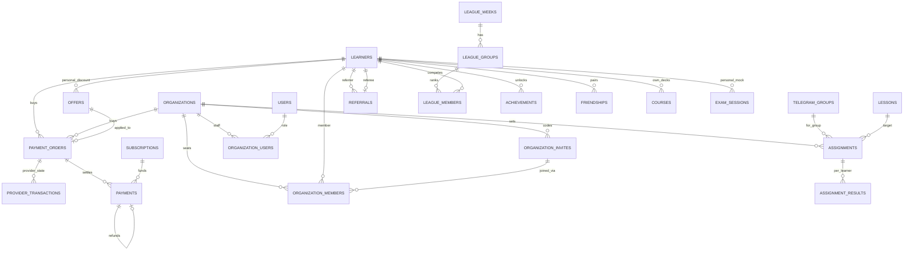

# 13. Фаза 2 — оплата, тарифы центров, рост и удержание, обучение

> Статус: проект, ред. 1 — 2026-10-19. Автор: architect (задача 2.0, Sprint 15). База: ветка `claude/magical-pascal-qz05gz` после мержа Фаз 0+1 (Pest 1495/1502, Larastan 8, PG 16 в CI).
> Документ **уточняет и в части Фазы 2 заменяет** [11_SYSTEM_ANALYSIS_AND_SAAS_STRATEGY.md](./11_SYSTEM_ANALYSIS_AND_SAAS_STRATEGY.md) §4.1–4.3, §6.3–6.6, §10 «Фаза 2» и реализует контракт оплаты из [12_PHASE1_DESIGN.md](./12_PHASE1_DESIGN.md) §6. Формат — как в docs/12: резюме решений, схема, контракты сервисов, порядок блокировок, нарезка на задачи с DoD, вопросы владельцу.

**Решения владельца, зафиксированные в проекте:** B2C-first, платные тарифы для всех; центр платит фиксированно раз в месяц, его ученики получают полный Pro без лимитов; интерфейс uz (латиница)/ru, изучаемый язык — только английский; Free = 20 новых слов/день, повторения без лимита; **прода с данными нет** — create-миграции правятся на месте + `migrate:fresh --seed`, новые таблицы — новыми миграциями с `down()`; цены ещё не назначены — всё в `config/billing.php`, UZS и Stars раздельно; новые зависимости — только по согласованию (§12).

Порядок фазы (координатор): **волна A — деньги** (2A оплата, 2B тарифы центров) проектируется до нарезки на coder; **волна B — рост и удержание** (2C) и **волна C — обучение** (2D) — схема и границы, задачи крупнее. Что из B/C зависит от A — отмечено явно (§11).

---

## 0. Резюме решений

| Вопрос | Решение | Почему |
|---|---|---|
| Модель оплаты | Два режима в одной `subscriptions`: **автопродление** (только Telegram Stars, `subscription_period` 30 дней, grace 3 дня) и **оплата периода** (Payme/Click: месяц/год, без grace, напоминание о продлении за 3 и 1 день). Оплата при живой подписке **продлевает** её от `max(конец, now)` | У Payme/Click нет рекуррентных списаний для мерчанта; grace имеет смысл только там, где продление делает провайдер |
| Таблицы оплаты | `payment_orders` (заказ = серверный источник суммы), `provider_transactions` (состояние транзакции провайдера: Payme state 1/2/-1/-2, Click prepare/complete), `payments` (леджер: charge/renewal/refund, unique `(provider, provider_event_id)`) | Клиент сумму не задаёт; Payme требует `CheckTransaction`/`GetStatement` по своей транзакции в любой момент; леджер отделён от состояния транзакции |
| Идемпотентность | Быстрый путь — `payments` по `(provider, provider_event_id)` без блокировки; медленный — транзакция с блокировкой `payment_orders` → … → INSERT `payments` последним; `UniqueConstraintViolationException` = повтор | Повтор и параллельная доставка вебхука безопасны; порядок совместим с docs/06 §4.2 и docs/12 §3.4 |
| Порядок блокировок | `promo_codes` → `payment_orders` → `provider_transactions` → субъект (`learners`/`organizations`) → `organization_members` → `subscriptions` → INSERT'ы с FK | Расширение правила docs/12 §3.4; никто, держа субъект, не ждёт заказ |
| `canceled` | Становится **live до `current_period_ends_at`** (без grace) одним согласованным изменением по чек-листу docs/12 §5.1 — задача 2A.1 | Отмена автопродления Stars = «Pro до конца периода» |
| `hasGrace()` | Только `telegram_stars` | Payme/Click — оплата периода, продления нет, grace нечего ждать |
| `pre_checkout_query` | Отвечается **синхронно** в `WebhookController` (чтение заказа + learner, без записи), остальные апдейты — в очередь как сейчас | Telegram ждёт ответ 10 с; очередь `high` этого не гарантирует |
| Тарифы центров | `subscriptions.plan` у организации остаётся `pro` (что получают ученики), тариф — новая колонка `subscriptions.tier` (`tutor`/`center_s`/`center_m`/`center_l`), `seats_limit` — из `config('billing.org_tiers')` | `EntitlementResolver`, `Plan` и Filament-гранты не меняются; `seats_limit` уже есть |
| Место (seat) | Явная запись `organization_members` со `seat_state = seated`; занимается при вступлении (инвайт-код или вступление в группу организации) под блокировкой строки `organizations`; освобождается при выходе/удалении; сверх лимита — `waitlisted` (без спонсорского Pro, FIFO при освобождении) | Детерминированный набор «кто занимает места», лимит защищает B2C, учеников не блокируют |
| Спонсорство | `EntitlementResolver` переходит с «активное членство в группе организации» на `organization_members (active, seated)`; членство из группы создаётся автоматически | Одно правило для мест и для Pro |
| Кабинет центра | **Отдельная Filament-панель `/org`** с tenancy по `Organization` (`organization_users`: `owner`/`teacher`), политики — второй рубеж; TWA-кабинет отклонён | Таблицы/формы/экспорт бесплатно, логин/2FA есть; изоляция tenant'а — встроенный механизм + тесты |
| Оплата центра | Payme/Click по ссылке из кабинета + ручная активация суперадмином с `tier` (счёт юрлицу — HTML-страница); Stars для организаций не предлагаем | Юрлица платят с расчётного счёта; Stars — личный кошелёк |
| B2B → B2C | `offers` (`post_org_discount`, −30 % на первый месяц, 14 дней): создаётся при потере места без личной live-подписки; скидка применяется к `payment_orders.amount` на сервере | Сумма заказа — единственный источник правды и для скидок |
| Рефералка | `learners.referral_code` (непредсказуемый), `referrals` со статусами; награда 7 дней Pro обоим **после активации** (≥ 10 оценок в ≥ 3 разных локальных дня за 14 дней), лимиты на referrer'а; `ref_<id>` отменяется | Фарм дорог, награды отложены, существующие аккаунты не рефералы |
| Streak freeze | Автопотребление при пропуске ровно одного дня (Pro), инвентарь `learners.streak_freezes` (≤ 2, +1 в неделю), факт — `learner_daily_stats.frozen_at` | Источник истины streak остаётся `learner_daily_stats`; без блокировок в транзакции оценки |
| Лиги | Недельные группы ≤ 30 по tier'ам; **очки считаются из `learner_daily_stats`**, не пишутся в горячем пути; таблица рейтинга — кэш 60 с | Ноль новых блокировок в транзакции оценки |
| Шеринг | Картинки — GD (расширение уже есть) + шрифт OFL как ассет; без новых composer-зависимостей | Imagick/Intervention не нужны |
| Упражнения | `TrainingStep` расширяется `exercise` + `prompt` (+ `audio_url` — хвост 1.2c); spelling/gap-fill **оцениваются сервером** (`POST /review {answer}`), Дамерау–Левенштейн с порогом от длины | Клиенту нельзя доверять оценку |
| FSRS | `SchedulerAlgorithm` (`sm2` / `fsrs`), поля `stability`/`difficulty` в `word_repetitions`, бакет A/B на learner'а (`learners.scheduler`), learning steps общие; метрики из `training_reviews.scheduler` | A/B без второй таблицы; откат — переключить бакет |
| Симулятор IELTS/SAT | Обобщить `exam_sessions` (`mode = personal_mock`, `learner_id`) как в Фазе 1 обобщили `training_sessions` | Переиспользуем builder/flow/TWA экзамена |
| Схема в коде | Новые таблицы — новые миграции с `down()`; правки существующих (`subscriptions` partial unique с `canceled`, `tier`; `word_repetitions` FSRS; `exam_sessions` nullable FK) — **на месте** в create-миграциях | Правило docs/12 §2.2 действует до первого прод-релиза |

---

## 1. Модель данных

### 1.1 ERD (добавления Фазы 2)



Таблицы Фазы 1 (`subscriptions`, `learner_daily_stats`, `word_repetitions`, `exam_sessions`, `courses`) получают колонки, перечисленные в §1.6.

### 1.2 Оплата — `payment_orders`, `provider_transactions`, `payments`, `offers`

**`payment_orders`** — намерение купить; единственный источник суммы.

| Колонка | Тип | Описание |
|---|---|---|
| id | bigint PK | |
| token | varchar(32) NOT NULL unique | `Str::random(32)`; уходит провайдеру как `invoice_payload` (Stars), `account.order_id` (Payme), `merchant_trans_id` (Click). Непредсказуем — по нему нельзя перебрать чужие заказы |
| subscriber_type / subscriber_id | varchar(16) / bigint NOT NULL | `learner` / `organization`; без FK (как `subscriptions`) |
| plan | varchar(16) NOT NULL | `pro` |
| tier | varchar(16) nullable | тариф организации (`tutor`/`center_s`/`center_m`/`center_l`), `NULL` для learner'а |
| period | varchar(8) NOT NULL | `month` / `year` |
| provider | varchar(16) NOT NULL | `telegram_stars` / `payme` / `click` |
| amount | bigint NOT NULL | минорные единицы: тийины для `UZS`, целые Stars для `XTR`; **после** скидки |
| list_amount | bigint NOT NULL | до скидки (аналитика) |
| currency | varchar(8) NOT NULL | `UZS` / `XTR` |
| offer_id | bigint nullable FK → offers `nullOnDelete` | применённая скидка |
| status | varchar(12) NOT NULL default `'pending'` | `pending` → `paid` / `canceled` / `expired` / `failed`. Для Stars-подписки заказ остаётся `paid` и служит якорем продлений (`invoice_payload` одинаков у всех списаний) |
| provider_ref | varchar(2048) nullable | ссылка на инвойс (Stars) / URL оплаты; **не** id транзакции (2A.4: расширено с 191 — Payme-ссылка ~250 символов) |
| expires_at | timestamp NOT NULL | `now + config('billing.checkout.order_ttl_minutes')` (1440); Payme/Click отвечают отказом на просроченный заказ |
| paid_at | timestamp nullable | первая успешная оплата |
| subscription_id | bigint nullable FK → subscriptions `nullOnDelete` | подписка, созданная/продлённая этим заказом |
| created_via | varchar(16) NOT NULL | `twa` / `bot` / `org_panel` / `admin` |
| meta | jsonb default `'{}'` | `{learner_locale, return_url, ...}` |
| created_at, updated_at | | |

Индексы: `token` unique; `(subscriber_type, subscriber_id, status)`; `(status, expires_at)`; `subscription_id`; `offer_id`.

**`provider_transactions`** — состояние транзакции на стороне провайдера (одна строка на `provider_transaction_id`; для Stars не используется).

| Колонка | Тип | Описание |
|---|---|---|
| id | bigint PK | для Click — это `merchant_prepare_id` |
| provider | varchar(16) NOT NULL | `payme` / `click` |
| provider_transaction_id | varchar(64) NOT NULL | Payme `params.id`, Click `click_trans_id` |
| payment_order_id | bigint NOT NULL FK → payment_orders `restrictOnDelete` | |
| state | smallint NOT NULL | Payme: 1 created, 2 performed, −1 canceled before perform, −2 canceled after perform; Click: 1 prepared, 2 completed, −1 canceled |
| amount | bigint NOT NULL | в минорных единицах, как пришло (сверяется с заказом) |
| provider_time | bigint nullable | Payme `params.time` (мс) |
| created_at_provider, performed_at, canceled_at | timestamp nullable | |
| cancel_reason | smallint nullable | Payme reason 1–5, 10; Click `error` |
| raw | jsonb default `'{}'` | последний запрос провайдера **после редактирования секретов** (без `Authorization`, `sign_string`) |
| history | jsonb default `'[]'` | `[{method, at, state_from, state_to}]` — журнал вебхука, отдельной таблицы не нужно |
| created_at, updated_at | | |

Индексы: `(provider, provider_transaction_id)` unique; `payment_order_id`; `(provider, state, created_at_provider)` — `GetStatement`.

**`payments`** — леджер (форма из docs/12 §1.9, уточнённая).

| Колонка | Тип | Описание |
|---|---|---|
| id | bigint PK | |
| payment_order_id | bigint nullable FK → payment_orders `nullOnDelete` | |
| provider_transaction_id | bigint nullable FK → provider_transactions `nullOnDelete` | |
| subscription_id | bigint nullable FK → subscriptions `nullOnDelete` | |
| subscriber_type / subscriber_id | varchar(16) / bigint NOT NULL | дублируется из заказа — отчёты без join'ов |
| provider | varchar(16) NOT NULL | |
| provider_event_id | varchar(191) NOT NULL | ключ идемпотентности: Stars `telegram_payment_charge_id`; Payme `<transaction id>:perform` / `:cancel`; Click `<click_trans_id>:complete` / `:cancel` |
| provider_charge_id | varchar(191) nullable | то, что нужно для возврата: Stars charge id, Payme transaction id |
| kind | varchar(12) NOT NULL | `charge` / `renewal` / `refund` |
| status | varchar(12) NOT NULL | `succeeded` / `refunded` / `failed` |
| amount, currency | bigint, varchar(8) | знак положительный; `refund` — отдельная строка с `refunded_payment_id` |
| refunded_payment_id | bigint nullable FK → payments `nullOnDelete` | |
| period_starts_at, period_ends_at | timestamp nullable | за какой период уплачено |
| occurred_at | timestamp NOT NULL | момент у провайдера |
| raw | jsonb default `'{}'` | нормализованное событие (без секретов) |
| created_at, updated_at | | |

Индексы: `(provider, provider_event_id)` unique; `(subscriber_type, subscriber_id, occurred_at)`; `(status, occurred_at)`; `subscription_id`; `payment_order_id`.

**`offers`** — персональные скидки (B2B → B2C, позже — промо-кампании).

| Колонка | Тип |
|---|---|
| id | bigint PK |
| learner_id | FK → learners cascade |
| kind | varchar(24): `post_org_discount` (Фаза 2), `winback`, `campaign` |
| plan, period | varchar(16), varchar(8) nullable (`NULL` = любой период) |
| discount_pct | smallint 1..90 |
| expires_at | timestamp NOT NULL |
| redeemed_at | timestamp nullable; `payment_order_id` FK nullable → заказ, в котором применена |
| source_organization_id | FK → organizations nullOnDelete (для `post_org_discount`) |
| meta, created_at, updated_at | |

Индексы: `(learner_id, kind, expires_at)`; partial unique `offers_one_open_per_learner_kind (learner_id, kind) WHERE redeemed_at IS NULL` (PG/sqlite с guard драйвера).

### 1.3 Организации — `organization_members`, `organization_invites`, `organization_users`

**`organization_members`** — явное членство и место.

| Колонка | Тип | Описание |
|---|---|---|
| id | bigint PK | |
| organization_id | FK → organizations cascade | |
| learner_id | FK → learners cascade | |
| status | varchar(12) NOT NULL | `active` / `left` (сам) / `removed` (учитель/владелец/суперадмин) |
| seat_state | varchar(12) NOT NULL | `seated` / `waitlisted` (мест нет) / `none` (status ≠ active) |
| joined_via | varchar(12) NOT NULL | `invite` / `group` / `admin` |
| invite_id | FK → organization_invites nullOnDelete | |
| seated_at, waitlisted_at, joined_at, left_at | timestamp | |
| meta | jsonb | |

Индексы: `(organization_id, learner_id)` unique; `(organization_id, status, seat_state)`; `(learner_id, status)`; `(organization_id, seat_state, waitlisted_at)` — FIFO.

Правила: место = строка `status = active AND seat_state = seated`; спонсорский Pro — только у `seated` в организации `status = active` с live-подпиской. `waitlisted` — обычный Free с баннером «мест в центре нет, попросите администратора». При освобождении места самый ранний `waitlisted` становится `seated` в той же транзакции. При понижении `seats_limit` (смена тарифа вниз) никто не снимается автоматически — владелец центра решает сам, виджет показывает «превышение»; **новые** не садятся, пока `seated >= seats_limit`.

**`organization_invites`**: id, `organization_id` FK cascade, `code` varchar(16) unique (`Str::upper(Str::random(10))` без `0/O/1/I`), `label` varchar(64) nullable («группа 7Б»), `telegram_group_id` FK nullable (авто-добавить в группу — нет: только метка; вступление в чат делает человек), `max_uses` int nullable, `uses_count` int default 0, `expires_at` nullable, `is_active` bool, `created_by_user_id` FK users nullOnDelete, timestamps. Deep-link: `t.me/<bot>?start=org_<code>` (`StartPayload` уже принимает `org_[A-Za-z0-9_-]{1,32}`).

**`organization_users`**: id, `organization_id` FK cascade, `user_id` FK users cascade, `role` varchar(12) (`owner` / `teacher`), `invited_by_user_id` nullable, timestamps; unique `(organization_id, user_id)`. Роли Filament `/org` читаются из этой таблицы (spatie-роли не используются для tenant-ролей — у одного пользователя могут быть разные роли в разных организациях). Учитель организации работает в группах организации; команды бота (`/start_training`) по-прежнему требуют `users.telegram_user_id` + `teacher_groups` — владелец в кабинете привязывает учителя к группам (создаются строки `teacher_groups`).

### 1.4 Задания — `assignments`, `assignment_results`

**`assignments`**: id, `organization_id` FK cascade, `telegram_group_id` FK cascade, `lesson_id` FK restrict, `title` varchar(120) nullable (дефолт — название урока), `due_at` timestamp NOT NULL, `announced_at` nullable (пост в группу отправлен), `reminded_at` nullable (напоминание за день), `status` varchar(10) (`active` / `closed`), `completion_threshold` smallint default 100 (% слов урока, засчитываемых как «выполнено»), `created_by_user_id` FK users nullOnDelete, `meta`, timestamps. Индексы: `(telegram_group_id, status, due_at)`; `(organization_id, due_at)`.

**`assignment_results`** — снимок прогресса (пересчитывается job'ом `assignments:refresh` каждые 30 мин для `active` и при открытии отчёта, если снимок старше 10 мин): id, `assignment_id` FK cascade, `learner_id` FK cascade, `progress_pct` smallint, `completed_at` nullable, `computed_at`; unique `(assignment_id, learner_id)`. Правило: `progress = (#активных слов урока с word_repetitions.repetitions >= 1 у learner'а) / (#активных слов урока)`; `completed_at` = момент первого достижения порога (ставится один раз; если прошёл после `due_at` — «выполнено с опозданием»). Источник — `word_repetitions`, достаточно для отчёта и дёшево; `training_reviews` — для детализации «сколько повторений/времени».

### 1.5 Рост и удержание — `referrals`, лиги, достижения, друзья

**`learners`** +: `referral_code` varchar(12) unique nullable (ленивая генерация при первом показе ссылки, алфавит без `0/O/1/I`), `streak_freezes` smallint default 0, `streak_freezes_refilled_on` date nullable, `scheduler` varchar(8) nullable (A/B: `sm2`/`fsrs`; `NULL` = дефолт конфига; ставится при создании по бакету `crc32(telegram_user_id) % 100 < fsrs_percent`).

**`referrals`**: id, `referrer_learner_id` FK cascade, `referee_learner_id` FK cascade **unique**, `status` varchar(12) (`pending` → `activated` → `rewarded`; `rejected` с `reject_reason`: `self`, `existing_learner`, `referrer_capped`, `flagged`), `linked_at`, `activated_at`, `rewarded_at`, `flagged_at`, `meta` (`{reward_subscription_ids, active_days}`), timestamps. Индексы: `(referrer_learner_id, status, linked_at)`.

**`learner_daily_stats`** +: `frozen_at` timestamp nullable (день закрыт заморозкой; `goal_met_at` остаётся `NULL`).

**`league_weeks`**: id, `starts_on` date unique (понедельник), `ends_on`, `status` (`open` / `closing` / `closed`), `closed_at`. **`league_groups`**: id, `league_week_id` FK cascade, `tier` smallint (0 Bronze … 4 Diamond), `capacity` smallint default 30, `members_count` smallint default 0; индекс `(league_week_id, tier, members_count)`. **`league_members`**: id, `league_group_id` FK cascade, `league_week_id` FK cascade (денормализация), `learner_id` FK cascade, `tier_before` smallint, `final_points` int nullable, `final_rank` smallint nullable, `result` varchar(10) nullable (`promoted` / `stayed` / `demoted`), timestamps; unique `(league_week_id, learner_id)`; индекс `(league_group_id)`. **Очки не хранятся до закрытия недели** — считаются из `learner_daily_stats` за даты недели (§7.3).

**`achievements`**: id, `learner_id` FK cascade, `key` varchar(32) (`words_100`, `words_500`, `words_1000`, `streak_7`, `streak_30`, `streak_100`, `league_top1`, `course_completed:<slug>`), `unlocked_at`, `shared_at` nullable, `meta`; unique `(learner_id, key)`.

**`friendships`**: id, `learner_id` (меньший id), `friend_id` (больший id), `status` (`pending` / `accepted` / `blocked`), `requested_by_learner_id`, timestamps; unique `(learner_id, friend_id)`; CHECK `learner_id < friend_id` (PG). **`challenges`** (минимум): id, `challenger_id`, `opponent_id`, `metric` (`reviews` / `new_words`), `starts_at`, `ends_at`, `status` (`pending` / `active` / `finished` / `declined`), `winner_learner_id` nullable, `scores` jsonb; результат считается из `learner_daily_stats` при закрытии.

### 1.6 Обучение — правки существующих таблиц (на месте)

| Таблица | Изменение | Задача |
|---|---|---|
| `subscriptions` | + `tier` varchar(16) nullable; partial unique `subscriptions_one_live_per_subscriber` → `WHERE status IN ('trialing','active','past_due','canceled')` | 2A.1 / 2B.1 |
| `word_repetitions` | + `stability` decimal(9,4) nullable, `difficulty` decimal(6,4) nullable, `scheduler` varchar(8) default `'sm2'`, `scheduled_days` smallint nullable (интервал, назначенный FSRS, для метрик) | 2D.4 |
| `training_reviews` | + `exercise` varchar(12) default `'flash'`, `answer_text` varchar(100) nullable, `scheduler` varchar(8) default `'sm2'`, `interval_before_days` smallint nullable | 2D.2 / 2D.4 |
| `exam_sessions` | `telegram_group_id`, `started_by_user_id` → nullable; + `learner_id` FK nullable cascade, `mode` varchar(16) default `'group_exam'` (`group_exam` / `personal_mock`), `course_id` FK nullable; PG CHECK формы по образцу `training_sessions_mode_shape_check`; `lesson_id` → nullable (`personal_mock` берёт слова курса) | 2D.5 |
| `courses` | `owner_type` получает значение `learner` (`owner_id = learners.id`), `visibility = private`; + `source` varchar(12) default `'platform'` (`platform` / `organization` / `learner`) для фильтров | 2D.1 |
| `words` | без изменений; пользовательские слова живут в `lessons` колоды (`stage` «Моя колода» создаётся автоматически) | 2D.1 |

### 1.7 Миграции (новые файлы, `down()` обязателен)

| Файл | Содержимое | Задача |
|---|---|---|
| `2026_10_20_000001_create_offers_table` | §1.2 `offers` (до `payment_orders` из-за FK) | 2A.1 |
| `2026_10_20_000002_create_payment_orders_table` | §1.2 | 2A.1 |
| `2026_10_20_000003_create_provider_transactions_table` | §1.2 | 2A.1 |
| `2026_10_20_000004_create_payments_table` | §1.2 (self-FK `refunded_payment_id`) | 2A.1 |
| `2026_10_21_000001_create_organization_users_table`, `…_000002_create_organization_invites_table`, `…_000003_create_organization_members_table` | §1.3 | 2B.1 |
| `2026_10_21_000004_create_assignments_table`, `…_000005_create_assignment_results_table` | §1.4 | 2B.4 |
| `2026_10_22_000001_create_referrals_table` | §1.5 | 2C.1 |
| `2026_10_22_000002_create_league_tables` (три таблицы, одна миграция) | §1.5 | 2C.3 |
| `2026_10_22_000003_create_achievements_table`, `…_000004_create_friendships_and_challenges_tables` | §1.5 | 2C.4 / 2C.5 |
| Правки на месте: `2026_04_23_095902_create_learners_table` (+ `referral_code`, `streak_freezes*`, `scheduler`), `2026_04_23_100016_create_learner_daily_stats_table` (+ `frozen_at`), `2026_04_23_100017_create_subscriptions_table` (+ `tier`, предикат partial unique), `2026_04_23_100006` / `2026_10_18_000002` (`word_repetitions` FSRS-поля), `2026_04_23_100008_create_training_reviews_table`, `2026_04_23_100009_create_exam_sessions_table` | §1.5–1.6 | по задачам |

`DatabaseSchemaTest` дополняется новыми таблицами, уникальностями (`payments (provider, provider_event_id)`, `provider_transactions (provider, provider_transaction_id)`, `payment_orders.token`, `organization_members (organization_id, learner_id)`, `referrals.referee_learner_id`, `league_members (league_week_id, learner_id)`), каскадами и `migrate:rollback`/`migrate` для новых файлов.

---

## 2. Домены и контракты сервисов

### 2.1 `app/Domain/Billing` — провайдеры и checkout

```php
namespace App\Domain\Billing\Contracts;

interface BillingProvider
{
    public function key(): SubscriptionProvider;                                  // TelegramStars | Payme | Click
    public function supports(string $subscriberType, string $currency): bool;     // Stars: learner + XTR; Payme/Click: learner|organization + UZS
    /** Создаёт платёжную ссылку/инвойс для уже сохранённого заказа (вызывается ВНЕ транзакции заказа). */
    public function createCheckout(PaymentOrder $order): CheckoutLink;           // {url, kind: 'invoice_link'|'redirect', expiresAt}
    /** Автопродление: только Stars. Остальные бросают ProviderCapabilityException. */
    public function cancelAutoRenew(Subscription $s): void;                       // editUserStarSubscription(is_canceled=true)
    public function resumeAutoRenew(Subscription $s): void;                       // is_canceled=false
    /** Возврат, инициированный нами (Stars). Payme/Click возвращают через свой кабинет — для них метод бросает ProviderCapabilityException, запись делает их вебхук CancelTransaction / Complete(error<0). */
    public function refund(Payment $p): void;
}

namespace App\Domain\Billing\DTO;

final readonly class ChargeEvent        // нормализованное «деньги получены»
{
    public SubscriptionProvider $provider; public string $providerEventId; public ?string $providerChargeId;
    public string $orderToken;          // payment_orders.token (invoice_payload / account.order_id / merchant_trans_id)
    public int $amount; public string $currency;
    public bool $isRenewal;             // Stars is_recurring && !is_first_recurring
    public ?CarbonImmutable $periodEndsAt; // Stars subscription_expiration_date; Payme/Click — null (считаем сами)
    public CarbonImmutable $occurredAt; public array $raw;
}
final readonly class RefundEvent { provider, providerEventId, refundedProviderChargeId, amount, currency, occurredAt, raw }
final readonly class CheckoutLink  { string $url; string $kind; CarbonImmutable $expiresAt; }
```

```php
namespace App\Domain\Billing\Services;

final class CheckoutService
{
    /** Валидирует план/период/провайдера/валюту по config('billing'), применяет открытый offer (если подходит), считает amount на сервере,
     *  создаёт payment_orders (pending) в короткой транзакции, затем ВНЕ транзакции provider->createCheckout(); provider_ref сохраняется.
     *  CheckoutException: price_not_configured (409) | provider_disabled (409) | provider_not_supported (422) | checkout_conflict (409 — живая Stars-подписка с автопродлением и другой провайдер) | too_many_pending (429 — > 3 pending заказов) | offer_not_applicable (409). */
    public function create(Learner|Organization $subscriber, Plan $plan, string $period, SubscriptionProvider $provider, ?string $tier, string $via, ?Offer $offer = null, ?CarbonImmutable $now = null): PaymentOrder;
    public function catalog(Learner|Organization $subscriber, ?CarbonImmutable $now = null): BillingCatalog; // {plans/tiers × periods × currencies, providers enabled, open offer, current subscription summary}
    public function expirePending(?CarbonImmutable $now = null): int;             // планировщик billing:expire-orders (каждые 15 мин)
    public function findByToken(string $token): ?PaymentOrder;                    // для вебхуков; token сравнивается как строка, не как id
}

final class PaymentApplier     // ядро идемпотентности (architect)
{
    /** Быстрый путь: payments.exists(provider, providerEventId) → DuplicatePayment (без побочных эффектов).
     *  Транзакция, порядок §3: lockForUpdate payment_orders по token → [provider_transactions] → субъект → subscriptions (lockedLive) →
     *  сверка amount/currency/plan с заказом (несовпадение → payments.status=failed, Log::error 'billing.amount_mismatch', подписка не меняется) →
     *  SubscriptionService::applyCharge → INSERT payments (unique; UniqueConstraintViolationException → rollback → DuplicatePayment) → order.paid → события → forget после commit.
     *  Возвращает Payment; бросает PaymentApplyException: order_not_found | order_expired | order_mismatch. */
    public function applyCharge(ChargeEvent $e, ?CarbonImmutable $now = null): Payment;
    /** Тот же порядок; находит исходный payment по provider_charge_id; создаёт payments.kind=refund, помечает исходный refunded;
     *  если возвращён текущий оплаченный период — SubscriptionService::endNow(reason='refund'); audit `payment.refunded` (если инициировал админ). */
    public function applyRefund(RefundEvent $e, ?User $by = null, ?CarbonImmutable $now = null): Payment;
}

final class SubscriptionService   // расширение 1.4a
{
    /** @internal для PaymentApplier, внутри его транзакции, субъект уже заблокирован.
     *  Нет live: создаёт active с provider=e.provider, starts_at=now, current_period_ends_at = e.periodEndsAt ?? now + period.
     *  Есть live: current_period_ends_at = max(текущий конец, e.periodEndsAt ?? max(конец, now) + period); status → active (из past_due/canceled при возобновлении Stars);
     *  provider = провайдер последнего платежа; provider_ref = providerChargeId (Stars — charge id первого платежа подписки хранится также в meta.stars.charge_id);
     *  tier/seats_limit — из заказа (организации) ТОЛЬКО если tier заказа = tier live-подписки (или у live нет tier / её период уже истёк); иначе tier/seats не трогаются, заказ помечается meta.tier_mismatch (2B.8); meta.history += {action: 'charge'|'renewal', payment_order_id}. */
    public function applyCharge(Learner|Organization $subscriber, PaymentOrder $order, ChargeEvent $e, CarbonImmutable $now): Subscription;
    /** active → canceled (canceled_at=now, период не трогается). Только для автопродляемого провайдера; вызывающий сначала делает provider->cancelAutoRenew() ВНЕ транзакции (§4.1). */
    public function cancel(Subscription $s, Learner|User $by, ?string $ip, ?CarbonImmutable $now = null): Subscription;
    public function resume(Subscription $s, Learner|User $by, ?string $ip, ?CarbonImmutable $now = null): Subscription;   // canceled → active, если период не истёк
    public function endNow(Subscription $s, string $reason, ?User $by, ?CarbonImmutable $now = null): Subscription;      // → expired, ended_at=now (refund/chargeback); порядок: субъект → подписка
    public function grantManual(..., ?string $tier = null): Subscription;         // + tier → seats_limit из config('billing.org_tiers.<tier>.seats') (organization)
    /** Награды (рефералка): как grantFromPromo, provider = reward; @internal для ReferralService в его транзакции. */
    public function grantReward(Learner $l, int $days, string $source, CarbonImmutable $now): Subscription;
    public function remindExpiring(?CarbonImmutable $now = null): int;           // §4.4: non-renewing live с концом через 3/1 день → RenewalReminderJob
}

final class OfferService
{
    public function openFor(Learner $l, string $kind, ?CarbonImmutable $now = null): ?Offer;
    public function createPostOrgDiscount(Learner $l, Organization $from, ?CarbonImmutable $now = null): ?Offer;   // null, если у learner'а есть Pro из любого источника (своя live-подписка или место в другом центре — 2B.7a) или открытый offer того же kind
    public function apply(Offer $o, int $listAmount): int;                       // round(list × (100 − pct) / 100), минимум 1 (Stars) / 100 тийинов
}
```

`SubscriptionProvider` +: `case Reward = 'reward'`; `hasGrace()` → `$this === self::TelegramStars`; `isAutoRenewing()` — то же; `isPaid()` — Stars/Payme/Click; `currency()` — `XTR` / `UZS` / `null`. `PaidSubscriptionQuery::aliveAt` берёт список «с grace» из enum — изменится автоматически; матрица `PaidSubscriptionQueryTest` расширяется статусом `canceled` и провайдером `reward`.

> **Реализация 2A.1 (2026-10-19, architect) — уточнения к контрактам выше:**
> - `ChargeEvent` получил `?int $providerTransactionId` (наш `provider_transactions.id`; Payme/Click заполняют, пишется в `payments.provider_transaction_id`).
> - Повтор события — `DuplicatePaymentException` (409, `->payment` = первая строка леджера), а не «тихий» выход: вебхук отвечает так же, как в первый раз. Проверка идёт дважды: без блокировок до транзакции и под блокировкой заказа; unique-индекс — последний рубеж.
> - События, которые нельзя зачесть (чужой провайдер, мёртвый/оплаченный заказ, несовпадение суммы/валюты) **коммитятся** как `payments.status = failed` (`raw.failure_reason`) + `payment.failed`, затем бросается `order_expired`/`order_mismatch`; при несовпадении суммы исключения нет — возвращается `failed`-строка. `order_not_found` — без строки; для «заказ потерян, learner известен» (Stars-продление, §4.1) — `PaymentApplier::recordOrphan(event, subscriber, reason)`.
> - `applyRefund` возвращает строку `refund`; `endNow(reason='refund')` — если возвращённый платёж оплачивал текущий период (`payments.period_ends_at > now`).
> - `OfferService::apply(Offer, int $listAmount, string $currency)` — валюта нужна для минимума (1 XTR / 100 тийинов). Partial unique `offers` считает и просроченные непогашенные — `createPostOrgDiscount` удаляет просроченную того же вида перед вставкой. FK `offers.payment_order_id` — только PostgreSQL (sqlite при `ALTER TABLE` терял предикат partial-индекса).
> - `remindExpiring` **не** использует `notifications_log` (у организаций нет `learner_id`): маркер `"<days>@<ISO конца периода>"` пишется в `subscriptions.meta.renewal_reminders` под блокировкой субъект → подписка, затем после commit поднимается событие `App\Domain\Billing\Events\SubscriptionRenewalDue {subscriptionId, subscriberType, subscriberId, provider, daysLeft, endsAt}`; `RenewalReminderJob` (2A.6) — слушатель этого события и пишет `notifications_log` для ЛС.
> - Добавлен `ProviderTransactionService::open(provider, providerTransactionId, orderToken, amount, providerTime, raw)` — общее ядро Payme `CreateTransaction` и Click `Prepare`: блокировка заказа → проверка «нет другой открытой транзакции» (`order_busy`) → вставка state 1; повтор того же id идемпотентен. Остальные переходы состояний — в 2A.4/2A.5.
> - `CheckoutService::create` дополнительно даёт `invalid_period` (422) и `invalid_tier` (422); `catalog()` возвращает `BillingCatalog {items, providers, offer, subscription}` (`items` — строки plan[/tier] × period с `prices`/`list_prices` по валютам включённых провайдеров; пусто = продавать нечего). `CheckoutService::summarize(Subscription, now)` — сводка для `/me.entitlement.renewal`.
> - `grantManual(..., ?string $tier = null)` — последний необязательный параметр; `grantReward` при бессрочной подписке возвращает её без изменений (награда не бросает исключений).
> - `FakeBillingProvider` живёт в `tests/Support` (`FakeBillingProvider::register(SubscriptionProvider)` регистрирует в `BillingProviderRegistry` и включает провайдера в config).

> **Реализация 2A.2 (2026-10-19, coder) — уточнения к §5:**
> - Оркестрация для TWA и бота — `LearnerBillingService` (`checkout`, `orderFor`, `cancelAutoRenew`/`resumeAutoRenew`, `paywall`, `renewal`): контроллер и хендлеры бота тонкие. Сбой адаптера провайдера (`RuntimeException`, кроме `BillingException`/`QueryException`) → `ProviderUnavailableException` (`provider_unavailable`, 502); при cancel/resume провайдер вызывается до транзакции, и при его отказе подписка не меняется.
> - `GET /billing/catalog` отдаёт `items` (а не `plans`) — имя из `BillingCatalog` (2A.1). `POST /billing/checkout` отвечает `201`. `GET /billing/orders/{token}` для чужого/неизвестного токена — `404 order_not_found`.
> - `paywall.mode = purchase` в `/me` понижается до `coming_soon`, если каталог пуст — это делает `LearnerBillingService::paywall()`; `EntitlementResolver::paywall()` не менялся (там сырой режим конфига: файл в зоне 2B.1).
> - `entitlement.renewal` — только собственная live-подписка learner'а (`null` для Free/спонсорского Pro): `{auto, provider, ends_at, reminder_sent}`.
> - Бот: `/pro` создаёт заказ только по нажатию кнопки (`pro1:buy:<period>:<provider>`), чтобы меню не съедало лимит неоплаченных заказов; при работающем автопродлении Stars кнопок покупки нет (иначе двойное списание). `/pro` — только личный чат; `/paysupport` — ЛС и активная группа.
> - Событие `paywall.shown` по-прежнему пишет сервер при исчерпанной квоте (без поля `mode`): клиент событий не шлёт.

> **Реализация 2A.7 (2026-10-19, coder) — админка оплаты:**
> - `PaymentResource`, `PaymentOrderResource`, `ProviderTransactionResource` — только чтение (policies: `PaymentPolicy`, `PaymentOrderPolicy`, `ProviderTransactionPolicy`, активный `admin`; teacher → 403). Сырые payload'ы (`payments.raw`, `provider_transactions.raw/history`, `payment_orders.meta`) показываются через `PayloadMasker` (ключи `sign*`, `*key*`, `*token*`, `*secret*`, `authorization`, `invoice_payload`, `order_id`, `merchant_trans_id` → `[redacted]`, + `SecretRedactor` по строкам); токен заказа усечён (`AbCd…wXyZ`), `provider_ref` не выводится.
> - Refund: `PaymentRefundService::refund(Payment, User, note, returnedByHand, ip)` — только активный admin; не-`succeeded`/не-charge/renewal или без `provider_charge_id` → `not_refundable`; уже возвращён → `already_refunded` **до** вызова провайдера. Деньги: `BillingProviderRegistry::for(provider)->refund($payment)` вне транзакции; `ProviderCapabilityException` (Payme/Click, адаптер не развёрнут) → `provider_cannot_refund` без изменений — админ возвращает деньги в кабинете и повторяет с `returnedByHand=true` (локальная отметка без вызова провайдера); сбой адаптера → `provider_refund_failed` (502-класс). Затем `PaymentApplier::applyRefund` с детерминированным `providerEventId = admin-refund:<payment id>` — повторный клик/второй админ даёт `already_refunded`, второй `refund` не создаётся. Сбой записи после успешного возврата у провайдера → `Log::error('billing.admin_refund_unrecorded')`, повтор — с `returnedByHand`.
> - `PaymentApplier::applyRefund` получил два необязательных последних параметра `?string $note, ?string $ip`: пишутся в `audit_logs` (`meta.note`, колонка `ip`) для `payment.refunded`.
> - Виджеты (`BillingReportService`): «Выручка 30 дней» — по валютам раздельно (UZS в тийинах, XTR), строки `kind ∈ {charge, renewal}` с `occurred_at ≥ now−30d`: `gross` = `succeeded + refunded`, `refunded` = со статусом `refunded`, `net = gross − refunded` (= `succeeded`); строки `refund` и `failed` не считаются. «Ошибки вебхуков 24 ч» — `payments.status=failed` по `created_at` (с разбивкой по провайдеру) + `provider_transactions` в state −1/−2 по `canceled_at`.
> - Grant в `SubscriptionResource` — необязательный `tier` для организации (`OrgTiers`), вызывает существующий `grantManual(..., tier:)`; без `tier` поведение прежнее.

> **Реализация 2A.3 (2026-10-19, architect) — Telegram Stars:**
> - `TelegramStarsProvider` (`app/Domain/Billing/Providers/`) регистрируется в `BillingProviderRegistry` всегда (AppServiceProvider); продаётся только при `BILLING_STARS_ENABLED=true`. `supports` — только `learner` + `XTR`. `createCheckout`: `createInvoiceLink(title ≤ 32, description ≤ 255, payload = token, XTR, одна цена, subscription_period = 2592000 только для `month`)`, тексты — `billing.stars.invoice.*` на `meta.learner_locale` заказа; `year` — разовый инвойс. Сбой Bot API — `TelegramApiException` (RuntimeException) → 502 `provider_unavailable`, заказ `failed` (как 2A.2).
> - Разбор апдейтов — только в `parseSuccessfulPayment` / `parseRefundedPayment` (имена полей Bot API — §15 п. 1, **сверить на стенде**). `raw` платежа не содержит `invoice_payload` (токен заказа); `UpdateSanitizer` маскирует `invoice_payload` в логе `telegram.update`. Возврат от Telegram пишется с `provider_event_id = refund:<charge id>` (unique-индекс не даёт столкнуться со строкой списания); админский — `admin-refund:<payment id>` (2A.7); эхо `refunded_payment` после админского возврата → `already_refunded` → молча.
> - `pre_checkout_query`: `WebhookController` → `PreCheckoutResponder` (Telegram-домен) → `StarsPreCheckoutGuard::check` → `answerPreCheckoutQuery`, всё синхронно, в очередь ничего не идёт. Guard — **один** SELECT (`payment_orders ⟕ learners` по токену), без записи; причины отказа `order_not_found | foreign | blocked | order_closed | order_expired | amount_mismatch | provider_disabled` → `billing.stars.precheckout.<reason>` на локали learner'а (чужой плательщик — на его Telegram-языке, о заказе ничего не раскрывается). Сбой самого guard'а → `ok=false` с `unavailable`, ответ 200 всегда.
> - `SuccessfulPaymentHandler` / `RefundedPaymentHandler` — первые два в `messageHandlers`. **Отклонение от §4.1:** продление «без заказа» (заказ потерян) не реализовано — `applyCharge` требует заказ, а `paid`-заказ Stars-подписки живёт вечно и теряется только при ручном удалении; такой платёж → `PaymentApplier::recordOrphan` (`failed`, `billing.payment_orphan`), learner'у — `billing.stars.paid_unresolved`, Pro выдаёт поддержка. Повтор, `order_expired`/`order_mismatch`, несовпадение суммы — финальные исходы без retry job'а; падение БД/Telegram — retry (tries = 3). Входящий лимит `bot-in:<id>` (docs/12 §8) на `successful_payment`/`refunded_payment` не действует — деньги не отбрасываются. Ответ на зачтённый платёж — `billing.stars.paid|renewed|paid_forever` с web_app-кнопкой `/twa/?from=payment`.
> - `TelegramClient` +: `createInvoiceLink`, `answerPreCheckoutQuery`, `editUserStarSubscription`, `refundStarPayment`, `getStarTransactions` (`IrazasyedTelegramClient`: первые два — обёртки SDK, остальные — сырой `post()` через тот же `call()`); `setWebhook.allowed_updates` += `pre_checkout_query` (`IrazasyedTelegramClient::ALLOWED_UPDATES`) — после деплоя повторить `telegram:set-webhook`.
> - `billing:reconcile-stars {--days=2}` (`StarsReconciliationService`, ежедневно 04:30 UTC): `getStarTransactions` постранично до cut-off; входящая от `source.type=user` без строки `payments` → `billing.reconcile_missing`; исходящая к `receiver.type=user` без `refund`-строки того же learner'а/суммы ±1 день → `billing.reconcile_missing_refund`; прочие партнёры (Fragment и т.д.) не проверяются. Только чтение; код выхода 1 при расхождениях; при выключенном Stars — ничего не делает.
> - Уведомление об отмене подписки пользователем из настроек Stars (§15) не обрабатывается: если Telegram такой апдейт не шлёт, строка остаётся `active`, пока не пройдут период + grace (`subscriptions:expire`); расхождение видно через reconcile.
> - Известная особенность 2A.1: `hasGrace()` — по провайдеру, поэтому разовый годовой Stars-инвойс тоже получает 3 дня `past_due` после конца периода (продления не будет — просто поздняя `expired`). Оставлено; при желании — `grace` по признаку «подписка», не провайдера.

> **Реализация 2A.4 (2026-10-20, architect) — Payme:**
> - Файлы: `PaymeProvider` (`app/Domain/Billing/Providers/`), `Payme\PaymeRpcService`, `Payme\PaymeAuth`, `Payme\PaymeRpcException` (таблица кодов и тексты `{ru, uz, en}` в одном месте — `en`-локали в приложении нет, поэтому не в `lang/`), контроллер `Http\Controllers\Billing\PaymeWebhookController`, middleware `BillingIpAllowlist:<provider>` (общий с Click, `*_IP_ALLOWLIST` CSV, пусто = выключен, 403 до аутентификации), лимитеры `billing-webhook` (120/мин per IP) и `billing-return` (30/мин), страница `GET /billing/return?order=<token>&lang=` (`BillingReturnController`, тексты `billing.return.*` ru/uz, `Cache-Control: no-store`, `noindex`, без сессии). Порядок проверок в контроллере: размер тела (> 64 КБ → `-32600`) → Basic (`-32504`, тело не разбирается) → JSON (`-32700`) → сервис. Протокольные ошибки — HTTP 200; **неожиданное исключение — HTTP 500 + `-32400`**, чтобы Payme повторил вызов.
> - **Схема:** `provider_transactions` + `perform_time` и `cancel_time` (bigint, мс; правка create-миграции на месте, docs/03 §2.28): Payme требует вернуть на повтор тот же `perform_time`/`cancel_time`, а колонки `timestamp` теряют миллисекунды и могут оказаться меньше `create_time` (= `params.time`). `payment_orders.provider_ref` расширен до 2048 (PG отверг Payme-ссылку в 191 символ — нашёл PG-прогон тестов).
> - **Отклонение от §4.2:** `CancelTransaction` до perform **не** отменяет заказ — заказ остаётся `pending` до своего TTL, чтобы плательщик мог повторить оплату на той же странице checkout (Payme откроет новую транзакцию на тот же `account.order_id`; после state −1 заказ снова «свободен»). `canceled` у заказа Payme не ставит никогда; возврат после perform (state −2) оставляет заказ `paid`, факт возврата — в леджере.
> - **Таймаут (12 ч)** проверяется в трёх местах и всегда фиксируется в БД до ответа `-31008`: `PerformTransaction` открытой просроченной транзакции и повторный `CreateTransaction` с тем же `id` → state −1, reason 4, `cancel_time`; `CheckPerformTransaction`/`CreateTransaction` для заказа с чужой просроченной открытой транзакцией сначала закрывают её (reason 4), затем отвечают как обычно (заказ не остаётся «занят» навсегда). `CreateTransaction` с новым `id` и `time` старше таймаута → `-31008`, строка не создаётся. `CheckoutService::expirePending` **не** переводит в `expired` заказ, у которого есть открытая транзакция моложе таймаута (деньги могут быть уже списаны и идти в `PerformTransaction`); как только транзакция просрочена, заказ истекает как обычно.
> - **Второй `CreateTransaction` с другим `id` на заказ с открытой транзакцией → `-31052`** (`data: order_id`, диапазон account-ошибок — как в официальном PHP-примере Payme: «There is other active/completed transaction for this order» с кодом из `-3105x`); то же для `CheckPerformTransaction`. Сверить в песочнице (§15).
> - `PerformTransaction`, когда заказ умер после `CreateTransaction` (оператор закрыл/истёк): `PaymentApplier` коммитит `failed`-строку, ответ `-31008`, транзакция остаётся state 1, повторы Payme получают тот же ответ (duplicate `failed`), пока Payme сам не отменит её (`CancelTransaction` → −1, возврата нет). Несовпадение суммы на perform невозможно: сумма сверена при create и берётся из `provider_transactions.amount`.
> - `CancelTransaction` после perform: `applyRefund` с `providerEventId = <id>:cancel`; `already_refunded` (админ отметил «returned by hand» в 2A.7) и `payment_not_found` **не** блокируют переход в −2 — деньги Payme уже вернул, расхождение логируется (`billing.payme.refund_unrecorded`). Окно возврата — `PAYME_CANCEL_AFTER_PERFORM_DAYS` (пусто = всегда можно, вопрос §12 п. 7); вне окна — `-31007`, состояние не меняется.
> - `GetStatement` фильтрует по `provider_time` (= `time` Payme = `create_time`) `BETWEEN from AND to`, отдаёт `account.order_id`, `receivers: null`; `CheckTransaction` отдаёт сохранённое состояние без побочных эффектов (просроченную открытую транзакцию он не закрывает — это делают Create/Perform/CheckPerform). `perform_time`/`cancel_time` = 0, `reason = null`, пока события не было. Поле `transaction` — наш `provider_transactions.id` строкой.
> - `detail` в `CheckPerformTransaction` отдаётся **только** при заданном `PAYME_FISCAL_IKPU` (`receipt_type: 0`, одна позиция `title = billing.payme.receipt_item` на локали заказа, `price = amount`, `count = 1`, `code`, `package_code`, `vat_percent`) — формат сверить (§15). `raw` транзакции = `{method, params}` последнего изменившего состояние запроса (без заголовков; `order_id` маскирует `PayloadMasker` при показе).
> - Checkout-ссылка: `{PAYME_CHECKOUT_URL}/base64("m=<merchant>;ac.order_id=<token>;a=<тийины>;l=<ru|uz>;c=<APP_URL>/billing/return?order=<token>&lang=<l>")`, `kind = redirect`, язык — `meta.learner_locale` заказа (организация — локаль по умолчанию); `return URL` строится от `APP_URL`, не от Host. Пустой `PAYME_MERCHANT_ID` → `ProviderCapabilityException` (заказ `failed`, как при сбое адаптера). `refund()`/`cancelAutoRenew()`/`resumeAutoRenew()` — `ProviderCapabilityException` (поведение 2A.7 сохранено).
> - `SecretRedactor`: литералы `PAYME_KEY`, `PAYME_TEST_KEY`, `CLICK_SECRET_KEY` (≥ 8 символов), `Basic <base64>` → `Basic [redacted]`, ключ/пара `sign_string`. Фикстуры — `tests/Fixtures/billing/payme/*.json` (+ `Tests\Support\PaymeFixtures`), тесты `PaymeRpcServiceTest`, `PaymeWebhookTest`, `PaymeProviderTest`, гонки в `BillingConcurrencyTest` (Perform × 2; Perform ∥ Cancel; Perform ∥ `grantManual`).

> **Реализация 2A.5 (2026-10-20, architect) — Click:**
> - Файлы: `ClickProvider` (`app/Domain/Billing/Providers/`), `Click\ClickMerchantService` (`prepare()` / `complete()`), `Click\ClickSignature` (md5 с **нашими** `service_id` и секретом, `hash_equals` для digest'а и для `service_id`; пустой секрет не верифицирует ничего), `Click\ClickRequest` (разбор формы: −8 / −3 / −1), `Click\ClickAmount` (строковая арифметика UZS ↔ тийины), `Click\ClickException` (таблица кодов и `error_note`), контроллер `Http\Controllers\Billing\ClickWebhookController` (`prepare`, `complete`), маршруты `POST /billing/webhook/click/prepare|complete` (`throttle:billing-webhook`, `BillingIpAllowlist:click`, без сессии/CSRF). Читается только тело формы (`$request->post()`); JSON-тело и query-string → −8. Порядок проверок: размер тела (> 64 КБ → −8) → форма (−8 / −3) → подпись (−1) → сумма (−2) → заказ. Протокольные ошибки — HTTP 200; **неожиданное исключение — HTTP 500 + `−7`**, чтобы Click повторил вызов.
> - **Коды заказа.** `merchant_trans_id` не найден **или заказ другого провайдера** → −5 (о чужих заказах ничего не раскрывается); `paid` → −4; `expired` / `canceled` / `failed` или `pending` за `expires_at` → **−9** («transaction cancelled»: заказ закрыт у нас, плательщику нужен новый — в отличие от −5, которое означает «такого заказа нет»). Неверный `service_id` → **−1**, а не −8: `service_id` — элемент подписи, digest считается с нашим `service_id`, и ответ одинаков для подделки ключа и для чужого сервиса (ничего не выдаёт, какой из двух не совпал).
> - **Prepare не эксклюзивен** (отклонение от модели Payme): `ProviderTransactionService::open(..., exclusive: false)` — у Click нет таймаута транзакции, а плательщик, повторяющий оплату, получает новый `click_trans_id`; «занятый» заказ держал бы его до TTL. Две prepared-транзакции на заказ допустимы; Complete второй после оплаты первой → `failed`-строка `order_already_paid` + ответ −4 (деньги видны в леджере). Повтор Prepare с тем же `click_trans_id` → та же строка и тот же `merchant_prepare_id` (идемпотентно); тот же `click_trans_id` на другой заказ → −8; на отменённую транзакцию → −9. `expirePending` (2A.4) не истекает заказ с открытой транзакцией моложе 12 ч — действует и для Click.
> - **Complete.** Транзакция ищется по `(click, click_trans_id)` **и** `merchant_prepare_id = provider_transactions.id` (иначе −6); `merchant_trans_id` должен быть токеном её заказа (иначе −6). Всё — в одной транзакции БД в порядке §3 (заказ FOR UPDATE → транзакция FOR UPDATE → `PaymentApplier`). `error < 0` от Click: state −1, `cancel_reason = error`, заказ `pending` → **`canceled`**, ответ −9; повтор → −9; `error < 0` по уже выполненной транзакции → −4, ничего не откатывается (возврат — только вручную в админке). Успех → `payments.provider_event_id = <click_trans_id>:complete`, `provider_charge_id = click_trans_id`, state 2, `perform_time`, `merchant_confirm_id = payments.id`. **Повторный Complete выполненной транзакции → `error: 0` с тем же `merchant_confirm_id`** — константа `ClickMerchantService::REPEATED_COMPLETE_ERROR` (одна строка, если песочница ждёт −4; §15). Заказ умер между Prepare и Complete → `failed`-строка, ответ −9, транзакция остаётся state 1, повторы получают тот же ответ. Сумма Complete ≠ prepared → −2.
> - **Checkout-ссылка:** `{CLICK_CHECKOUT_URL}?service_id=&merchant_id=&amount=<UZS с двумя знаками>&transaction_param=<token>&return_url=<APP_URL>/billing/return?order=<token>&lang=<ru|uz>[&merchant_user_id=]`, `kind = redirect`; пустые `CLICK_SERVICE_ID` / `CLICK_MERCHANT_ID` → `ProviderCapabilityException` (заказ `failed`). Return URL строит общий `Support\BillingReturnUrl` (Payme делегирует ему). Тексты страницы возврата больше не называют Payme («платёжная система»).
> - **Возврат.** `ClickProvider::refund()` → `ProviderCapabilityException`; суперадмин возвращает деньги в кабинете Click и отмечает это в Filament **Payments → Refund** с переключателем «returned by hand» (никогда не включён по умолчанию — админ подтверждает возврат явно; описание модалки — по провайдеру), `note` обязателен, аудит `payment.refunded`. **Отклонение от §4.3 / §1.2:** `provider_event_id` ручного возврата — общий детерминированный `admin-refund:<payment id>` (2A.7), а не `<click_trans_id>:refund:<n>`: леджер допускает один возврат на списание (`already_refunded`), так что `<n>` всегда было бы 1, а единый ключ не создаёт провайдер-специфичной ветки. Суффикс `:refund:<n>` зарезервирован на случай, если Click добавит уведомления о возвратах.
> - `SecretRedactor`: литерал `CLICK_SECRET_KEY` (≥ 8 символов) и ключ/пара `sign_string` маскировались с 2A.4; `provider_transactions.raw` = `{method, params}` без `sign_string`. Фикстуры — `tests/Fixtures/billing/click/{prepare,complete}.json` + `Tests\Support\ClickFixtures` (подпись считается в тесте независимо от `ClickSignature`); тесты `ClickMerchantServiceTest`, `ClickWebhookTest`, `ClickProviderTest`, `ClickRefundAdminTest`, гонки в `BillingConcurrencyTest` (Complete × 2; Complete ∥ Complete(error<0); Complete ∥ `grantManual`).

**`canceled` как live (2A.1, чек-лист docs/12 §5.1 — выполняется целиком одной задачей):** `SubscriptionStatus::liveValues()` + `canceled`; `SubscriptionLiveness::liveUntil()` — для `canceled` `current_period_ends_at` **без** grace (отдельная ветка до проверки провайдера); `PaidSubscriptionQuery::aliveAt` — `canceled` в ветку «по концу периода без grace» независимо от провайдера; partial unique index — предикат с `canceled` (правка миграции на месте); `EntitlementResolver::liveCandidates` — через `liveValues()` автоматически; `expireDue` — `canceled` → `expired` по концу периода (уже так); тесты `BillingPlanTest`, `EntitlementResolverTest` (кейс `canceled` до/после конца периода), `SubscriptionServiceTest` («одна live» теперь включает `canceled`: `grantManual` поверх `canceled` продлевает ту же строку и возвращает `active`), `PaidSubscriptionQueryTest`.

### 2.2 `app/Domain/Billing/Providers`

```php
final class TelegramStarsProvider implements BillingProvider
{
    public function createCheckout(PaymentOrder $o): CheckoutLink;   // createInvoiceLink: title/description на локали learner'а, payload = order.token, currency 'XTR', prices [{label, amount}], subscription_period 2592000 только для period=month (year — разовый инвойс на 365 дней, без subscription_period)
    public function parseSuccessfulPayment(array $message): ChargeEvent;  // message.successful_payment: telegram_payment_charge_id → providerEventId и providerChargeId; invoice_payload → orderToken; total_amount/currency; is_recurring/is_first_recurring → isRenewal; subscription_expiration_date → periodEndsAt
    public function parseRefundedPayment(array $message): RefundEvent;    // message.refunded_payment (возврат, сделанный Telegram/поддержкой)
    public function cancelAutoRenew(Subscription $s): void;              // editUserStarSubscription(user_id = learner.telegram_user_id, telegram_payment_charge_id = meta.stars.charge_id, is_canceled = true)
    public function refund(Payment $p): void;                            // refundStarPayment(user_id, telegram_payment_charge_id)
}
final class StarsPreCheckoutGuard        // синхронно в WebhookController (§4.1)
{
    /** ≤ 1 запрос к БД: заказ по invoice_payload — pending, не истёк, learner = from.id, не заблокирован, сумма/валюта совпадают, провайдер включён. Возвращает ok|error_message (локализован). Ничего не пишет. */
    public function check(array $preCheckoutQuery): PreCheckoutVerdict;
}

final class PaymeProvider implements BillingProvider   // + PaymeRpcService: JSON-RPC методы (§4.2)
{
    public function createCheckout(PaymentOrder $o): CheckoutLink;   // GET-ссылка `{checkout_url}/{base64("m={merchant_id};ac.order_id={token};a={amount};l={ru|uz};c={return_url}")}` — формат сверить
}
final class PaymeRpcService
{
    public function handle(array $rpc, PaymeAuth $auth): array;     // диспетчер методов → JSON-RPC ответ {id, result} | {id, error:{code, message:{ru,uz,en}, data}}
    // CheckPerformTransaction, CreateTransaction, PerformTransaction, CancelTransaction, CheckTransaction, GetStatement — §4.2
}

final class ClickProvider implements BillingProvider   // + ClickMerchantService: prepare()/complete() (§4.3)
```

Регистрация: `BillingProviderRegistry::for(SubscriptionProvider): BillingProvider` (singleton map в `AppServiceProvider`), `enabled(): list<SubscriptionProvider>` по `config('billing.providers.*.enabled')`. В тестах — `FakeBillingProvider` (in-memory, возвращает `https://pay.test/{token}`, умеет `emitCharge(order)` → `ChargeEvent`).

### 2.3 `app/Domain/Organizations` (новый)

```php
final class OrganizationMembershipService
{
    /** Транзакция: lockForUpdate organizations → upsert organization_members (active) → seat: seated, если seated_count < seats_limit live-подписки (нет live-подписки → waitlisted; seats_limit NULL при live → без лимита) → uses_count инвайта → событие org.member_joined {via, seat_state}; forget(learner) после commit.
     *  Идемпотентно для уже active. OrganizationMembershipException: invite_invalid (404) | invite_exhausted (409) | invite_expired (410) | organization_suspended (409). */
    public function joinByInvite(Learner $l, string $code, ?CarbonImmutable $now = null): OrganizationMember;
    /** Вызывается GroupMembershipService::join (после своей записи, отдельной транзакцией, best effort + job-повтор) для группы с organization_id. joined_via=group. */
    public function joinFromGroup(Learner $l, TelegramGroup $g, ?CarbonImmutable $now = null): ?OrganizationMember;
    /** status → left|removed, seat_state → none; освобождённое место отдаётся самому раннему waitlisted (та же транзакция); после commit — forget обоих и OfferService::createPostOrgDiscount(ушедшему), если место было seated. */
    public function leave(Learner $l, Organization $o, string $status, ?User $by = null, ?CarbonImmutable $now = null): void;
    /** GroupMembershipService::leave для группы организации: если joined_via=group и у learner'а не осталось активных членств в группах организации — leave(status='left'). */
    public function onGroupLeft(Learner $l, TelegramGroup $g): void;
    public function reseat(Organization $o, ?CarbonImmutable $now = null): int;  // после повышения тарифа: waitlisted → seated FIFO до лимита; вызывается SubscriptionService::applyCharge/grantManual (afterCommit) при росте seats_limit
    public function seatsSummary(Organization $o): SeatsSummary;             // {limit: ?int, seated, waitlisted}
}

final class OrganizationInviteService { create(Organization, User $by, array $attrs): OrganizationInvite; deactivate(...); link(OrganizationInvite): string /* t.me/<bot>?start=org_<code> */; }

final class OrganizationStaffService   // кабинет: владелец приглашает учителя по email (создаёт users при отсутствии, роль teacher в organization_users, письмо со ссылкой сброса пароля); привязка учителя к группам = teacher_groups
final class AssignmentService          // create/close; announce (бот: сообщение в группу с web_app-кнопкой на урок); remindDue (за 24 ч); refreshResults(Assignment) — §1.4
final class OrgActivityReport          // perLearner(Organization, ?TelegramGroup, DateRange): rows {learner, reviews, new_words, days_active, goal_met_days, streak_current, assignments_done/total, last_seen_at}; perGroup(...); источники learner_daily_stats + assignments; экспорт CSV через Filament
final class OrgBillingService          // tier catalog, checkout через CheckoutService (subscriber=organization), invoice page data; смена тарифа = новый заказ с tier (при оплате seats_limit пересчитывается, reseat после commit)
```

**EntitlementResolver (2B.1)**: запрос спонсора меняется на `subscriptions WHERE subscriber_type='organization' AND subscriber_id IN (SELECT om.organization_id FROM organization_members om JOIN organizations o ON o.id = om.organization_id WHERE om.learner_id = ? AND om.status='active' AND om.seat_state='seated' AND o.status='active') AND status IN (live)`. `forgetGroup` остаётся (группы по-прежнему создают членство), `forgetOrganization` — по `organization_members`. `PaidSubscriptionQuery::sponsoredLearnerIds` и `OrganizationSeatsTableWidget` — на `organization_members`. Команда `organizations:sync-members` создаёт членства `joined_via=group` из текущих активных членств в группах организаций (для демо-сида и тестов).

> **Реализация 2B.1 (2026-10-19, architect) — уточнения к контрактам выше:**
> - **`OrgTier` enum не создан**: тарифы остаются конфигурируемыми (`config('billing.org_tiers')` через `OrgTiers` из 2A.1 — ключи, места, цены); фиксированный enum дублировал бы конфиг и мешал бы добавлять тариф без релиза. Enum'ы заведены для состояний членства: `App\Domain\Organizations\Enums\{MemberStatus, SeatState, JoinedVia, OrganizationRole}`; в моделях колонки остаются строками (как в `Subscription`).
> - `OrganizationMembershipException` (`App\Domain\Organizations\Exceptions`) — та же форма, что у `BillingException` (`errorCode`, `httpStatus()`), но без наследования от биллинга: `invite_invalid` 404 · `invite_expired` 410 · `invite_exhausted` 409 · `organization_suspended` 409 · `not_a_member` 404 (leave без активного членства).
> - `joinByInvite` **идемпотентен** для активного члена (`uses_count` не растёт), но участник `joined_via = group`, погасивший код, становится `invite`-участником (членство переживает выход из групп); возврат после `left/removed` реактивирует ту же строку и считается новым использованием. Проверка кода идёт дважды: без блокировки (ранний отказ) и под `organizations FOR UPDATE` (`uses_count`/`max_uses` не бывает устаревшим — вступления в одну организацию сериализованы). `waitlisted` тоже считается использованием.
> - Добавлены `joinByAdmin(Learner, Organization, User $by, ?ip)` (`joined_via = admin`, audit `organization.member_added`) и `activeMembership(Learner, Organization)`; `leave(..., ?User $by, ?string $ip, ...)` пишет audit `organization.member_removed`, если действовал человек. Сигнатура: `leave(Learner, Organization, string $status = 'left', ?User $by = null, ?string $ip = null, ?CarbonImmutable $now = null)`.
> - Доменные события (после commit): `OrganizationMemberJoined {organizationId, learnerId, memberId, via, seatState}`, `OrganizationMemberLeft {…, status, wasSeated, byUserId}`, `OrganizationMemberSeated {organizationId, learnerId, memberId}`. `OfferService::createPostOrgDiscount` из `leave()` **не вызывается напрямую** — это слушатель `OrganizationMemberLeft` с `wasSeated = true` (задача 2B.7); ЛС бота в 2B.2 — слушатели тех же событий. Продуктовые события: `org.member_joined {via, seat_state, organization_id, invite_id}`, `org.member_left {status, was_seated, joined_via}`, `org.member_seated` (вместо `org.member_waitlisted` — состояние места есть в `member_joined`).
> - Хук группы — `GroupMembershipService::join/leave` → `DB::afterCommit` → `joinFromGroup`/`onGroupLeft`, best effort с `Log::warning('organizations.join_from_group_failed' | 'organizations.on_group_left_failed')`; **без отдельного job-повтора** — повтором служит `organizations:sync-members` (идемпотентна, в планировщике **каждый час**; опция `--organization=<slug>`). Хук срабатывает только при реальном изменении членства в группе (как и инвалидация кэша). `joinFromGroup` для suspended-организации возвращает `null`, не бросает.
> - `TelegramGroupObserver` расширен: смена `organization_id` → после commit `leaveGroupOrphans(старая, участники группы)` + `syncGroup(группа)` (привязка группы с учениками сразу создаёт членства — иначе существующий центр-клиент потерял бы Pro); удаление группы → `releaseOrphans(организация)` в `deleted` (в `deleting` `afterCommit` без внешней транзакции выполняется немедленно, до каскада). **Статус группы (`disabled`/`pending`) на место не влияет** — бот, удалённый из чата, учеников не выселяет (тест `TelegramHandlersTest` переписан).
> - `SubscriptionService::forgetAfterCommit` для организации вызывает `OrganizationMembershipService::reseat()` после **любого** commit подписки организации (grant/charge/revoke/expire): идемпотентно, без свободных мест — no-op; исключение логируется (`organizations.reseat_failed`), а не бросается. Конструктор `SubscriptionService` получил третью зависимость — `OrganizationMembershipService` (цикла нет: сервис мест читает подписку напрямую через `SubscriptionLiveness`).
> - `seatsSummary()` возвращает `SeatsSummary {limit, seated, waitlisted, sponsoring}` с `free()`, `unlimited()`, `overLimit()`; `sponsoring = false` (нет live-подписки) → `free() = 0`. Виджет суперадмина показывает `Seated` (красным при превышении лимита) и `Waiting`.
> - Алерт `organizations.join_burst` — `config('organizations.invite_burst_per_day')` (новый `config/organizations.php`, также `invite_code_length = 10`); баннер в админке — 2B.2.
> - Фабрики: `OrganizationMember/Invite/UserFactory` + `LearnerFactory::seatedIn(Organization, seat_state = 'seated', via = 'invite')` — все тесты Фазы 1, строившие спонсорство через `memberOf(группа организации)`, переведены на место (`seatedIn`).

> **Реализация 2B.2 (2026-10-19, coder) — уточнения:**
> - Бот: `OrganizationMessenger` (тексты `lang/{ru,uz}/organizations.php`) + `OrganizationCallbackHandler` (`org1:join:<код>` / `skip` / `list` / `leave:<id>` / `leaveyes:<id>` / `leaveno`). `OrganizationMembershipService::previewInvite()` — проверка кода без записи (те же отказы, что у `joinByInvite`). Код проверяется **дважды до вступления**: при `/start` (негодный не запоминается, объясняется сразу, онбординг обычный) и на шаге «Вступить» (`joinByInvite` под блокировкой); `meta.pending_org_invite` очищается после предложения. Участнику `joined_via = group` ссылка предлагается тоже (членство становится `invite`); learner'у, уже состоящему по инвайту/admin, — «Вы уже в центре».
> - ЛС «Pro активен» / «мест нет» / «освободилось место» — слушатели `app/Listeners/Organizations/*` (очередь, `afterCommit`, tries 3), только для `joined_via = invite|admin` (вступление через группу и массовый `organizations:sync-members` молчат); состояние места читается заново при отправке; `dm_blocked_at`/`blocked_at` — пропуск, 403 → `dm_blocked_at`. Продуктовые события `org.member_joined/left/seated` уже пишет сервис 2B.1 — не дублируются.
> - API: `GET /me/organizations`, `DELETE /me/organizations/{id}` (docs/04 A.11), `LearnerOrganizationsService`; коды `membership_not_found` 404 / `membership_via_group` 409 добавлены в `OrganizationMembershipException`; лимитер `twa-organizations` 10/мин. «Покинуть» — только `invite`/`admin` (`OrganizationMember::isLeavableByLearner()`).
> - Filament: `InvitesRelationManager` (создать/деактивировать/копируемая ссылка; нужна `TELEGRAM_BOT_USERNAME`) и `MembersRelationManager` (seat_state, фильтр статуса, remove → `leave(…, 'removed')`, add → `joinByAdmin`) на `OrganizationResource`; политики `OrganizationInvitePolicy`/`OrganizationMemberPolicy` — только активный `admin`. **Не сделано:** баннер в админке по `organizations.join_burst` (остаётся предупреждением в логе).
>
> **Реализация 2B.3 (2026-10-20, architect) — кабинет `/org`, уточнения к §6.3:**
> - **Панель.** `OrgPanelProvider` (`id org`, `path org`), `->tenant(Organization, slugAttribute: 'slug', ownershipRelationship: 'organization')`, ресурсы/страницы/виджеты — `app/Filament/Org/**`; **свой session-guard `org`** и broker `org` (`config/auth.php`; токен сброса/приглашения — 24 ч, одноразовый) — логин в `/admin` не является логином в кабинет и наоборот. `User` реализует `HasTenants`: `getTenants()` — организации из `organization_users`, `canAccessTenant()` — наличие строки; `canAccessPanel('org')` — активен и есть хотя бы одна строка (spatie-роли не участвуют; суперадмин без строки получает 403).
> - **Три рубежа изоляции.** (1) Filament tenancy: `IdentifyTenant` → 404 для чужого slug; на модели всех ресурсов панели (`TelegramGroup`, `OrganizationMember`, `OrganizationInvite`, `OrganizationUser`) Filament 5 вешает global scope `org_tenancy` (`organization_id = tenant`), активный только пока текущая панель — `org`; следствие — сервисы, которым внутри кабинета нужна строка ВНЕ tenant'а, читают `withoutGlobalScopes()` (`OrgGroupLinkService`, `OrganizationGroupLinker`, `OrganizationStaffService::organizationGroupIds`). (2) Политики `App\Policies\Org\*` (Organization, TelegramGroup, OrganizationMember, OrganizationInvite, OrganizationUser, Learner): `OrgPolicyResolver` через `Gate::guessPolicyNamesUsing` подставляет их **только** когда `Filament::getCurrentPanel()` — `org`; в `/admin`, API и боте платформенные политики не меняются (ни одна строка `app/Policies/*.php` не тронута). Модель без тенант-политики в кабинете падает на платформенную, которая персоналу ничего не даёт (тест проверяет, что каждая модель ресурса панели есть в `OrgPolicyResolver::MAP`). (3) `OrgTenantScope` (`app/Domain/Organizations/Services`) — единственный источник запросов ресурсов, дашборда и бота: owner — всё организации; teacher — группы из `teacher_groups` ∩ группы организации, активные ученики этих групп, без инвайтов/персонала. Действие над чужой записью не исполняется: Filament не находит запись в scoped-запросе (`ActionNotResolvableException`).
> - **2FA.** Тот же кастомный TOTP-поток (`/2fa/*`), маршруты под `auth:web,org`. `RequireOrgTwoFactor` (authMiddleware панели, persistent для Livewire): владелец **любой** организации без подтверждённого TOTP → `redirect()->guest(2fa.setup)` (intended URL сохраняется, `TwoFactorController` возвращает в кабинет через `intended('/admin')`; страница recovery-кодов ведёт туда же); учитель без 2FA проходит, с включённой — проходит challenge. Сессия у guard'ов общая, поэтому контроллер пишет `2fa.user_id`, и кабинет принимает метку только своего пользователя. Встроенный MFA Filament 5 не используется (вторая реализация TOTP и свои колонки).
> - **Персонал.** `OrganizationStaffService` (`invite` по email — unknown → `users` с случайным паролем + письмо `OrgStaffInvitationMail` со ссылкой сброса broker'а `org`; known → письмо «вы добавлены» с URL кабинета; ответ владельцу одинаков; повтор → `already_staff`; `resendInvitation`, `changeRole`, `remove` (снимает `teacher_groups` только этой организации), `syncGroups` (только группы организации, иначе `foreign_group`); инвариант «≥ 1 owner» под `organizations FOR UPDATE`; audit `organization.staff_invited|staff_invitation_resent|staff_role_changed|staff_groups_changed|staff_removed`). `OrganizationStaffException` — `already_staff` 409 · `not_staff` 404 · `last_owner` 409 · `foreign_group` 422 · `invalid_email` 422.
> - **Привязка группы владельцем.** `OrgGroupLinkService::link(org, chatId, owner, ip)`: `owner.telegram_user_id` обязателен (`owner_telegram_missing`), группа известна боту (`group_not_found`), не чужая (`group_taken`), `getChatMemberStatus(chat, owner) ∈ {creator, administrator}` вне транзакции (`not_chat_admin` 403, `telegram_unavailable` 502), запись — общий `OrganizationGroupLinker` (audit `organization.linked_group` с `by`), затем `GroupBotAccessChecker::warnIfNotAdmin`. Любой статус группы (`pending` тоже) — активирует её суперадмин.
> - **Экраны.** Members (`OrganizationMember`, list + view; owner: add по точному `@username`/Telegram ID → `joinByAdmin`, remove → `leave(removed)`; без Telegram ID учеников в таблице), Groups (list + view; owner: link/unlink), Invites (owner; create/deactivate/копия ссылки; выбранная группа перепроверяется на принадлежность tenant'у), Teachers (owner; invite/groups/role/resend/remove; «Telegram привязан» — только индикатор), Dashboard (`OrgSeatsWidget` — owner: места/очередь/подписка; `OrgActivityWidget` — активные/повторения/новые слова за 7 дней из `learner_daily_stats` в scope пользователя; `OrgOverviewService`), Settings — `EditTenantProfile` (owner; name, contact {email, phone, telegram} в `settings.contact`, timezone, locale; `OrganizationSettingsService`, audit `organization.settings_updated`), Profile — `EditProfile` + `telegram_user_id` (**self-service**: владелец не редактирует идентичность чужой учётки — она может быть персоналом нескольких центров; отклонение от «указать telegram_user_id» в §6.3), Assignments/Reports/Billing — заглушки (`StubPage`, Billing — owner only, показывает подписку и места). Язык кабинета — `organizations.locale` (`SetOrgLocale`, tenantMiddleware); тексты — `lang/{ru,uz}/org.php`.
> - **Отклонения.** Teacher не видит Members целиком — только учеников своих групп (read-only); «пересадить из ожидания вручную» не сделано (есть только FIFO `reseat`); QR нет (как и решено). Бот `/org` — `OrgCommandHandler` (DM; персонал по `users.telegram_user_id`; owner — места, все — активные за 7 дней, URL кабинета) **не зарегистрирован** в `TelegramDispatcher` (его меняет 2A.3): добавить параметр конструктора и элемент `messageHandlers` перед `$start`.

> **Реализация 2B.4 (2026-10-21) — задания центра, уточнения к §1.4 / §2.3:**
> - **Схема.** Миграции `2026_10_21_000004_create_assignments_table`, `…000005_create_assignment_results_table` — строго по §1.4 (индексы `(telegram_group_id, status, due_at)`, `(organization_id, due_at)`, unique `(assignment_id, learner_id)`, `lesson_id` RESTRICT). Модели `Assignment`, `AssignmentResult` (+ factories); на `Assignment` — scope `withProgressCounts()` («X из Y выполнили» считается по результатам **активных** сейчас участников группы: вышедший ученик не «должен» выполнять).
> - **`AssignmentService`.** `create(org, group, lesson, dueAt, ?title, threshold, ?by)`: группа принадлежит организации (`foreign_group`), у группы есть курс (`group_without_course`), урок — из курса группы (`lesson_not_in_course`), срок в будущем (`invalid_due`), порог 1..100 (`invalid_threshold`); `AssignmentException` (422), событие `assignment.created {assignment_id, lesson_id, organization_id}`, `AnnounceAssignmentJob` с `afterCommit()`. `close()` — последний снимок + условный `UPDATE status` (повтор — no-op). `announce()`/`remindDue()` — **claim условным UPDATE** (`announced_at`/`reminded_at IS NULL`) до отправки, Telegram вне транзакций: определённый отказ Bot API (`TelegramApiException`/`Forbidden`) снимает claim и увеличивает `meta.<column>_failures` (повтор из `assignments:refresh`, до `organizations.assignments.announce_attempts` = 3 раз); неоднозначный сбой оставляет claim (лучше пропущенный пост, чем двойной). Напоминание — одно сообщение в группу за `remind_before_hours` (24) до срока, не личные сообщения; если объявление ушло менее чем за 24 ч до срока, `reminded_at` ставится без второго сообщения. `refreshResults()` — прогресс по активным словам урока (`words.is_active`), `repetitions >= 1`; `completed_at` ставится **один раз** условным `UPDATE … WHERE completed_at IS NULL` (одновременно — событие `assignment.completed {assignment_id, late}` один раз; параллельная вставка строки закрыта `insertOrIgnore` по unique) и не сбрасывается, даже если слова урока потом деактивировали; опоздание = `completed_at > due_at` (производное, отдельного поля нет). Момент выполнения — оценка по `last_reviewed_at` N-го по порядку слова (в `word_repetitions` хранится только последний просмотр), зажатая между созданием задания и «сейчас». Пустой урок (0 активных слов) не завершается никогда.
> - **Статус.** Прошедший `due_at` задание **не закрывает**: оно остаётся `active` (опоздавшие выполнения продолжают учитываться; в кабинете статус «Срок прошёл»), `assignments:refresh` закрывает через `overdue_grace_days` (14) после срока или вручную кнопкой «Закрыть».
> - **Планировщик.** `assignments:refresh` каждые 30 мин (`withoutOverlapping(20)`): повтор неудавшихся объявлений → пересчёт снимков → напоминания → автозакрытие. Все шаги идемпотентны. Отчёт в кабинете пересчитывается при открытии, если снимок старше `stale_after_minutes` (10). Конфиг — `config/organizations.php` → `assignments`.
> - **Кабинет.** `AssignmentResource` в `/org` (заглушка `Pages\Assignments` удалена): список (группа, название, урок `этап.урок`, срок в часовом поясе центра, статус, «X из Y»), создание (группа → урок из курса группы; submitted id перепроверяются через `OrgTenantScope::groups` и сервис), просмотр + `ResultsRelationManager` (только агрегат по ученикам: имя, %, результат — без сессий, ответов и Telegram ID, docs/12 §4.4), «Закрыть». Три рубежа изоляции как в 2B.3: (1) `org_tenancy` на `Assignment` (`organization_id`); (2) `OrgAssignmentPolicy`/`OrgAssignmentResultPolicy` в `OrgPolicyResolver::MAP` (тест «каждая модель ресурса в MAP» покрывает); (3) `OrgTenantScope::assignments()` / `canSeeAssignment()` — owner: все задания организации, teacher: задания групп из `teacher_groups`. Чужая организация и чужая группа учителя — 404, действие над чужой записью не исполняется. Удаления и редактирования нет — только создание и закрытие.
> - **API/TWA.** `GET /api/twa/assignments` (docs/04 A.9), `source = assignment` в `POST /training/sessions`, блок «Задания центра» на «Сегодня» (`AssignmentsBlock`, стор `assignments`; сбой загрузки блок прячет, но «Сегодня» работает), ссылка `/twa/?from=assignment&lesson=<id>` открывает сессию урока тем же путём, что «Учить» (доступ к уроку проверяет сервер). Тексты — `assignments.*` в `ru.ts`/`uz.ts`, сообщения группе — `lang/{ru,uz}/assignments.php` на языке группы (`LocaleResolver::forGroup`).
> - **События.** `assignment.created`, `assignment.completed` — `ProductEventName` + `ProductEventRecorder` (сбой записи не ломает основной поток).
> - **Отклонения/допущения.** (а) «Просроченное» не отдельный статус БД (`status` остаётся `active|closed`, §1.4), «overdue» производный. (б) Порог по умолчанию 100% — поле формы. (в) Блокировки из §3 не задействованы: строки billing-цепочки не трогаются. (г) Бот `/org` и Reports (2B.5) не затронуты.

> **Реализация 2B.5 (2026-10-21) — отчёт об активности, уточнения к §2.3 / §6.4:**
> - **`OrgActivityReport`** (`app/Domain/Organizations/Services`): `perLearner(User, Organization, ?TelegramGroup, DateRange, ?now): list<LearnerActivityRow>` и `perGroup(User, Organization, DateRange): list<GroupActivityRow>`. Отклонение от сигнатуры §2.3: первым аргументом идёт `User` — состав отчёта определяет `OrgTenantScope` (owner — вся организация, teacher — ученики своих групп); группа, недоступная пользователю, даёт пустой отчёт. `DateRange` (`DTO`) — две **локальные** даты `Y-m-d`, обе включительно, ≤ 366 дней (`ReportRangeException`: `invalid_range` | `range_too_long`); «последние N дней» считаются в часовом поясе организации.
> - **Источники и определения.** Только `learner_daily_stats` (агрегаты по `GROUP BY`, число запросов не зависит от числа учеников) и `assignment_results`; `training_sessions`/`training_reviews` не читаются (тест фиксирует по SQL-логу). `days_active` = дни с `reviews_count > 0 OR new_words_count > 0` (как виджет дашборда), `goal_met_days` = дни с `goal_met_at`. Границы `date` сравниваются в формате хранения Eloquent (иначе на sqlite последний день периода выпадает). `streak_current` — сохранённое значение, трактуемое как 0, если `streak_last_date` старше «вчера» (часовой пояс организации); чистое чтение, в отличие от `StreakService::current()` (тот может писать в `learners`). `last_seen_at` — `learners.last_seen_at`. В отчёт попадают все активные члены организации (в т. ч. ожидающие места и без группы — их видит только owner).
> - **Задания.** Берутся задания организации, у которых **`due_at` попадает в период** (границы суток — в часовом поясе центра), для учеников, всё ещё активных в группе задания; `total` = строки `assignment_results`, `done` = с `completed_at` (опоздавшие — тоже). Это последний снимок `assignments:refresh`, отчёт сам пересчёт не запускает. Задание со сроком в будущем в «прошлые 7/30 дней» не входит.
> - **`perGroup`.** Строка на каждую видимую группу: учеников (активные члены группы из скоупа), активных (были события в периоде), повторения/новые слова/`goal_met_days` — суммы по этим ученикам за период (в т. ч. за дни до вступления в группу), задания. Ученик в двух группах учитывается в обеих.
> - **Страница `Reports`** (`app/Filament/Org/Pages`, обе роли, `StubPage` больше не используется для неё): фильтры — группа (только из `OrgTenantScope::groups`), период 7/30/свой (date-picker, не позже «сегодня» центра), ошибка периода показывается текстом, таблицы не выводятся, кнопки CSV отключены. Чужой slug — 404 (tenancy панели). Подставленный через Livewire id чужой группы — пустой отчёт.
> - **CSV.** Вместо Filament Export (он требует очереди, таблиц `exports`/`imports` и фоновых заданий — избыточно для синхронного отчёта) — потоковый `response()->streamDownload` из действия страницы (`OrgActivityReportCsv`). UTF-8 с BOM, разделитель **`;`** (Excel в ru/uz-региональных настройках), CRLF, заголовки из `org.reports.csv.*` на языке центра; два файла: ученики (`activity-<slug>-<from>_<to>.csv`) и группы (`groups-…`). Telegram ID не выгружается, имена защищены от формул (`= + - @`, tab, CR → префикс `'`). Файл содержит ровно то, что видит пользователь с текущими фильтрами.
> - **Перенесено.** Еженедельная сводка владельцу (бот/email) — «опционально» в §11 — **в 2B.5 не сделана**; остаётся кандидатом на отдельную задачу после 2B.8 (нужен планировщик рассылок и согласование формата).

> **Реализация 2B.6 (2026-10-20, coder) — оплата центра:**
> - `OrgBillingService` (`app/Domain/Organizations/Services/`) — всё только для **owner** (каждый метод перепроверяет `OrgTenantScope::isOwner`, иначе `OrgBillingException::not_owner` 403): `page()` (подписка, `SeatsSummary`, `overBy = seated − limit` при понижении, каталог `org_tiers` с ценами UZS в тийинах, `below_seated` у тарифов меньше занятых мест, список включённых провайдеров, `canRequestInvoice`), `checkout()`, `history()`, `requestInvoice()`, `invoice()`. Страница `Billing` и контроллер счёта — тонкие. `OrgBillingException`: `not_owner` 403 · `tier_not_purchasable` 422 · `invoice_not_found` 404 · `invoice_not_configured` 409 · `invoice_request_throttled` 429; отказы checkout остаются `CheckoutException`/`ProviderUnavailableException`.
> - **Checkout:** `CheckoutService::create(org, Pro, period, provider, tier, 'org_panel')`; допустимы только `payme`/`click` — любой другой провайдер (Stars) отвечает `provider_not_supported` (422) **до** проверки «включён ли» (одинаково при выключенных и включённых Stars). Тариф без цены на период (`center_l`, `year` — в конфиге только `month`) → `tier_not_purchasable` 422, неизвестный тариф/период → `invalid_tier`/`invalid_period` 422. Сбой адаптера → `provider_unavailable` 502 (заказ `failed`, как в 2A.2). Смена тарифа = обычный новый заказ с `tier`; `applyCharge`/`reseat` из 2A.1/2B.1 **не менялись** (уже ставят `tier`, `seats_limit` и вызывают `reseat` в `afterCommit`) — добавлены тесты: порядок (внутри открытой внешней транзакции места ещё не выданы; после commit — выданы; при rollback — нет), FIFO, повтор события → один платёж, апгрейд (период продлевается, очередь садится), даунгрейд (`seated > limit`, никто не снят, новый вступающий — `waitlisted`) и полный поток через настоящий Payme-вебхук (Create + Perform).
> - **Страница `/org/{slug}/billing`:** Livewire-страница (не `StubPage`): текущая подписка, места и предупреждения («превышение», «нет подписки», «в очереди N»), выбор тарифа/срока (`wire:model.live`), цена выбранного, кнопки «Оплатить через Payme/Click» **только для включённых и обслуживающих организации провайдеров** (нет ни одного — подсказка про счёт), редирект на `provider_ref` заказа; «Запросить счёт»; история заказов (ссылка «Счёт») и платежей (последние 20). Teacher: `canAccess()` → 403 (в `mount` проверка выполняется до чтения данных), чужой slug → 404 (tenancy).
> - **Счёт:** `GET /org/{slug}/invoice/{order}` (`filament.org.invoice`, регистрируется через `authenticatedTenantRoutes` панели — под auth + tenant-middleware; контроллер `Org\OrgInvoiceController`). Заказ ищется строго `subscriber_type='organization' AND subscriber_id = tenant` — чужой/learner-заказ/несуществующий → 404 (teacher 403, чужой центр → 404 от tenancy, гость → логин). HTML для печати (inline-стили, без JS — CSP; печать Ctrl+P): продавец из `config('site.legal')` (пустые поля не печатаются), плательщик = название центра + контакты из `settings.contact`, номер `LF-<id:06>`, дата заказа, тариф/места/срок, сумма в сумах (`PriceFormatter`), статус заказа; `Cache-Control: no-store, private`, `X-Robots-Tag: noindex`. Счёт выставляется на любой заказ центра (в т.ч. оплаченный — как справка).
> - **«Запросить счёт»:** письмо `OrgInvoiceRequestMail` (язык приложения, `Reply-To` = email владельца) на `config('billing.invoice.request_email')`, иначе `site.legal.email`; нет ни одного — кнопка скрыта, сервис `invoice_not_configured`. Можно запросить любой существующий тариф, включая `center_l`. Повтор того же выбора в течение 10 минут — `invoice_request_throttled` (маркер в кэше снимается, если отправка упала). Audit `organization.invoice_requested` (`tier`, `period`, ip). Платформа отвечает вручную и активирует тариф `grantManual(org, Pro, until, tier)` (ADMIN_GUIDE).
> - **Конфиг:** `config/site.php` с `legal` (`SITE_LEGAL_*`: name, inn, address, bank, bank_account, mfo, phone, email) — в репозитории его не было; `config/billing.php` + `invoice.request_email` (`BILLING_INVOICE_REQUEST_EMAIL`); оба в `.env.example`, `EnvExampleTest` теперь проверяет и `site`.
> - **Напоминания владельцу (§4.4)** уже реализованы в 2A.6 (`RenewalReminderSender`: письмо каждому активному owner + ЛС со ссылкой на `/org`, за 3 и 1 день, без дублей) — менять не пришлось.
> - **Отклонения:** (1) счёт привязан к `payment_orders` (как в маршруте задачи), а «Запросить счёт» заказа не создаёт — у заказа обязателен `provider` из `telegram_stars|payme|click`, а безналичная оплата идёт вне провайдера и закрывается ручным `grantManual`; поэтому HTML-счёт доступен для онлайн-заказов, а безналичный счёт выставляет платформа. (2) Click в этой ветке ещё не развёрнут (2A.5): кнопка «Click» появится сама, как только адаптер зарегистрирован и `CLICK_ENABLED=true`. (3) Годовой период у тарифов центров в конфиге не задан — в UI он выбирается, но «к оплате» не показывается (`not_purchasable`) до появления цены.

> **Реализация 2B.7 (2026-10-20, coder) — мост B2B → B2C:**
> - **Слушатель** `App\Listeners\Organizations\GrantPostOrgDiscount` (очередь, `afterCommit`, 3 попытки; авто-обнаружение) на `OrganizationMemberLeft` **только при `wasSeated = true`** (`left` и `removed` одинаково): `OfferService::createPostOrgDiscount` (из `leave()` напрямую не вызывается) → ЛС. Offer не создаётся при личной live-подписке и при уже открытом offer того же вида (повтор события, повторный уход после возвращения → ни второго offer, ни второго ЛС). ~~Если уход произошёл, пока человек остаётся спонсируемым другим центром, offer всё равно создаётся (правило docs — «без личной подписки»; см. открытые вопросы).~~ (устарело: с 2B.7a offer не создаётся, пока Pro есть из любого источника, включая место в другом центре).
> - **ЛС** — `Telegram\Services\OfferMessenger` (текст `lang/{ru,uz}/billing.php` → `offer_dm.*`, локаль learner'а, дата в его часовом поясе) + кнопки покупки `/pro` (`pro1:buy:<period>:<provider>`, цены уже со скидкой, заказ создаётся по нажатию — путь `/pro` из 2A.2, отдельный deep link в TWA не нужен). Отправка вне транзакции; пропуск при `blocked_at`/`dm_blocked_at`; 403 → `dm_blocked_at`; «ничего не продаётся» (paywall не `purchase` / пустой каталог) → ЛС не уходит (offer остаётся в каталоге). Идемпотентность — `offers.meta.dm_sent_at` (ставится после успешной отправки): ретрай после сбоя Telegram находит offer (`OfferService::unannouncedPostOrgDiscount`) и досылает ровно один раз.
> - **Каталог/TWA:** `offer` в `GET /billing/catalog` получил `period` (`null` = любой); цены со скидкой и без — по-прежнему в `items[].prices/list_prices`. `BillingView` показывает карточку скидки (текст `billing.offer`, цена и зачёркнутая цена по провайдерам) до нажатия «Купить»; `PaywallSheet` показывал скидку и раньше (2A.2).
> - **Checkout/оплата — без изменений 2A.1, подтверждены тестами:** скидка считается только в `CheckoutService::create` (`OfferService::apply`: round(list × (100 − pct)/100), минимум 1 XTR / 100 тийинов), `payment_orders.offer_id` + `amount` + `list_amount`; провайдеры и `PaymentApplier` сверяют сумму со **скидкой заказа** (`payment_orders.amount`: Payme `CheckPerformTransaction` → `-31001` на цену прайса). «Резерв» offer — это `payment_orders.offer_id` у pending-заказа: `offers.payment_order_id`/`redeemed_at` ставятся **только** при успешной оплате (`applyCharge`, та же транзакция, продуктовое событие `offer.redeemed`); истёкший/отменённый/опоздавший заказ offer не трогает — он остаётся доступным до `expires_at`.
> - **События:** `offer.created {offer_id, kind, discount_pct, plan, period, organization_id}` (в `OfferService`), `offer.redeemed {offer_id, payment_order_id, amount, list_amount, currency}` (в `PaymentApplier`).
> - **Админка:** `LearnerResource` → relation manager «Offers» (admin only; вид, %, состояние open/redeemed/expired, срок, центр, заказ) и действие **Annul** → `OfferService::annul` (offer истекает сейчас, `meta.annulled_by`, аудит `offer.annulled`; для погашенного/истёкшего — нет).
> - ~~Известное ограничение: offer не привязывается к одному pending-заказу~~ — закрыто в 2B.7a (ниже): offer держит ровно один pending-заказ, новый checkout со скидкой переносит резерв и отменяет прежний заказ.

> **Реализация 2B.7a (2026-10-20, architect) — одна скидка на одну оплату; offer только при реальной потере Pro:**
> - **Проблема.** `payment_orders.offer_id` ставился на каждый pending-заказ (до 3 — разные провайдеры/периоды), а `offers.redeemed_at` — только при первой оплате; провайдеры сверяют сумму с заказом, поэтому второй и третий заказ оплачивались со скидкой. Нужно «не более одной оплаты со скидкой» и «ни одна принятая провайдером оплата не теряется».
> - **Решение — эксклюзивный резерв с переносом (вариант a) + приём in-flight платежа.** Открытый offer «держит» не более одного pending-заказа (holder). `CheckoutService::create` со скидкой: блокирует holder'ы (`payment_orders` FOR UPDATE, по id) **до** субъекта → субъект → под блокировкой субъекта сверяет список holder'ов (если параллельный checkout того же learner'а успел вставить нового — откат и повтор, до 3 попыток, затем `offer_busy`) → `offers` FOR UPDATE (ещё открыт? иначе `offer_not_applicable`) → если у какого-то holder'а есть **открытая транзакция провайдера моложе таймаута** (Payme `CreateTransaction` / Click `Prepare` уже были — деньги могут списываться прямо сейчас) → **`offer_busy` (409)**, ничего не меняется → иначе вставка нового заказа и отмена holder'ов: `status = canceled`, `meta.canceled_reason = offer_moved`, `meta.offer_moved_to_order_id`, `meta.canceled_at` (`Log::info billing.offer_holder_canceled`). Отменённые holder'ы не считаются в лимите `too_many_pending`. Токен отменённого заказа умирает на всех пре-проверках: Stars `pre_checkout_query` → `order_closed`; Payme `CheckPerformTransaction`/`CreateTransaction` → `-31051`; Click `Prepare` → −9 — **до** списания денег. `PaymentApplier::applyCharge` погашает offer под `offers` FOR UPDATE (порядок §3: … → `subscriptions` → `offers`).
> - **Гарантии.** Payme/Click: двойная скидка невозможна по конструкции — между `Create`/`Prepare` и `Perform`/`Complete` у заказа есть открытая транзакция, и перенос резерва отказывается (`offer_busy`); до `Create`/`Prepare` отменённый заказ не проходит пре-проверку. Stars: окно «`pre_checkout_query` подтверждён → `successful_payment`» (секунды) не видно в БД (у Stars нет `provider_transactions`), поэтому заказ, **отменённый нашей же логикой offer** (`PaymentOrder::canceledForOffer()`: `offer_moved` / `offer_redeemed`, не renewal), **принимается** `PaymentApplier` как pending: подписка выдаётся полностью, заказ → `paid`, `meta.paid_after_cancel = true`, `Log::warning billing.offer_canceled_order_paid`. Если offer к этому моменту уже погашён другим заказом — платёж всё равно зачитывается, `meta.offer_double_discount = true` + `Log::error billing.offer_double_discount` (допустимая потеря, видна в админке в meta заказа); `offers.payment_order_id` указывает на первый заказ. После погашения offer (после commit, своя транзакция только по `payment_orders` — §3 п. 1) `OfferService::releaseHolders` отменяет остальные pending-holder'ы с `offer_redeemed` (без открытой транзакции) — в норме их нет. Отмена по другим причинам (Click `error<0`, admin) по-прежнему → `failed`-строка. `CheckoutService::create` перечитывает заказ (`refresh()`) перед записью `provider_ref`/`meta.checkout` после commit — иначе `releaseHolders`, успевший между commit и ответом провайдера, терял бы `meta.canceled_reason`.
> - **Problem 2 (принято).** `createPostOrgDiscount` и `unannouncedPostOrgDiscount` проверяют `EntitlementResolver::resolve()` (без кэша — `leave()` сбрасывает его после commit, а слушатель может прийти раньше/позже): offer не создаётся, пока у learner'а есть Pro из любого источника (своя подписка, в т.ч. `canceled` в периоде, или место в другом центре). Потеря последнего места даёт offer от того центра. `OfferService` больше не зависит от `SubscriptionService`.
> - **Отвергнуто.** (b) «резерв не трогать, при второй оплате решать» — провайдер уже списал деньги, вариантов нет: продление пропорционально = та же скидка, возврат = плохой UX и ручная работа; «снять скидку с прежнего заказа» (amount := list) — сумма Stars-инвойса неизменяема, а Payme `Perform`/Click `Complete` несут сумму транзакции и получили бы `amount_mismatch` после списания; «всегда `offer_busy` при любом pending-holder'е» — смена провайдера на странице оплаты требовала бы отмены заказа пользователем (эндпоинта нет); блокировка `offers` первой в цепочке (как `promo_codes`) — потребовала бы менять порядок блокировок в Payme/Click (`order → transaction → applier`), retry под блокировкой субъекта дешевле и локален.
> - **Схема не менялась** (только ключи `payment_orders.meta`). Новые коды: `CheckoutException::OFFER_BUSY` (409); константы `PaymentOrder::CANCEL_REASON_OFFER_MOVED|OFFER_REDEEMED`; scope `PaymentOrder::withoutOpenProviderTransaction(openSince)` (общий с `expirePending`). Тесты: `OfferReservationTest` (sqlite/PG), `PostOrgDiscountTest` (место в другом центре), гонки в `BillingConcurrencyTest`: checkout × 2 со скидкой → один holder; checkout ∥ оплата holder'а → offer погашён ровно раз; checkout ∥ Payme `CreateTransaction` → `offer_busy` либо `order_not_payable`.

> **Реализация 2B.7b (2026-10-20, coder) — обвязка резерва offer:** `offer_busy` (409) отдаётся API как есть (`CheckoutException::httpStatus`) и объясняется в боте (`billing.pro.errors.offer_busy`) и TWA (`error.code.offer_busy`) без изменения заказов. `GET /billing/orders/{token}` получил `reason` (`replaced` для заказа, отменённого логикой offer) и `replaced_by` (**токен** преемника: `meta.offer_moved_to_order_id`, а для `offer_redeemed` — заказ, погасивший offer; только заказы того же learner'а, иначе `null`) — `LearnerBillingService::replacementFor`. TWA (`billing.waitForPayment`) идёт за `replaced_by`, а без него завершает опрос состоянием `replaced` («Заказ заменён новым заказом», не ошибка). Админка: колонки/бейджи *Canceled reason*, *Paid after cancel*, *Double discount* (красный) и фильтр «Double discount» в `PaymentOrderResource`; `BillingReportService::webhookErrorsLast24Hours()['double_discounts']` — заказы с `meta.offer_double_discount = true` и `paid_at` за 24 ч (JSON-запрос `where('meta->offer_double_discount', true)`, `payment_orders.meta` — jsonb) + плитка в «Payment webhook errors».

> **Реализация 2B.8 (2026-10-20, architect) — исправления по ревью «деньги»:**
> - **Смена тарифа центра задним числом (находка 2).** `applyCharge` продлевал период от `max(конец, now)` и ставил `tier`/`seats_limit` на всю подписку, а `checkout` разрешал любой tier при live-подписке: 12 мес Tutor + 1 мес Center M давали 13 мес Center M; предоплаченный Center M + 1 мес Tutor терял 270 мест на весь срок. **Решение — консервативное:** (1) `CheckoutService::insertOrder` под блокировкой субъекта: организация с live-подпиской (`SubscriptionLiveness::isLive`, в т.ч. бессрочной) и `tier` заказа ≠ `live.tier` → `tier_change_requires_support` (409); продление тем же tier, live без tier (старый грант) и строка с истёкшим периодом (ещё не выметена `subscriptions:expire`) — продаются. (2) `SubscriptionService::applyCharge` (гонка: заказ создан до другой оплаты/`grantManual`): если tier заказа ≠ live tier при живой подписке — деньги приняты, период продлён, `tier`/`seats_limit` **не меняются** (ни вверх, ни вниз), заказ `meta.tier_mismatch = true` + `meta.tier_mismatch_live_tier`, `subscriptions.meta.history[].tier_mismatch {ordered, kept}`, `Log::warning billing.org_tier_mismatch`, `audit_logs` `subscription.tier_mismatch` (без user_id) — платформа решает вручную (ADMIN_GUIDE). Кабинет: `org.billing.errors.tier_change_requires_support` (ru/uz). Отвергнуто: пропорциональный пересчёт остатка (сложная арифметика денег, спорная при даунгрейде, нужны новые поля) и «смена с даты оплаты, старый tier до конца срока» (две активные строки / расписание tier — ломает инвариант одной live-подписки и `seats_limit`); тариф центра меняется редко и всегда с переговорами — ручной путь дешевле и безопаснее.
> - **Повторная скидка через вход/выход (находка 5).** `OfferService::createPostOrgDiscount`: `post_org_discount` даётся **один раз на learner'а** — если есть погашенный (`redeemed_at`) offer этого вида, новый не создаётся, сколько бы центров ни покинул learner. Истёкший неиспользованный offer по-прежнему может быть выдан заново (это не злоупотребление).
> - **Дешёвые заказы, созданные заранее, продлевали дорогой tier (повторное ревью, 🟡1 + ⚪5).** `max_pending = 3` и TTL 24 ч позволяли центру без live-подписки открыть 2 × Tutor + 1 × Center M, оплатить Center M, а затем оба Tutor — `applyCharge` принимал деньги и продлевал период при прежнем tier (`tier_mismatch`): 3 мес Center M за 849 000 + 2 × 129 000. **Решение — два рубежа, `App\Domain\Billing\Services\OrganizationOrderGuard`:** (a) **pre-check провайдеров до списания** — `refusal(order, now)` для заказа организации: организация не `active` → `organization_suspended`; `CheckoutService::changesLiveTier(live, order.tier, now)` → `tier_changed`; learner-заказы не трогаются. Вызывается в Payme `CheckPerformTransaction` (после `assertPayable`) и `CreateTransaction` (под блокировкой заказа — новый параметр `ProviderTransactionService::open(..., guard:)`), в Click `Prepare` (`assertPayable` + под блокировкой; `refusalFor` учитывает guard). Коды: Payme `-31053` «тариф центра изменился» и `-31054` «центр приостановлен» (account-диапазон, `data: order_id`, сообщения ru/uz/en — `PaymeRpcException::forRefusal`; отдельные коды, потому что текст `-31051` «оплачен/отменён/просрочен» для ещё pending-заказа вводил бы плательщика в заблуждение); Click — `-9` в обоих случаях (заказ существует, но закрыт к оплате на нашей стороне; `-5` отрицал бы заказ, `-7` заставил бы Click повторять). Stars организациям недоступен (`supports('organization')` = false, `StarsPreCheckoutGuard` ищет только learner-заказы) — guard не нужен. (b) **отмена конкурирующих заказов** — `cancelCompeting(orgId, liveTier, paidOrderId)`: `PaymentApplier::applyCharge` после commit (`DB::afterCommit`, своя транзакция только по `payment_orders` — §3 п. 1, по образцу `releaseHolders`), когда у подписки организации есть tier (новая подписка, продление, в т.ч. `tier_mismatch`-оплата — решает live tier): остальные pending-заказы этой организации с другим tier → `status = canceled`, `meta.canceled_reason = tier_changed`, `meta.tier_changed_by_order_id`, `meta.tier_changed_to`, `meta.canceled_at` (`Log::info billing.org_order_canceled`), **кроме** заказов с открытой транзакцией провайдера моложе таймаута (`PaymentOrder::isBeingPaidAt`, общий с `OfferService::isBeingPaid`) — те остаются и при оплате попадают в страховку `tier_mismatch`. Отменённый `tier_changed`-заказ принимается `PaymentApplier` как `offer_*` (`PaymentOrder::canceledBySystem()`): деньги, уже списанные провайдером, зачитываются (`meta.paid_after_cancel`, `Log::warning billing.canceled_order_paid`) и попадают в `tier_mismatch` — «деньги списаны, заказ отменён без оплаты» невозможно. Гонка `applyCharge` ∥ `CreateTransaction` (PG, `BillingConcurrencyTest`): либо Create отказан (`-31051` после отмены / `-31053` после commit), либо транзакция успела — заказ не отменяется (sweep ждёт блокировку заказа и видит открытую транзакцию) и помечается при Perform. Известное ограничение: отказанные pre-check'ом заказы остаются pending до TTL и считаются в `too_many_pending` (отмена только по оплате; `grantManual` заказы не трогает — §3 п. 1). Тесты: `OrgCompetingOrdersTest`, гонки в `BillingConcurrencyTest`.
> - **Висящий Click Prepare держал резерв offer 12 ч (находка 6).** Таймаут открытой транзакции теперь **по провайдеру** — `App\Domain\Billing\Support\ProviderTransactionTimeout` (`billing.providers.<key>.transaction_timeout_ms`): Payme 12 ч (как было), Click `CLICK_TRANSACTION_TIMEOUT_MS` = 30 мин по умолчанию (Prepare → списание → Complete занимает секунды; запас — на повторы Complete после ошибки на нашей стороне), Stars — нет транзакций. `OfferService::isBeingPaid` берёт таймаут по `payment_orders.provider` (`openTransactionSince` удалён), `CheckoutService::expirePending` и scope `PaymentOrder::withoutOpenProviderTransaction(array<provider, since>)` — срез по каждому провайдеру; `PaymeRpcService` свой 12-часовой таймаут читает из того же ключа конфига. Тесты: `OrgTierChangeTest`, `ProviderTransactionTimeoutTest`, `OfferServiceTest` (once per lifetime), правки `OrgBillingServiceTest` (апгрейд/даунгрейд — через `grantManual`).

> **Реализация 2B.8 (изоляция и задания; исправления по ревью).**
> - **Отвязка группы закрывает её задания.** `TelegramGroupObserver::updated` при смене `telegram_groups.organization_id` (любой путь: `OrganizationGroupLinker`, владелец, суперадмин, прямое сохранение) в той же транзакции зовёт `GroupAssignmentCloser::closeForGroup(group, прежняя организация)`: активные задания → `closed`, `meta.closed_reason = group_unlinked`, снимок результатов остаётся. Дополнительно (защита в глубину) `Assignment::scopeInLinkedGroup()` (`telegram_groups.organization_id = assignments.organization_id`) стоит в `OrgTenantScope::assignments()`, `announcePending`, `remindDue`, `refreshActive`, клейме `post()` и `forLearner`; `canSeeAssignment` и `refreshResults` проверяют то же. Бывший владелец получает 404 на задание, пустой список и никаких напоминаний; ученики нового центра не видят чужое задание.
> - **Приостановленный центр** не публикует (`announce`/`remind` — `Assignment::scopeOfActiveOrganization()`), не пересчитывается и не показывается ученикам; `OrgBillingService::checkout` — `organization_suspended` (409). «Запросить счёт» для приостановленного центра остаётся (это письмо, не заказ).
> - **Задание по private-курсу выполнимо.** Правило docs/12: private-курс недоступен для личных сессий, кроме владельца. Курс центра для его группы — исключение только для **назначенного урока**: `TrainingSessionService::assertLessonAvailable` пускает learner'а, активного в группе с активным заданием на этот урок (организация активна, группа всё ещё принадлежит центру); остальные уроки курса и посторонние learner'ы — по-прежнему `lesson_not_available`. Draft/archived-курс: `AssignmentService::create` → `lesson_not_available`; неактивная группа → `group_inactive`.
> - **Дубль поста.** `TelegramApiException::isApiResponse()` — Bot API ответил 4xx (определённый отказ); транспортные ошибки и 5xx — `false`. `AssignmentService::post` снимает claim только при ответе API (или `TelegramForbiddenException`); при транспортной ошибке claim остаётся, исключение пробрасывается.
> - **`GET /api/twa/assignments`** пересчитывает только снимки старше `stale_after_minutes` (10 мин) и грузит слова уроков одним запросом; тёплый вызов ничего не пишет, число запросов не растёт с числом заданий.
> - **«Запросить счёт»:** лимит на организацию — 1 письмо в 10 мин и не более 5 в сутки (любой тариф/период); комментарий, имя центра и заявителя экранируются для Markdown (`OrgInvoiceRequestMail::escapeMarkdown`), переводы строк → пробелы. Даты заказов/платежей в `/org/billing` — в поясе центра.
> - **Фильтр статуса группы в `groupLearnerIdsSubquery` не добавлен:** правило «активного членства» (docs/12) — это `group_members.status = active`; `teacherGroupIds` и список групп тоже не фильтруют по `telegram_groups.status` (учитель видит свою группу и после отключения бота), поэтому фильтр сделал бы список учеников и список групп несогласованными.
> - **Повторное ревью 2B.8 (задания).** (1) Транспортный сбой Telegram больше не роняет `assignments:refresh`: `AssignmentService::post` оставляет claim, ставит `meta.announce_uncertain` / `meta.remind_uncertain = true`, пишет `Log::warning assignments.post_uncertain` и возвращает `false` (не пробрасывает) — цикл идёт дальше, `AnnounceAssignmentJob` тоже не падает; `RefreshAssignments` изолирует шаги (`report($e)` на упавшем) и в конце возвращает FAILURE, если какой-то шаг упал. (2) `forLearner`: снимок свежий, только если `computed_at` позже окна `stale_after_minutes` И не раньше `max(word_repetitions.updated_at)` learner'а — прогресс виден сразу после урока; тёплый вызов без активности по-прежнему ничего не пишет. (3) `isAssignedTo` не открывает уроки курсов `owner_type = learner`. (4) `AssignmentService::create`: неактивный центр → `organization_suspended` (422); группа берётся `lockForUpdate` в транзакции, `organization_id` проверяется на заблокированной строке (гонка с отвязкой). (5) `TrainingSessionService::ensureStillAvailable` вызывается из `TrainingController::resolve` (`start`/`next`/`review`): урочная сессия private-курса центра при потере доступа (выход из группы, закрытое задание) закрывается (`expired`), ответ 404 `lesson_not_available`.

### 2.4 `app/Domain/Engagement` (новый: рефералы, streak freeze, лиги, достижения, друзья)

```php
final class ReferralService
{
    public function link(Learner $referee, string $code, CarbonImmutable $now): ?Referral;   // из OnboardingService::start при ref_<code>: только если learner создан этим /start (wasRecentlyCreated) и код ≠ его собственный; иначе referrals.status=rejected {self|existing_learner}
    /** Слушатель daily_goal.met / training.session_finished для referee с pending-рефералом: активен, если learner_daily_stats за 14 дней от linked_at содержит ≥ 3 дат с reviews_count ≥ 10 (config). Переход pending→activated условным UPDATE. */
    public function evaluate(Learner $referee, CarbonImmutable $now): void;
    /** Клейм условным UPDATE activated→rewarded (meta.rewards=[]), затем ДВЕ отдельные транзакции grantReward (referee, referrer) через стандартный порядок блокировок (никогда не блокировать двух learner'ов в одной транзакции); частичный успех — повтор job'ом по meta.rewards. Лимиты referrer'а: config referrals.max_rewards_per_30d (10), lifetime (50) → rejected {referrer_capped}; > 20 linked за сутки → flagged_at, награды ждут ревью админа. */
    public function reward(Referral $r, CarbonImmutable $now): void;
    public function codeFor(Learner $l): string;                                               // ленивая генерация referral_code (retry при коллизии unique)
}

final class StreakFreezeService
{
    /** Вызывается из StreakService::current()/apply() при разрыве ровно в один день (streak_last_date = today − 2): Pro (feature streak.freeze) и streak_freezes > 0 →
     *  UPDATE learners SET streak_freezes = streak_freezes − 1 WHERE id=? AND streak_freezes > 0 (affected=1) → INSERT learner_daily_stats (learner_id, yesterday) ON CONFLICT DO UPDATE SET frozen_at = now WHERE frozen_at IS NULL AND goal_met_at IS NULL → streak сохраняется (StreakService считает день «удержанным», если goal_met_at IS NOT NULL OR frozen_at IS NOT NULL) → событие streak.frozen. Вне любой транзакции оценки (как сам current()). */
    public function tryFreeze(Learner $l, string $missedLocalDate, CarbonImmutable $now): bool;
    public function refill(Learner $l, CarbonImmutable $today): void;   // +1 в понедельник локальной недели до config max (2), лениво на чтении /today
}

final class LeagueService
{
    public function currentWeek(CarbonImmutable $now): LeagueWeek;                        // недели в config('leagues.timezone') (Asia/Tashkent), понедельник; firstOrCreate
    /** Размещение при первой активности недели (слушатель daily stats, вне транзакции оценки): tier = результат прошлой недели (или 0); группа tier'а с members_count < capacity под `FOR UPDATE SKIP LOCKED`, иначе новая; unique (week, learner) делает повтор безопасным. */
    public function place(Learner $l, CarbonImmutable $now): LeagueMember;
    /** points(learner, week) = Σ по learner_daily_stats.date ∈ [starts_on, ends_on]: reviews_count×1 + correct_count×1 + new_words_count×2 + (goal_met ? 10 : 0) (веса в config). standings(group) — один запрос с группировкой, Cache 60 с, ключ `league:standings:{group}`. */
    public function standings(LeagueGroup $g, CarbonImmutable $now): Collection;
    /** Планировщик понедельник 00:05 (tz лиг): week.status=closing → для каждой группы финальные очки/ранги, топ-N promoted, низ-N demoted (config 5/5; tier 0 не понижается, tier 4 не повышается), league_members.final_*; события league.week_closed; сообщения в ЛС (через глобальный лимит исходящих 2R.3); week.status=closed. Идемпотентно по status. */
    public function closeWeek(LeagueWeek $w, CarbonImmutable $now): void;
}

final class AchievementService  { evaluate(Learner $l, CarbonImmutable $now): list<Achievement>; /* слушатели daily stats/streak/league после commit; INSERT ... ON CONFLICT DO NOTHING */ }
final class AchievementCardRenderer { render(Achievement $a, string $locale): string /* путь PNG на диске public, GD + шрифт resources/fonts/*.ttf, кэш по (key, locale, значение) */; }
final class FriendshipService   { request(Learner, Learner): Friendship; accept/decline/remove; list(Learner): Collection /* + streak, words_learned из LearnerStatsService */; }
final class ChallengeService    { propose(Learner, Learner, string $metric, int $days): Challenge; accept/decline; close(Challenge): Challenge /* из learner_daily_stats */; }
```

> **Реализация 2C.2 (2026-10-20, architect) — streak freeze, уточнения к `StreakFreezeService` и §7.2:**
> - **Порядок внутри `tryFreeze` обратный наброску по смыслу гонки:** сначала `UPDATE learners … streak_freezes − 1 WHERE streak_freezes > 0`, затем строка `(learner, вчера)` (`insertOrIgnore` + условный `UPDATE … SET frozen_at WHERE frozen_at IS NULL AND goal_met_at IS NULL`) — **в одной короткой транзакции**, и если claim даты не прошёл, декремент откатывается. Иначе два параллельных `current()` при инвентаре 2 потратили бы обе заморозки на одну дату. Без raw SQL (`ON CONFLICT DO UPDATE … WHERE` недоступен в билдере). Замок `learners` берётся первым — как у пикера; транзакция оценки `learners` не трогает, цикла нет (docs/06 §6a).
> - **Семантика «удержанного дня» и проекции:** `streak_last_date` = последний удержанный день (цель **или** заморозка); замороженный день — «мост» (серия не рвётся, `streak_current` не растёт). `StreakService::apply()` стал обёрткой над `project(date, goalMet)`: для замороженного дня — без `+1` и без событий `daily_goal.met`/`streak.extended`. Следствие: две заморозки покрывают два пропущенных дня подряд (на второй день «последний удержанный = today − 2» снова верно) — трактуем «ровно один день» как «один пропуск с момента последнего удержанного дня».
> - **Где тратится:** `current()` (чтение; экран «Сегодня», `/finish`, напоминания) и `apply(today)` в `afterCommit`; отставшая проекция за `today − 2` сначала чинится по факту. Проекция после траты продвигается `StreakService` (`project(yesterday, false)`), не `StreakFreezeService`.
> - **`refill`** возвращает `bool` (а не `void`) и помечает неделю её понедельником **и при полном инвентаре**; первое открытие экрана в любой день недели даёт пополнение этой недели («в понедельник» = «за неделю с понедельника»). Лимит — `config('learners.streak_freeze.max')` (2), а не `billing.plans.*.limits`: фича `streak.freeze` остаётся единственной связью с тарифом; `max = 0` выключает заморозки целиком.
> - **`/today.streak` и `/finish.streak`** получили `freezes` / `frozen_yesterday` вместе (общий `StreakState`); `freezes = 0` у Free всегда. Free в TWA: тизер в карточке серии → `PaywallSheet` с `reason = 'streak_freeze'` (отдельный lead); событие `paywall.shown` для него не пишется (клиентский тизер, как `info`).
> - **Смена пояса:** та же «мелкая аномалия», что у streak (docs/12 §7.4) — на восток можно потратить заморозку на день раньше, повторных трат на одну дату и повторных пополнений за одну неделю нет (тесты). Миграция `2026_10_22_200001_add_streak_freeze_columns` (не правка на месте); `DatabaseSchemaTest` считает `--step` для rollback динамически от имени файла, чтобы миграции параллельных задач не ломали чужие rollback-тесты.

### 2.5 `app/Domain/Learning` и `app/Domain/Content` (волна C)

```php
// Упражнения
enum ExerciseType: string { case Flash='flash'; case Reverse='reverse'; case Audio='audio'; case Spelling='spelling'; case GapFill='gap_fill'; public function serverGraded(): bool; public function feature(): ?string; }
final readonly class ExercisePrompt { ExerciseType $type; string $front; ?string $audioUrl; ?string $maskedExample; ?array $options /* reverse/audio: 4 варианта */; ?int $answerLength; }
// TrainingStep: + public ?ExercisePrompt $prompt, + public ?string $audioUrl (хвост 1.2c: WordAudioService::urlFor(word) → /storage/audio/… или null → клиент идёт в /tts)
final class ExerciseSelector    { select(WordRepetition $rep, Word $w, Entitlement $e, LearnerExerciseSettings $s, string $sessionMode): ExerciseType; } // new → flash; review с repetitions ≥ 2 → чередование flash/reverse/audio (детерминированно от (repetitions, word_id)); Pro + feature → spelling при repetitions ≥ 3 каждое 3-е, gap_fill при наличии example; group_lesson — только flash/reverse
final class SpellingGrader      { grade(string $expected, string $answer): SpellingVerdict /* {quality, distance, normalizedExpected} */; }  // нормализация: trim, lower, NFKC, схлопывание пробелов, ’→'; OSA-Дамерау–Левенштейн; допуск: len ≤ 4 → 0, 5–8 → 1, ≥ 9 → 2; exact → 5, в допуске → 4, иначе 1
final class GapFillBuilder      { build(Word $w): ?string; }  // маска формы слова в example: \b(word|word+s|+es|+ed|+d|+ing|y→ies/ied) \b без регистра → «____»; не найдено → null (селектор берёт flash)
// ReviewSubmissionService::submit(..., int $quality | string $answer): для serverGraded() quality вычисляется сервером, answer_text пишется в training_reviews (обрезка 100), exercise — всегда

// FSRS
interface SchedulerAlgorithm { public function key(): string; public function schedule(WordRepetition $rep, int $quality, CarbonImmutable $now): void; }
final class Sm2Scheduler implements SchedulerAlgorithm  // обёртка SpacedRepetitionEngine::applyReview (поведение не меняется)
final class FsrsScheduler implements SchedulerAlgorithm // new/learning/relearning — ОБЩАЯ машина шагов (LearningPolicy), FSRS считает только интервал review-карточек: rating = q∈{0,1,2}→1 Again, 3→2 Hard, 4→3 Good, 5→4 Easy; формулы FSRS-5 с дефолтными w[0..18], desired_retention 0.9, cap LEARNING_MAX_INTERVAL_DAYS; при первом применении к SM-2 карточке — инициализация stability = max(1, interval_days), difficulty = clamp(1..10, 5 + (2.5 − EF)·(4/1.2))
final class SchedulerResolver   { for(Learner $l): SchedulerAlgorithm; }  // learners.scheduler ?? config('learning.algorithm'); бакет назначается LearnerRegistrar при создании: crc32(telegram_user_id) % 100 < config('learning.fsrs.rollout_percent')
// Метрики (Filament-виджет «SM-2 vs FSRS», 2D.4): по training_reviews.scheduler за 28 дней — pass-rate due review-карточек, повторений на выученное слово (repetitions ≥ 1 → graduated), удержание learner'ов D7 по бакету

// Колоды
final class LearnerDeckService  { create(Learner, string $title): Course; addWords(Course, list<DeckRow>): ImportReport; removeWord(...); delete(Course); } // owner_type=learner, visibility=private, status=published сразу, stage «Моя колода»/lesson «Часть N» по 50 слов; лимиты config('billing.plans.<plan>.limits.decks', .deck_words): Free 1×50, Pro 20×2000; DeckImportParser::parse(string $text, 'list'|'csv'): list<DeckRow> (строка «word - translation», CSV word,translation,example; ≤ 500 строк, ≤ 256 КБ, strip_tags, длины как у words) ; CourseCatalogService::isAvailable: private доступен владельцу-learner'у (и forLearner включает свои колоды)

// Симулятор
final class MockExamService     { open(Learner $l, Course $c, ?CarbonImmutable $now = null): ExamSession; } // mode=personal_mock, learner_id, course_id, config {questions: 40, seconds: 1200}, слова — случайные активные слова курса (seed = session id), ExamQuestionBuilder::forWords(); flow/answer/result — существующие ExamFlowService с политикой «владелец»; результат: процент + перцентиль среди personal_mock того курса за 90 дней (кэш 1 ч); Pro feature exam.simulator; одна открытая на learner'а (partial unique как у daily_review)
```

---

## 3. Порядок блокировок (обязателен; расширяет docs/12 §3.4 и docs/06 §4.2)

```
promo_codes → payment_orders → provider_transactions → субъект (learners FOR UPDATE / organizations FOR UPDATE)
            → organization_members → subscriptions → offers (FOR UPDATE: погашение в PaymentApplier, проверка в CheckoutService — 2B.7a)
            → INSERT'ы с FK (payments, promo_redemptions, product_events, audit_logs, referrals, offers)
```

Правила:
1. Любой путь записи биллинга, держа строку субъекта или подписки, **никогда не ждёт** `payment_orders`/`provider_transactions` — заказ блокируется первым или не блокируется вообще (`grantManual`, `revoke`, `expireOne`, `cancel`, `endNow` заказы не трогают). `CheckoutService::create` блокирует pending-заказы, держащие offer, **до** субъекта; holder, появившийся между этой блокировкой и блокировкой субъекта, обнаруживается под субъектом и ведёт к повтору попытки (не к блокировке заказа под субъектом); `OfferService::releaseHolders` — отдельная транзакция после commit.
2. Внешние вызовы (Telegram API, HTTP провайдера) — **вне транзакций**: `createCheckout` после commit заказа; `cancelAutoRenew` до транзакции `cancel()` (если API упал — ничего не меняем; если упала БД после API — продление всё равно не придёт, `expireDue` закроет подписку по концу периода + grace; `billing:reconcile` чинит статус).
3. Места: `OrganizationMembershipService` блокирует `organizations` FOR UPDATE и пишет `organization_members`; `subscriptions` организации **читает** без блокировки (`seats_limit`). Путь подписки организации (`grantManual`/`applyCharge`) блокирует `organizations` → `subscriptions`; `reseat` вызывается после commit отдельной транзакцией. Цикла нет: никто, держа `organization_members`, не ждёт `subscriptions`, и наоборот.
4. Два learner'а в одной транзакции **не блокируются никогда** (рефералы — две транзакции с клеймом; друзья/вызовы — без блокировок learner'ов).
5. Пикер (`FOR NO KEY UPDATE` learner'а) и транзакция оценки (`training_sessions → word_repetitions → learner_daily_stats`) не меняются; лиги, достижения, freeze, рефералы работают **после commit** (`DB::afterCommit`) или по событиям — в транзакцию оценки ничего не добавляется. `training_reviews.exercise/answer_text/scheduler` — колонки той же вставки, не новые блокировки.
6. Проверка — `tests/Feature/Billing/BillingConcurrencyTest` расширяется сценариями: двойная доставка `successful_payment` (fork, PG) → один `payments`; Payme `PerformTransaction` параллельно с `grantManual` того же learner'а → нет deadlock; `CreateTransaction` × 2 для одного заказа → одна транзакция, вторая получает ошибку «заказ занят»; N одновременных `joinByInvite` на последнее место → ровно `seats_limit` seated.

---

## 4. Провайдеры оплаты — потоки

Общее: `payment_orders.amount` — единственная истина; провайдеру передаётся только `token`; суммы из вебхуков сверяются с заказом; все сравнения секретов — `hash_equals`; логи — канал `billing` через `SecretRedactor` (маски `PAYME_KEY`, `PAYME_TEST_KEY`, `CLICK_SECRET_KEY`, заголовок `Authorization`, поле `sign_string`); тела > 64 КБ отвергаются; маршруты `/billing/webhook/*` — без CSRF/сессии (как `/telegram/webhook`), `throttle:billing-webhook` 120/мин per IP, IP-allowlist из config (опционально; адреса Payme/Click — из их кабинетов, `PAYME_IP_ALLOWLIST`, `CLICK_IP_ALLOWLIST`, пусто = выключено).

> Пункты, помеченные **[сверить]**, перед соответствующей задачей проверяются по официальной документации (core.telegram.org/bots/api, developer.help.paycom.uz, docs.click.uz) — сеть из среды architect'а была недоступна (403 proxy).

### 4.1 Telegram Stars

- **Checkout.** `CheckoutService::create(provider=telegram_stars, currency=XTR)` → `createInvoiceLink({title, description, payload: order.token, currency: 'XTR', prices: [{label, amount}], subscription_period: 2592000 (только period=month)})`. **[сверить]**: `subscription_period` допускает только 2592000; максимальная цена подписки в Stars (координатор: ≤ 10 000; в Bot API 7.x было 2 500) — лимит в `config('billing.providers.telegram_stars.max_subscription_price')`, `CheckoutService` отказывает с `price_not_configured`, если цена выше. Годовой Pro через Stars — разовый инвойс без `subscription_period` на 365 дней (оплата периода). TWA открывает ссылку `Telegram.WebApp.openInvoice(url, cb)`, бот — отправляет ссылку кнопкой (или `sendInvoice` тем же payload — реализация на выбор coder'а, контракт одинаков).
- **`pre_checkout_query`** — ответ ≤ 10 с. `WebhookController`: если в апдейте `pre_checkout_query` — **синхронно** `StarsPreCheckoutGuard::check()` → `answerPreCheckoutQuery(ok | error_message)` и 200; всё остальное — в очередь как сейчас. `setWebhook.allowed_updates` += `pre_checkout_query` (и `message` уже покрывает `successful_payment`/`refunded_payment`). Guard читает заказ по `invoice_payload`: `pending`, не истёк, `subscriber = learner с telegram_user_id = from.id`, `blocked_at IS NULL`, `total_amount/currency` = заказ, провайдер включён. Ошибки локализованы на локали learner'а.
- **`successful_payment`** (в `message` приватного чата): `SuccessfulPaymentHandler` — **первый** в `messageHandlers` (до `LearnerDmHandler`), `requiresActiveGroup=false`. `TelegramStarsProvider::parseSuccessfulPayment` → `PaymentApplier::applyCharge`. Поля: `telegram_payment_charge_id` (идемпотентность и charge id), `invoice_payload` (заказ), `total_amount`, `currency`, `subscription_expiration_date` → `current_period_ends_at`, `is_recurring`/`is_first_recurring` → `kind = charge|renewal`. `provider_payment_charge_id` — в `raw`. Ответ learner'у: «Pro до <дата>» + кнопка «Сегодня». Заказ не найден (БД потеряла заказ, а продление пришло): ищем подписку по `meta.stars.charge_id`/`provider_ref` → продление без заказа (`payment_order_id = NULL`, `Log::warning`), иначе `payments.status=failed` + алерт — деньги у нас, Pro не выдан, поддержка возвращает вручную.
- **Продление.** Telegram списывает сам и шлёт `successful_payment` с `is_recurring=true`; наша подписка `active` до `subscription_expiration_date` + grace 3 дня; если продление не пришло — `past_due` → `expired` планировщиком (docs/12 §5.6). **[сверить]**: уведомляет ли Telegram бота об отмене подписки пользователем из настроек Stars; если нет — ежедневный `billing:reconcile-stars` сравнивает `getStarTransactions` с `payments` и логирует расхождения.
- **Отмена/возобновление автопродления.** `POST /api/twa/billing/subscription/cancel|resume` и бот `/pro` → `editUserStarSubscription(user_id, telegram_payment_charge_id, is_canceled)` **вне транзакции**, затем `SubscriptionService::cancel/resume` → `canceled` live до конца периода (§2.1). Событие `subscription.canceled {provider}` / `subscription.resumed`.
- **Возврат.** Суперадмин в Filament `PaymentResource` → `refund` (обязателен `note`): `refundStarPayment(user_id, charge_id)` вне транзакции → `applyRefund` (audit `payment.refunded`, подписка `endNow` если возвращён текущий период). Входящий `message.refunded_payment` (возврат сделал Telegram) → тот же `applyRefund`. **[сверить]** имена полей `refunded_payment`.
- **Требования Telegram:** цифровые товары внутри бота/Mini App — только Stars; команда **`/paysupport`** обязательна — `PaySupportCommandHandler` отвечает текстом (контакт `BILLING_SUPPORT_CONTACT`, правила возврата из оферты, ссылка на `/offer`). Условия вывода Stars (задержка/комиссия) — вопрос владельца (§12).
- **Клиент SDK.** `irazasyed/telegram-bot-sdk ^3.15` может не иметь обёрток `createInvoiceLink` с `subscription_period`, `refundStarPayment`, `editUserStarSubscription`, `answerPreCheckoutQuery` — использовать сырой вызов SDK (`$api->post('<method>', $params)` / `__call`) через существующий `IrazasyedTelegramClient::call()` (токен не утекает); новые методы — в контракт `TelegramClient` (+ `getChatMember` из 2R.2). Без новых зависимостей.

### 4.2 Payme (Merchant API, JSON-RPC 2.0)

- **Checkout.** Ссылка на `checkout.paycom.uz` (`checkout.test.paycom.uz` для sandbox) с base64-параметрами `m` (merchant id), `ac.order_id` (= `token`), `a` (сумма в тийинах), `l` (язык), `c` (return URL — страница `/billing/return?order=<token>` публичного сайта: «оплата получена / ждём подтверждение», без секретов) **[сверить формат]**. Открывается из TWA через `openLink` и из бота кнопкой-URL.
- **Эндпоинт.** `POST /billing/webhook/payme` — один URL для всех методов. Аутентификация: `Authorization: Basic base64("Paycom:" + KEY)`; сравнение `hash_equals` с `PAYME_KEY` (и с `PAYME_TEST_KEY`, если задан — sandbox и прод различаются ключом). Неверно → **HTTP 200** с JSON-RPC ошибкой `-32504` **[сверить: Payme ожидает 200 + error, не 401]**. Парсинг → `-32700`; неизвестный метод → `-32601`; невалидные params → `-32600`. Ответ всегда `{jsonrpc:'2.0', id: <из запроса>, result|error}`; тексты ошибок `{ru, uz, en}`.
- **Суммы** — тийины (`UZS × 100`), `payment_orders.amount` хранится в тийинах. Сверка строгая: `params.amount === order.amount`, иначе `-31001`.
- **Методы** (`PaymeRpcService`):
  - `CheckPerformTransaction {amount, account.order_id}` → заказ по `token`: нет → `-31050` («заказ не найден», код из диапазона `-31050…-31099`); не `pending` или истёк → `-31051`; сумма ≠ → `-31001`; заказ организации с tier ≠ live tier → `-31053`, организация не `active` → `-31054` (2B.8); у заказа уже есть транзакция в state 1 → `-31052`; иначе `{allow: true, detail: {receipt_type: 0, items: [{title, price, count: 1, code: <ИКПУ>, package_code, vat_percent}]}}` — фискальные реквизиты из `config('billing.providers.payme.fiscal')` **[сверить обязательность detail; ИКПУ — вопрос владельцу §12]**.
  - `CreateTransaction {id, time, amount, account}` → транзакция: `lockForUpdate payment_orders` → `provider_transactions` по `(payme, id)`: есть → вернуть её текущее состояние (идемпотентно; state 1 → `{create_time, transaction: <наш id>, state: 1}`; иначе `-31008`); нет → повторить проверки `CheckPerformTransaction`; другая транзакция state 1 на этом заказе → `-31052`; `time` старше `transaction_timeout_ms` (43 200 000) → `-31008`; создать state 1, `create_time = params.time`, ответ `{create_time, transaction, state: 1}`.
  - `PerformTransaction {id}` → транзакция не найдена → `-31003`; state 2 → вернуть `{transaction, perform_time, state: 2}` (идемпотентно); state −1/−2 → `-31008`; state 1 и `now − create_time > timeout` → cancel reason 4, state −1, `-31008`; иначе `PaymentApplier::applyCharge(ChargeEvent{providerEventId: id.':perform', providerChargeId: id, orderToken, amount, isRenewal=false, periodEndsAt=null})` в той же транзакции (порядок §3: заказ → provider_transactions → субъект → подписка → payments) → state 2, `perform_time = now(ms)`.
  - `CancelTransaction {id, reason}` → не найдена → `-31003`; state 1 → state −1, `cancel_time`, заказ **остаётся `pending`** (уточнено в 2A.4: плательщик может повторить оплату на той же странице); state 2 → **разрешаем** (оплаченная подписка возвращается): `applyRefund` (`providerEventId: id.':cancel'`), state −2, подписка `endNow(reason=refund)` если период текущий; state −1/−2 → вернуть как есть (идемпотентно). Ответ `{transaction, cancel_time, state}`. Если возврат бизнес-правилом запрещён (например, период использован > 7 дней) — `-31007` (политика возврата — вопрос §12).
  - `CheckTransaction {id}` → `{create_time, perform_time, cancel_time, transaction, state, reason}` из `provider_transactions`; не найдена → `-31003`.
  - `GetStatement {from, to}` → все транзакции с `create_time ∈ [from, to]`: `{transactions: [{id, time, amount, account: {order_id}, create_time, perform_time, cancel_time, transaction, state, reason}]}`.
  - `SetFiscalData` / `ChangePassword` — не реализуем (`-32601`); смена ключа — через env.
- **Тесты:** фикстуры JSON-RPC всех методов в `tests/Fixtures/billing/payme/*.json`; матрица состояний (создать → выполнить → проверить; создать → таймаут; выполнить дважды; отменить до/после; чужой Basic; неверная сумма; заказ истёк); PG fork: `PerformTransaction` × 2 параллельно → один `payments`.
- **Статус:** реализовано в 2A.4 — см. заметку «Реализация 2A.4» в §2.1 (отклонения: заказ не отменяется при cancel до perform; `perform_time`/`cancel_time` — отдельные колонки; HTTP 500 для сбоев инфраструктуры).

### 4.3 Click (Prepare / Complete)

- **Checkout.** Ссылка `https://my.click.uz/services/pay?service_id={service_id}&merchant_id={merchant_id}&amount={UZS с двумя знаками}&transaction_param={token}&return_url={return}` **[сверить параметры]**.
- **Эндпоинты.** `POST /billing/webhook/click/prepare` и `/complete` (form-encoded). Подпись **[сверить]**: Prepare `sign_string = md5(click_trans_id + service_id + SECRET_KEY + merchant_trans_id + amount + action + sign_time)`; Complete — `… + merchant_trans_id + merchant_prepare_id + amount + action + sign_time`. Сравнение `hash_equals`; `service_id` должен совпадать с config; `amount` (строка UZS с копейками) → тийины `(int) round(amount × 100)`. Ответ всегда HTTP 200 JSON `{click_trans_id, merchant_trans_id, merchant_prepare_id|merchant_confirm_id, error, error_note}`.
- **Коды ошибок (Click):** 0 ok; −1 подпись; −2 сумма; −3 action; −4 уже оплачен; −5 заказ/пользователь не найден; −6 транзакция не найдена; −7 ошибка обновления; −8 ошибка запроса Click; −9 транзакция отменена.
- **Prepare (`action=0`)**: подпись → заказ по `merchant_trans_id` (`token`): нет или чужого провайдера → −5; `paid` → −4; истёк/отменён/`failed` → −9 (уточнено в 2A.5); сумма ≠ → −2; `provider_transactions` upsert `(click, click_trans_id)` state 1 (повтор Prepare → тот же `merchant_prepare_id`; **не** эксклюзивно — второй `click_trans_id` на тот же заказ допустим, см. заметку 2A.5 в §2.1); ответ `merchant_prepare_id = provider_transactions.id`.
- **Complete (`action=1`)**: подпись (с `merchant_prepare_id`) → транзакция по `click_trans_id` и `merchant_prepare_id` (нет → −6); если `error < 0` в запросе (Click отменил) → state −1, заказ `canceled`, ответ `error: -9`; state 2 → ответ как есть (`error: 0`, идемпотентно — константа `ClickMerchantService::REPEATED_COMPLETE_ERROR`; **[сверить]**: Click при повторе ожидает 0 или −4); иначе `applyCharge(providerEventId: click_trans_id.':complete', providerChargeId: click_trans_id)` → state 2 → `merchant_confirm_id = payments.id`.
- **Возвраты** — инициируются в кабинете Click; уведомления о возврате у Click нет **[сверить]** → суперадмин отмечает возврат вручную в Filament (**Payments → Refund**, «returned by hand», `note`; `providerEventId = admin-refund:<payment id>` — общий ключ 2A.7, см. заметку 2A.5 в §2.1).
- **Тесты:** фикстуры form-данных с подписью, рассчитанной тестовым секретом; матрица: подпись неверна; Prepare для чужого/истёкшего/оплаченного заказа; Complete без Prepare; Complete дважды; Complete с `error<0`; гонка Complete × 2.
- **Статус:** реализовано в 2A.5 — см. заметку «Реализация 2A.5» в §2.1 (отклонения: Prepare не эксклюзивен; −9 для закрытых заказов; ручной возврат под ключом `admin-refund:<payment id>`; HTTP 500 + −7 для сбоев инфраструктуры).

### 4.4 Оплата периода, продления, напоминания, сверка

- `period`: `month` = 30 дней, `year` = 365 дней (константы в config). Оплата при живой подписке продлевает от `max(конец, now)`; при живой **Stars-подписке с автопродлением** заказ через Payme/Click запрещён (`checkout_conflict`), пока автопродление не отменено — иначе два источника продления; обратное (Stars поверх оплаченного периода) разрешено, конец = `max`.
- `subscriptions:remind-expiring` (ежедневно 10:00 UTC, `SubscriptionService::remindExpiring`): live-подписки `provider ∈ {payme, click}` (без автопродления) и `canceled` любого провайдера с `current_period_ends_at` через 3 и 1 день → `RenewalReminderJob(learnerId|organizationId, daysLeft)`: ЛС learner'у с кнопкой «Продлить» (`/pro`), владельцу организации — ЛС (если `users.telegram_user_id`) и email. Идемпотентность — `notifications_log.type = renewal_reminder` + `meta.days_left` (один раз на (подписка, daysLeft)). Выключено для `manual`/`promo`/`reward`.
- `billing:expire-orders` каждые 15 мин: `pending` с `expires_at <= now` → `expired` (без блокировок субъекта). `billing:reconcile-stars` ежедневно (опционально, 2A.6): `getStarTransactions` постранично за последние 2 дня → отсутствующие в `payments` → `Log::error('billing.reconcile_missing')` (не применяет автоматически — только алерт).
- После истечения — Free; данные не удаляются (docs/11 §6.4). Экран «Сегодня» показывает «Pro закончился <дата> — продлить».

---

## 5. Paywall `purchase`, API и бот

**`config/billing.php` (дополнения):**

```php
'prices' => [ // суммы в минорных единицах (UZS — тийины; XTR — Stars); 0/отсутствие = не продаётся
    'pro' => [
        'month' => ['XTR' => (int) env('BILLING_PRICE_PRO_MONTH_XTR', 0), 'UZS' => (int) env('BILLING_PRICE_PRO_MONTH_UZS', 0)],
        'year'  => ['XTR' => (int) env('BILLING_PRICE_PRO_YEAR_XTR', 0),  'UZS' => (int) env('BILLING_PRICE_PRO_YEAR_UZS', 0)],
    ],
],
'periods' => ['month' => 30, 'year' => 365], // дней
'org_tiers' => [ // организации: plan остаётся 'pro' для учеников, tier задаёт места и цену; Stars не используются
    'tutor'    => ['seats' => 30,   'prices' => ['month' => ['UZS' => (int) env('BILLING_PRICE_TUTOR_MONTH_UZS', 0)]]],
    'center_s' => ['seats' => 100,  'prices' => ['month' => ['UZS' => (int) env('BILLING_PRICE_CENTER_S_MONTH_UZS', 0)]]],
    'center_m' => ['seats' => 300,  'prices' => ['month' => ['UZS' => (int) env('BILLING_PRICE_CENTER_M_MONTH_UZS', 0)]]],
    'center_l' => ['seats' => null, 'prices' => []], // индивидуально: только ручная активация суперадмином с seats_limit
],
'providers' => [
    'telegram_stars' => ['enabled' => (bool) env('BILLING_STARS_ENABLED', false), 'max_subscription_price' => (int) env('BILLING_STARS_MAX_SUBSCRIPTION_PRICE', 10000)],
    'payme' => ['enabled' => (bool) env('PAYME_ENABLED', false), 'merchant_id' => env('PAYME_MERCHANT_ID', ''), 'key' => env('PAYME_KEY', ''), 'test_key' => env('PAYME_TEST_KEY', ''),
                'checkout_url' => env('PAYME_CHECKOUT_URL', 'https://checkout.paycom.uz'), 'ip_allowlist' => env('PAYME_IP_ALLOWLIST', ''), 'transaction_timeout_ms' => 43_200_000,
                'fiscal' => ['ikpu' => env('PAYME_FISCAL_IKPU', ''), 'package_code' => env('PAYME_FISCAL_PACKAGE_CODE', ''), 'vat_percent' => (int) env('PAYME_FISCAL_VAT_PERCENT', 0)]],
    'click' => ['enabled' => (bool) env('CLICK_ENABLED', false), 'merchant_id' => env('CLICK_MERCHANT_ID', ''), 'service_id' => env('CLICK_SERVICE_ID', ''), 'merchant_user_id' => env('CLICK_MERCHANT_USER_ID', ''),
                'secret_key' => env('CLICK_SECRET_KEY', ''), 'checkout_url' => env('CLICK_CHECKOUT_URL', 'https://my.click.uz/services/pay'), 'ip_allowlist' => env('CLICK_IP_ALLOWLIST', '')],
],
'checkout' => ['order_ttl_minutes' => (int) env('BILLING_ORDER_TTL_MINUTES', 1440), 'max_pending_per_subscriber' => 3, 'renewal_reminder_days' => [3, 1]],
'offers' => ['post_org_discount' => ['pct' => (int) env('BILLING_POST_ORG_DISCOUNT_PCT', 30), 'valid_days' => 14, 'period' => 'month']],
'referrals' => ['reward_days' => 7, 'activation' => ['days' => 3, 'reviews_per_day' => 10, 'window_days' => 14], 'max_rewards_per_30d' => 10, 'max_rewards_lifetime' => 50, 'flag_links_per_day' => 20],
'paywall' => ['mode' => env('BILLING_PAYWALL_MODE', 'coming_soon'), ...], // 'purchase' включается владельцем, когда хотя бы один провайдер enabled и цены заданы; EntitlementResolver::paywall() понижает до coming_soon, если продавать нечего
```

`plans.pro.features` += `exercise.spelling`, `exercise.gap_fill`, `exam.simulator`, `decks.extended`; `plans.*.limits` += `decks`, `deck_words`.

**API TWA (`/api/twa/billing/*`, под `TwaAuth`; docs/04 A.8):**

| Метод | Путь | Сервис | Ответ |
|---|---|---|---|
| GET | `/billing/catalog` | `CheckoutService::catalog` | `{plans: [{plan, period, prices: {XTR?, UZS?}, list_prices}], providers: ['telegram_stars','payme','click'], offer: {kind, discount_pct, expires_at}|null, subscription: {status, provider, ends_at, auto_renew, can_cancel, can_resume}|null}` |
| POST | `/billing/checkout` `{plan, period, provider}` (throttle `twa-checkout` 10/мин) | `CheckoutService::create(via: twa)` | `{order: {id, token, status, amount, currency, expires_at}, checkout: {url, kind}}`; ошибки 409 `price_not_configured`/`provider_disabled`/`checkout_conflict`, 422 `provider_not_supported` |
| GET | `/billing/orders/{token}` | заказ владельца | `{status, paid_at, subscription: {...}}` — TWA опрашивает после `openInvoice` (`paid`) / возврата с Payme/Click, не чаще 1 раз/3 с |
| POST | `/billing/subscription/cancel` / `/resume` | провайдер → `SubscriptionService::cancel/resume` | `MeResource` |
| GET | `/me` | — | `entitlement` += `renewal: {auto: bool, provider, ends_at, reminder_sent: bool}` |

`PaywallSheet` в режиме `purchase`: цены из каталога на локали, кнопки «Оплатить Stars» (`openInvoice`), «Payme», «Click» (`openLink`), промокод остаётся; событие `paywall.shown {reason, mode}`; после `paid` — обновление `/me`, `/today`, тост «Pro до <дата>». Новый экран `BillingView` (`/billing`): текущая подписка, история платежей (`GET /billing/payments` — по желанию, 2A.7), кнопки отмены/возобновления.

**Бот:** `/pro` — текст с ценами и inline-кнопками (Stars-инвойс; Payme/Click — URL); `/paysupport` — поддержка/возвраты; `SuccessfulPaymentHandler`; `RenewalReminderJob` сообщения. Тексты в `lang/{ru,uz}/billing.php`, `I18N_UZ_REVIEW.md` дополняется.

**Filament `/admin`:** `PaymentResource` (список, фильтры провайдер/статус, действие Refund для Stars с `note`, «Отметить возврат» для Payme/Click), `PaymentOrderResource` (read-only + «Отменить заказ»), `ProviderTransactionResource` (read-only, журнал), виджет «Выручка 30 дней» по валютам и «Ошибки вебхуков за 24 ч» (из `payments.status=failed` + лог). `SubscriptionResource` «Grant Pro» получает поле `tier` для организаций.

---

## 6. Тарифы для центров (2B)

### 6.1 Места

Определение — §1.3. Лимит берётся из `subscriptions.seats_limit` live-подписки организации (ставится из `org_tiers.<tier>.seats` при `applyCharge`/`grantManual`; для `center_l` — вручную). Нет live-подписки → никто не `seated` (все `waitlisted`), организация без оплаты не спонсирует — как сейчас. Превышение: новые участники `waitlisted` (Free), кабинет показывает «Мест: 100/100, в ожидании: 7 — повысьте тариф», суперадмин видит виджет; **никто не блокируется и ничего не теряет**. Защита B2C от «одного центра на весь город»: жёсткие потолки тарифов, `center_l` только вручную; алерт `Log::warning('organizations.join_burst')` при > `config('organizations.invite_burst_per_day')` (50) вступлений по одному коду за сутки + баннер в админке; суперадмин может `suspended` организацию (уже есть) — все члены теряют спонсорство мгновенно (`forgetOrganization`).

### 6.2 Инвайт и привязка групп

- `/start org_<code>` → `OnboardingService::start` ставит `meta.pending_org_invite = code`, онбординг идёт как обычно; на шаге `done` (или сразу для learner'а с завершённым онбордингом) — подтверждение «Вступить в центр <name>?» (`org1:join:<code>` / `org1:skip`) → `joinByInvite`. Ответ: «Вы в центре X. Pro активен» / «мест пока нет — сообщите администратору». `acquisition_source = 'org'` только у новых learner'ов (first-touch, как сейчас).
- Вступление в Telegram-группу организации → `GroupMembershipService::join` → `joinFromGroup` (joined_via=group); выход из всех групп организации → `onGroupLeft` → `left`. Инвайт-членство живёт до «Покинуть центр» в настройках TWA/`/settings` или удаления в кабинете.
- Привязка групп к организации: суперадмин — как сейчас (+ предупреждение `getChatMember`, 2R.2 выполняется); владелец центра из кабинета — «Привязать группу»: вводит `chat_id`/выбирает группу, где бот активен **и** `getChatMember(chat, owner.telegram_user_id)` ∈ {creator, administrator} (иначе отказ — чужую группу привязать нельзя); аудит `organization.linked_group` с `by`.

### 6.3 Кабинет — Filament-панель `/org`

Выбор: **Filament** (не TWA). Обоснование: отчёты, таблицы, экспорт CSV, формы заданий и приглашений — всё готовое; логин/пароль + 2FA и `RequireTwoFactor` уже есть; `PanelDataScope`-подход проверен тестами. TWA-кабинет потребовал бы десятков экранов на Vue и смешивал бы learner-идентичность с ролью персонала. Телефон-ориентированность не критична: администратор центра работает с ноутбука. Компромисс: в бот добавляется `/org` для владельца с ссылкой на кабинет и краткой сводкой (мест/активных за неделю).

Устройство:
- `OrgPanelProvider` (`id('org')->path('org')`), **tenancy** `->tenant(Organization::class, slugAttribute: 'slug')`, `User::getTenants()` — организации из `organization_users`, `canAccessTenant()` — наличие строки; `->tenantMiddleware`; ресурсы — только из `app/Filament/Org/**`; `canAccessPanel('org')` — есть хотя бы одна организация. Каждая модель кабинета scoping'уется через `ownershipRelationship`/`BelongsToTenant`-подобный scope `organization_id = tenant`; `TelegramGroup` (прямой `organization_id`), `OrganizationMember`, `OrganizationInvite`, `Assignment`, `Learner` (через `members`), `User`-учителя (через `organization_users`).
- **Второй рубеж — политики**: `OrgPolicies` для всех моделей кабинета проверяют `organization_id === Filament::getTenant()->id` (`viewAny/view/update/delete`), для `Learner` — наличие активного членства в tenant'е; роль `teacher` — только чтение отчётов по своим группам (`teacher_groups`) и создание заданий в них; `owner` — всё, включая биллинг и персонал. Тесты изоляции обязательны: пользователь организации A по URL с `slug` организации B → 404/403; прямой `GET` на страницу learner'а чужой организации → 404; учитель не видит биллинг; суперадмин `/admin` видит всё как раньше.
- Экраны: Dashboard (места, активных за 7 дней, задания с дедлайном, статус подписки), Members (seat_state, активность, «удалить», «пересадить из ожидания» вручную), Groups (привязка/отвязка, учителя группы, предупреждение «бот не админ»), Invites (создать/деактивировать/ссылка/QR — QR без зависимостей не делаем, только ссылка), Teachers (пригласить по email, привязать к группам, указать `telegram_user_id`), Assignments (CRUD, прогресс), Reports (фильтры период/группа, CSV), Billing (тариф, места, оплата Payme/Click, запрос счёта, история платежей), Settings (название, часовой пояс, язык).
- Пароли/почта: `MAIL_*` уже в конфиге; приглашение учителя — письмо со ссылкой сброса пароля (стандартный `Password::broker`). 2FA обязательна для `owner` (middleware как в `/admin`), для `teacher` — по желанию.

### 6.4 Задания и отчёт

§1.4 и `AssignmentService`/`OrgActivityReport` (§2.3). Объявление в группу: «Задание: урок 3.2 до 25 окт» + web_app-кнопка `/twa/?from=assignment&lesson=<id>` → `TodayView` открывает `POST /training/sessions {mode: lesson, lesson_id}` (существующий путь). Для learner'а в TWA — блок «Задания центра» на «Сегодня» (`GET /api/twa/assignments` → активные задания его групп с прогрессом). Напоминание за 24 ч — в группу одним сообщением (не в ЛС каждому). Отчёт — таблица по learner'ам: оценки, новые слова, дней активности, streak, выполнение заданий, последний визит; уровни — group/organization; период — 7/30 дней/произвольный; CSV. Личные сессии ученика учителю не показываются по отдельности (приватность docs/12 §4.4) — только агрегаты `learner_daily_stats`.

### 6.5 Оплата центра и мост в B2C

`OrgBillingService` + `CheckoutService(subscriber=organization, tier)`: кабинет показывает тарифы из `org_tiers`, кнопки Payme/Click (создают заказ `created_via=org_panel`), «Запросить счёт» (письмо суперадмину/владельцу платформы + страница счёта HTML для печати с реквизитами из `config('site.legal')`), ручная активация — `grantManual(org, Pro, until, tier)` суперадмином (audit). **Смена тарифа (2B.8):** пока подписка центра live, онлайн продаётся только **продление текущего tier**; заказ другого tier отклоняется (`CheckoutException::tier_change_requires_support`, 409, в кабинете — «Чтобы сменить тариф, свяжитесь с нами»), смена тарифа — только через платформу (`grantManual(tier)`); если к моменту оплаты tier заказа всё же ≠ live tier (гонка с ручной сменой), платёж принимается и период продлевается, а tier/seats_limit не меняются — заказ `meta.tier_mismatch = true`, аудит `subscription.tier_mismatch`, платформа разбирается вручную. Напоминания о продлении — §4.4. Потеря места (`leave` seated без личной live-подписки) → `OfferService::createPostOrgDiscount` → ЛС: «Вы покинули центр X. Личный Pro со скидкой 30 % на первый месяц до <дата>» + кнопки оплаты; скидка применяется только в заказе этого learner'а; offer одноразовый.

---

## 7. Волна B — рост и удержание (2C)

### 7.1 Рефералка
Схема §1.5, сервис §2.4. Ссылка `t.me/<bot>?start=ref_<referral_code>` (TWA «Пригласить друга» → `shareUrl`), `StartPayload::Ref` → `[A-Z0-9]{6,12}`, числовой `ref_<id>` **удаляется** (прода нет). Награда обоим — 7 дней Pro (`provider=reward`, продление live личной как у промо; бессрочная — пропуск награды с записью в meta). Что с `acquisition_source` у learner'а, созданного раньше: не меняется (first-touch), реферал `rejected {existing_learner}` — считаем только новых. События `referral.linked/activated/rewarded/rejected`. Зависимость от A: нет (награда — через существующий `SubscriptionService`).

### 7.2 Streak freeze (Pro)
§2.4. Инвентарь +1 в понедельник (локальная неделя) до 2; потребление автоматическое при пропуске ровно одного дня; `/today.streak` += `{freezes: n, frozen_yesterday: bool}`; событие `streak.frozen`. Free видит «заморозки — в Pro» (мотив покупки — **зависит от A** по смыслу, не по коду).
- **Статус:** реализовано в 2C.2 — см. «Реализация 2C.2» в §2.4 и правила в docs/06 §6a (замороженный день — «мост» серии; две заморозки покрывают два дня подряд; пополнение — за неделю с понедельника).

### 7.3 Лиги
§1.5, §2.4. Неделя — понедельник–воскресенье в `config('leagues.timezone')` (`Asia/Tashkent`): все пользователи региона, одна граница. Вступление — автоматически при первой оценке недели (можно отключить в настройках: `learners.meta.leagues_opt_out`). Очки — формула из `learner_daily_stats`, без записи в горячем пути; standings — кэш 60 с; закрытие — идемпотентный job. TWA `LeagueView`: моя группа, место, очки, до повышения; «Сегодня» — короткая строка. Сообщение о результате — ЛС через глобальный лимит исходящих (2R.3).

### 7.4 Шеринг достижений
`achievements` + `AchievementCardRenderer` (GD, шрифт OFL в `resources/fonts/`, кириллица + узбекская латиница; 1080×1080 PNG, кэш по ключу). Бот отправляет `sendPhoto` с подписью и кнопкой «Поделиться» → `switch_inline_query_chosen_chat` (без inline-режима — просто текст «перешлите это сообщение») **[сверить `shareMessage`/`savePreparedInlineMessage` Bot API 8.0 для TWA]**. Событие `achievement.unlocked/shared`.

### 7.5 Друзья и вызовы
§1.5. Добавление — по реферальной ссылке (`ref_` + уже существующий learner → предложение «добавить в друзья», а не реферал) или `f_<referral_code>`; список друзей со streak/выученными словами; вызов «кто больше повторит за 7 дней» — счёт из `learner_daily_stats` при закрытии. Низкий приоритет внутри волны.

---

## 8. Волна C — обучение (2D)

### 8.1 Свои колоды — §2.5 `LearnerDeckService`
Лимиты Free 1 колода × 50 слов, Pro 20 × 2000 (config); ввод списком/CSV в TWA (`MyDecksView`, `DeckEditView`), валидация и очистка на сервере, без модерации (private); публикация колоды публично — Фаза 3. Колода доступна как курс: выбор `active_course`, `daily_review` берёт новые слова из неё, квота Free применяется как обычно. Удаление колоды → `words.is_active=false` (правило docs/03 §8) и `courses.status=archived`.

### 8.2 Типы упражнений и `audio_url`
§2.5: `TrainingStep.prompt`/`audioUrl`, `ExerciseSelector`, `SpellingGrader`, `GapFillBuilder`; `POST /review` принимает `quality` **или** `answer` (взаимоисключающе; `answer` только для `serverGraded()` упражнений текущей карточки — сервер хранит ожидаемый тип в `training_sessions.meta.current_exercise` или пересчитывает детерминированно по тем же входам; выбранный путь — детерминированный пересчёт, без состояния). Reverse/audio — Free; spelling/gap-fill — Pro (`features`). Настройки learner'а: `exercises: {reverse, audio, spelling, gap_fill}` в `PATCH /me/settings`.

### 8.3 FSRS как A/B
§2.5. `config('learning.fsrs.rollout_percent')` (0 на старте), `learners.scheduler` фиксируется при создании; суперадмин может переключить learner'а в Filament (аудит). `training_reviews.scheduler` + виджет сравнения; docs/06 §9 → полноценный раздел FSRS (формулы, маппинг оценок, инициализация из SM-2). Откат — `rollout_percent = 0` и `scheduler = sm2` массово: SM-2 поля не трогались (FSRS пишет `interval_days`/`next_review_at` тоже, EF не меняет).

### 8.4 Симулятор IELTS/SAT vocab (Pro)
§1.6 обобщение `exam_sessions`, §2.5 `MockExamService`; TWA `ExamView` переиспользуется (таймер есть — `useTimer`); вход — с страницы курса `exam_tag ∈ {ielts, sat}` кнопка «Пробный тест» (Pro, иначе paywall `reason: exam.simulator`). Политика `ExamSessionPolicy`: `personal_mock` — только владелец.

---

## 9. Хвосты Фазы 1 (2R)

| # | Хвост | Решение | Кто |
|---|---|---|---|
| 2R.1 | Локаль TWA-запросов по learner'у (`APP_LOCALE=ru` в валидации) | **выполняется сейчас (coder)**; в этом документе не перепроектируется | coder |
| 2R.2 | `getChatMember`-предупреждение при привязке группы | **выполняется сейчас (coder)**; `TelegramClient::getChatMember` затем переиспользуется в 2B.2 | coder |
| 2R.3 | Глобальный лимит исходящих Telegram (> ~21 тыс. напоминаний за 15 мин) | `TelegramMessageRateLimiter::reserveGlobal()` — токен-бакет `telegram:outbound:global:{sec}` (Redis `INCR` + TTL 2 с, лимит `TELEGRAM_OUTBOUND_GLOBAL_PER_SECOND` 25), используется всеми исходящими job'ами (напоминания, лиги, задания, продления): нет слота → `release(delay)`; `ReminderDispatcher` ограничивает клеймы за запуск `send_rate × 840` (остальные due остаются на следующий запуск, `max_delay_minutes` защищает от устаревших) **Выполнено в 2R.3 (2026-10-20), реализация:** `TelegramMessageRateLimiter::reserveGlobal()` (Redis — один Lua `INCR`+`EXPIRE`, иначе `Cache::add/increment`; `0` = выкл., в `phpunit.xml` выключен) + `awaitGlobal()` для синхронных путей; job-middleware `App\Jobs\Middleware\ThrottleTelegramOutbound` (нет слота → `release(1–5 с, джиттер)`, обработчик не запускается, ничего не клеймится; на `sync`-соединении не действует) подключено к `SendLearnerReminderJob`, `RenewalReminderJob`, `AnnounceAssignmentJob`, `PostLeaderboardJob`, `SendTelegramMessageJob` и очередным слушателям `SendMemberJoinedMessage` / `SendMemberSeatedMessage` / `GrantPostOrgDiscount` (`release` тратит попытку, поэтому `tries = 0` + `maxExceptions`, у слушателей и продлений ещё `retryUntil`); `AssignmentService::post` (команда `assignments:refresh`) ждёт слот до 2 с ПЕРЕД клеймом, при отказе claim не берётся и прогон прекращается (следующий через 30 мин); ответы на входящие апдейты (хендлеры бота) глобальным лимитом не считаются; `ReminderDispatcher` клеймит не больше `send_rate × 840` за запуск (`capped` в отчёте). Лиги (2C.3) подключают свои job'ы тем же middleware. | coder (после 2A.3, т.к. меняет `TelegramClient`) |
| 2R.4 | `audio_url` через DTO `TrainingStep` | в 2D.2 (`TrainingStep.audioUrl`) | coder |
| 2R.5 | `referral_code` вместо `ref_<id>` | в 2C.1 | architect → coder |
| 2R.6 | `canceled` как live | в 2A.1 (чек-лист §2.1) | architect |
| 2R.7 | Отмена ошибочной смены часового пояса | `LearnerSettingsService::revertTimezone()`: в течение 10 мин после смены вернуть прежний пояс **и прежний снимок** `meta.local_day_carry`/`timezone_changed_at` (сохраняются в `meta.timezone_change_undo`), без штрафа 24 ч; окно квоты становится ровно таким, каким было бы без смены (начало переноса не двигается вперёд — инвариант docs/12 §5.3 сохраняется). Низкий приоритет | coder, тест квоты — по шаблону `NewWordQuotaTimezoneTest` |
| 2R.8 | Staging 0.7 (restore, ZAP, k6, Lighthouse) | инфраструктура — владелец/DevOps; k6-сценарии дополняются `/billing/catalog`, вебхуком Payme (фикстуры) | владелец / DevOps |
| 2R.9 | Маски секретов провайдеров в `SecretRedactor` | в 2A.4/2A.5 | coder |

---

## 10. Безопасность Фазы 2 (дополнение docs/07)

| Угроза | Мера |
|---|---|
| Подмена суммы/плана клиентом | Сумма только из `payment_orders` (сервер); провайдеры получают `token`; вебхук сверяет `amount/currency` с заказом; несовпадение → `payments.status=failed`, подписка не меняется, `Log::error` |
| Поддельный вебхук | Payme — Basic `hash_equals` + опциональный IP-allowlist; Click — `md5` подпись `hash_equals` + `service_id`; Stars — существующий secret-token webhook; все — throttle 120/мин per IP, тело ≤ 64 КБ |
| Replay / двойная доставка | `payments (provider, provider_event_id)` unique + блокировка заказа; `provider_transactions` — машина состояний (повтор возвращает текущее состояние) |
| Перебор заказов | `token` 32 случайных символа; `GET /billing/orders/{token}` — только владелец (JWT) |
| Доступ к чужой организации | Filament tenancy + политики на каждой модели кабинета + тесты изоляции; привязка группы владельцем — проверка `getChatMember` на права владельца в чате |
| Перепродажа мест | жёсткие `seats_limit` по тарифам, `center_l` вручную, алерт на всплеск вступлений, `suspended` снимает Pro мгновенно |
| Фарм рефералов | награда после активации (3 дня × 10 оценок), только новые learner'ы, лимиты и `flagged_at`, коды непредсказуемы |
| Накрутка лиг/вызовов | очки — из серверных `learner_daily_stats`; `max_cards_per_session` и квота остаются; аномалии (> 2000 оценок/день) — исключение из рейтинга недели (config) |
| Клиентская оценка spelling/gap-fill | оценивает сервер по `answer` |
| Пользовательский контент колод | private, очистка/лимиты, без публикации |
| Секреты в логах | `SecretRedactor` + маски `PAYME_*`, `CLICK_*`, `Authorization`, `sign_string`; `provider_transactions.raw` пишется после редактирования |
| Фрод возвратов | возврат Stars — только суперадмин с `note` + audit; Payme/Click — по их вебхуку/вручную с audit |

Чек-лист к пен-тесту (docs/07 §14) дополняется: вебхук Payme с чужим ключом → `-32504`; `PerformTransaction` дважды → один платёж; Click с неверной подписью → `-1`; чужой `GET /billing/orders/{token}` → 404; пользователь организации A на URL организации B → 404; `answer` для flash-карточки → 422; 31-й learner по инвайту Tutor → `waitlisted`, Pro не выдан.

---

## 11. Нарезка на задачи

Обозначения как в docs/12 §9: **A** — architect (ядро + тесты), **C** — coder, **A→C** — ядро architect, обвязка coder. ‖ — параллельно с предыдущей. Для всех: pint, Larastan 8, Pest (sqlite + PG), vue-tsc/vitest/build при изменении TWA; docs обновляются **до** кода задачи (§14).

### Волна A — деньги

| # | Задача | Исп. | Зависит | Что делать | DoD |
|---|---|---|---|---|---|
| 2A.1 | **Ядро биллинга: `canceled` live, схема оплаты, `CheckoutService`, `PaymentApplier`** | **A** | — | Чек-лист `canceled` (§2.1) одним изменением; `SubscriptionProvider` (`Reward`, `hasGrace` только Stars); правка `2026_04_23_100017` (`tier`, предикат); миграции `offers`, `payment_orders`, `provider_transactions`, `payments` + модели/factories; `BillingProvider`, DTO, `BillingProviderRegistry`, `FakeBillingProvider`; `CheckoutService`, `PaymentApplier::applyCharge/applyRefund`, `SubscriptionService::applyCharge/cancel/resume/endNow/grantReward/remindExpiring` (без job'а отправки), `OfferService`; `config/billing.php` §5; docs/03 §1.2, docs/12 §5.1 помечен «выполнено в 2A.1» | `BillingPlanTest`/`EntitlementResolverTest`/`SubscriptionServiceTest`/`PaidSubscriptionQueryTest` на новом правиле (`canceled` live до конца периода, без grace; матрица × `reward`); `PaymentApplierTest`: повтор события → без побочных эффектов; сумма ≠ → failed, подписка не тронута; продление от `max(конец, now)`; Stars поверх Payme-периода → `max`; Payme при живой Stars → `checkout_conflict`; refund текущего периода → `expired`; offer применяется один раз; `BillingConcurrencyTest` (PG fork): двойная доставка, `applyCharge` ∥ `grantManual`, два `CreateTransaction`; `DatabaseSchemaTest` новые таблицы/уникальности/`down()` |
| 2A.2 ‖ | **Checkout API, paywall `purchase`, бот `/pro`, `/paysupport`** | C | 2A.1 | Маршруты §5 (`BillingController`, FormRequest'ы, `BillingCatalogResource`, `CheckoutResource`, `OrderStatusResource`), `MeResource.entitlement.renewal`; TWA `PaywallSheet` purchase, `BillingView`, стор `billing`, `openInvoice`/`openLink`, опрос заказа; бот `/pro`, `/paysupport`, `lang/billing.php` ru/uz, `I18N_UZ_REVIEW.md`; `billing:expire-orders` в планировщике; docs/04 A.8, B.3 | `TwaContractTest` новые эндпоинты; `FakeBillingProvider` в feature-тестах: checkout → заказ pending → `emitCharge` → `/me` Pro; 409-коды; throttle 429; vitest paywall/BillingView; `coming_soon` при отсутствии провайдеров |
| 2A.3 | **Telegram Stars** | **A→C** | 2A.1 | A: `TelegramStarsProvider`, `StarsPreCheckoutGuard` + синхронная ветка в `WebhookController`, `SuccessfulPaymentHandler` (первым в dispatcher), `refunded_payment`, `TelegramClient` методы (`createInvoiceLink`, `answerPreCheckoutQuery`, `editUserStarSubscription`, `refundStarPayment`, `getStarTransactions`) через сырой вызов SDK, `allowed_updates` + `pre_checkout_query`; C: тексты ответов, `PaymentResource` Refund, `billing:reconcile-stars`, docs/04 B.11, docs/07 §2 | A: фикстуры `pre_checkout_query`/`successful_payment` (first/recurring/year); guard: чужой `from.id` → `ok=false`; истёкший заказ → `ok=false`; webhook с `pre_checkout_query` отвечает синхронно (очередь не используется — `Queue::fake` + assertion); повтор `successful_payment` → один платёж; продление ставит `current_period_ends_at = subscription_expiration_date`; cancel → `canceled` live; resume → `active`; `refundStarPayment` вызывается вне транзакции (порядок вызовов в тесте); C: Filament-тест refund с аудитом |
| 2A.4 ‖ | **Payme** | **A→C** | 2A.1 | A: `PaymeProvider`, `PaymeRpcService` (6 методов §4.2, коды ошибок, таймаут, идемпотентность состояний), `PaymeAuth` (Basic, `hash_equals`, test/prod ключ), контроллер JSON-RPC; C: маршрут без CSRF + throttle + `BillingIpAllowlist` middleware (общий с Click), env/config/`.env.example`/`EnvExampleTest`, `SecretRedactor` маски, `ProviderTransactionResource`, страница `/billing/return`, DEVOPS_GUIDE (регистрация URL в кабинете Payme, sandbox) | A: фикстуры всех методов; матрица состояний §4.2; неверный Basic → 200 + `-32504`; сумма ≠ → `-31001`; второй `CreateTransaction` на занятый заказ → `-31052`; таймаут → `-31008` и state −1 reason 4; `GetStatement` возвращает созданные; PG fork `PerformTransaction` × 2 → один платёж; C: `SecretRedactionTest` на ключи, allowlist-тест |
| 2A.5 ‖ | **Click** | **A→C** | 2A.1 | A: `ClickProvider`, `ClickMerchantService::prepare/complete`, подпись, коды ошибок; C: маршруты, config/env, redactor, допуск IP, ручная отметка возврата в Filament, DEVOPS_GUIDE | A: фикстуры с подписью тестовым секретом; неверная подпись → −1; Prepare чужого/оплаченного/истёкшего → −5/−4; Complete без Prepare → −6; Complete `error<0` → state −1 и заказ `canceled`; Complete × 2 → один платёж; суммы с копейками → тийины точно |
| 2A.6 | **Оплата периода: напоминания о продлении, job'ы** | C | 2A.2, 2A.4 или 2A.5 | `RenewalReminderJob` (ЛС learner'у / владельцу организации + email), планировщик `subscriptions:remind-expiring`, `notifications_log.type=renewal_reminder`, экран «Pro закончился — продлить»; `billing:reconcile-stars` (если не сделан в 2A.3) | напоминания ровно по одному разу на (подписка, 3/1 день); не шлются для `manual/promo/reward` и для Stars `active` (автопродление); `canceled` Stars — шлются; `dm_blocked_at` учитывается |
| 2A.7 ‖ | **Админка оплаты и документация** | C | 2A.1 | `PaymentResource`, `PaymentOrderResource`, `ProviderTransactionResource` (если не сделаны в 2A.3–2A.5), виджеты «Выручка 30 дней» (по валютам) и «Ошибки вебхуков 24 ч»; `SubscriptionResource` Grant с `tier`; ADMIN_GUIDE, DEVOPS_GUIDE (env, URL вебхуков, sandbox-ключи, что проверять после деплоя) | Filament-тесты: учитель не видит платежи; refund требует `note`; виджеты считают по `payments.status=succeeded` минус `refunded` |
| 2A.8 | **Ревью волны 2A, smoke с sandbox** | reviewer / координатор | все 2A | Полное ревью diff'а; smoke на демо-стенде с тестовыми ключами Payme/Click и тестовым Stars-инвойсом (вручную владельцем) | pint/phpstan/pest зелёные; блокирующих нет; `paywall.mode=purchase` на стенде |

### Волна A — центры

| # | Задача | Исп. | Зависит | Что делать | DoD |
|---|---|---|---|---|---|
| 2B.1 | **Членство и места: схема, `OrganizationMembershipService`, спонсорство по местам** | **A** | — (2A.1 — только для `tier` в `grantManual`; можно параллельно с общей правкой миграции `subscriptions`) | Миграции `organization_users`, `organization_invites`, `organization_members` + модели/factories; `OrganizationMembershipService` (join/leave/reseat, FIFO, блокировка `organizations`), `OrganizationInviteService`; хуки `GroupMembershipService::join/leave`; `EntitlementResolver` на `organization_members (seated)`, `forgetOrganization`, `PaidSubscriptionQuery::sponsoredLearnerIds`, `OrganizationSeatsTableWidget`; `organizations:sync-members`; `OrgTier` enum + `config('billing.org_tiers')`; `grantManual(tier)` → `seats_limit`; docs/03 §1.3, docs/12 §1.8/§5.1 помечены «изменено в 2B.1» | `OrganizationMembershipServiceTest`: инвайт → seated; 31-й в Tutor → waitlisted и Free; leave seated → первый waitlisted seated и его кэш сброшен; suspended → Free; группа организации → членство `group`; выход из всех групп → left, членство по инвайту остаётся; `EntitlementResolverTest` на новом правиле (участник группы без seat → Free); `PaidSubscriptionQueryTest` синхронна; PG fork: N `joinByInvite` на последнее место → ровно лимит; `BillingConcurrencyTest`: `joinByInvite` ∥ `grantManual(org)` без deadlock |
| 2B.2 ‖ | **Инвайт-ссылка и бот** | C | 2B.1 | `StartPayload::Org` → `meta.pending_org_invite`, подтверждение `org1:join/skip`, тексты ru/uz; «Покинуть центр» в `/settings` и `SettingsView`; суперадмин: `OrganizationResource` → relation manager Invites и Members (seat_state, remove); `getChatMember` из 2R.2 переиспользуется в 2B.3; события `org.member_joined/left/waitlisted`; docs/04 B.3, docs/12 §7.2 | `OnboardingFlowTest`: `/start org_X` → онбординг → подтверждение → членство; плохой код → обычный онбординг; повтор идемпотентен; `exhausted/expired` → сообщение; Filament-тесты |
| 2B.3 | **Кабинет `/org`: панель, tenancy, политики, экраны** (выполнено architect'ом целиком, см. «Реализация 2B.3» в §2.3) | **A→C** | 2B.1 | A: `OrgPanelProvider` с tenancy, `organization_users` в `User::getTenants/canAccessTenant`, базовый `OrgTenantScope`/политики для всех моделей кабинета, тесты изоляции; C: ресурсы Members/Groups/Invites/Teachers/Assignments(заглушка до 2B.4, сделано в 2B.4)/Reports(заглушка)/Billing(заглушка)/Settings, Dashboard, приглашение учителя по email, привязка группы владельцем с `getChatMember`, бот `/org`; TEACHER_GUIDE → раздел «Кабинет центра» | A: пользователь A на `/org/<slug B>/…` → 404; прямой URL записи чужой организации → 404; teacher не видит Billing/Teachers и чужие группы; owner без 2FA → редирект на setup; суперадмин `/admin` не затронут; C: Filament-тесты CRUD в рамках tenant'а, письмо приглашения (`Mail::fake`) |
| 2B.4 ‖ | **Задания** | C | 2B.3 | Миграции `assignments`, `assignment_results`; `AssignmentService` (create/close/announce/remindDue/refreshResults); ресурс в `/org`; `assignments:refresh` (30 мин), напоминание за 24 ч в группу; `GET /api/twa/assignments` + блок на «Сегодня», переход на урок; события `assignment.created/completed`; docs/04 A.9 | прогресс считается по `word_repetitions` только по активным словам; `completed_at` ставится один раз; просроченное — помечено; объявление уходит один раз (`announced_at`); учитель видит только задания своих групп |
| 2B.5 ‖ | **Отчёт об активности** | C | 2B.3 | `OrgActivityReport` (perLearner/perGroup из `learner_daily_stats` + задания), страница Reports с фильтрами и CSV-экспортом (Filament export), еженедельная сводка владельцу (бот/email, опционально — **перенесена**, см. «Реализация 2B.5») | числа совпадают с `learner_daily_stats` (тест на фикстурах); learner чужой организации не попадает в отчёт; личные сессии не раскрываются; CSV в UTF-8 с BOM |
| 2B.6 | **Оплата центра** | C | 2A.1, 2A.4/2A.5, 2B.3 | `OrgBillingService`, страница Billing (тариф, места, кнопки Payme/Click, «Запросить счёт», история), счёт HTML (`/org/.../invoice/{order}`), ручная активация с `tier` (из 2A.7), напоминания владельцу (из 2A.6), `reseat` после оплаты повышения; docs/04 | заказ организации → `applyCharge` → `seats_limit` из тарифа, `reseat` сажает waitlisted; смена тарифа вниз никого не снимает, виджет «превышение»; `center_l` без цены не покупается (только вручную); Stars для организации → 422 |
| 2B.7 ‖ | **Мост B2B → B2C (offer со скидкой)** | C | 2A.2, 2B.1 | `OfferService::createPostOrgDiscount` из `leave()` (afterCommit), ЛС с предложением, offer в `/billing/catalog`, применение в checkout; Filament: список offers у learner'а | offer создаётся только при потере seated места и без личной live-подписки; одноразовый; истёкший не применяется; сумма заказа = цена − 30 % (округление), вебхук сверяет именно её |
| 2B.8 | **Ревью волны 2B** | reviewer | все 2B | Приоритет — изоляция tenant'ов и места | блокирующих нет |

### Волна B — рост и удержание (2C)

| # | Задача | Исп. | Зависит | Что делать | DoD (кратко) |
|---|---|---|---|---|---|
| 2C.1 | **Рефералка** | **A→C** | — (Pro-награда через существующий `SubscriptionService`; 2A.1 даёт `Reward`-провайдер — иначе добавить в этой задаче) | A: `referrals`, `referral_code` (2R.5), `ReferralService` (link/evaluate/reward с клеймом и двумя транзакциями, лимиты, флаг), `StartPayload` без `ref_<id>`; C: TWA «Пригласить друга» (`shareUrl`), экран рефералов, бот `/invite`, тексты, Filament-колонка «рефералы» + снятие флага; события | самореферал/существующий learner → rejected; активация только при 3 днях × 10 оценок за 14 дней; награда ровно один раз каждому (повтор job'а идемпотентен); лимит referrer'а; флаг при всплеске |
| 2C.2 | **Streak freeze (Pro)** (выполнено architect'ом целиком, см. «Реализация 2C.2» в §2.4) | **A→C** | — | A: `frozen_at`, `streak_freezes*`, `StreakFreezeService`, правка `StreakService::apply/current` (день удержан при `goal_met_at` или `frozen_at`), пересчёт по фактам учитывает `frozen_at`; C: `/today.streak.freezes`, UI, тексты | заморозка тратится только при пропуске ровно одного дня, только у Pro, не чаще одного раза за дату; Free — нет; refill по понедельникам до 2; не вызывается внутри транзакции оценки (тест на порядок) |
| 2C.3 | **Лиги** | **A→C** | 2R.3 (рассылка итогов) | A: таблицы, `LeagueService` (place с `SKIP LOCKED`, standings из `learner_daily_stats` + кэш, closeWeek идемпотентный), веса/tz в `config/leagues.php`; C: `GET /api/twa/league`, `LeagueView`, строка на «Сегодня», opt-out, сообщения итогов, Filament-виджет | гонка размещения (fork) → группы ≤ 30; очки совпадают с суммой по `learner_daily_stats`; закрытие дважды → один результат; повышение/понижение по правилам; learner без активности не размещается |
| 2C.4 ‖ | **Достижения и шеринг** | C | — (шрифт — вопрос §12) | `achievements`, `AchievementService` (слушатели после commit), `AchievementCardRenderer` (GD), бот `sendPhoto` + «поделиться», TWA список достижений; `TelegramClient::sendPhoto` | ключи выдаются один раз; картинка рендерится для ru/uz (тест на размер/формат файла); без новых composer-пакетов |
| 2C.5 | **Друзья и вызовы** | C | 2C.1 | `friendships`, `challenges`, сервисы, API, TWA экран «Друзья», бот-уведомления | нормализованная пара unique; вызов закрывается по `learner_daily_stats`; удаление из друзей закрывает активные вызовы |

**Зависимость волны B от A:** по коду — только 2C.1 (провайдер `reward` из 2A.1) и 2C.3 (2R.3); по смыслу — streak freeze и лиги как мотив покупки Pro работают только при включённом paywall `purchase`.

### Волна C — обучение (2D)

| # | Задача | Исп. | Зависит | Что делать | DoD (кратко) |
|---|---|---|---|---|---|
| 2D.1 | **Свои колоды** | C (+A-консультация по лимитам/очистке) | — | `LearnerDeckService`, `DeckImportParser`, `courses.owner_type=learner`/`source`, доступность private владельцу, лимиты в `plans.*.limits`, API `/decks*`, TWA `MyDecksView`/`DeckEditView`; docs/04 A.10 | Free 1×50 / Pro 20×2000; CSV/список парсятся, мусор отсекается; чужая колода → 404; удаление архивирует, прогресс сохраняется; колода участвует в `daily_review` и квоте |
| 2D.2 | **Типы упражнений + `audio_url`** | **A→C** | — (2R.4 закрывается здесь) | A: `ExerciseType`, `ExercisePrompt`, `TrainingStep.prompt/audioUrl`, `ExerciseSelector` (детерминированный), `SpellingGrader` (OSA, порог от длины), `GapFillBuilder`, `ReviewSubmissionService` с `answer`, колонки `training_reviews`; C: `TrainingNextResource`, TWA компоненты Reverse/Audio/Spelling/GapFill, настройки упражнений, тексты; docs/04 A.3, docs/06 §4.3 | unit: расстояния/пороги/нормализация (регистр, апострофы, пробелы), gap-fill формы слова; feature: `answer` для flash → 422; spelling у Free → недоступно (paywall-reason); сервер ставит quality; `audio_url` отдаётся при `audio_path` |
| 2D.3 | **FSRS A/B** | **A** (+C виджет) | 2D.2 (колонка `scheduler` в `training_reviews`) | `SchedulerAlgorithm`, `Sm2Scheduler`, `FsrsScheduler` (FSRS-5, дефолтные веса, общие learning steps), `SchedulerResolver`, бакет в `LearnerRegistrar`, поля `word_repetitions`, `config/learning.php` `fsrs.*`, инициализация из SM-2, Filament-переключение learner'а с аудитом, виджет метрик; docs/06 новый §FSRS | unit: детерминированные значения интервалов на эталонных последовательностях; SM-2 путь не изменился (существующие тесты зелёные); бакет стабилен; переключение learner'а инициализирует stability/difficulty; cap `max_interval_days`; метрики считаются по `scheduler` |
| 2D.4 | **Симулятор IELTS/SAT (Pro)** | **A→C** | — | A: обобщение `exam_sessions` (`mode`, `learner_id`, `course_id`, nullable FK, CHECK), `MockExamService`, `ExamQuestionBuilder::forWords`, политика владельца, перцентиль; C: кнопка на странице курса, TWA вход/результат, тексты | Free → paywall `exam.simulator`; одна открытая на learner'а; групповой экзамен не изменился (тесты зелёные); результат и перцентиль детерминированы на фикстуре; таймер закрывает сессию |
| 2D.5 | **Ревью волны C** | reviewer | все 2D | | |

### Порядок внутри спринта
2A.1 → {2A.2 ‖ 2A.3 ‖ 2A.4 ‖ 2A.5 ‖ 2A.7} → 2A.6 → 2A.8; параллельно 2B.1 → {2B.2 ‖ 2B.3} → {2B.4 ‖ 2B.5} → 2B.6 (ждёт 2A.4/2A.5) → 2B.7 → 2B.8; 2R.3 после 2A.3; волна B после 2A.8 (или параллельно силами второго coder'а: 2C.2, 2C.4 независимы); волна C — после B или параллельно 2D.1/2D.2.

---

## 12. Вопросы владельцу

| # | Вопрос | Варианты | Рекомендация |
|---|---|---|---|
| 1 | **Цены** (UZS и Stars раздельно; месяц/год; тарифы центров) | задать в env `BILLING_PRICE_*` | Ориентиры: Pro 29 000 UZS/мес и 249 000/год (≈ −30 %); 150 Stars/мес (≈ $2–3 при текущем курсе Stars), год — 1 300 Stars; Tutor 129 000, Center S 349 000, Center M 849 000 UZS/мес; L — вручную. Код не зависит от значений |
| 2 | **Мерчант-аккаунты Payme и Click** | нужны юрлицо/ИП, договоры, `merchant_id`/`service_id`/ключи (test и prod), URL вебхуков в кабинетах; **ИКПУ/коды упаковки** для фискального чека Payme; политика возврата | начать оформление параллельно с 2A.1 — без ключей 2A.4/2A.5 тестируются только фикстурами |
| 3 | Кабинет центра: Filament `/org` или TWA | §6.3 | **Filament `/org`** с tenancy |
| 4 | Что считать местом | (a) явная запись `organization_members` seated, занимается при вступлении, освобождается при выходе/удалении **(рекомендуется)**; (b) активные за 30 дней — «плавающий» лимит, легко злоупотребить ротацией; (c) лимит на группу — не отражает размер центра | (a) |
| 5 | Что происходит при превышении мест | (a) новые — `waitlisted`, Free, без блокировки **(рекомендуется)**; (b) запрет вступления | (a) |
| 6 | Stars: подписка (автопродление, 30 дней) и/или разовые инвойсы (год) | обе формы — §4.1 | обе; проверить актуальный потолок цены подписки в Stars и условия вывода |
| 7 | Политика возвратов (для `/paysupport`, оферты и `CancelTransaction` после оплаты) | например, полный возврат в течение 7 дней без использования Pro; далее — только через поддержку | зафиксировать текст; код: Payme `-31007` при отказе |
| 8 | Скидка бывшему ученику центра | 30 % на первый месяц, 14 дней | подтвердить проценты/срок |
| 9 | Рефералка | 7 дней обоим; активация 3 дня × 10 оценок за 14 дней; лимиты 10/30 дней, 50 всего | подтвердить |
| 10 | Лиги | неделя пн–вс по `Asia/Tashkent`, группы 30, повышение/понижение по 5 | подтвердить |
| 11 | Шрифт для карточек достижений (ассет OFL, напр. Noto Sans) и использование GD | не composer-зависимость, файл в репозитории ~0.5–1 МБ | согласовать |
| 12 | Персонал центра: email + пароль (+2FA владельцу) в `/org` или вход через Telegram | §6.3 | email/пароль, 2FA владельцу обязательна |
| 13 | Платит ли организация Stars'ами | нет / да | **нет** — только Payme/Click и счёт |
| 14 | Контакт поддержки платежей (`/paysupport`, `BILLING_SUPPORT_CONTACT`) и реквизиты для счёта | | задать до 2A.2 |
| 15 | Uzum Bank как третий провайдер | позже | отложить до данных по Payme/Click |

Блокирует код только №2 (ключи — для sandbox-проверки, не для разработки) и №1 (для включения `purchase` на стенде). Остальное имеет дефолты в конфиге.

---

## 13. Отвергнутые варианты

| Вариант | Причина отказа |
|---|---|
| Хранить сумму заказа на клиенте / принимать `amount` в checkout | провайдеры сверяются только с серверным заказом; иначе подмена цены |
| Одна таблица `payments` без `payment_orders`/`provider_transactions` | Payme требует состояние транзакции (`CheckTransaction`, `GetStatement`, таймаут) независимо от леджера; заказ нужен до оплаты как якорь суммы и `invoice_payload` |
| Отдельная таблица журнала вебхуков | `provider_transactions.raw/history` + лог канала `billing` покрывают отладку и сверку; отдельная таблица — лишние записи на каждый `CheckTransaction` |
| Обработка `pre_checkout_query` через очередь `high` | 10 с Telegram не гарантируются очередью; синхронная проверка — одно чтение |
| Grace для Payme/Click | продления нет — grace лишь продлевал бы Pro бесплатно на 3 дня |
| Отдельный `plan` для тарифов организаций (`center_s` в `subscriptions.plan`) | `EntitlementResolver`/`Plan`/Filament-гранты пришлось бы переучивать на маппинг «тариф → план ученика»; `tier` + `seats_limit` дают то же без churn |
| Спонсорство по-прежнему «через активную группу», места — отдельно | два правила «кто получает Pro» расходятся при лимите; одно правило — `organization_members.seated` |
| Блокировка вступления при переполнении | ученик теряет доступ к обучению из-за решения центра; waitlisted + баннер мягче и мотивирует центр повысить тариф |
| TWA-кабинет центра | десятки экранов, смешение learner-идентичности и персонала; Filament даёт таблицы/экспорт/2FA сразу |
| Отдельная роль `org_admin` в панели `/admin` | платформенные ресурсы в той же панели — риск утечки через непокрытый scope; отдельная панель с tenancy изолирует по конструкции |
| Postgres RLS в Фазе 2 | tenancy + политики + тесты достаточны; RLS остаётся опцией для Фазы 3 (как в docs/12 §4.5) |
| Очки лиг инкрементом в транзакции оценки | новая блокировка в горячем пути (docs/06 §4.2); очки из `learner_daily_stats` — те же данные без записи |
| Награда рефералов сразу при `/start` | фарм; активация по реальной активности |
| Награда двум learner'ам в одной транзакции | блокировка двух строк `learners` — риск deadlock симметричных пар; клейм + две транзакции |
| Imagick / Intervention для картинок | новая зависимость; GD есть и достаточен для текста на фоне |
| Оценка spelling на клиенте | доверять клиенту нельзя; сервер считает расстояние |
| FSRS со своей машиной learning steps | две машины состояний; общие шаги + FSRS только для review-интервалов |
| Отдельная `mock_exam_sessions` | дубль flow/TWA экзамена; обобщение `exam_sessions` по образцу `training_sessions` Фазы 1 |
| Forward-миграции для `subscriptions`/`word_repetitions`/`exam_sessions` | прода нет — правка на месте по правилу docs/12 §2.2 |

---

## 14. Правки существующих документов (до кода соответствующей задачи)

- **docs/03_DATABASE.md** — 2A.1: §1.2 таблицы оплаты, ERD, порядок миграций; 2B.1/2B.4: организации, задания; 2C.*: рефералы, лиги, достижения, друзья; 2D.*: правки `word_repetitions`, `training_reviews`, `exam_sessions`, `courses`; `subscriptions.tier` и предикат partial unique.
- **docs/04_API_AND_BOT.md** — 2A.2: A.8 `/billing/*`, `/me.entitlement.renewal`, B.3 `/pro`, `/paysupport`; 2A.3: B.11 `pre_checkout_query`/`successful_payment`/`refunded_payment`, `allowed_updates`; 2A.4/2A.5: часть D «Вебхуки провайдеров» (Payme JSON-RPC, Click Prepare/Complete, коды ошибок); 2B.2/2B.4: `org_<code>`, A.9 `/assignments`; 2C/2D: `/league`, `/referrals`, `/decks`, A.3 `answer`/`prompt`/`audio_url`.
- **docs/06_SPACED_REPETITION.md** — 2D.2: §4.3 типы упражнений и серверная оценка; 2D.3: раздел FSRS (формулы, маппинг, инициализация, A/B), §4.2 — подтверждение, что лиги/freeze/достижения не входят в транзакцию оценки; 2C.2: streak freeze в правилах streak (ссылка на docs/12 §7.4).
- **docs/07_SECURITY.md** — 2A.*: §2a «Вебхуки провайдеров оплаты», §6 rate limits (`billing-webhook`, `twa-checkout`), §13 маски `PAYME_*`/`CLICK_*`, §14 чек-лист §10; 2B.3: §5 политики `/org` и tenancy; 2C.1: §1 фарм рефералов.
- **docs/02_ARCHITECTURE.md** — домены `Billing/Providers`, `Organizations`, `Engagement`; §2.5 планировщик (`billing:expire-orders`, `subscriptions:remind-expiring`, `billing:reconcile-stars`, `assignments:refresh`, `leagues:close-week`); ADR-10 «оплата периода + автопродление Stars, порядок блокировок §3», ADR-11 «кабинет центра — Filament tenancy», ADR-12 «FSRS как A/B через `SchedulerAlgorithm`».
- **docs/08_ROADMAP.md** — Фаза 2 по этому документу; **docs/11** — §4, §6, §10 «Фаза 2» помечены «уточнено в docs/13».
- **docs/12_PHASE1_DESIGN.md** — §5.1/§6.2 чек-лист `canceled` → «выполнено в 2A.1»; §1.8 организации → «расширено в docs/13 §1.3»; §7.2 `ref_<id>` → `ref_<code>` (2C.1).
- **DEVOPS_GUIDE.md** — env провайдеров, регистрация URL вебхуков, sandbox, `allowed_updates`, новые команды планировщика, k6-сценарии; **ADMIN_GUIDE.md** — платежи/возвраты/тарифы/места; **TEACHER_GUIDE.md** — кабинет центра; **I18N_UZ_REVIEW.md** — `billing.php`, `organizations.php`, `leagues.php`.

---

## 15. Что сверить с документацией провайдеров перед реализацией

1. Telegram Bot API: допустимые `subscription_period` (2592000) и потолок цены Stars-подписки; поля `successful_payment` (`subscription_expiration_date`, `is_recurring`, `is_first_recurring`), `refunded_payment`; сигнатуры `editUserStarSubscription`, `refundStarPayment`, `getStarTransactions`; уведомляется ли бот об отмене подписки пользователем; `shareMessage`/`savePreparedInlineMessage` для шеринга из TWA; требования к `/paysupport`.
2. Payme Merchant API: формат checkout-ссылки (`m`, `ac.*`, `a`, `l`, `c`), HTTP-код при ошибке аутентификации (200 + `-32504`), обязательность `detail`/ИКПУ в `CheckPerformTransaction`, актуальный таймаут транзакции (12 ч), коды `-31050…-31099`, формат `GetStatement`, адреса для IP-allowlist, sandbox (`checkout.test.paycom.uz`, тестовый ключ).

**Сверить в песочнице Payme перед включением (2A.4; координатор подтвердил по открытым источникам: JSON-RPC 2.0, тийины, Basic `Paycom:<ключ>` → `-32504` с HTTP 200, таймаут 43 200 000 мс → state −1 reason 4, `-31001`/`-31003`/`-31007`/`-31008`, account-ошибки `-31050…-31099` с `message {ru,uz,en}`; Perform/Cancel/Check принимают Payme `id`):**
- Сценарий «заказ ожидает оплаты» (второй `CreateTransaction` с другим `id` на заказ с открытой транзакцией): мы отвечаем `-31052` (`data: order_id`). Если песочница ждёт `-31008` — поменять маппинг `ORDER_BUSY` в `PaymeRpcService::createTransaction` и `checkPerformTransaction` (одна строка в каждом).
- Формат checkout-ссылки `m;ac.order_id;a;l;c` в base64 (`PaymeProvider::checkoutParams`) и то, что Payme возвращает плательщика на `c` без добавления своих параметров; поддерживаемые значения `l` (`ru`/`uz`/`en`).
- `detail` в `CheckPerformTransaction`: обязателен ли (мы шлём только при `PAYME_FISCAL_IKPU`), имена `receipt_type`, `items[].code` (ИКПУ/MXIK), `package_code`, `vat_percent`, `count`, `price`, `title`; ИКПУ и код упаковки — от бухгалтера владельца (§12 п. 2).
- `GetStatement`: достаточно ли полей `{id, time, amount, account, create_time, perform_time, cancel_time, transaction, state, reason, receivers: null}`, фильтр по `time` создания (включительно).
- `CheckTransaction` для открытой, но просроченной транзакции: мы отдаём сохранённое state 1 (закрываем её только Create/Perform/CheckPerform); если песочница ждёт −1 reason 4 уже на `CheckTransaction` — добавить вызов таймаута туда.
- Повторный `CancelTransaction` с другим `reason` после state −1/−2: мы возвращаем сохранённое состояние и первый reason.
- HTTP 500 + `-32400` при сбое инфраструктуры — что Payme действительно повторяет такой вызов (иначе отдавать 200 и полагаться на их ретраи по `-31008`).
3. Click Merchant API: параметры checkout-URL, точная формула `sign_string` для Prepare/Complete, ожидаемый ответ на повторный Complete (0 или −4), поведение при `error < 0`, наличие уведомлений о возвратах, адреса для allowlist, тестовый контур.

**Сверить в песочнице Click перед включением (2A.5; координатор подтвердил по docs.click.uz: form-encoded Prepare/Complete, `sign_time` `YYYY-MM-DD HH:mm:ss`, формула Prepare `md5(click_trans_id + service_id + SECRET_KEY + merchant_trans_id + amount + action + sign_time)`, коды 0 / −1…−9, ответ HTTP 200 JSON `{click_trans_id, merchant_trans_id, merchant_prepare_id | merchant_confirm_id, error, error_note}`):**
- Формула Complete с `merchant_prepare_id` между `merchant_trans_id` и `amount` (`ClickSignature::digest`) — подтверждена косвенно; при расхождении меняется одна строка в `digest()` и в `Tests\Support\ClickFixtures::sign`.
- Повторный Complete уже выполненной транзакции: мы отвечаем `0` с тем же `merchant_confirm_id`. Если песочница ждёт `−4` — поменять `ClickMerchantService::REPEATED_COMPLETE_ERROR` на `ClickException::ALREADY_PAID` (одна строка).
- Что Click действительно шлёт Complete с `error < 0` при неудачной/отменённой оплате (мы ставим state −1 и заказ `canceled`), и что на наш `error ≠ 0` в ответе Complete Click отменяет списание (иначе −4/−9 при умершем заказе означают «деньги у Click, Pro не выдан» — `failed`-строка в леджере, DEVOPS 17.5).
- Формат `amount` в Prepare/Complete (строка «29000.00» / «29000» / «29000.5» — все принимаются; больше двух знаков — только нули) и в checkout-URL (`29000.00`); параметры `service_id`, `merchant_id`, `transaction_param`, `return_url`, `merchant_user_id` и то, что Click возвращает плательщика на `return_url` (наша страница игнорирует добавленные параметры).
- Нет ли уведомлений о возвратах (мы считаем, что нет: возврат отмечается вручную); адреса серверов Click для `CLICK_IP_ALLOWLIST`; что Click повторяет вызов при HTTP 500 (иначе отдавать 200 + −7 и полагаться на ретраи Click).
- Тестовый контур Click (тестовый `service_id`/`merchant_id`/секрет) — DEVOPS_GUIDE 17.3.
4. `irazasyed/telegram-bot-sdk ^3.15`: наличие обёрток для новых методов или сырой `post()`. **Выяснено в 2A.3:** есть `createInvoiceLink` (с `subscription_period`) и `answerPreCheckoutQuery`; `editUserStarSubscription`, `refundStarPayment`, `getStarTransactions` — через `post()`.

**Сверить перед включением Stars на стенде (2A.3, координатор подтвердил по зеркалам документации: `refundStarPayment(user_id, telegram_payment_charge_id)`; `editUserStarSubscription(user_id, telegram_payment_charge_id, is_canceled)` — отмена только останавливает продление, `is_canceled=false` возобновляет; `subscription_period` только 2592000; цена подписки ≤ 10 000 XTR; `provider_token` для Stars не передаётся):**
- `SuccessfulPayment`: точные имена `subscription_expiration_date` (unix-время), `is_recurring`, `is_first_recurring`; что `telegram_payment_charge_id` у каждого списания (первого и повторных) свой, а `invoice_payload` одинаков. Разбор — `TelegramStarsProvider::parseSuccessfulPayment`, фикстуры — `tests/Feature/Billing/TelegramStarsProviderTest.php`, `StarsPaymentFlowTest.php`.
- `RefundedPayment`: имена `telegram_payment_charge_id`, `total_amount`, `currency`, `invoice_payload`; приходит ли оно как `message.refunded_payment` и после нашего `refundStarPayment` (мы это считаем — и отвечаем `already_refunded` молча).
- `editUserStarSubscription`: какой `telegram_payment_charge_id` нужен — первого списания (мы передаём `subscriptions.meta.stars.charge_id`) или последнего.
- `StarTransaction` для `billing:reconcile-stars`: `source`/`receiver` с `type = user`, `id` входящей транзакции = `telegram_payment_charge_id`; `date` unix-время; размер страницы ≤ 100.
- Уведомляет ли Telegram бота об отмене подписки пользователем из настроек Stars (мы ничего не обрабатываем).
- `pre_checkout_query` приходит только на первый платёж подписки (повторные списания — без него).
